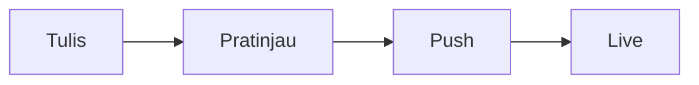

# Panduan Lengkap Membuat Postingan

Panduan ini untuk situs **Jekyll + Chirpy** yang dikembangkan dengan **Podman**.
Isinya: langkah membuat artikel, cara mengisi tiap bagian, sampai publish.

## Daftar Isi

1. [Alur Singkat](#1-alur-singkat)
2. [Persiapan](#2-persiapan)
3. [Membuat File Postingan](#3-membuat-file-postingan)
4. [Mengisi Front Matter](#4-mengisi-front-matter)
5. [Menulis Isi Artikel](#5-menulis-isi-artikel)
6. [Gambar dan Media](#6-gambar-dan-media)
7. [Kategori dan Tag](#7-kategori-dan-tag)
8. [Draft, Pin, dan Mengubah Postingan](#8-draft-pin-dan-mengubah-postingan)
9. [Pratinjau dan Pengecekan](#9-pratinjau-dan-pengecekan)
10. [Publish ke GitHub Pages](#10-publish-ke-github-pages)
11. [Template Siap Salin](#11-template-siap-salin)
12. [Troubleshooting](#12-troubleshooting)
13. [Checklist Sebelum Publish](#13-checklist-sebelum-publish)

---

## 1. Alur Singkat

```
Nyalakan server  →  Buat file  →  Isi front matter  →  Tulis isi
      →  Pratinjau  →  make test  →  git push  →  Cek di Actions
```

| Langkah | Perintah |
|---|---|
| Nyalakan VM dan server | `podman machine start` lalu `make up` |
| Buat postingan | `make new-post TITLE="Judul Artikel"` |
| Pratinjau | buka http://localhost:4000 |
| Uji build produksi | `make test` |
| Publish | `git add . && git commit -m "..." && git push` |

## 2. Persiapan

Pastikan drive eksternal ter-mount, lalu dari folder proyek:

```bash
podman machine start     # lewati jika sudah berjalan
make up                  # server di http://localhost:4000 (LiveReload aktif)
```

Biarkan terminal itu terbuka. Buka terminal kedua untuk perintah lain.
Gunakan `make start` bila Anda ingin server berjalan di background.

## 3. Membuat File Postingan

### Cara otomatis (disarankan)

```bash
make new-post TITLE="Belajar Podman untuk Pemula"
```

File dibuat di `_posts/` dengan nama:

```
_posts/2026-10-29-belajar-podman-untuk-pemula.md
```

### Cara manual

Buat file di folder `_posts/` dengan format nama:

```
YYYY-MM-DD-judul-dengan-tanda-hubung.md
```

Aturan nama file:

- Awali dengan tanggal `YYYY-MM-DD`.
- Pakai huruf kecil, angka, dan tanda hubung (`-`). Hindari spasi dan karakter khusus.
- Ekstensi `.md`.
- Nama file menentukan URL: `/posts/judul-dengan-tanda-hubung/`.

## 4. Mengisi Front Matter

Front matter adalah blok di paling atas file, diapit dua baris `---`.
Tanpa blok ini, postingan tidak akan diproses.

```yaml
---
title: Belajar Podman untuk Pemula
date: 2026-10-29 14:00:00 +0700
categories: [Teknologi, Tutorial]
tags: [podman, container, devops]
description: Panduan singkat memakai Podman sebagai pengganti Docker.
---
```

### Field yang umum dipakai

| Field | Wajib | Penjelasan | Contoh |
|---|---|---|---|
| `title` | Ya | Judul artikel. Beri tanda kutip bila memuat `:` | `"Tips: Podman"` |
| `date` | Ya | Tanggal dan jam terbit, lengkap dengan zona waktu | `2026-10-29 14:00:00 +0700` |
| `categories` | Disarankan | Maksimal 2 tingkat: `[induk, anak]` | `[Teknologi, Tutorial]` |
| `tags` | Disarankan | Daftar kata kunci, huruf kecil | `[podman, jekyll]` |
| `description` | Disarankan | Ringkasan 1 kalimat untuk daftar artikel dan SEO | |
| `image` | Opsional | Gambar header artikel | lihat bagian 6 |
| `pin` | Opsional | `true` untuk menyematkan di atas beranda | `pin: true` |
| `toc` | Opsional | `false` untuk mematikan daftar isi | `toc: false` |
| `comments` | Opsional | `false` untuk mematikan komentar | `comments: false` |
| `math` | Opsional | `true` bila memakai rumus | `math: true` |
| `mermaid` | Opsional | `true` bila memakai diagram | `mermaid: true` |
| `media_subpath` | Opsional | Folder dasar untuk gambar, agar path lebih pendek | `/assets/img/podman/` |
| `permalink` | Opsional | URL kustom | `/posts/podman-pemula/` |
| `author` | Opsional | Penulis (bila memakai `_data/authors.yml`) | `author: asep` |

### Aturan penting

- **Tanggal di masa depan tidak akan terbit** pada build produksi. Server dev memakai
  `--future` sehingga tetap tampil di lokal, tapi tidak di situs live.
- Zona waktu situs adalah `Asia/Jakarta`, jadi tulis `+0700`.
- Gunakan spasi, bukan tab, untuk indentasi YAML.
- Judul yang mengandung `:`, `#`, atau tanda kutip harus dibungkus kutip:
  `title: "Podman: Panduan Awal"`.
- Format list bisa satu baris `[a, b]` atau berbaris:

```yaml
tags:
  - podman
  - container
```

## 5. Menulis Isi Artikel

Tulis isi setelah front matter, dengan baris kosong sebagai pemisah.

### 5.1 Struktur judul

Judul artikel (`title`) otomatis menjadi H1. Di dalam isi, mulai dari `##` (H2),
lalu `###` (H3). Daftar isi dibuat otomatis dari heading H2 dan H3.

```markdown
## Pendahuluan

### Latar Belakang

## Langkah Instalasi
```

### 5.2 Teks dasar

```markdown
Teks biasa, **tebal**, *miring*, ~~coret~~, dan `kode inline`.

Baris baru dalam satu paragraf: akhiri baris dengan dua spasi
atau pisahkan dengan baris kosong.

[Teks tautan](https://contoh.com)
```

### 5.3 Daftar

```markdown
- Item pertama
- Item kedua
  - Sub item

1. Langkah satu
2. Langkah dua

- [x] Tugas selesai
- [ ] Tugas belum selesai
```

### 5.4 Kutipan

```markdown
> Ini adalah kutipan.
```

### 5.5 Tabel

```markdown
| Perintah | Fungsi |
|---|---|
| `make up` | Jalankan server |
| `make test` | Uji build |
```

### 5.6 Blok kode

Tulis tiga backtick diikuti nama bahasa. Nomor baris dan tombol salin
ditambahkan otomatis oleh tema.

````markdown
```bash
podman machine start
make up
```

```yaml
title: Contoh
```
````

Bahasa yang sering dipakai: `bash`, `yaml`, `json`, `python`, `javascript`,
`html`, `css`, `ruby`, `dockerfile`, `sql`, `markdown`.

Untuk menampilkan nama file atau path:

```markdown
Edit file `_config.yml`{: .filepath}.
```

### 5.7 Kotak prompt

```markdown
> Tips yang berguna untuk pembaca.
{: .prompt-tip }

> Informasi tambahan.
{: .prompt-info }

> Peringatan agar pembaca berhati-hati.
{: .prompt-warning }

> Bahaya atau tindakan yang tidak bisa dibatalkan.
{: .prompt-danger }
```

Baris `{: .prompt-... }` harus berada tepat di bawah kutipan, tanpa baris kosong.

### 5.8 Catatan kaki

```markdown
Kalimat yang perlu rujukan.[^1]

[^1]: Isi catatan kaki di sini.
```

### 5.9 Garis pemisah

```markdown
---
```

### 5.10 Rumus matematika

Tambahkan `math: true` di front matter, lalu:

```markdown
Rumus sebaris: $ a^2 + b^2 = c^2 $

Rumus blok:

$$
\sum_{i=1}^{n} i = \frac{n(n+1)}{2}
$$
```

### 5.11 Diagram Mermaid

Tambahkan `mermaid: true` di front matter, lalu:

````markdown

````

### 5.12 Video YouTube

```markdown

```

`ID_VIDEO` adalah bagian setelah `v=` pada URL YouTube.

### 5.13 Menampilkan kode Liquid / kurung kurawal ganda

Jika artikel Anda menulis `{{ ... }}` atau `` sebagai teks contoh,
Jekyll akan mencoba memprosesnya dan bisa error. Bungkus dengan `raw`:

```markdown

{{ page.title }}

```

### 5.14 Tips menulis isi yang baik

- Buka dengan 2 sampai 3 kalimat tentang apa yang akan dipelajari pembaca.
- Satu H2 untuk satu topik. Hindari bagian yang terlalu panjang tanpa subjudul.
- Pakai langkah bernomor untuk tutorial, dan sertakan hasil yang diharapkan.
- Jelaskan perintah, jangan hanya menempelnya.
- Tutup dengan ringkasan atau langkah lanjutan.

## 6. Gambar dan Media

### 6.1 Letak file

Simpan gambar di `assets/img/`. Bisa dibuat subfolder per artikel:

```
assets/img/podman/arsitektur.png
assets/img/podman/header.jpg
```

Panduan ukuran:

- Format: `.jpg` untuk foto, `.png` atau `.webp` untuk tangkapan layar.
- Lebar maksimal sekitar 1200 px, ukuran file di bawah 500 KB.
- Nama file huruf kecil tanpa spasi, misalnya `arsitektur-podman.png`.

### 6.2 Menyisipkan gambar

```markdown

```

Teks alternatif wajib diisi agar mudah diakses dan baik untuk SEO.

### 6.3 Ukuran, posisi, dan efek

```markdown
{: w="700" h="400" }
{: .left w="300" }
{: .right w="300" }
{: .normal }
{: .shadow }
```

### 6.4 Keterangan gambar

Tulis baris miring tepat di bawah gambar, tanpa baris kosong:

```markdown

_Gambar 1. Arsitektur Podman_
```

### 6.5 Gambar berbeda untuk mode terang dan gelap

```markdown
{: .light }
{: .dark }
```

### 6.6 Gambar header artikel

Tampil di bagian atas artikel dan sebagai pratinjau saat dibagikan.
Ukuran ideal **1200 x 630 px** (rasio 1.91 : 1).

```yaml
image:
  path: /assets/img/podman/header.jpg
  alt: Ilustrasi Podman dan container
```

### 6.7 Memperpendek path dengan `media_subpath`

```yaml
media_subpath: /assets/img/podman/
image:
  path: header.jpg
  alt: Ilustrasi Podman
```

Di isi artikel cukup tulis ``.
Pada Chirpy versi lama, nama field-nya `img_path`.

## 7. Kategori dan Tag

- **Kategori** adalah pengelompokan besar dan hierarkis. Contoh `[Teknologi, Tutorial]`
  berarti kategori induk Teknologi dengan anak Tutorial.
- **Tag** adalah kata kunci bebas yang spesifik.

Rekomendasi:

- Pakai sedikit kategori (3 sampai 6 untuk seluruh blog) dan konsisten penulisannya.
  `Teknologi` dan `teknologi` dianggap berbeda.
- Beri 2 sampai 5 tag per artikel, huruf kecil.
- Halaman **Categories** dan **Tags** di sidebar terisi otomatis.

## 8. Draft, Pin, dan Mengubah Postingan

### Draft

Simpan file di folder `_drafts/` **tanpa** awalan tanggal:

```
_drafts/ide-artikel-podman.md
```

Draft tampil di server lokal (`--drafts`) tapi tidak ikut build produksi.
Saat siap terbit, pindahkan ke `_posts/` dan tambahkan awalan tanggal:

```bash
mv _drafts/ide-artikel-podman.md _posts/2026-10-30-ide-artikel-podman.md
```

Lalu isi `date` di front matter.

### Menyematkan artikel

```yaml
pin: true
```

Artikel akan tampil di atas daftar beranda.

### Mengubah artikel yang sudah terbit

Edit file, lalu commit dan push seperti biasa. Untuk menandai tanggal pembaruan:

```yaml
last_modified_at: 2026-11-02 10:00:00 +0700
```

### Menghapus artikel

```bash
git rm _posts/2026-10-29-judul-artikel.md
git commit -m "Hapus artikel"
git push
```

Atau pindahkan ke `_drafts/` agar tidak tampil di situs.

## 9. Pratinjau dan Pengecekan

1. Simpan file. Browser akan refresh otomatis.
2. Periksa tampilan di http://localhost:4000, terutama:
   - judul, tanggal, kategori, dan tag,
   - daftar isi di sisi kanan,
   - gambar header dan gambar isi,
   - blok kode dan kotak prompt,
   - tampilan di mode terang dan gelap.
3. Uji build produksi dan cek link rusak:

```bash
make test
```

Perintah ini membangun situs dengan `JEKYLL_ENV=production` lalu menjalankan
`html-proofer`. Perbaiki setiap error sebelum push. Link eksternal tidak diperiksa.

Bila Anda mengubah `_config.yml`, hentikan server (`Ctrl+C`) lalu `make up` lagi.

## 10. Publish ke GitHub Pages

```bash
git status
git add .
git commit -m "Tambah artikel: Belajar Podman untuk Pemula"
git push
```

Lalu:

1. Buka repo di GitHub, tab **Actions**, dan tunggu workflow menjadi hijau.
2. Buka `https://USERNAME.github.io/posts/judul-artikel/`.

Setup awal (sekali saja): di **Settings → Pages**, pilih **Source: GitHub Actions**.

Tips commit:

- Satu artikel, satu commit, dengan pesan yang jelas.
- Commit `Gemfile.lock` agar versi gem di lokal dan CI sama.

## 11. Template Siap Salin

Simpan sebagai `_posts/YYYY-MM-DD-judul.md`:

````markdown
---
title: Judul Artikel
date: 2026-10-29 14:00:00 +0700
categories: [Kategori, Subkategori]
tags: [tag1, tag2, tag3]
description: Ringkasan satu kalimat tentang isi artikel.
image:
  path: /assets/img/folder/header.jpg
  alt: Deskripsi gambar header
# pin: true
# math: true
# mermaid: true
# toc: false
---

Paragraf pembuka: apa yang dibahas dan apa manfaatnya bagi pembaca.

## Prasyarat

- Prasyarat pertama
- Prasyarat kedua

## Langkah 1: Judul Langkah

Penjelasan singkat.

```bash
perintah --contoh
```

> Tips atau catatan penting.
{: .prompt-tip }

## Langkah 2: Judul Langkah

{: w="700" }
_Gambar 1. Keterangan gambar_

## Troubleshooting

| Masalah | Solusi |
|---|---|
| Error A | Perbaikan A |
| Error B | Perbaikan B |

## Kesimpulan

Ringkasan dan langkah lanjutan.

## Referensi

- [Nama sumber](https://contoh.com)
````

## 12. Troubleshooting

| Masalah | Penyebab dan solusi |
|---|---|
| Artikel tidak muncul | Nama file harus `YYYY-MM-DD-judul.md`; front matter harus diapit dua `---`; cek tanggal tidak di masa depan |
| Error `mapping values are not allowed` | Judul memuat `:`. Bungkus dengan tanda kutip |
| Error `Liquid syntax error` | Teks `{{ }}` atau `` di isi. Bungkus dengan `` dan `` |
| Gambar tidak tampil | Cek path diawali `/`, nama file dan huruf besar-kecil, lalu buka URL gambar langsung |
| Prompt tidak berwarna | Pastikan `{: .prompt-tip }` tepat di bawah kutipan tanpa baris kosong |
| Perubahan tidak terlihat | Hard reload `Cmd + Shift + R`; bila memakai PWA, hapus service worker di DevTools |
| Perubahan `_config.yml` tidak berlaku | Restart server |
| Diagram atau rumus tidak tampil | Tambahkan `mermaid: true` atau `math: true` di front matter |
| `make test` melaporkan link rusak | Perbaiki path gambar atau link internal, lalu ulangi |
| Build gagal di Actions tapi lokal berhasil | Periksa `url` dan `baseurl` di `_config.yml`, dan pastikan `Gemfile.lock` ter-commit |

## 13. Checklist Sebelum Publish

- [ ] Nama file berformat `YYYY-MM-DD-judul.md`
- [ ] `title`, `date`, `categories`, `tags`, dan `description` terisi
- [ ] Tanggal bukan di masa depan
- [ ] Heading dimulai dari `##` dan berurutan
- [ ] Semua blok kode punya nama bahasa
- [ ] Semua gambar punya teks alternatif dan ukuran file wajar
- [ ] Gambar header 1200 x 630 px (bila dipakai)
- [ ] Link internal dan eksternal sudah dicek
- [ ] Tampilan sudah dilihat di mode terang dan gelap
- [ ] `make test` lulus tanpa error
- [ ] Commit dengan pesan jelas, lalu `git push`
- [ ] Workflow di tab **Actions** hijau dan artikel tampil di situs
