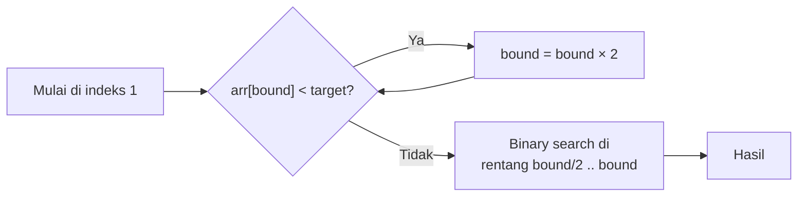
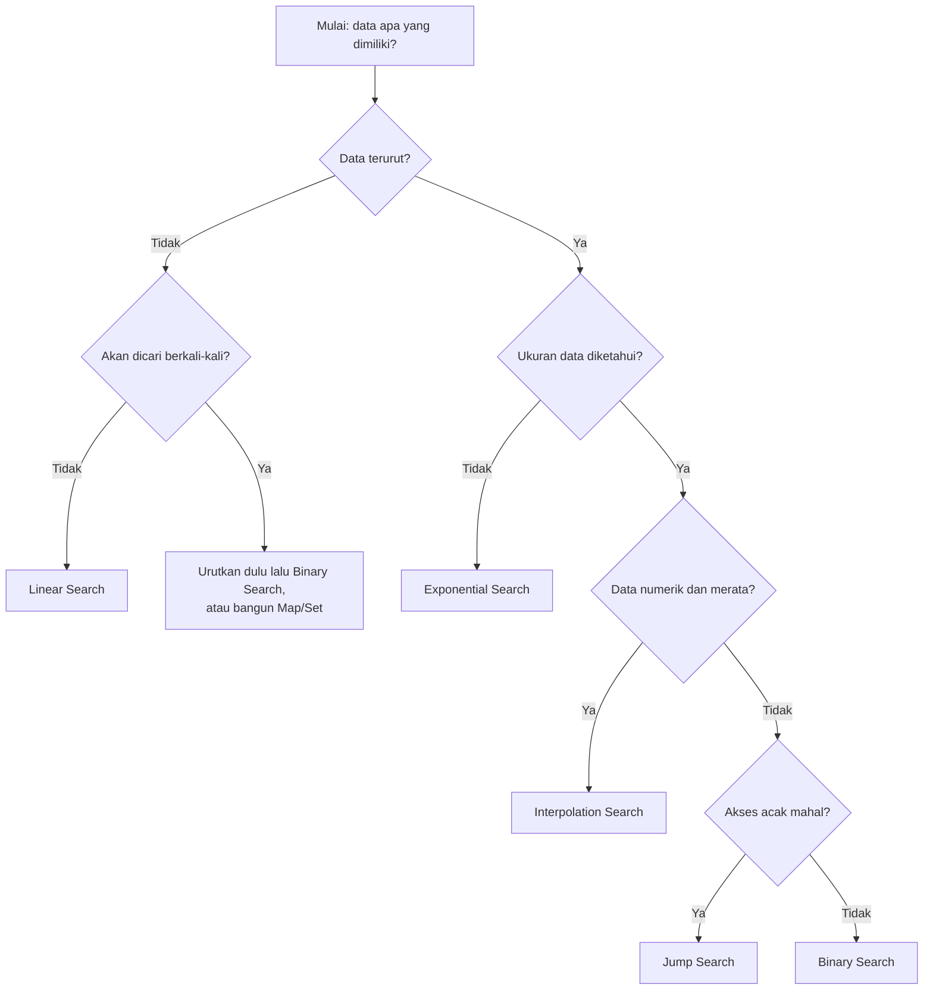

> **Level:** Beginner – Intermediate  |  **Prasyarat:** array, perulangan, fungsi, dasar analisis kompleksitas (Big O)  |  **Bahasa:** JavaScript (ES6+)

**Searching (pencarian)** adalah salah satu operasi paling mendasar dalam pemrograman: menemukan sebuah data di antara kumpulan data. Mencari kontak di ponsel, mencari produk di toko online, mencari nama di database, bahkan mengecek apakah *username* sudah dipakai, semuanya adalah masalah pencarian.

Pada tulisan ini kita akan mempelajari enam topik beserta implementasinya dalam JavaScript:

1. **Linear Search**
2. **Binary Search**
3. **Binary Search Variations**
4. **Jump Search**
5. **Interpolation Search**
6. **Exponential Search**

Setelah itu kita mengerjakan lima praktik: mencari angka di array, mencari data mahasiswa, mencari nilai pertama yang memenuhi kondisi, mencari batas bawah dan batas atas, serta mencari elemen di data terurut.

**Target:** mampu memilih algoritma pencarian yang tepat, mengimplementasikannya dengan benar (tanpa *off-by-one error*), dan menjelaskan efisiensinya.

## Daftar Isi

* TOC
{:toc}

---

# 0. Pengantar Searching

## 0.1 Definisi Masalah

> **Input:** kumpulan data $$A$$ berukuran $$n$$ dan sebuah nilai target $$x$$.
> **Output:** indeks posisi $$x$$ pada $$A$$, atau `-1` jika tidak ditemukan.

Konvensi yang dipakai pada seluruh tulisan ini:

* Indeks dimulai dari **0**.
* Fungsi mengembalikan **indeks** jika ditemukan dan **`-1`** jika tidak.
* Pada data yang memiliki duplikat, fungsi "biasa" mengembalikan **salah satu** indeks yang cocok. Untuk indeks pertama atau terakhir, kita pakai varian khusus (Bagian 3).

## 0.2 Dua Kelompok Algoritma

| Kelompok | Syarat data | Algoritma |
|----------|-------------|-----------|
| **Tidak butuh data terurut** | Tidak ada | Linear Search |
| **Butuh data terurut** | Terurut menaik (ascending) | Binary, Jump, Interpolation, Exponential Search |

Data terurut memberi kita informasi tambahan: jika `arr[i] < target`, maka **seluruh elemen sebelum `i` juga lebih kecil** dari target. Informasi inilah yang memungkinkan kita "melompati" banyak elemen sekaligus.

## 0.3 Ringkasan Kompleksitas

| Algoritma | Best | Average | Worst | Memori | Syarat |
|-----------|------|---------|-------|--------|--------|
| Linear Search | O(1) | O(n) | O(n) | O(1) | Tidak ada |
| Binary Search | O(1) | O(log n) | O(log n) | O(1) | Terurut |
| Jump Search | O(1) | O(√n) | O(√n) | O(1) | Terurut |
| Interpolation Search | O(1) | O(log log n) | O(n) | O(1) | Terurut dan **tersebar merata** |
| Exponential Search | O(1) | O(log i) | O(log i) | O(1) | Terurut |

*(Pada exponential search, `i` adalah posisi target, bukan ukuran array.)*

**Perbandingan jumlah langkah (perkiraan, kasus terburuk) untuk $$n = 1.000.000$$:**

| Algoritma | Langkah |
|-----------|---------|
| Linear | 1.000.000 |
| Jump | sekitar 2.000 |
| Binary | sekitar 20 |
| Interpolation (data merata) | sekitar 4–5 |

## 0.4 Menyiapkan Lingkungan

Semua kode dapat dijalankan di dua tempat:

* **Node.js:** simpan sebagai `searching.js`, lalu jalankan `node searching.js`.
* **Browser:** tempel ke tab *Console* di DevTools (F12).

## 0.5 Perangkap JavaScript yang Perlu Diwaspadai

**1. `sort()` bawaan mengurutkan sebagai string!**

```javascript
const angka = [10, 9, 1, 100, 25];

console.log([...angka].sort());              // [1, 10, 100, 25, 9]   ← SALAH untuk angka
console.log([...angka].sort((a, b) => a - b)); // [1, 9, 10, 25, 100]   ← benar
```

Binary search pada array yang salah urut akan menghasilkan jawaban salah tanpa pesan error. **Selalu** berikan fungsi pembanding saat mengurutkan angka.

**2. Gunakan `===`, bukan `==`.** Operator `==` melakukan konversi tipe (`"5" == 5` bernilai `true`) yang sering menimbulkan bug halus.

**3. Bilangan desimal tidak presisi.** `0.1 + 0.2 === 0.3` bernilai `false`. Saat mencari bilangan real, bandingkan dengan toleransi kecil:

```javascript
const hampirSama = (a, b, eps = 1e-9) => Math.abs(a - b) < eps;
```

**4. `NaN !== NaN`.** Pencarian `NaN` dengan `===` tidak pernah berhasil. Gunakan `Number.isNaN()` atau `Object.is()`.

**5. Menyalin array:** `const b = a` hanya menyalin referensi. Gunakan `[...a]` atau `a.slice()` bila ingin menyalin.

---

# 1. Linear Search

## 1.1 Konsep

**Linear search** (sequential search) memeriksa elemen **satu per satu dari awal** hingga target ditemukan atau data habis. Ini cara paling sederhana dan satu-satunya yang bekerja pada data **tidak terurut**.

**Analogi:** mencari nama teman di daftar hadir yang belum diurutkan. Anda menelusuri dari baris pertama ke bawah.

## 1.2 Pseudocode

```
FUNGSI linearSearch(A, n, target)
  UNTUK i DARI 0 SAMPAI n - 1
    JIKA A[i] = target MAKA
      KEMBALIKAN i
    SELESAI JIKA
  SELESAI UNTUK
  KEMBALIKAN -1
SELESAI FUNGSI
```

## 1.3 Implementasi JavaScript

```javascript
function linearSearch(arr, target) {
  for (let i = 0; i < arr.length; i++) {
    if (arr[i] === target) {
      return i;          // ditemukan
    }
  }
  return -1;             // tidak ditemukan
}

const data = [34, 7, 23, 32, 5, 62, 32];
console.log(linearSearch(data, 5));    // 4
console.log(linearSearch(data, 32));   // 3  (kemunculan pertama)
console.log(linearSearch(data, 99));   // -1
```

## 1.4 Penelusuran (Trace)

Mencari `5` pada `[34, 7, 23, 32, 5, 62, 32]`:

| Langkah | i | arr[i] | arr[i] === 5 ? |
|---------|---|--------|----------------|
| 1 | 0 | 34 | tidak |
| 2 | 1 | 7 | tidak |
| 3 | 2 | 23 | tidak |
| 4 | 3 | 32 | tidak |
| 5 | 4 | 5 | **ya, kembalikan 4** |

## 1.5 Analisis Kompleksitas

| Kasus | Kondisi | Perbandingan | Kompleksitas |
|-------|---------|--------------|--------------|
| Best | Target di indeks 0 | 1 | O(1) |
| Average | Target di posisi acak | sekitar n/2 | O(n) |
| Worst | Target di akhir atau tidak ada | n | O(n) |

Memori tambahan: **O(1)**.

## 1.6 Varian Linear Search

### a. Mencari semua kemunculan

```javascript
function linearSearchAll(arr, target) {
  const hasil = [];
  for (let i = 0; i < arr.length; i++) {
    if (arr[i] === target) hasil.push(i);
  }
  return hasil;
}

console.log(linearSearchAll([34, 7, 23, 32, 5, 62, 32], 32)); // [3, 6]
```

### b. Pencarian dengan predikat (kondisi bebas)

Tidak harus mencari nilai yang sama persis. Kita bisa mencari elemen pertama yang memenuhi **suatu kondisi**:

```javascript
function findIndexBy(arr, predicate) {
  for (let i = 0; i < arr.length; i++) {
    if (predicate(arr[i], i)) return i;
  }
  return -1;
}

console.log(findIndexBy([3, 8, 12, 5, 20], (x) => x > 10)); // 2
```

### c. Sentinel linear search

Pada loop biasa, setiap iterasi melakukan **dua** pengecekan (`i < n` dan `arr[i] === target`). Trik *sentinel* menaruh target di elemen terakhir sebagai "penjaga" sehingga pengecekan batas tidak diperlukan.

```javascript
function sentinelSearch(arr, target) {
  const n = arr.length;
  if (n === 0) return -1;

  const terakhir = arr[n - 1];
  arr[n - 1] = target;               // pasang sentinel

  let i = 0;
  while (arr[i] !== target) i++;     // dijamin berhenti paling lambat di n - 1

  arr[n - 1] = terakhir;             // kembalikan nilai asli

  if (i < n - 1 || terakhir === target) return i;
  return -1;
}

console.log(sentinelSearch([4, 8, 15, 16], 15)); // 2
console.log(sentinelSearch([4, 8, 15, 16], 23)); // -1
```

Kompleksitas tetap O(n); trik ini hanya mengurangi konstanta.

### d. Fungsi bawaan JavaScript

JavaScript sudah menyediakan linear search:

| Fungsi | Hasil |
|--------|-------|
| `arr.indexOf(x)` | Indeks pertama, atau `-1` |
| `arr.lastIndexOf(x)` | Indeks terakhir, atau `-1` |
| `arr.includes(x)` | `true` atau `false` |
| `arr.find(fn)` | Elemen pertama yang memenuhi `fn`, atau `undefined` |
| `arr.findIndex(fn)` | Indeks elemen pertama yang memenuhi `fn`, atau `-1` |
| `arr.some(fn)` / `arr.every(fn)` | Ada / semua elemen memenuhi `fn` |

Semuanya O(n). Membuat sendiri tetap penting agar Anda memahami cara kerjanya dan dapat memodifikasinya.

## 1.7 Kapan Linear Search Tepat?

* Data **tidak terurut** dan hanya dicari sekali atau sedikit kali.
* Data **sangat kecil** (di bawah puluhan elemen); konstanta kecil sering mengalahkan algoritma kompleks.
* Struktur data yang tidak mendukung akses acak (misalnya *linked list*).
* Kondisi pencarian rumit dan tidak berupa urutan sederhana.

---

# 2. Binary Search

## 2.1 Konsep

**Binary search** bekerja pada **array terurut**. Bandingkan target dengan elemen **tengah**:

* Jika sama, selesai.
* Jika target **lebih kecil**, buang separuh **kanan** dan cari di separuh kiri.
* Jika target **lebih besar**, buang separuh **kiri** dan cari di separuh kanan.

Setiap langkah membuang **setengah** kemungkinan sehingga ruang pencarian menyusut cepat: $$n \to n/2 \to n/4 \to \dots \to 1$$.

**Analogi:** menebak angka 1–100. Anda menebak 50, lalu diberi petunjuk "lebih besar" atau "lebih kecil". Dengan strategi ini, maksimal 7 tebakan sudah cukup.

## 2.2 Pseudocode

```
FUNGSI binarySearch(A, n, target)
  low <- 0
  high <- n - 1

  ULANGI SELAMA low <= high
    mid <- low + (high - low) DIV 2

    JIKA A[mid] = target MAKA
      KEMBALIKAN mid
    SELAIN ITU JIKA A[mid] < target MAKA
      low <- mid + 1
    SELAIN ITU
      high <- mid - 1
    SELESAI JIKA
  SELESAI ULANG

  KEMBALIKAN -1
SELESAI FUNGSI
```

## 2.3 Implementasi Iteratif

```javascript
function binarySearch(arr, target) {
  let low = 0;
  let high = arr.length - 1;

  while (low <= high) {
    const mid = low + Math.floor((high - low) / 2);

    if (arr[mid] === target) {
      return mid;
    } else if (arr[mid] < target) {
      low = mid + 1;        // buang separuh kiri
    } else {
      high = mid - 1;       // buang separuh kanan
    }
  }
  return -1;
}

const terurut = [3, 8, 15, 23, 42, 56, 78, 91];
console.log(binarySearch(terurut, 42));  // 4
console.log(binarySearch(terurut, 3));   // 0
console.log(binarySearch(terurut, 91));  // 7
console.log(binarySearch(terurut, 50));  // -1
```

## 2.4 Implementasi Rekursif

```javascript
function binarySearchRecursive(arr, target, low = 0, high = arr.length - 1) {
  if (low > high) return -1;                        // kasus dasar: tidak ditemukan

  const mid = low + Math.floor((high - low) / 2);

  if (arr[mid] === target) return mid;              // kasus dasar: ditemukan
  if (arr[mid] < target) {
    return binarySearchRecursive(arr, target, mid + 1, high);
  }
  return binarySearchRecursive(arr, target, low, mid - 1);
}

console.log(binarySearchRecursive(terurut, 78)); // 6
```

Versi rekursif memakai memori O(log n) untuk tumpukan pemanggilan, sedangkan versi iteratif O(1). Pada praktiknya, **versi iteratif lebih disukai**.

## 2.5 Penelusuran (Trace)

Mencari `42` pada `[3, 8, 15, 23, 42, 56, 78, 91]` (indeks 0–7):

| Langkah | low | high | mid | arr[mid] | Keputusan |
|---------|-----|------|-----|----------|-----------|
| 1 | 0 | 7 | 3 | 23 | 23 < 42, maka `low = 4` |
| 2 | 4 | 7 | 5 | 56 | 56 > 42, maka `high = 4` |
| 3 | 4 | 4 | 4 | 42 | **ditemukan di indeks 4** |

Hanya 3 langkah, sedangkan linear search membutuhkan 5.

## 2.6 Analisis Kompleksitas

Setelah $$k$$ langkah, sisa ruang pencarian sekitar $$n / 2^k$$. Pencarian berhenti saat sisa mencapai 1:

$$\frac{n}{2^k} = 1 \;\Rightarrow\; k = \log_2 n$$

| Kasus | Kompleksitas |
|-------|--------------|
| Best (target tepat di tengah) | O(1) |
| Average dan Worst | O(log n), maksimal $$\lfloor \log_2 n \rfloor + 1$$ perbandingan |
| Memori (iteratif) | O(1) |

| Ukuran array n | Maksimal perbandingan |
|----------------|-----------------------|
| 1.000 | 10 |
| 1.000.000 | 20 |
| 1.000.000.000 | 30 |

## 2.7 Kesalahan Umum pada Binary Search

1. **Array belum terurut.** Hasilnya salah tanpa peringatan.
2. **Salah kondisi loop.** `while (low < high)` akan melewatkan kasus satu elemen tersisa. Pada pola ini gunakan `low <= high`.
3. **Lupa `+ 1` atau `- 1`.** Menulis `low = mid` (bukan `mid + 1`) dapat menyebabkan **infinite loop**.
4. **Rumus `mid`.** Pada bahasa dengan integer terbatas (Java, C++), `(low + high) / 2` dapat *overflow*. Rumus `low + (high - low) / 2` aman. Pada JavaScript, bilangan berupa *floating-point* sehingga tidak overflow pada array biasa, tetapi **jangan lupa `Math.floor`**, karena `(low + high) / 2` bisa menghasilkan pecahan seperti `2.5`.
5. **Mengira hasil selalu indeks pertama.** Pada data duplikat, hasil bisa indeks mana pun. Untuk indeks pertama/terakhir lihat Bagian 3.

> **Catatan:** binary search terkenal sulit ditulis tanpa bug. Studi klasik menyebutkan mayoritas programmer profesional gagal menulisnya dengan benar pada percobaan pertama. Selalu uji dengan **array kosong, satu elemen, target di ujung, dan target tidak ada**.

---

# 3. Binary Search Variations

Binary search lebih luas dari sekadar "temukan nilai sama persis". Ide intinya, **membuang separuh ruang pencarian berdasarkan satu pertanyaan ya/tidak**, bisa diterapkan pada banyak masalah.

## 3.1 Template: Rentang Setengah Terbuka

Untuk varian, kita memakai pola yang lebih aman, yaitu rentang **setengah terbuka** `[low, high)`: `low` inklusif dan `high` eksklusif.

```
low <- 0
high <- n               // perhatikan: n, bukan n - 1
SELAMA low < high:
  mid <- low + (high - low) DIV 2
  JIKA (kondisi di mid terpenuhi) MAKA high <- mid
  SELAIN ITU low <- mid + 1
KEMBALIKAN low          // posisi pertama di mana kondisi terpenuhi
```

Pola ini selalu berhenti dan `low` pada akhirnya menunjuk ke **posisi pertama yang memenuhi kondisi**.

## 3.2 Lower Bound dan Upper Bound

| Fungsi | Definisi | Hasil jika semua elemen lebih kecil |
|--------|----------|-------------------------------------|
| **Lower bound** | Indeks **pertama** dengan `arr[i] >= target` | `n` |
| **Upper bound** | Indeks **pertama** dengan `arr[i] > target` | `n` |

Contoh pada `[10, 20, 20, 20, 30, 40]`:

```
indeks:   0   1   2   3   4   5
nilai:   10  20  20  20  30  40
              ↑           ↑
        lowerBound(20)  upperBound(20)
              = 1          = 4
```

```javascript
function lowerBound(arr, target) {
  let low = 0;
  let high = arr.length;                 // eksklusif
  while (low < high) {
    const mid = low + Math.floor((high - low) / 2);
    if (arr[mid] < target) {
      low = mid + 1;
    } else {
      high = mid;
    }
  }
  return low;
}

function upperBound(arr, target) {
  let low = 0;
  let high = arr.length;
  while (low < high) {
    const mid = low + Math.floor((high - low) / 2);
    if (arr[mid] <= target) {
      low = mid + 1;
    } else {
      high = mid;
    }
  }
  return low;
}

const a = [10, 20, 20, 20, 30, 40];
console.log(lowerBound(a, 20)); // 1
console.log(upperBound(a, 20)); // 4
console.log(lowerBound(a, 25)); // 4  (posisi sisip yang menjaga keterurutan)
console.log(lowerBound(a, 99)); // 6  (= a.length)
```

Perbedaan satu karakter, yaitu `<` pada lower bound dan `<=` pada upper bound, menghasilkan dua fungsi yang sangat berguna.

## 3.3 Kemunculan Pertama, Terakhir, dan Jumlah Kemunculan

```javascript
function firstOccurrence(arr, target) {
  const i = lowerBound(arr, target);
  return i < arr.length && arr[i] === target ? i : -1;
}

function lastOccurrence(arr, target) {
  const i = upperBound(arr, target) - 1;
  return i >= 0 && arr[i] === target ? i : -1;
}

function countOccurrences(arr, target) {
  return upperBound(arr, target) - lowerBound(arr, target);
}

console.log(firstOccurrence(a, 20));   // 1
console.log(lastOccurrence(a, 20));    // 3
console.log(countOccurrences(a, 20));  // 3
console.log(countOccurrences(a, 25));  // 0
```

Menghitung jumlah kemunculan hanya butuh **O(log n)**, sedangkan linear search membutuhkan O(n).

## 3.4 Posisi Sisip (Search Insert Position)

Di indeks berapa `target` harus disisipkan agar array tetap terurut? Jawabannya adalah **lower bound**.

```javascript
const posisiSisip = (arr, target) => lowerBound(arr, target);

console.log(posisiSisip([1, 3, 5, 6], 5)); // 2
console.log(posisiSisip([1, 3, 5, 6], 2)); // 1
console.log(posisiSisip([1, 3, 5, 6], 7)); // 4
```

## 3.5 Pencarian Predikat Monoton (First True)

Generalisasi terkuat: jika ada fungsi `pred(x)` yang bernilai `false, false, ..., false, true, true, ..., true` (**monoton**), kita bisa menemukan `x` pertama yang `true` dengan binary search.

```javascript
// Cari x terkecil dalam [lo, hi] sehingga pred(x) === true.
// pred harus monoton: false ... false true ... true. Mengembalikan -1 bila tidak ada.
function firstTrue(lo, hi, pred) {
  let low = lo;
  let high = hi + 1;                       // eksklusif
  while (low < high) {
    const mid = low + Math.floor((high - low) / 2);
    if (pred(mid)) {
      high = mid;
    } else {
      low = mid + 1;
    }
  }
  return low <= hi ? low : -1;
}

console.log(firstTrue(1, 100, (x) => x * x >= 50)); // 8  (8*8 = 64)
```

Perhatikan bahwa `lowerBound` dan `upperBound` hanyalah kasus khusus dari `firstTrue`.

## 3.6 Search on Answer: Akar Kuadrat Bilangan Bulat

Binary search tidak harus dilakukan pada array. Ia dapat dipakai pada **rentang jawaban**.

**Soal:** hitung $$\lfloor \sqrt{n} \rfloor$$ tanpa `Math.sqrt`.

**Ide:** `x * x > n` bersifat monoton terhadap `x`. Cari `x` pertama yang `x * x > n`, lalu kurangi 1.

```javascript
function integerSqrt(n) {
  if (n < 2) return n;
  const pertama = firstTrue(1, n, (x) => x * x > n);
  return pertama - 1;
}

console.log(integerSqrt(16));  // 4
console.log(integerSqrt(17));  // 4
console.log(integerSqrt(99));  // 9
console.log(integerSqrt(100)); // 10
```

Kompleksitas O(log n), jauh lebih cepat daripada mencoba satu per satu (O(√n)).

## 3.7 Binary Search pada Array Terurut yang Diputar (Rotated)

Array terurut yang "diputar" pada suatu titik, misalnya `[15, 18, 2, 3, 6, 12]`, tidak lagi terurut penuh, tetapi **salah satu separuhnya selalu terurut**. Kita memanfaatkannya.

```javascript
function searchRotated(arr, target) {     // asumsi: tidak ada elemen duplikat
  let low = 0;
  let high = arr.length - 1;

  while (low <= high) {
    const mid = low + Math.floor((high - low) / 2);
    if (arr[mid] === target) return mid;

    if (arr[low] <= arr[mid]) {             // separuh kiri terurut
      if (arr[low] <= target && target < arr[mid]) {
        high = mid - 1;
      } else {
        low = mid + 1;
      }
    } else {                                // separuh kanan terurut
      if (arr[mid] < target && target <= arr[high]) {
        low = mid + 1;
      } else {
        high = mid - 1;
      }
    }
  }
  return -1;
}

console.log(searchRotated([15, 18, 2, 3, 6, 12], 3));  // 3
console.log(searchRotated([15, 18, 2, 3, 6, 12], 15)); // 0
console.log(searchRotated([15, 18, 2, 3, 6, 12], 7));  // -1
```

## 3.8 Pencarian Biner pada Array Urutan Menurun

Jika array terurut **menurun**, cukup balik arah perbandingan:

```javascript
function binarySearchDesc(arr, target) {
  let low = 0;
  let high = arr.length - 1;
  while (low <= high) {
    const mid = low + Math.floor((high - low) / 2);
    if (arr[mid] === target) return mid;
    if (arr[mid] > target) {
      low = mid + 1;            // dibalik
    } else {
      high = mid - 1;
    }
  }
  return -1;
}

console.log(binarySearchDesc([90, 70, 50, 30, 10], 30)); // 3
```

## 3.9 Ringkasan Variasi

| Variasi | Pertanyaan yang dijawab | Kompleksitas |
|---------|-------------------------|--------------|
| Pencarian standar | Di mana nilai x? | O(log n) |
| Lower bound | Indeks pertama dengan nilai ≥ x | O(log n) |
| Upper bound | Indeks pertama dengan nilai > x | O(log n) |
| First/last occurrence | Kemunculan pertama atau terakhir x | O(log n) |
| Count occurrences | Berapa kali x muncul? | O(log n) |
| Search insert | Di mana x disisipkan? | O(log n) |
| First true (predikat) | Nilai terkecil yang memenuhi kondisi | O(log n × biaya pred) |
| Search on answer | Nilai jawaban optimal | O(log rentang) |
| Rotated array | Cari di array terurut yang diputar | O(log n) |

---

# 4. Jump Search

## 4.1 Konsep

**Jump search** adalah jalan tengah antara linear dan binary search. Pada array terurut, kita **melompat** per blok berukuran $$m$$ sampai menemukan blok yang mungkin memuat target, lalu melakukan **linear search di dalam blok** itu.

**Analogi:** mencari halaman tertentu di buku tebal. Anda membuka halaman dengan lompatan, misalnya kelipatan 20, sampai halaman yang dibuka sudah melewati target, lalu mundur dan membaca halaman satu per satu.

## 4.2 Memilih Ukuran Lompatan

Jika ukuran blok adalah $$m$$, maka:

* Jumlah lompatan paling banyak $$n / m$$.
* Pencarian linear di dalam blok paling banyak $$m - 1$$ langkah.

Total langkah terburuk $$\approx \dfrac{n}{m} + m$$. Fungsi ini minimum ketika $$m = \sqrt{n}$$, sehingga total menjadi $$2\sqrt{n}$$, yaitu **O(√n)**.

## 4.3 Pseudocode

```
FUNGSI jumpSearch(A, n, target)
  step <- floor(sqrt(n))
  prev <- 0
  curr <- step

  // lompat selama elemen terakhir blok masih lebih kecil dari target
  ULANGI SELAMA prev < n DAN A[min(curr, n) - 1] < target
    prev <- curr
    curr <- curr + step
  SELESAI ULANG

  // pencarian linear dalam blok [prev, min(curr, n))
  UNTUK i DARI prev SAMPAI min(curr, n) - 1
    JIKA A[i] = target MAKA KEMBALIKAN i
    JIKA A[i] > target MAKA KEMBALIKAN -1
  SELESAI UNTUK

  KEMBALIKAN -1
SELESAI FUNGSI
```

## 4.4 Implementasi JavaScript

```javascript
function jumpSearch(arr, target) {
  const n = arr.length;
  if (n === 0) return -1;

  const step = Math.floor(Math.sqrt(n));
  let prev = 0;
  let curr = step;

  // Tahap 1: lompat antar blok
  while (prev < n && arr[Math.min(curr, n) - 1] < target) {
    prev = curr;
    curr += step;
  }

  // Tahap 2: pencarian linear di dalam blok
  const akhirBlok = Math.min(curr, n);
  for (let i = prev; i < akhirBlok; i++) {
    if (arr[i] === target) return i;
    if (arr[i] > target) return -1;      // sudah terlewat, target tidak ada
  }
  return -1;
}

const d = [1, 3, 5, 7, 9, 11, 13, 15, 17, 19, 21, 23, 25, 27, 29, 31];
console.log(jumpSearch(d, 21));  // 10
console.log(jumpSearch(d, 1));   // 0
console.log(jumpSearch(d, 31));  // 15
console.log(jumpSearch(d, 8));   // -1
```

## 4.5 Penelusuran (Trace)

Array berisi 16 elemen, maka `step = √16 = 4`. Mencari `21`:

| Tahap | prev | curr | Elemen yang dicek | Keputusan |
|-------|------|------|-------------------|-----------|
| Lompat 1 | 0 | 4 | `arr[3] = 7` < 21 | lompat |
| Lompat 2 | 4 | 8 | `arr[7] = 15` < 21 | lompat |
| Lompat 3 | 8 | 12 | `arr[11] = 23` ≥ 21 | berhenti, target mungkin di blok [8, 11] |
| Linear | 8 | | `arr[8] = 17`, `arr[9] = 19`, `arr[10] = 21` | **ditemukan di indeks 10** |

## 4.6 Analisis

| Aspek | Nilai |
|-------|-------|
| Waktu (worst) | O(√n) |
| Memori | O(1) |
| Syarat | Terurut |
| Dibanding linear | Jauh lebih cepat |
| Dibanding binary | Lebih lambat |

**Mengapa masih dipelajari, padahal binary search lebih cepat?** Jump search hanya bergerak **maju** (kecuali saat scan blok). Pada sistem di mana **mundur/lompat acak mahal** (misalnya pita magnetik atau media penyimpanan berurutan), jump search lebih menguntungkan daripada binary search yang loncat ke tengah secara acak. Dengan demikian, jump search adalah contoh bahwa algoritma terbaik bergantung pada **konteks perangkat keras**, bukan hanya Big O.

---

# 5. Interpolation Search

## 5.1 Konsep

Binary search selalu memeriksa **tengah**, tak peduli nilai targetnya. **Interpolation search** lebih cerdas: ia **memperkirakan posisi** target berdasarkan nilainya, seperti manusia yang membuka kamus.

> Mencari kata "Zebra" di kamus, Anda tidak membuka halaman tengah; Anda langsung membuka dekat bagian akhir. Mencari "Apel", Anda membuka dekat bagian awal.

Posisi perkiraan dihitung dengan interpolasi linear:

$$pos = low + \left\lfloor \frac{(target - arr[low]) \times (high - low)}{arr[high] - arr[low]} \right\rfloor$$

**Syarat:** data terurut, bertipe numerik, dan **tersebar relatif merata** (distribusi seragam).

## 5.2 Pseudocode

```
FUNGSI interpolationSearch(A, n, target)
  low <- 0
  high <- n - 1

  ULANGI SELAMA low <= high DAN target >= A[low] DAN target <= A[high]
    JIKA A[high] = A[low] MAKA
      KEMBALIKAN (A[low] = target) ? low : -1
    SELESAI JIKA

    pos <- low + floor((target - A[low]) * (high - low) / (A[high] - A[low]))

    JIKA A[pos] = target MAKA KEMBALIKAN pos
    JIKA A[pos] < target MAKA low <- pos + 1
    SELAIN ITU high <- pos - 1
  SELESAI ULANG

  KEMBALIKAN -1
SELESAI FUNGSI
```

## 5.3 Implementasi JavaScript

```javascript
function interpolationSearch(arr, target) {
  let low = 0;
  let high = arr.length - 1;

  while (low <= high && target >= arr[low] && target <= arr[high]) {
    // Hindari pembagian dengan nol bila semua elemen di rentang sama
    if (arr[high] === arr[low]) {
      return arr[low] === target ? low : -1;
    }

    const pos =
      low +
      Math.floor(((target - arr[low]) * (high - low)) / (arr[high] - arr[low]));

    if (arr[pos] === target) return pos;
    if (arr[pos] < target) {
      low = pos + 1;
    } else {
      high = pos - 1;
    }
  }
  return -1;
}

const seragam = [10, 20, 30, 40, 50, 60, 70, 80, 90, 100];
console.log(interpolationSearch(seragam, 70));  // 6
console.log(interpolationSearch(seragam, 10));  // 0
console.log(interpolationSearch(seragam, 55));  // -1
```

**Mengapa ada pengecekan `target >= arr[low] && target <= arr[high]`?** Jika target di luar rentang, rumus bisa menghasilkan `pos` di luar array. Pengecekan ini sekaligus menjadi penghenti awal untuk target yang pasti tidak ada.

## 5.4 Penelusuran pada Data Merata

Mencari `70` pada `[10, 20, ..., 100]` (indeks 0–9):

$$pos = 0 + \left\lfloor \frac{(70 - 10) \times (9 - 0)}{100 - 10} \right\rfloor = \left\lfloor \frac{540}{90} \right\rfloor = 6$$

`arr[6] = 70`, **ditemukan pada langkah pertama**. Binary search membutuhkan sekitar 3 langkah.

## 5.5 Penelusuran pada Data Tidak Merata (Kasus Buruk)

Data: `[1, 2, 3, 4, 5, 6, 7, 8, 9, 1000]`, mencari `9`:

| Langkah | low | high | pos | arr[pos] | Keputusan |
|---------|-----|------|-----|----------|-----------|
| 1 | 0 | 9 | 0 | 1 | 1 < 9, maka `low = 1` |
| 2 | 1 | 9 | 1 | 2 | 2 < 9, maka `low = 2` |
| 3 | 2 | 9 | 2 | 3 | `low = 3` |
| ... | ... | ... | ... | ... | maju satu per satu |
| 9 | 8 | 9 | 8 | 9 | **ditemukan** |

Nilai ekstrem `1000` merusak perkiraan sehingga algoritma merayap seperti linear search.

## 5.6 Analisis

| Kondisi data | Waktu |
|--------------|-------|
| Tersebar merata (seragam) | **O(log log n)** (rata-rata) |
| Tidak merata / ada nilai ekstrem | **O(n)** (worst case) |

Untuk $$n = 1.000.000$$ data merata, $$\log_2 \log_2 n \approx 4{,}3$$, yaitu sekitar 4–5 langkah. Bandingkan dengan 20 langkah pada binary search.

**Kelemahan:**

* Hanya untuk data numerik (atau yang dapat dipetakan ke angka).
* Sangat bergantung pada distribusi data.
* Rawan masalah presisi untuk bilangan sangat besar atau desimal.

---

# 6. Exponential Search

## 6.1 Konsep

**Exponential search** (galloping search) cocok ketika **ukuran data tidak diketahui** atau target diperkirakan berada di **awal** data. Algoritma bekerja dalam dua tahap:

1. **Cari batas:** mulai dari indeks 1, gandakan terus (1, 2, 4, 8, 16, ...) sampai `arr[bound] >= target` atau melewati akhir array.
2. **Binary search** pada rentang `[bound / 2, bound]` yang sudah dipersempit.



## 6.2 Implementasi JavaScript

```javascript
// Binary search yang dibatasi pada rentang [low, high] (inklusif)
function binarySearchRange(arr, target, low, high) {
  while (low <= high) {
    const mid = low + Math.floor((high - low) / 2);
    if (arr[mid] === target) return mid;
    if (arr[mid] < target) {
      low = mid + 1;
    } else {
      high = mid - 1;
    }
  }
  return -1;
}

function exponentialSearch(arr, target) {
  const n = arr.length;
  if (n === 0) return -1;
  if (arr[0] === target) return 0;

  // Tahap 1: temukan batas dengan menggandakan indeks
  let bound = 1;
  while (bound < n && arr[bound] < target) {
    bound *= 2;
  }

  // Tahap 2: binary search pada rentang yang sudah dipersempit
  return binarySearchRange(
    arr,
    target,
    Math.floor(bound / 2),
    Math.min(bound, n - 1)
  );
}

const e = [2, 3, 4, 10, 40, 50, 60, 70, 80, 90, 100];
console.log(exponentialSearch(e, 10));   // 3
console.log(exponentialSearch(e, 100));  // 10
console.log(exponentialSearch(e, 5));    // -1
```

## 6.3 Penelusuran (Trace)

Mencari `40` pada `[2, 3, 4, 10, 40, 50, 60, 70, 80, 90, 100]` (n = 11):

| Tahap | bound | arr[bound] | Keputusan |
|-------|-------|-----------|-----------|
| 1 | 1 | 3 | 3 < 40, `bound = 2` |
| 2 | 2 | 4 | 4 < 40, `bound = 4` |
| 3 | 4 | 40 | 40 ≥ 40, **berhenti** |

Binary search pada indeks `[2, 4]` menemukan `40` di **indeks 4**.

## 6.4 Pencarian pada Data Tak Terbatas

Keunggulan utama exponential search: ia **tidak perlu mengetahui `n`**. Contohnya pada aliran data terurut atau API yang hanya menyediakan akses `get(i)`.

```javascript
// Simulasi data terurut "tak terbatas": get(i) mengembalikan Infinity setelah akhir data
function exponentialSearchUnbounded(get, target) {
  if (get(0) === target) return 0;

  let bound = 1;
  while (get(bound) < target) {
    bound *= 2;
  }

  let low = Math.floor(bound / 2);
  let high = bound;
  while (low <= high) {
    const mid = low + Math.floor((high - low) / 2);
    const nilai = get(mid);
    if (nilai === target) return mid;
    if (nilai < target) {
      low = mid + 1;
    } else {
      high = mid - 1;
    }
  }
  return -1;
}

const tersembunyi = [1, 4, 9, 16, 25, 36, 49, 64, 81, 100];
const get = (i) => (i < tersembunyi.length ? tersembunyi[i] : Infinity);

console.log(exponentialSearchUnbounded(get, 49)); // 6
console.log(exponentialSearchUnbounded(get, 50)); // -1
```

## 6.5 Analisis

* Tahap 1 membutuhkan $$O(\log i)$$ langkah, dengan $$i$$ adalah posisi target.
* Tahap 2: rentang berukuran sekitar $$i/2$$, sehingga binary search membutuhkan $$O(\log i)$$.
* **Total: O(log i)**, dengan memori O(1).

Jika target berada di awal data, exponential search lebih cepat daripada binary search biasa karena tidak perlu "melihat" seluruh array. Jika target di akhir, performanya setara binary search dengan konstanta sedikit lebih besar.

---

# 7. Memilih Algoritma yang Tepat



| Situasi | Pilihan |
|---------|---------|
| Data kecil atau tidak terurut, dicari sekali | Linear Search |
| Data terurut, kasus umum | **Binary Search** (pilihan default) |
| Perlu batas bawah/atas, jumlah kemunculan, posisi sisip | Binary Search Variations |
| Data terurut, akses mundur mahal | Jump Search |
| Data angka merata (misalnya ID berurutan, timestamp) | Interpolation Search |
| Ukuran data tidak diketahui, atau target dekat awal | Exponential Search |
| Pencarian berulang pada data yang berubah-ubah | `Map` atau `Set` (hash), rata-rata O(1) |

**Biaya pengurutan:** mengurutkan data memakan O(n log n). Jika hanya mencari **sekali**, linear search O(n) lebih murah. Jika mencari **berkali-kali**, mengurutkan sekali lalu memakai binary search jauh lebih hemat:

* Mencari $$q$$ kali dengan linear search: $$O(q \cdot n)$$.
* Mengurutkan lalu binary search: $$O(n \log n + q \log n)$$.

---

# Praktik

Pada praktik berikut, salin fungsi yang dibutuhkan dari bagian materi di atas ke dalam satu file `searching.js`.

## Praktik 1: Mencari Angka dalam Array

**Soal:** buat fungsi pencarian angka dalam array yang mendukung: (a) mencari satu angka, (b) mencari semua posisi, dan (c) mengecek keberadaan dengan jumlah langkah yang dicatat.

**Tabel IPO**

| Input | Proses | Output |
|-------|--------|--------|
| Array angka, target | Telusuri dan bandingkan | Indeks (atau daftar indeks), jumlah perbandingan |

**Solusi:**

```javascript
// (a) satu posisi + hitung jumlah perbandingan
function cariAngka(arr, target) {
  let perbandingan = 0;
  for (let i = 0; i < arr.length; i++) {
    perbandingan++;
    if (arr[i] === target) {
      return { indeks: i, perbandingan };
    }
  }
  return { indeks: -1, perbandingan };
}

// (b) semua posisi
function cariSemuaPosisi(arr, target) {
  const hasil = [];
  arr.forEach((nilai, i) => {
    if (nilai === target) hasil.push(i);
  });
  return hasil;
}

// (c) uji
const angka = [12, 45, 7, 23, 45, 89, 3, 45];

console.log(cariAngka(angka, 23));        // { indeks: 3, perbandingan: 4 }
console.log(cariAngka(angka, 100));       // { indeks: -1, perbandingan: 8 }
console.log(cariSemuaPosisi(angka, 45));  // [1, 4, 7]
console.log(cariSemuaPosisi(angka, 5));   // []
```

**Menguji dengan `console.assert`:**

```javascript
console.assert(cariAngka(angka, 12).indeks === 0, "gagal: elemen pertama");
console.assert(cariAngka(angka, 45).indeks === 1, "gagal: kemunculan pertama");
console.assert(cariAngka([], 5).indeks === -1, "gagal: array kosong");
console.assert(cariSemuaPosisi(angka, 45).length === 3, "gagal: jumlah kemunculan");
console.log("Semua uji Praktik 1 selesai.");
```

**Tantangan:**

1. Ubah `cariAngka` agar mencari dari **belakang**, yaitu kemunculan terakhir.
2. Tambahkan parameter `mulaiDariIndeks` agar bisa melanjutkan pencarian dari posisi tertentu.
3. Bagaimana mencari **dua angka sekaligus** dengan sekali telusur?

## Praktik 2: Mencari Data Mahasiswa

**Soal:** diberikan daftar mahasiswa. Buat fitur pencarian berdasarkan **NIM** (tepat), **nama** (sebagian, tidak peka huruf besar/kecil), dan bandingkan pendekatan linear, binary, dan `Map`.

**Data:**

```javascript
const mahasiswa = [
  { nim: "2301007", nama: "Rina Marlina",   prodi: "Sistem Informasi", ipk: 3.72 },
  { nim: "2301003", nama: "Budi Santoso",   prodi: "Informatika",      ipk: 3.10 },
  { nim: "2301010", nama: "Citra Dewi",     prodi: "Informatika",      ipk: 3.88 },
  { nim: "2301001", nama: "Andi Pratama",   prodi: "Informatika",      ipk: 3.45 },
  { nim: "2301005", nama: "Dewi Lestari",   prodi: "Sistem Informasi", ipk: 3.51 },
  { nim: "2301009", nama: "Budi Hartono",   prodi: "Teknik Komputer",  ipk: 2.95 },
  { nim: "2301002", nama: "Eko Wijaya",     prodi: "Teknik Komputer",  ipk: 3.28 },
];
```

### a. Linear search berdasarkan NIM (data tidak terurut)

```javascript
function cariByNimLinear(daftar, nim) {
  for (const m of daftar) {
    if (m.nim === nim) return m;
  }
  return null;
}

console.log(cariByNimLinear(mahasiswa, "2301005")); // objek Dewi Lestari
console.log(cariByNimLinear(mahasiswa, "9999999")); // null
```

### b. Pencarian sebagian pada nama (hasil bisa banyak)

Karena nama bisa sama atau mirip, hasilnya berupa **daftar**. Ini tidak bisa dipercepat dengan binary search biasa, sehingga linear search tepat dipakai.

```javascript
function cariByNama(daftar, kataKunci) {
  const kunci = kataKunci.trim().toLowerCase();
  return daftar.filter((m) => m.nama.toLowerCase().includes(kunci));
}

console.log(cariByNama(mahasiswa, "budi"));
// [Budi Santoso, Budi Hartono]
console.log(cariByNama(mahasiswa, "DEWI"));
// [Citra Dewi, Dewi Lestari]
```

### c. Binary search pada data terurut berdasarkan NIM

Binary search untuk objek membutuhkan **fungsi pengambil kunci** (`keyFn`) dan data **terurut berdasarkan kunci yang sama**.

```javascript
// Urutkan salinan berdasarkan NIM (string dengan panjang sama, jadi urutan leksikografis sudah benar)
const terurutNim = [...mahasiswa].sort((a, b) => a.nim.localeCompare(b.nim));

function binarySearchBy(arr, target, keyFn) {
  let low = 0;
  let high = arr.length - 1;
  while (low <= high) {
    const mid = low + Math.floor((high - low) / 2);
    const kunci = keyFn(arr[mid]);
    if (kunci === target) return mid;
    if (kunci < target) {
      low = mid + 1;
    } else {
      high = mid - 1;
    }
  }
  return -1;
}

const idx = binarySearchBy(terurutNim, "2301009", (m) => m.nim);
console.log(idx, terurutNim[idx]);   // 5 { nim: '2301009', nama: 'Budi Hartono', ... }
```

> **Penting:** NIM adalah *string*. Perbandingan `<` pada string bersifat leksikografis, sehingga `"2301009" < "2301010"` benar. Pastikan format NIM **berpanjang sama**, karena `"9" > "10"` pada perbandingan string.

### d. Membangun indeks dengan `Map` (rata-rata O(1))

Jika pencarian dilakukan **sangat sering**, bangun indeks satu kali.

```javascript
const indeksNim = new Map(mahasiswa.map((m) => [m.nim, m]));

console.log(indeksNim.get("2301003"));  // Budi Santoso
console.log(indeksNim.has("0000000"));  // false
```

### e. Perbandingan pendekatan

| Pendekatan | Persiapan | Waktu per pencarian | Cocok untuk |
|------------|-----------|---------------------|-------------|
| Linear search | Tidak ada | O(n) | Data kecil, pencarian jarang |
| Sort + binary search | O(n log n) sekali | O(log n) | Perlu pencarian rentang (misalnya NIM 2301003 s.d. 2301008) |
| `Map` (hash) | O(n) sekali | O(1) rata-rata | Pencarian kunci tepat berulang kali |

### f. Menyatukan menjadi fitur pencarian

```javascript
function tampilkan(m) {
  return `${m.nim} | ${m.nama} | ${m.prodi} | IPK ${m.ipk.toFixed(2)}`;
}

function cariMahasiswa(daftar, { nim, nama, prodi, ipkMin } = {}) {
  return daftar.filter((m) => {
    if (nim && m.nim !== nim) return false;
    if (nama && !m.nama.toLowerCase().includes(nama.toLowerCase())) return false;
    if (prodi && m.prodi !== prodi) return false;
    if (ipkMin !== undefined && m.ipk < ipkMin) return false;
    return true;
  });
}

console.log(
  cariMahasiswa(mahasiswa, { prodi: "Informatika", ipkMin: 3.4 }).map(tampilkan)
);
// ["2301010 | Citra Dewi | Informatika | IPK 3.88",
//  "2301001 | Andi Pratama | Informatika | IPK 3.45"]
```

**Tantangan:**

1. Tambahkan pencarian berdasarkan **rentang NIM** (misalnya `2301003` sampai `2301007`) memakai `lowerBound` dan `upperBound` pada data terurut.
2. Buat pencarian nama yang **mengabaikan spasi dan tanda baca**.
3. Urutkan hasil pencarian berdasarkan IPK tertinggi.

## Praktik 3: Mencari Nilai Pertama yang Memenuhi Kondisi

**Soal:** temukan elemen/posisi **pertama** yang memenuhi kondisi tertentu.

### a. Data tidak terurut: linear search dengan predikat

```javascript
const suhu = [24, 26, 25, 31, 29, 35, 33];

// Hari pertama suhu di atas 30
const hari = suhu.findIndex((t) => t > 30);
console.log(hari);   // 3  (suhu 31)

// Nilai pertamanya
console.log(suhu.find((t) => t > 30));   // 31
```

### b. Data terurut: binary search pada predikat

Jika data terurut menaik, predikat seperti `nilai >= 75` bersifat **monoton**, yaitu `false ... false true ... true`. Kita dapat memakai `firstTrue` dengan O(log n).

```javascript
const nilai = [40, 55, 60, 72, 75, 80, 90, 95];

// Indeks pertama dengan nilai >= 75
const i = firstTrue(0, nilai.length - 1, (k) => nilai[k] >= 75);
console.log(i, nilai[i]);   // 4 75

// Tidak ada yang memenuhi
console.log(firstTrue(0, nilai.length - 1, (k) => nilai[k] >= 100)); // -1
```

### c. Kasus klasik: First Bad Version

Sebuah aplikasi memiliki versi 1 sampai $$n$$. Mulai dari suatu versi, semua versi berikutnya rusak. Fungsi `isBadVersion(v)` mahal (misalnya harus menjalankan uji otomatis). Temukan **versi rusak pertama** dengan **panggilan sesedikit mungkin**.

```javascript
function buatPemeriksa(versiRusakPertama) {
  let panggilan = 0;
  const isBad = (v) => {
    panggilan++;
    return v >= versiRusakPertama;
  };
  return { isBad, jumlahPanggilan: () => panggilan };
}

function firstBadVersion(n, isBad) {
  return firstTrue(1, n, isBad);
}

const { isBad, jumlahPanggilan } = buatPemeriksa(37);
const hasil = firstBadVersion(100, isBad);
console.log(hasil);              // 37
console.log(jumlahPanggilan());  // paling banyak 7 (⌈log₂ 100⌉)
```

Dengan linear search, kasus terburuknya 100 panggilan. Dengan binary search, hanya sekitar 7.

### d. Kapan binary search boleh dipakai?

Pertanyaan kuncinya: **apakah predikatnya monoton?**

| Predikat | Monoton pada data terurut menaik? |
|----------|-----------------------------------|
| `x >= 75` | Ya |
| `x > 50` | Ya |
| `x % 2 === 0` | **Tidak** (genap dan ganjil bergantian) |
| `x * x > n` (x positif) | Ya |

Untuk predikat yang tidak monoton, gunakan linear search.

**Tantangan:**

1. Cari **bulan pertama** saat saldo tabungan melebihi 10 juta, jika setiap bulan menabung tetap.
2. Cari **kecepatan minimum** (bilangan bulat) agar sebuah perjalanan selesai dalam batas waktu tertentu (search on answer).
3. Cari indeks pertama elemen yang **tidak lebih kecil dari** 50 pada data terurut yang mungkin kosong. Pastikan kasus tepi tertangani.

## Praktik 4: Mencari Batas Bawah dan Batas Atas

**Soal:** pada data nilai ujian terurut (ada duplikat), jawab berbagai pertanyaan statistik dengan cepat.

```javascript
const skor = [50, 60, 60, 70, 70, 70, 80, 90, 90, 100];
//             0   1   2   3   4   5   6   7   8   9
```

### a. Batas bawah dan atas

```javascript
console.log(lowerBound(skor, 70));  // 3  (indeks pertama bernilai >= 70)
console.log(upperBound(skor, 70));  // 6  (indeks pertama bernilai > 70)
```

### b. Jumlah kemunculan dan rentang indeks

```javascript
const jumlah70 = upperBound(skor, 70) - lowerBound(skor, 70);
console.log(jumlah70);              // 3  → indeks 3, 4, 5
```

### c. Menghitung banyak data dalam rentang nilai [a, b]

```javascript
function hitungDalamRentang(arr, a, b) {
  return upperBound(arr, b) - lowerBound(arr, a);
}

console.log(hitungDalamRentang(skor, 60, 80));  // 6  → 60, 60, 70, 70, 70, 80
console.log(hitungDalamRentang(skor, 70, 89));  // 4  → 70, 70, 70, 80
console.log(hitungDalamRentang(skor, 101, 200)); // 0
```

### d. Posisi sisip

```javascript
console.log(lowerBound(skor, 65));   // 3  → 65 disisipkan di indeks 3
console.log(lowerBound(skor, 0));    // 0  → di paling depan
console.log(lowerBound(skor, 999));  // 10 → di paling belakang (= skor.length)
```

### e. Nilai terdekat: floor dan ceiling

* **Floor(x):** nilai terbesar yang **≤ x**.
* **Ceiling(x):** nilai terkecil yang **≥ x**.

```javascript
function floorValue(arr, x) {
  const i = upperBound(arr, x) - 1;
  return i >= 0 ? arr[i] : null;
}

function ceilingValue(arr, x) {
  const i = lowerBound(arr, x);
  return i < arr.length ? arr[i] : null;
}

console.log(floorValue(skor, 75));    // 70
console.log(ceilingValue(skor, 75));  // 80
console.log(floorValue(skor, 40));    // null (tidak ada yang ≤ 40)
console.log(ceilingValue(skor, 101)); // null (tidak ada yang ≥ 101)
```

### f. Nilai paling dekat dengan target

```javascript
function nilaiTerdekat(arr, x) {
  const lo = floorValue(arr, x);
  const hi = ceilingValue(arr, x);
  if (lo === null) return hi;
  if (hi === null) return lo;
  return x - lo <= hi - x ? lo : hi;   // jika seri, pilih yang lebih kecil
}

console.log(nilaiTerdekat(skor, 74));  // 70
console.log(nilaiTerdekat(skor, 76));  // 80
console.log(nilaiTerdekat(skor, 75));  // 70 (seri, pilih lebih kecil)
```

### g. Visualisasi batas

```
skor:      50  60  60  70  70  70  80  90  90  100
indeks:     0   1   2   3   4   5   6   7   8    9
                        ↑           ↑
                  lowerBound(70)  upperBound(70)
                       = 3            = 6
                   └─── 3 elemen bernilai 70 ───┘
```

**Aturan mudah diingat:**

* `[lowerBound(x), upperBound(x))` adalah rentang semua elemen bernilai `x`.
* Jika `lowerBound(x) === upperBound(x)`, maka `x` tidak ada, dan nilai itu adalah posisi sisipnya.

**Tantangan:** gunakan `lowerBound` dan `upperBound` untuk menghitung berapa mahasiswa yang lulus (nilai ≥ 55) dan berapa yang mendapat nilai A (≥ 85) pada data nilai terurut.

## Praktik 5: Mencari Elemen dalam Data Terurut

**Soal:** bandingkan **semua algoritma pada data terurut** dari sisi kebenaran dan kecepatan.

### a. Menyiapkan data dan algoritma

```javascript
const N = 1_000_000;
const dataMerata = Array.from({ length: N }, (_, i) => i * 3); // 0, 3, 6, ..., 2.999.997

const algoritma = {
  linearSearch,
  binarySearch,
  jumpSearch,
  interpolationSearch,
  exponentialSearch,
};
```

### b. Uji kebenaran (semua harus sepakat)

```javascript
function ujiKebenaran(data) {
  const kasus = [
    { target: 0, harapan: 0 },                       // elemen pertama
    { target: 3 * 500_000, harapan: 500_000 },       // di tengah
    { target: 3 * (N - 1), harapan: N - 1 },         // elemen terakhir
    { target: 7, harapan: -1 },                      // di antara elemen
    { target: -5, harapan: -1 },                     // lebih kecil dari semua
    { target: 3 * N + 10, harapan: -1 },             // lebih besar dari semua
  ];

  for (const [nama, fn] of Object.entries(algoritma)) {
    for (const { target, harapan } of kasus) {
      const hasil = fn(data, target);
      console.assert(
        hasil === harapan,
        `${nama} salah untuk target ${target}: dapat ${hasil}, harapan ${harapan}`
      );
    }
  }
  console.log("Uji kebenaran selesai.");
}

ujiKebenaran(dataMerata);
```

Pastikan tidak ada pesan `Assertion failed` pada konsol.

### c. Uji kasus tepi

```javascript
for (const [nama, fn] of Object.entries(algoritma)) {
  console.assert(fn([], 5) === -1,        `${nama}: array kosong`);
  console.assert(fn([5], 5) === 0,        `${nama}: satu elemen, ada`);
  console.assert(fn([5], 3) === -1,       `${nama}: satu elemen, tidak ada`);
  console.assert(fn([1, 2], 2) === 1,     `${nama}: dua elemen`);
  console.assert(fn([4, 4, 4, 4], 4) !== -1, `${nama}: semua elemen sama`);
}
console.log("Uji kasus tepi selesai.");
```

### d. Mengukur kecepatan

```javascript
function ukurWaktu(fn, data, daftarTarget) {
  const mulai = performance.now();
  for (const t of daftarTarget) fn(data, t);
  return performance.now() - mulai;
}

// 100 target acak yang ADA pada data
const daftarTarget = Array.from({ length: 100 }, () => 3 * Math.floor(Math.random() * N));

console.log(`n = ${N.toLocaleString("id-ID")}, 100 pencarian`);
for (const [nama, fn] of Object.entries(algoritma)) {
  const ms = ukurWaktu(fn, dataMerata, daftarTarget);
  console.log(`${nama.padEnd(20)} ${ms.toFixed(3)} ms`);
}
```

**Hasil yang diharapkan (angka bervariasi di tiap komputer):**

```
n = 1.000.000, 100 pencarian
linearSearch          38.000 ms   ← paling lambat (ratusan kali lipat)
binarySearch           0.200 ms
jumpSearch             4.800 ms
interpolationSearch    0.030 ms   ← sangat cepat karena data merata
exponentialSearch      0.160 ms
```

Angka di atas hanya ilustrasi. Yang penting adalah **urutan dan rasionya**: linear jauh tertinggal, sedangkan binary dan interpolation berada pada orde mikro-detik.

### e. Menghitung jumlah perbandingan (lebih stabil daripada waktu)

Waktu eksekusi dipengaruhi banyak faktor. Menghitung **jumlah langkah** lebih konsisten. Contoh untuk binary search:

```javascript
function binarySearchHitung(arr, target) {
  let low = 0;
  let high = arr.length - 1;
  let langkah = 0;
  while (low <= high) {
    langkah++;
    const mid = low + Math.floor((high - low) / 2);
    if (arr[mid] === target) return { indeks: mid, langkah };
    if (arr[mid] < target) low = mid + 1;
    else high = mid - 1;
  }
  return { indeks: -1, langkah };
}

console.log(binarySearchHitung(dataMerata, 3 * 999_999));  // langkah ≈ 20
console.log(binarySearchHitung(dataMerata, 7));            // langkah ≈ 20
```

Untuk $$n = 10^6$$, $$\lfloor \log_2 10^6 \rfloor + 1 = 20$$ langkah.

### f. Uji pengaruh distribusi data pada interpolation search

```javascript
const tidakMerata = Array.from({ length: 10_000 }, (_, i) => i * i); // 0, 1, 4, 9, ...

function interpolasiHitung(arr, target) {
  let low = 0, high = arr.length - 1, langkah = 0;
  while (low <= high && target >= arr[low] && target <= arr[high]) {
    langkah++;
    if (arr[high] === arr[low]) return { indeks: arr[low] === target ? low : -1, langkah };
    const pos = low + Math.floor(((target - arr[low]) * (high - low)) / (arr[high] - arr[low]));
    if (arr[pos] === target) return { indeks: pos, langkah };
    if (arr[pos] < target) low = pos + 1;
    else high = pos - 1;
  }
  return { indeks: -1, langkah };
}

const merata = Array.from({ length: 10_000 }, (_, i) => i * 7);

console.log(interpolasiHitung(merata, 7 * 6543));       // langkah: 1
console.log(interpolasiHitung(tidakMerata, 7000 ** 2)); // langkah: 7 (lebih banyak)
```

Data kuadrat (`i * i`) tersebar **tidak merata**, sehingga interpolation search membutuhkan lebih banyak langkah (7 dibanding 1 pada data berjarak tetap). Pada data yang jauh lebih ekstrem, seperti contoh di Bagian 5.5, selisihnya bisa mencapai puluhan hingga ribuan kali.

### g. Kesimpulan eksperimen

| Algoritma | Pengamatan |
|-----------|------------|
| Linear | Tumbuh sebanding n; tidak memanfaatkan keterurutan |
| Binary | Konsisten sekitar log₂ n langkah pada data apa pun |
| Jump | Sekitar 2√n langkah; di tengah-tengah |
| Interpolation | Tercepat pada data merata, tetapi **bisa buruk** pada data tidak merata |
| Exponential | Bagus bila target dekat awal; mirip binary secara umum |

**Tantangan:**

1. Tambahkan penghitung langkah pada `jumpSearch` dan `exponentialSearch`, lalu buat tabel perbandingan untuk $$n = 10^3, 10^4, 10^5, 10^6$$.
2. Uji exponential search saat target berada di indeks 5 versus indeks $$n - 5$$, lalu bandingkan langkahnya dengan binary search.
3. Cari elemen pada **matriks terurut** (setiap baris dan kolom terurut menaik) dengan strategi "tangga" dari pojok kanan atas, dengan kompleksitas O(m + n).

---

# Kesalahan Umum

| No | Kesalahan | Cara menghindari |
|----|-----------|------------------|
| 1 | Memakai binary search pada array **belum terurut** | Pastikan terurut; ingat `sort()` tanpa pembanding mengurutkan sebagai string |
| 2 | Kondisi loop salah (`<` vs `<=`) | Pilih satu pola (inklusif `[low, high]` atau eksklusif `[low, high)`) dan konsisten |
| 3 | `low = mid` atau `high = mid` pada pola inklusif | Pada pola inklusif selalu `mid + 1` dan `mid - 1` agar tidak infinite loop |
| 4 | Lupa `Math.floor` pada `mid` | `(low + high) / 2` bisa pecahan, lalu `arr[2.5]` bernilai `undefined` |
| 5 | Tidak menangani array kosong | Uji `[]` pada setiap fungsi |
| 6 | Interpolation search membagi dengan nol | Cek `arr[high] === arr[low]` sebelum menghitung `pos` |
| 7 | Membandingkan string numerik | Samakan panjang NIM atau ubah menjadi `Number` |
| 8 | Mengurutkan ulang di setiap pencarian | Urutkan **sekali**, lalu cari berkali-kali |
| 9 | Mengira algoritma lebih kompleks selalu lebih cepat | Untuk data kecil, linear search sering lebih cepat dalam praktik |
| 10 | Membandingkan `NaN` atau desimal dengan `===` | Gunakan `Number.isNaN` atau toleransi `eps` |

# Checklist Penguasaan

- [ ] Menjelaskan cara kerja linear search dan kapan ia tepat dipakai.
- [ ] Menulis binary search iteratif dan rekursif tanpa melihat contoh.
- [ ] Menjelaskan mengapa binary search O(log n) dan mengapa membutuhkan data terurut.
- [ ] Menulis `lowerBound` dan `upperBound`, serta memakainya untuk menghitung kemunculan dan rentang.
- [ ] Mengubah masalah "temukan yang pertama memenuhi kondisi" menjadi binary search pada predikat monoton.
- [ ] Menjelaskan mengapa ukuran lompatan ideal pada jump search adalah √n.
- [ ] Menjelaskan kapan interpolation search unggul dan kapan buruk.
- [ ] Menjelaskan keunggulan exponential search pada data tak terbatas.
- [ ] Memilih algoritma yang tepat berdasarkan sifat data dan pola pencarian.
- [ ] Menguji fungsi pencarian dengan kasus tepi (kosong, satu elemen, ujung, tidak ada).

# Latihan Mandiri

1. Modifikasi `binarySearch` agar mengembalikan **jumlah langkah** selain indeks, lalu verifikasi batas $$\lfloor \log_2 n \rfloor + 1$$ untuk berbagai $$n$$.
2. Implementasikan `lastOccurrence` **tanpa** memakai `upperBound`, hanya dengan modifikasi langsung pada binary search standar.
3. Cari **titik puncak** (*peak element*): indeks `i` dengan `arr[i] > arr[i-1]` dan `arr[i] > arr[i+1]` pada array yang naik lalu turun (mountain array) dengan O(log n).
4. Cari **elemen minimum** pada array terurut yang diputar (rotated) dengan binary search.
5. Diberikan sebuah array terurut, cari **dua angka yang jumlahnya sama dengan target** dengan teknik dua penunjuk (*two pointers*), lalu bandingkan dengan pendekatan binary search untuk tiap elemen.
6. Cari **akar pangkat tiga bilangan bulat** $$\lfloor \sqrt[3]{n} \rfloor$$ dengan binary search on answer.
7. Implementasikan pencarian **ternary search** untuk mencari nilai maksimum pada fungsi unimodal.
8. Gabungkan semua fungsi menjadi modul `searching.js` dengan `module.exports`, lalu tulis uji otomatis memakai modul `node:assert`.
9. Bandingkan kecepatan `Array.prototype.includes` dan `Set.prototype.has` untuk pencarian 10.000 kali pada array berisi 100.000 elemen.
10. Buat fitur **autocomplete**: dari daftar kata terurut, tampilkan semua kata berawalan tertentu menggunakan `lowerBound` dan batas atas berbasis awalan.

# Penutup

Searching tampak sederhana, tetapi di dalamnya terdapat pelajaran besar dalam ilmu algoritma:

* **Informasi tambahan (keterurutan) menurunkan biaya**: dari O(n) menjadi O(log n).
* **Tidak ada algoritma terbaik untuk semua situasi**: pilihan bergantung pada sifat data, pola penggunaan, dan karakteristik perangkat keras.
* **Binary search adalah ide yang jauh lebih luas** dari sekadar mencari angka di array. Ia adalah teknik untuk "membuang separuh kemungkinan" pada masalah apa pun yang punya sifat monoton.

Langkah berikutnya yang natural adalah mempelajari **algoritma sorting** (karena banyak pencarian cepat mensyaratkan data terurut), **hash table** untuk pencarian O(1) rata-rata, serta **pencarian pada struktur pohon dan graf** (BST, BFS, DFS).

Selamat berlatih! Cobalah menulis sendiri setiap algoritma di atas tanpa melihat contoh, lalu ujilah dengan kasus tepi. Di situlah pemahaman Anda benar-benar teruji.

---
