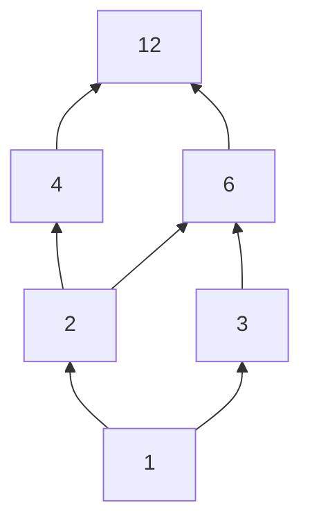

> **Level:** Beginner – Intermediate  |  **Prasyarat:** dasar algoritma, pseudocode, dan perulangan  |  **Bahasa kode:** pseudocode dan Python

Matematika diskrit adalah salah satu mata kuliah terpenting dalam Computer Science. Komputer bekerja dengan data yang **terpisah-pisah (diskrit)**, yaitu bit, bilangan bulat, graf, dan himpunan, sehingga alat matematikanya pun berbeda dari kalkulus yang berfokus pada besaran kontinu.

Tulisan ini terdiri dari dua modul yang saling melengkapi:

1. **Matematika Diskrit**: logika, himpunan, relasi dan fungsi, kombinatorika, serta induksi matematika. Modul ini memberi Anda *bahasa* dan *alat bukti* untuk bernalar tentang algoritma.
2. **Analisis Algoritma**: cara mengukur dan membandingkan efisiensi algoritma dari sisi waktu dan memori.

**Target:** mampu membuktikan klaim sederhana secara formal, menghitung kemungkinan secara sistematis, dan menjelaskan *mengapa* sebuah algoritma efisien atau tidak efisien.

## Daftar Isi

* TOC
{:toc}

---

# Modul 1. Matematika Diskrit

## A. Logic and Propositions (Logika dan Proposisi)

### A.1 Propositional Logic

**Proposisi** adalah kalimat deklaratif yang **bernilai tepat satu**: benar (True, T) atau salah (False, F).

| Kalimat | Proposisi? | Alasan |
|---------|-----------|--------|
| "7 adalah bilangan prima" | Ya (benar) | Dapat ditentukan nilai kebenarannya |
| "2 + 2 = 5" | Ya (salah) | Pernyataan salah tetap proposisi |
| "Tutup pintunya!" | Tidak | Kalimat perintah |
| "x + 3 = 10" | Tidak | Nilainya bergantung pada `x` (ini *predikat*, dibahas di A.5) |
| "Apakah hari ini hujan?" | Tidak | Kalimat tanya |

Proposisi dilambangkan dengan huruf kecil seperti $$p$$, $$q$$, dan $$r$$. Proposisi yang dirangkai dengan operator logika disebut **proposisi majemuk**.

### A.2 Logical Operators

| Operator | Simbol | Dibaca | Benar ketika |
|----------|--------|--------|--------------|
| Negasi | ¬p | "bukan p" | p salah |
| Konjungsi | p ∧ q | "p dan q" | p dan q keduanya benar |
| Disjungsi | p ∨ q | "p atau q" | minimal satu benar |
| XOR (eksklusif) | p ⊕ q | "p atau q, tetapi tidak keduanya" | tepat satu benar |
| Implikasi | p → q | "jika p maka q" | kecuali p benar dan q salah |
| Biimplikasi | p ↔ q | "p jika dan hanya jika q" | p dan q bernilai sama |

Padanan di bahasa pemrograman: `∧` adalah `&&` / `and`, `∨` adalah `||` / `or`, `¬` adalah `!` / `not`, dan `⊕` adalah `^` (XOR).

### A.3 Truth Tables

**Tabel kebenaran** mendaftar semua kombinasi nilai kebenaran. Untuk $$n$$ proposisi, jumlah barisnya adalah $$2^n$$.

| p | q | ¬p | p ∧ q | p ∨ q | p ⊕ q | p → q | p ↔ q |
|---|---|----|-------|-------|-------|-------|-------|
| T | T | F | T | T | F | T | T |
| T | F | F | F | T | T | **F** | F |
| F | T | T | F | T | T | T | F |
| F | F | T | F | F | F | T | T |

**Contoh menyusun tabel proposisi majemuk:** $$(p \lor q) \land \lnot (p \land q)$$

| p | q | p ∨ q | p ∧ q | ¬(p ∧ q) | (p ∨ q) ∧ ¬(p ∧ q) |
|---|---|-------|-------|----------|---------------------|
| T | T | T | T | F | F |
| T | F | T | F | T | T |
| F | T | T | F | T | T |
| F | F | F | F | T | F |

Kolom terakhir identik dengan kolom XOR, sehingga $$p \oplus q \equiv (p \lor q) \land \lnot(p \land q)$$.

**Tiga kategori proposisi majemuk:**

* **Tautologi:** selalu benar, contoh $$p \lor \lnot p$$.
* **Kontradiksi:** selalu salah, contoh $$p \land \lnot p$$.
* **Kontingensi:** bisa benar atau salah, tergantung nilai variabelnya.

### A.4 Implication dan Variannya

Implikasi $$p \to q$$ sering membingungkan karena baris ketiga dan keempat pada tabel kebenaran (p salah) menghasilkan **benar**. Ini disebut *vacuous truth*: janji "jika hujan, saya bawa payung" tidak dilanggar ketika tidak hujan.

Dari implikasi $$p \to q$$ dapat dibentuk tiga variasi:

| Nama | Bentuk | Ekuivalen dengan implikasi asal? |
|------|--------|----------------------------------|
| Konvers | q → p | **Tidak** |
| Invers | ¬p → ¬q | **Tidak** |
| Kontraposisi | ¬q → ¬p | **Ya** |

**Contoh:** "Jika bilangan itu habis dibagi 4, maka bilangan itu genap."

* Konvers: "Jika genap, maka habis dibagi 4." (salah, contoh penyangkal: 6)
* Kontraposisi: "Jika tidak genap, maka tidak habis dibagi 4." (benar)

Kesetaraan lain yang sangat berguna: $$p \to q \equiv \lnot p \lor q$$. Bentuk ini sering dipakai untuk menyederhanakan kondisi dalam program.

### A.5 Logical Equivalence

Dua proposisi majemuk disebut **ekuivalen** ($$\equiv$$) bila tabel kebenarannya identik. Berikut hukum-hukum yang perlu dihafal:

| Hukum | Bentuk |
|-------|--------|
| Identitas | p ∧ T ≡ p,  p ∨ F ≡ p |
| Dominasi | p ∨ T ≡ T,  p ∧ F ≡ F |
| Idempoten | p ∧ p ≡ p,  p ∨ p ≡ p |
| Negasi ganda | ¬(¬p) ≡ p |
| Komutatif | p ∧ q ≡ q ∧ p,  p ∨ q ≡ q ∨ p |
| Asosiatif | (p ∧ q) ∧ r ≡ p ∧ (q ∧ r) |
| Distributif | p ∧ (q ∨ r) ≡ (p ∧ q) ∨ (p ∧ r) |
| Absorpsi | p ∨ (p ∧ q) ≡ p |

### A.6 De Morgan's Laws

$$\lnot (p \land q) \equiv \lnot p \lor \lnot q$$

$$\lnot (p \lor q) \equiv \lnot p \land \lnot q$$

**Verifikasi dengan tabel kebenaran** untuk hukum pertama:

| p | q | p ∧ q | ¬(p ∧ q) | ¬p | ¬q | ¬p ∨ ¬q |
|---|---|-------|----------|----|----|----------|
| T | T | T | F | F | F | F |
| T | F | F | T | F | T | T |
| F | T | F | T | T | F | T |
| F | F | F | T | T | T | T |

Kolom ke-4 dan ke-7 identik, sehingga terbukti.

**Penerapan dalam kode:** menyederhanakan kondisi.

```
// Versi awal: "tidak (sudah login DAN punya izin)"
JIKA TIDAK (sudahLogin DAN punyaIzin) MAKA
  TULIS "Akses ditolak"

// Dengan De Morgan: "belum login ATAU tidak punya izin"
JIKA (TIDAK sudahLogin) ATAU (TIDAK punyaIzin) MAKA
  TULIS "Akses ditolak"
```

Kedua versi menghasilkan perilaku yang sama persis.

### A.7 Predicate Logic

**Predikat** adalah pernyataan yang memuat variabel dan menjadi proposisi saat variabelnya diberi nilai.

* $$P(x)$$: "$$x > 3$$". Maka $$P(5)$$ benar dan $$P(2)$$ salah.
* $$Q(x, y)$$: "$$x + y = 10$$". Maka $$Q(4, 6)$$ benar.

Himpunan nilai yang boleh dipakai variabel disebut **domain (semesta pembicaraan)**.

### A.8 Quantifiers

| Kuantor | Simbol | Dibaca | Benar ketika |
|---------|--------|--------|--------------|
| Universal | $$\forall x\, P(x)$$ | "untuk semua x, P(x)" | P(x) benar untuk **setiap** x di domain |
| Eksistensial | $$\exists x\, P(x)$$ | "ada x sehingga P(x)" | P(x) benar untuk **minimal satu** x |

**Contoh** (domain: bilangan bulat):

* $$\forall x\,(x^2 \ge 0)$$ benar.
* $$\exists x\,(x^2 = 4)$$ benar (x = 2 atau x = −2).
* $$\forall x\,(x > 0)$$ salah. Satu contoh penyangkal (misalnya x = −1) sudah cukup.

**Negasi kuantor** (versi De Morgan untuk predikat):

$$\lnot \forall x\, P(x) \equiv \exists x\, \lnot P(x)$$

$$\lnot \exists x\, P(x) \equiv \forall x\, \lnot P(x)$$

Artinya, untuk membantah "semua mahasiswa lulus" cukup menunjukkan **satu** mahasiswa yang tidak lulus.

**Kuantor bersarang: urutan penting!** Domain bilangan bulat:

* $$\forall x\, \exists y\,(x + y = 0)$$ **benar**: untuk setiap x ada y (yaitu −x).
* $$\exists y\, \forall x\,(x + y = 0)$$ **salah**: tidak ada satu y yang cocok untuk semua x.

**Hubungan dengan pemrograman:** $$\forall$$ setara dengan `all(...)` dan $$\exists$$ setara dengan `any(...)`.

```python
data = [2, 4, 6, 8]
semua_genap = all(x % 2 == 0 for x in data)   # ∀x genap  -> True
ada_lebih_5 = any(x > 5 for x in data)        # ∃x > 5    -> True
```

---

## B. Set Theory (Teori Himpunan)

### B.1 Set dan Subset

**Himpunan** adalah kumpulan objek berbeda yang disebut **elemen**.

* Enumerasi: $$A = \{1, 2, 3, 4\}$$
* Pembentuk himpunan: $$B = \{x \mid x \text{ bilangan genap}, 0 < x \le 10\} = \{2, 4, 6, 8, 10\}$$
* Keanggotaan: $$3 \in A$$ dan $$7 \notin A$$.
* Himpunan kosong: $$\emptyset$$ atau $$\{\}$$.
* Kardinalitas (jumlah elemen): $$\lvert A \rvert = 4$$.

**Subset:** $$A \subseteq B$$ jika setiap elemen $$A$$ juga elemen $$B$$. Beberapa fakta:

* $$\emptyset \subseteq A$$ dan $$A \subseteq A$$ untuk setiap himpunan $$A$$.
* **Subset sejati** ($$A \subset B$$): $$A \subseteq B$$ dan $$A \neq B$$.
* $$A = B$$ jika dan hanya jika $$A \subseteq B$$ dan $$B \subseteq A$$.

Perhatikan: himpunan tidak memperhatikan urutan dan tidak mengizinkan duplikat, sehingga $$\{1, 2, 3\} = \{3, 1, 2, 2\}$$.

### B.2 Operasi Himpunan

Misalkan $$A = \{1, 2, 3, 4\}$$, $$B = \{3, 4, 5, 6\}$$, dan semesta $$U = \{1,\dots,8\}$$.

| Operasi | Simbol | Definisi | Hasil contoh |
|---------|--------|----------|--------------|
| Union (gabungan) | $$A \cup B$$ | elemen di A **atau** B | {1, 2, 3, 4, 5, 6} |
| Intersection (irisan) | $$A \cap B$$ | elemen di A **dan** B | {3, 4} |
| Difference (selisih) | $$A \setminus B$$ | di A tetapi tidak di B | {1, 2} |
| Complement | $$\overline{A}$$ | elemen U yang tidak di A | {5, 6, 7, 8} |
| Symmetric difference | $$A \oplus B$$ | di salah satu saja | {1, 2, 5, 6} |

**Prinsip inklusi-eksklusi untuk dua himpunan:**

$$\lvert A \cup B \rvert = \lvert A \rvert + \lvert B \rvert - \lvert A \cap B \rvert$$

Pada contoh: 4 + 4 − 2 = 6 ✓.

**Hukum himpunan** mirip dengan hukum logika (karena ∪ ↔ ∨, ∩ ↔ ∧, komplemen ↔ ¬):

* De Morgan: $$\overline{A \cup B} = \overline{A} \cap \overline{B}$$ dan $$\overline{A \cap B} = \overline{A} \cup \overline{B}$$
* Distributif: $$A \cap (B \cup C) = (A \cap B) \cup (A \cap C)$$

**Padanan di kode** (Python):

```python
A = {1, 2, 3, 4}
B = {3, 4, 5, 6}
print(A | B)    # union        -> {1, 2, 3, 4, 5, 6}
print(A & B)    # intersection -> {3, 4}
print(A - B)    # difference   -> {1, 2}
print(A ^ B)    # symmetric    -> {1, 2, 5, 6}
print(A <= B)   # subset?      -> False
```

### B.3 Cartesian Product

**Hasil kali Kartesius** $$A \times B$$ adalah himpunan semua pasangan terurut $$(a, b)$$ dengan $$a \in A$$ dan $$b \in B$$.

Contoh: $$A = \{1, 2\}$$, $$B = \{x, y, z\}$$

$$A \times B = \{(1,x), (1,y), (1,z), (2,x), (2,y), (2,z)\}$$

* $$\lvert A \times B \rvert = \lvert A \rvert \cdot \lvert B \rvert = 2 \cdot 3 = 6$$.
* Pada umumnya $$A \times B \neq B \times A$$ karena pasangan **terurut**.
* Pada basis data, `CROSS JOIN` adalah hasil kali Kartesius dua tabel.

### B.4 Power Set

**Himpunan kuasa** $$\mathcal{P}(A)$$ adalah himpunan semua subset dari $$A$$.

Contoh: $$A = \{a, b, c\}$$

$$\mathcal{P}(A) = \{\emptyset, \{a\}, \{b\}, \{c\}, \{a,b\}, \{a,c\}, \{b,c\}, \{a,b,c\}\}$$

$$\lvert \mathcal{P}(A) \rvert = 2^{\lvert A \rvert}$$

**Alasan:** untuk tiap elemen ada dua pilihan, yaitu dimasukkan atau tidak, sehingga $$2 \times 2 \times \dots \times 2 = 2^n$$. Fakta inilah yang membuat enumerasi semua subset berkompleksitas **O(2ⁿ)** (dibahas di Modul 2).

---

## C. Relations and Functions

### C.1 Relations

**Relasi** dari himpunan $$A$$ ke $$B$$ adalah subset dari $$A \times B$$. Jika $$(a, b) \in R$$, kita tulis $$a\,R\,b$$.

**Contoh:** $$A = \{1, 2, 3, 4\}$$, relasi $$R$$ pada $$A$$: "$$a$$ membagi $$b$$".

$$R = \{(1,1),(1,2),(1,3),(1,4),(2,2),(2,4),(3,3),(4,4)\}$$

Relasi dapat disajikan sebagai himpunan pasangan, tabel/matriks, atau graf berarah.

**Sifat-sifat relasi pada himpunan $$A$$:**

| Sifat | Definisi | Contoh |
|-------|----------|--------|
| **Refleksif** | $$a\,R\,a$$ untuk semua $$a$$ | ≤ pada bilangan bulat |
| **Simetris** | $$a\,R\,b \Rightarrow b\,R\,a$$ | "bersaudara kandung" |
| **Antisimetris** | $$a\,R\,b$$ dan $$b\,R\,a \Rightarrow a = b$$ | ≤, "membagi" |
| **Transitif** | $$a\,R\,b$$ dan $$b\,R\,c \Rightarrow a\,R\,c$$ | <, ≤, "membagi" |

Catatan: *simetris* dan *antisimetris* bukan lawan satu sama lain. Relasi kesamaan (=) memenuhi keduanya.

### C.2 Equivalence Relations

Relasi **ekuivalensi** adalah relasi yang **refleksif, simetris, dan transitif** sekaligus.

**Contoh klasik: kongruensi modulo 3** pada bilangan bulat, yaitu $$a \equiv b \pmod 3$$ jika $$(a - b)$$ habis dibagi 3.

* Refleksif: $$a - a = 0$$ habis dibagi 3 ✓
* Simetris: jika $$a - b = 3k$$ maka $$b - a = -3k$$ ✓
* Transitif: jika $$a - b = 3k$$ dan $$b - c = 3m$$ maka $$a - c = 3(k+m)$$ ✓

Relasi ekuivalensi **mempartisi** himpunan menjadi **kelas ekuivalensi** yang saling lepas. Untuk mod 3 terdapat tiga kelas:

* $$[0] = \{\dots, -3, 0, 3, 6, \dots\}$$
* $$[1] = \{\dots, -2, 1, 4, 7, \dots\}$$
* $$[2] = \{\dots, -1, 2, 5, 8, \dots\}$$

Konsep ini menjadi dasar *hash table* (kunci dengan hash sama masuk "bucket" yang sama), aritmetika jam, dan pengelompokan data.

### C.3 Partial Ordering

Relasi **urutan parsial** adalah relasi yang **refleksif, antisimetris, dan transitif**. Pasangan $$(A, R)$$ disebut *poset* (partially ordered set). Disebut "parsial" karena tidak setiap pasang elemen harus dapat dibandingkan.

**Contoh:** relasi "membagi" pada $$\{1, 2, 3, 4, 6, 12\}$$. Angka 4 dan 6 tidak dapat dibandingkan karena tidak saling membagi.

**Diagram Hasse** menggambar poset dengan menghilangkan panah refleksif dan transitif (cukup relasi "langsung"):



*(Panah menuju ke atas berarti "membagi".)*

Contoh poset lain: $$\subseteq$$ pada power set, dan urutan ketergantungan antar-tugas (*task scheduling*). Pengurutan topologis pada graf dependensi adalah penerapan nyata partial order.

### C.4 Functions

**Fungsi** $$f : A \to B$$ memetakan **setiap** elemen $$A$$ (domain) ke **tepat satu** elemen $$B$$ (kodomain). Himpunan nilai yang benar-benar dihasilkan disebut **range (daerah hasil)**.

Perbedaan dengan relasi: pada fungsi, tidak boleh ada elemen domain yang tidak dipetakan, dan tidak boleh satu elemen domain dipetakan ke dua nilai berbeda.

### C.5 Injective, Surjective, Bijective

| Jenis | Syarat | Intuisi |
|-------|--------|---------|
| **Injektif** (one-to-one) | $$f(a) = f(b) \Rightarrow a = b$$ | Tidak ada dua input berbeda yang menghasilkan output sama |
| **Surjektif** (onto) | untuk setiap $$b \in B$$ ada $$a$$ dengan $$f(a) = b$$ | Seluruh kodomain "terpakai" |
| **Bijektif** | injektif **dan** surjektif | Pasangan satu-satu sempurna, sehingga punya fungsi invers |

**Contoh** (domain dan kodomain: bilangan bulat $$\mathbb{Z}$$):

| Fungsi | Injektif? | Surjektif? | Keterangan |
|--------|-----------|-----------|------------|
| $$f(x) = x + 1$$ | Ya | Ya | **Bijektif** (invers: $$x - 1$$) |
| $$f(x) = 2x$$ | Ya | Tidak | Bilangan ganjil tidak pernah dihasilkan |
| $$f(x) = x^2$$ | Tidak | Tidak | $$f(2) = f(-2)$$ dan nilai negatif tak terjangkau |

**Menghitung fungsi pada himpunan hingga** dengan $$\lvert A \rvert = m$$ dan $$\lvert B \rvert = n$$:

* Banyak fungsi: $$n^m$$
* Banyak fungsi injektif: $$\dfrac{n!}{(n-m)!}$$ (0 jika $$m > n$$)
* Banyak fungsi bijektif ($$m = n$$): $$n!$$

**Penerapan di ilmu komputer:**

* **Fungsi hash** idealnya injektif, tetapi karena ruang input lebih besar daripada output maka *collision* tidak terhindarkan (lihat pigeonhole di bagian D).
* **Enkripsi** harus bijektif agar data dapat didekripsi kembali.
* **Komposisi fungsi:** $$(g \circ f)(x) = g(f(x))$$. Komposisi dua fungsi bijektif juga bijektif.

---

## D. Combinatorics (Kombinatorika)

Kombinatorika adalah ilmu **menghitung** tanpa harus mendaftar semua kemungkinan. Ini penting untuk menganalisis berapa banyak langkah yang dilakukan sebuah algoritma.

### D.1 Counting Principles

**Aturan penjumlahan (sum rule):** jika tugas dapat dilakukan dengan cara A (m cara) **atau** cara B (n cara), dan kedua cara tidak tumpang tindih, maka total $$m + n$$ cara.

> Memilih 1 buku dari 5 buku fiksi atau 3 buku sains: 5 + 3 = **8** pilihan.

**Aturan perkalian (product rule):** jika tugas terdiri dari dua langkah berurutan dengan m dan n cara, maka total $$m \times n$$ cara.

> Memilih 1 baju dari 4 baju **dan** 1 celana dari 3 celana: 4 × 3 = **12** setelan.

**Contoh gabungan:** kata sandi 4 karakter yang tiap karakternya adalah angka 0–9: $$10^4 = 10.000$$ kemungkinan. Jika angka tidak boleh berulang: $$10 \times 9 \times 8 \times 7 = 5.040$$.

### D.2 Permutations

**Permutasi** adalah penyusunan objek dengan **memperhatikan urutan**.

* Menyusun semua $$n$$ objek berbeda: $$n!$$
* Memilih dan menyusun $$r$$ dari $$n$$ objek: 

$$P(n, r) = \frac{n!}{(n - r)!}$$

**Contoh:** juara 1, 2, dan 3 dari 10 peserta: $$P(10, 3) = 10 \times 9 \times 8 = 720$$.

**Permutasi dengan elemen sama** (*multiset permutation*):

$$\frac{n!}{n_1!\, n_2!\, \cdots\, n_k!}$$

Contoh: anagram kata **BANANA** (huruf: B×1, A×3, N×2):

$$\frac{6!}{1!\,3!\,2!} = \frac{720}{12} = 60$$

**Permutasi dengan pengulangan:** menyusun $$r$$ posisi dari $$n$$ pilihan yang boleh berulang menghasilkan $$n^r$$.

**Permutasi melingkar:** menyusun $$n$$ orang mengelilingi meja bundar menghasilkan $$(n - 1)!$$ susunan.

### D.3 Combinations

**Kombinasi** adalah pemilihan objek **tanpa memperhatikan urutan**.

$$C(n, r) = \binom{n}{r} = \frac{n!}{r!\,(n - r)!}$$

Hubungan: $$P(n, r) = C(n, r) \cdot r!$$. Kombinasi lebih sedikit karena $$r!$$ urutan berbeda dihitung sebagai satu pilihan.

**Contoh:**

* Memilih 3 anggota panitia dari 10 orang: $$C(10, 3) = \dfrac{10 \cdot 9 \cdot 8}{3 \cdot 2 \cdot 1} = 120$$.
* Tangan poker (5 kartu dari 52): $$C(52, 5) = 2.598.960$$.
* Jabat tangan di antara 20 orang: $$C(20, 2) = 190$$.

**Sifat penting:**

* **Simetri:** $$\binom{n}{r} = \binom{n}{n-r}$$
* **Identitas Pascal:** $$\binom{n}{r} = \binom{n-1}{r-1} + \binom{n-1}{r}$$
* **Jumlah seluruh baris:** $$\sum_{r=0}^{n} \binom{n}{r} = 2^n$$ (sama dengan banyaknya subset)

**Segitiga Pascal:**

```
         1
        1 1
       1 2 1
      1 3 3 1
     1 4 6 4 1
    1 5 10 10 5 1
```

**Bagaimana memilih permutasi atau kombinasi?** Tanyakan: *apakah menukar urutan menghasilkan hasil yang berbeda?* Jika ya (ranking, kata sandi, antrean), pakai permutasi. Jika tidak (panitia, tim, pilihan menu), pakai kombinasi.

**Kombinasi dengan pengulangan (stars and bars):** memilih $$r$$ objek dari $$n$$ jenis dengan pengulangan diperbolehkan:

$$\binom{n + r - 1}{r}$$

Contoh: membagikan 10 permen identik kepada 4 anak: $$\binom{10 + 4 - 1}{10} = \binom{13}{10} = 286$$.

### D.4 Pigeonhole Principle

> Jika $$n + 1$$ merpati ditempatkan ke dalam $$n$$ sarang, maka paling sedikit satu sarang berisi **2 merpati atau lebih**.

**Bentuk umum:** jika $$N$$ objek ditempatkan ke dalam $$k$$ kotak, ada kotak yang berisi paling sedikit $$\lceil N / k \rceil$$ objek.

**Contoh:**

1. Di antara 13 orang, pasti ada minimal 2 orang yang lahir pada bulan yang sama (13 orang, 12 bulan).
2. Dari 5 bilangan bulat mana pun, pasti ada dua yang selisihnya habis dibagi 4. Sebab sisa bagi 4 hanya ada 4 kemungkinan (0, 1, 2, 3), sehingga dua bilangan harus punya sisa sama.
3. **Collision pada hash:** fungsi hash yang memetakan data berukuran tak terbatas ke 256 bit pasti punya input berbeda dengan hash sama.
4. **Kompresi:** tidak mungkin ada algoritma kompresi *lossless* yang memperkecil **semua** file, sebab jumlah file kecil lebih sedikit daripada jumlah file besar.

### D.5 Binomial Theorem

$$(x + y)^n = \sum_{k=0}^{n} \binom{n}{k}\, x^{\,n-k}\, y^{\,k}$$

Koefisiennya adalah baris ke-$$n$$ Segitiga Pascal.

**Contoh:** 

$$(x + y)^4 = x^4 + 4x^3y + 6x^2y^2 + 4xy^3 + y^4$$

**Mencari koefisien tertentu:** koefisien $$x^3y^2$$ pada $$(x + y)^5$$ adalah $$\binom{5}{2} = 10$$.

**Kasus khusus:**

* $$x = y = 1$$: $$2^n = \sum_{k} \binom{n}{k}$$
* $$x = 1,\ y = -1$$: $$0 = \sum_{k} (-1)^k \binom{n}{k}$$ (jumlah subset ukuran genap sama dengan ukuran ganjil)

---

## E. Mathematical Induction & Teknik Pembuktian

### E.1 Weak Induction (Induksi Lemah)

Induksi dipakai untuk membuktikan pernyataan $$P(n)$$ benar untuk semua bilangan bulat $$n \ge n_0$$. Analogi: **efek domino**.

**Langkah:**

1. **Basis:** buktikan $$P(n_0)$$ benar (domino pertama jatuh).
2. **Langkah induksi:** asumsikan $$P(k)$$ benar (*hipotesis induksi*) untuk suatu $$k \ge n_0$$, lalu buktikan $$P(k+1)$$ benar (setiap domino menjatuhkan domino berikutnya).
3. **Kesimpulan:** $$P(n)$$ benar untuk semua $$n \ge n_0$$.

**Contoh: buktikan** $$1 + 2 + 3 + \dots + n = \dfrac{n(n+1)}{2}$$.

* **Basis** ($$n = 1$$): ruas kiri = 1, ruas kanan = $$\frac{1 \cdot 2}{2} = 1$$ ✓.
* **Hipotesis:** untuk suatu $$k \ge 1$$, $$1 + 2 + \dots + k = \dfrac{k(k+1)}{2}$$.
* **Langkah:** tambahkan $$(k+1)$$ pada kedua ruas:

$$1 + 2 + \dots + k + (k+1) = \frac{k(k+1)}{2} + (k+1) = \frac{k(k+1) + 2(k+1)}{2} = \frac{(k+1)(k+2)}{2}$$

Hasil ini sama dengan rumus untuk $$n = k+1$$. ∎

### E.2 Strong Induction (Induksi Kuat)

Pada langkah induksi, kita boleh mengasumsikan $$P(j)$$ benar untuk **semua** $$j$$ dari $$n_0$$ sampai $$k$$ (bukan hanya $$P(k)$$), lalu membuktikan $$P(k+1)$$. Teknik ini berguna bila kasus $$k+1$$ bergantung pada kasus yang lebih kecil, tetapi bukan hanya $$k$$.

**Contoh: buktikan** setiap postage (prangko) $$n \ge 12$$ rupiah dapat dibentuk dari prangko bernilai 4 dan 5.

* **Basis:** 12 = 4+4+4, 13 = 4+4+5, 14 = 4+5+5, 15 = 5+5+5 ✓ (perlu empat basis).
* **Langkah:** ambil $$n \ge 16$$ dan asumsikan semua nilai dari 12 sampai $$n-1$$ bisa dibentuk. Karena $$n - 4 \ge 12$$, nilai $$n - 4$$ bisa dibentuk menurut hipotesis. Tambahkan satu prangko 4, maka $$n$$ terbentuk. ∎

**Contoh kedua:** setiap bilangan bulat $$n \ge 2$$ adalah bilangan prima atau hasil kali bilangan prima. Jika $$n$$ tidak prima, maka $$n = a \cdot b$$ dengan $$2 \le a, b < n$$. Menurut hipotesis kuat, $$a$$ dan $$b$$ masing-masing hasil kali prima, sehingga $$n$$ juga. Induksi lemah tidak cukup di sini karena $$a$$ dan $$b$$ bisa berapa pun yang lebih kecil dari $$n$$, bukan hanya $$n-1$$.

> **Induksi dan program rekursif:** struktur bukti induksi sama dengan struktur fungsi rekursif. *Basis* adalah kasus dasar, dan *langkah induksi* adalah pemanggilan rekursif. Induksi dipakai untuk membuktikan **kebenaran** algoritma rekursif.

### E.3 Proof by Contradiction (Bukti dengan Kontradiksi)

Untuk membuktikan $$P$$: **asumsikan $$\lnot P$$**, turunkan sesuatu yang mustahil (kontradiksi), lalu simpulkan bahwa asumsi salah sehingga $$P$$ benar.

**Contoh: $$\sqrt{2}$$ adalah bilangan irasional.**

1. Andaikan $$\sqrt{2}$$ rasional: $$\sqrt{2} = \dfrac{a}{b}$$ dengan $$a, b$$ bulat dan pecahan sudah paling sederhana (FPB(a, b) = 1).
2. Kuadratkan: $$2b^2 = a^2$$, sehingga $$a^2$$ genap, maka $$a$$ genap. Tulis $$a = 2c$$.
3. Substitusi: $$2b^2 = 4c^2 \Rightarrow b^2 = 2c^2$$, sehingga $$b^2$$ genap, maka $$b$$ genap.
4. Jadi $$a$$ dan $$b$$ sama-sama genap, bertentangan dengan FPB(a, b) = 1. Maka asumsi salah dan $$\sqrt{2}$$ irasional. ∎

**Contoh lain:** terdapat tak hingga banyak bilangan prima (bukti Euclid). Andaikan hanya ada $$p_1, \dots, p_m$$. Bilangan $$N = p_1 p_2 \cdots p_m + 1$$ tidak habis dibagi satu pun $$p_i$$, sehingga $$N$$ prima baru atau punya faktor prima baru. Ini kontradiksi. ∎

**Variasi: bukti kontraposisi.** Untuk membuktikan $$p \to q$$, buktikan $$\lnot q \to \lnot p$$ (ekuivalen, lihat A.4). Misalnya, "jika $$n^2$$ genap maka $$n$$ genap" lebih mudah dibuktikan dari: jika $$n$$ ganjil maka $$n^2$$ ganjil.

### E.4 Proof by Construction (Bukti Konstruktif)

Untuk membuktikan bahwa sesuatu **ada**, kita tunjukkan secara eksplisit **cara membuatnya**.

**Contoh:** untuk setiap bilangan bulat positif $$n$$ terdapat $$n$$ bilangan bulat berurutan yang semuanya komposit.

**Konstruksi:** ambil bilangan

$$(n+1)! + 2,\ (n+1)! + 3,\ \dots,\ (n+1)! + (n+1)$$

Bilangan $$(n+1)! + j$$ habis dibagi $$j$$ untuk $$2 \le j \le n+1$$, dan nilainya lebih besar dari $$j$$, sehingga komposit. Contohnya $$n = 3$$: $$(n+1)! = 4! = 24$$, sehingga barisnya adalah 26, 27, 28. Bilangan 26 habis dibagi 2, 27 habis dibagi 3, dan 28 habis dibagi 4, jadi ketiganya komposit. ∎

**Perbandingan teknik pembuktian:**

| Teknik | Cocok untuk | Ciri khas |
|--------|-------------|-----------|
| Bukti langsung | Implikasi sederhana | Dari premis langsung ke kesimpulan |
| Kontraposisi | Implikasi yang sulit dibuktikan langsung | Buktikan ¬q → ¬p |
| Kontradiksi | Ketidakmungkinan, irasionalitas, ketakhinggaan | Asumsikan lawan, cari kontradiksi |
| Konstruktif | Klaim keberadaan | Tunjukkan contoh dan cara membuatnya |
| Induksi | Klaim untuk semua bilangan bulat ≥ n₀ | Basis + langkah induksi |
| Induksi kuat | Kasus bergantung pada banyak kasus lebih kecil | Asumsikan semua kasus sebelumnya |

---

## Praktik Modul 1

### Praktik 1: Membuktikan Rumus Deret dengan Induksi

**Soal A:** buktikan $$1 + 3 + 5 + \dots + (2n - 1) = n^2$$.

* **Basis** ($$n = 1$$): $$1 = 1^2$$ ✓
* **Langkah:** asumsikan benar untuk $$k$$. Maka
 $$1 + 3 + \dots + (2k-1) + (2k+1) = k^2 + (2k + 1) = (k+1)^2$$ ∎

**Soal B:** buktikan $$\sum_{i=0}^{n} 2^i = 2^{n+1} - 1$$.

* **Basis** ($$n = 0$$): ruas kiri = $$2^0 = 1$$, ruas kanan = $$2^1 - 1 = 1$$ ✓
* **Langkah:** $$\sum_{i=0}^{k+1} 2^i = (2^{k+1} - 1) + 2^{k+1} = 2 \cdot 2^{k+1} - 1 = 2^{k+2} - 1$$ ∎

*(Hasil ini menjelaskan mengapa angka biner $$n$$ bit semuanya 1 bernilai $$2^n - 1$$.)*

**Soal C:** buktikan $$\sum_{i=1}^{n} i^2 = \dfrac{n(n+1)(2n+1)}{6}$$.

* **Basis** ($$n = 1$$): $$1 = \frac{1 \cdot 2 \cdot 3}{6} = 1$$ ✓
* **Langkah:** 

$$\frac{k(k+1)(2k+1)}{6} + (k+1)^2 = \frac{(k+1)\,[\,k(2k+1) + 6(k+1)\,]}{6} = \frac{(k+1)(2k^2 + 7k + 6)}{6} = \frac{(k+1)(k+2)(2k+3)}{6}$$

 Ini sama dengan rumus untuk $$n = k+1$$. ∎

**Verifikasi dengan program:** induksi membuktikan untuk *semua* $$n$$, sedangkan program hanya menguji beberapa nilai. Program cocok untuk **memeriksa** dugaan sebelum membuktikannya.

```python
for n in range(1, 11):
    langsung = sum(i * i for i in range(1, n + 1))
    rumus = n * (n + 1) * (2 * n + 1) // 6
    assert langsung == rumus, f"gagal pada n={n}"
print("Rumus cocok untuk n = 1..10")
```

### Praktik 2: Menghitung Kombinasi dan Permutasi

Kerjakan sendiri terlebih dahulu, lalu cocokkan jawabannya.

| No | Soal | Jawaban | Penjelasan |
|----|------|---------|------------|
| 1 | Berapa cara menyusun 5 orang dalam satu baris? | 120 | $$5!$$ |
| 2 | Memilih ketua, sekretaris, bendahara dari 8 orang | 336 | $$P(8,3) = 8 \cdot 7 \cdot 6$$ (urutan peran penting) |
| 3 | Memilih 3 anggota tim dari 8 orang | 56 | $$C(8,3)$$ (urutan tidak penting) |
| 4 | Susunan huruf kata **KOMPUTER** | 40.320 | $$8!$$ (semua huruf berbeda) |
| 5 | Susunan huruf kata **MATEMATIKA** | 151.200 | $$\frac{10!}{3!\,2!\,2!}$$ (M×2, A×3, T×2) |
| 6 | 5 orang, dua orang tertentu harus bersebelahan | 48 | Anggap pasangan sebagai 1 blok: $$2 \times 4!$$ |
| 7 | Memilih 2 pria dan 3 wanita dari 6 pria dan 5 wanita | 150 | $$C(6,2) \times C(5,3) = 15 \times 10$$ |
| 8 | Susunan 6 orang mengelilingi meja bundar | 120 | $$(6-1)!$$ |

**Verifikasi dengan Python:**

```python
from math import factorial, comb, perm

print(factorial(5))        # 120
print(perm(8, 3))          # 336
print(comb(8, 3))          # 56
print(factorial(10) // (factorial(3) * factorial(2) * factorial(2)))  # 151200
```

### Praktik 3: Membuat Program Pembangkit Kombinasi

**Tujuan:** menghasilkan **semua** kombinasi $$k$$ elemen dari $$\{1, 2, \dots, n\}$$ (bukan hanya menghitung jumlahnya).

**Ide: backtracking.** Bangun kombinasi secara bertahap. Pada setiap langkah, pilih elemen berikutnya yang **lebih besar** dari elemen terakhir agar tidak ada duplikat urutan (misalnya `[1,2]` dan `[2,1]` dianggap sama).

**Pseudocode:**

```
FUNGSI bangkitkan(n, k)
  hasil <- daftar kosong
  saatIni <- daftar kosong
  telusuri(1, n, k, saatIni, hasil)
  KEMBALIKAN hasil
SELESAI FUNGSI

PROSEDUR telusuri(mulai, n, k, saatIni, hasil)
  JIKA panjang(saatIni) = k MAKA
    tambahkan salinan saatIni ke hasil
    KEMBALI
  SELESAI JIKA

  UNTUK i DARI mulai SAMPAI n
    tambahkan i ke saatIni            // pilih
    telusuri(i + 1, n, k, saatIni, hasil)
    hapus elemen terakhir dari saatIni // batalkan (backtrack)
  SELESAI UNTUK
SELESAI PROSEDUR
```

**Implementasi Python:**

```python
def bangkitkan_kombinasi(n, k):
    hasil = []
    saat_ini = []

    def telusuri(mulai):
        if len(saat_ini) == k:
            hasil.append(saat_ini.copy())
            return
        for i in range(mulai, n + 1):
            saat_ini.append(i)       # pilih
            telusuri(i + 1)          # lanjut
            saat_ini.pop()           # batalkan

    telusuri(1)
    return hasil


print(bangkitkan_kombinasi(4, 2))
# [[1, 2], [1, 3], [1, 4], [2, 3], [2, 4], [3, 4]]
```

**Uji:** `C(4, 2) = 6` dan benar ada 6 hasil. Jumlah hasil selalu sama dengan $$\binom{n}{k}$$.

**Pengembangan (pruning/pemangkasan):** pada loop, `i` tidak perlu melebihi `n - (k - len(saat_ini)) + 1` karena sisa elemen tidak cukup untuk melengkapi kombinasi. Pemangkasan ini mengurangi percabangan yang sia-sia.

**Pembangkit subset (power set) dengan bitmask:** karena ada $$2^n$$ subset, setiap bilangan 0 sampai $$2^n - 1$$ merepresentasikan satu subset.

```python
def semua_subset(elemen):
    n = len(elemen)
    for mask in range(1 << n):                       # 0 .. 2^n - 1
        yield [elemen[i] for i in range(n) if mask & (1 << i)]

print(list(semua_subset(['a', 'b', 'c'])))
# [[], ['a'], ['b'], ['a','b'], ['c'], ['a','c'], ['b','c'], ['a','b','c']]
```

### Praktik 4: Menyelesaikan Masalah Counting

Gunakan strategi: **(1)** tentukan apakah urutan penting, **(2)** apakah pengulangan diperbolehkan, **(3)** adakah syarat khusus, **(4)** bila syarat rumit, hitung komplemennya.

**Soal 1: Kata sandi.** Kata sandi 6 karakter terdiri dari huruf kecil (26) dan angka (10). Berapa kata sandi yang **memuat minimal satu angka**?

*Strategi komplemen:* total − tanpa angka = $$36^6 - 26^6 = 2.176.782.336 - 308.915.776 = 1.867.866.560$$.

**Soal 2: Panitia dengan syarat.** Dari 7 pria dan 5 wanita dibentuk panitia 4 orang yang **minimal 1 wanita**.

Total: $$C(12, 4) = 495$$. Tanpa wanita (semua pria): $$C(7, 4) = 35$$. Jawaban: $$495 - 35 = 460$$.

**Soal 3: Plat nomor.** Format: 2 huruf, 4 angka, 2 huruf (huruf A–Z, boleh berulang). Banyaknya: $$26^2 \times 10^4 \times 26^2 = 26^4 \times 10^4 = 4.569.760.000$$.

**Soal 4: Distribusi (stars and bars).** Berapa solusi bulat tak negatif dari $$x_1 + x_2 + x_3 + x_4 = 10$$?

$$\binom{10 + 4 - 1}{4 - 1} = \binom{13}{3} = 286$$

**Soal 5: Pigeonhole.** Seorang siswa memiliki 5 kaus kaki hitam, 5 putih, dan 5 biru dalam laci gelap. Berapa minimal kaus kaki yang diambil agar **dijamin** ada sepasang berwarna sama? Ada 3 warna (sarang), maka ambil $$3 + 1 = 4$$ kaus kaki.

**Soal 6: Inklusi-eksklusi.** Berapa bilangan dari 1 sampai 100 yang habis dibagi 3 **atau** 5?

$$\lfloor 100/3 \rfloor + \lfloor 100/5 \rfloor - \lfloor 100/15 \rfloor = 33 + 20 - 6 = 47$$

**Verifikasi soal 6 dengan program:**

```python
print(sum(1 for x in range(1, 101) if x % 3 == 0 or x % 5 == 0))   # 47
```

---

# Modul 2. Algorithm Analysis (Analisis Algoritma)

## 2.1 Apa Itu Analisis Algoritma?

**Analisis algoritma** adalah proses memprediksi sumber daya yang dibutuhkan sebuah algoritma, terutama **waktu** dan **memori**, sebagai fungsi dari **ukuran input** ($$n$$).

**Mengapa tidak cukup mengukur dengan stopwatch?** Waktu eksekusi nyata bergantung pada perangkat keras, bahasa pemrograman, kompiler, dan beban sistem. Kita ingin ukuran yang **independen dari mesin** dan menjawab pertanyaan: *"Bagaimana pertumbuhan biaya ketika data menjadi 10 kali lebih besar?"*

Pendekatan yang dipakai: hitung **banyaknya operasi dasar** sebagai fungsi $$n$$, lalu perhatikan **laju pertumbuhannya**.

| Pertanyaan | Jawaban dari analisis |
|------------|-----------------------|
| Apakah algoritma ini cukup cepat untuk 1 juta data? | Ya/tidak berdasarkan pertumbuhan T(n) |
| Mana yang lebih baik, algoritma A atau B? | Bandingkan kompleksitas asimtotiknya |
| Di mana letak bottleneck? | Bagian dengan kompleksitas tertinggi |

## 2.2 Time Complexity dan Space Complexity

**Time complexity** $$T(n)$$: jumlah langkah/operasi dasar yang dijalankan untuk input berukuran $$n$$.

**Space complexity** $$S(n)$$: jumlah memori **tambahan** yang dibutuhkan (di luar input) untuk input berukuran $$n$$.

**Contoh: menjumlahkan elemen array**

```
FUNGSI jumlah(A, n)
  total <- 0                    // 1 kali
  UNTUK i DARI 0 SAMPAI n - 1   // n kali
    total <- total + A[i]       // n kali penjumlahan
  SELESAI UNTUK
  KEMBALIKAN total              // 1 kali
SELESAI FUNGSI
```

Jika setiap operasi dianggap 1 langkah, $$T(n) \approx 2n + 2$$, yaitu **linear** terhadap $$n$$. Memori tambahan hanya variabel `total` dan `i`, sehingga $$S(n) = O(1)$$.

**Contoh space complexity:**

| Algoritma | Time | Space | Alasan memori |
|-----------|------|-------|---------------|
| Menjumlah array (iteratif) | O(n) | O(1) | Hanya beberapa variabel |
| Faktorial rekursif | O(n) | O(n) | Tumpukan pemanggilan sedalam n |
| Binary search rekursif | O(log n) | O(log n) | Kedalaman rekursi log n |
| Binary search iteratif | O(log n) | O(1) | Tanpa rekursi |
| Merge sort | O(n log n) | O(n) | Array bantu saat penggabungan |
| Membalik array dengan array baru | O(n) | O(n) | Salinan array |
| Membalik array *in-place* | O(n) | O(1) | Tukar elemen di tempat |

**Trade-off ruang dan waktu:** sering kali kita dapat mempercepat algoritma dengan memakai memori lebih banyak (misalnya *caching* atau *hash table*), dan sebaliknya. Contohnya di Praktik 4.

## 2.3 Best, Average, dan Worst Case

Untuk input yang **ukurannya sama**, waktu eksekusi bisa berbeda tergantung isi input.

**Contoh: linear search** mencari nilai `x` dalam array berukuran $$n$$.

```
FUNGSI cari(A, n, x)
  UNTUK i DARI 0 SAMPAI n - 1
    JIKA A[i] = x MAKA
      KEMBALIKAN i
    SELESAI JIKA
  SELESAI UNTUK
  KEMBALIKAN -1
SELESAI FUNGSI
```

| Kasus | Kondisi | Perbandingan | Kompleksitas |
|-------|---------|--------------|--------------|
| **Best case** | `x` ada di indeks pertama | 1 | $$O(1)$$ |
| **Average case** | `x` tersebar acak (rata-rata di tengah) | $$\approx n/2$$ | $$O(n)$$ |
| **Worst case** | `x` di akhir atau tidak ada | $$n$$ | $$O(n)$$ |

**Mana yang paling sering dipakai?** **Worst case**, karena memberi **jaminan batas atas**: algoritma tidak akan lebih lambat dari itu apa pun inputnya. Average case lebih realistis tetapi membutuhkan asumsi distribusi input. Best case jarang berguna karena terlalu optimistis.

## 2.4 Asymptotic Analysis

**Analisis asimtotik** mempelajari perilaku $$T(n)$$ ketika $$n \to \infty$$. Dua prinsip utamanya:

1. **Abaikan konstanta:** $$5n$$ dan $$100n$$ keduanya tumbuh linear.
2. **Abaikan suku berorde lebih rendah:** pada $$3n^2 + 5n + 2$$, suku $$n^2$$ mendominasi saat $$n$$ besar.

Misalnya $$T(n) = 3n^2 + 5n + 2$$:

| n | 3n² | 5n | 2 | Total | Kontribusi 3n² |
|---|-----|----|---|-------|----------------|
| 10 | 300 | 50 | 2 | 352 | 85% |
| 100 | 30.000 | 500 | 2 | 30.502 | 98,4% |
| 1.000 | 3.000.000 | 5.000 | 2 | 3.005.002 | 99,8% |

Semakin besar $$n$$, semakin jelas bahwa hanya $$n^2$$ yang menentukan.

## 2.5 Big O Notation (Batas Atas)

**Definisi:** $$f(n) = O(g(n))$$ jika terdapat konstanta $$c > 0$$ dan $$n_0$$ sehingga

$$f(n) \le c \cdot g(n) \quad \text{untuk semua } n \ge n_0$$

Artinya, $$f$$ **tumbuh tidak lebih cepat** dari $$g$$ (dalam faktor konstanta). Big O adalah **batas atas**.

**Contoh bukti:** tunjukkan $$3n^2 + 5n + 2 = O(n^2)$$.

Untuk $$n \ge 1$$: $$5n \le 5n^2$$ dan $$2 \le 2n^2$$. Maka

$$3n^2 + 5n + 2 \le 3n^2 + 5n^2 + 2n^2 = 10n^2$$

Jadi $$c = 10$$ dan $$n_0 = 1$$ memenuhi definisi. ∎

**Aturan praktis menentukan Big O:**

| Aturan | Contoh |
|--------|--------|
| Buang konstanta pengali | $$7n = O(n)$$ |
| Ambil suku dominan | $$n^3 + 100n^2 + 5 = O(n^3)$$ |
| Urutan dua blok **berurutan**: ambil yang terbesar | O(n) lalu O(n²) menjadi O(n²) |
| Blok **bersarang**: kalikan | O(n) di dalam O(n) menjadi O(n²) |
| Basis logaritma diabaikan | $$\log_2 n = O(\log_{10} n)$$ (beda konstanta saja) |

**Peringatan:** secara formal, $$n = O(n^2)$$ juga benar (batas atas longgar). Namun kita biasanya mencari **batas atas yang paling ketat**.

## 2.6 Big Omega (Ω): Batas Bawah

**Definisi:** $$f(n) = \Omega(g(n))$$ jika terdapat $$c > 0$$ dan $$n_0$$ sehingga

$$f(n) \ge c \cdot g(n) \quad \text{untuk semua } n \ge n_0$$

Artinya, $$f$$ **tumbuh setidaknya secepat** $$g$$. Pada contoh sebelumnya, $$3n^2 + 5n + 2 \ge 3n^2$$ untuk semua $$n \ge 1$$, sehingga $$3n^2 + 5n + 2 = \Omega(n^2)$$ dengan $$c = 3$$.

**Penggunaan:** menyatakan bahwa suatu masalah *paling tidak* butuh sekian langkah. Misalnya, pengurutan berbasis perbandingan memerlukan $$\Omega(n \log n)$$ perbandingan pada worst case.

## 2.7 Big Theta (Θ): Batas Ketat

**Definisi:** $$f(n) = \Theta(g(n))$$ jika $$f(n) = O(g(n))$$ **dan** $$f(n) = \Omega(g(n))$$. Dengan kata lain, terdapat $$c_1, c_2 > 0$$ dan $$n_0$$ sehingga

$$c_1 \cdot g(n) \le f(n) \le c_2 \cdot g(n) \quad \text{untuk } n \ge n_0$$

Pada contoh: $$3n^2 \le 3n^2 + 5n + 2 \le 10n^2$$, sehingga $$3n^2 + 5n + 2 = \Theta(n^2)$$.

**Ringkasan tiga notasi:**

| Notasi | Makna | Analogi | Dipakai untuk |
|--------|-------|---------|---------------|
| $$O(g)$$ | Batas atas | $$\le$$ | Jaminan "tidak lebih lambat dari" |
| $$\Omega(g)$$ | Batas bawah | $$\ge$$ | Jaminan "tidak lebih cepat dari" |
| $$\Theta(g)$$ | Batas ketat | $$=$$ | Pertumbuhan tepat |

> **Kesalahan umum:** menyamakan Big O dengan "worst case". Keduanya konsep berbeda. *Worst case* menyatakan **kasus input** yang dianalisis, sedangkan *Big O* adalah **notasi** untuk batas pertumbuhan. Kita bisa menyatakan Big O, Omega, atau Theta untuk best, average, maupun worst case.

## 2.8 Growth Rate (Laju Pertumbuhan)

Urutan pertumbuhan dari yang paling lambat ke paling cepat:

$$1 < \log n < \sqrt{n} < n < n \log n < n^2 < n^3 < 2^n < n!$$

**Perbandingan jumlah operasi** (pembulatan):

| n | log₂ n | n | n log₂ n | n² | n³ | 2ⁿ | n! |
|---|--------|---|----------|----|----|----|----|
| 10 | 3 | 10 | 33 | 100 | 1.000 | 1.024 | 3.628.800 |
| 20 | 4 | 20 | 86 | 400 | 8.000 | ≈ 1 juta | ≈ 2,4 × 10¹⁸ |
| 100 | 7 | 100 | 664 | 10.000 | 1.000.000 | ≈ 1,3 × 10³⁰ | ≈ 9,3 × 10¹⁵⁷ |
| 1.000 | 10 | 1.000 | ≈ 10.000 | 1.000.000 | 10⁹ | tak terhitung | tak terhitung |

**Gambaran waktu nyata:** anggap komputer menjalankan 10⁹ operasi per detik dan $$n = 100$$:

* $$O(n^2)$$: 10⁴ operasi, yaitu 0,00001 detik.
* $$O(n^3)$$: 10⁶ operasi, yaitu 0,001 detik.
* $$O(2^n)$$: 10³⁰ operasi, yaitu sekitar 4 × 10¹³ tahun (jauh lebih lama dari usia alam semesta).

Inilah mengapa algoritma eksponensial hanya praktis untuk $$n$$ yang sangat kecil.

**Efek pelipatan input:** jika $$n$$ digandakan, waktu menjadi:

| Kompleksitas | Waktu setelah n × 2 |
|--------------|---------------------|
| O(1) | Tetap |
| O(log n) | Bertambah konstan (+1 langkah) |
| O(n) | × 2 |
| O(n log n) | sedikit di atas × 2 |
| O(n²) | × 4 |
| O(n³) | × 8 |
| O(2ⁿ) | dikuadratkan |

Tabel ini menjadi dasar **eksperimen rasio** pada Praktik 5.

## 2.9 Kompleksitas yang Wajib Dipahami

| Kompleksitas | Nama | Contoh | Intuisi |
|--------------|------|--------|---------|
| **O(1)** | Konstan | Akses array berdasarkan indeks | Waktu tidak bergantung pada n |
| **O(log n)** | Logaritmik | Binary search | Ruang pencarian dibagi dua tiap langkah |
| **O(n)** | Linear | Linear search | Menyentuh setiap elemen sekali |
| **O(n log n)** | Linearitmik | Merge sort | Membagi log n kali, tiap level memproses n elemen |
| **O(n²)** | Kuadratik | Bubble sort | Dua loop bersarang |
| **O(n³)** | Kubik | Triple nested loop | Tiga loop bersarang (misalnya perkalian matriks naif) |
| **O(2ⁿ)** | Eksponensial | Enumerasi subset | Setiap elemen: masuk atau tidak |
| **O(n!)** | Faktorial | Enumerasi permutasi | Semua urutan penyusunan |

**Contoh kode untuk setiap kelas:**

```python
# O(1): akses indeks
def elemen_pertama(a):
    return a[0]

# O(log n): binary search (array terurut)
def binary_search(a, x):
    kiri, kanan = 0, len(a) - 1
    while kiri <= kanan:
        tengah = (kiri + kanan) // 2
        if a[tengah] == x:
            return tengah
        elif a[tengah] < x:
            kiri = tengah + 1
        else:
            kanan = tengah - 1
    return -1

# O(n): linear search
def linear_search(a, x):
    for i, v in enumerate(a):
        if v == x:
            return i
    return -1

# O(n log n): merge sort
def merge_sort(a):
    if len(a) <= 1:
        return a
    tengah = len(a) // 2
    kiri, kanan = merge_sort(a[:tengah]), merge_sort(a[tengah:])
    hasil, i, j = [], 0, 0
    while i < len(kiri) and j < len(kanan):
        if kiri[i] <= kanan[j]:
            hasil.append(kiri[i]); i += 1
        else:
            hasil.append(kanan[j]); j += 1
    return hasil + kiri[i:] + kanan[j:]

# O(n^2): bubble sort
def bubble_sort(a):
    n = len(a)
    for i in range(n):
        for j in range(n - 1 - i):
            if a[j] > a[j + 1]:
                a[j], a[j + 1] = a[j + 1], a[j]
    return a

# O(n^3): tiga loop bersarang (perkalian matriks naif)
def kali_matriks(A, B, n):
    C = [[0] * n for _ in range(n)]
    for i in range(n):
        for j in range(n):
            for k in range(n):
                C[i][j] += A[i][k] * B[k][j]
    return C

# O(2^n): enumerasi semua subset
def semua_subset(a):
    if not a:
        return [[]]
    sisa = semua_subset(a[1:])
    return sisa + [[a[0]] + s for s in sisa]

# O(n!): enumerasi semua permutasi
def semua_permutasi(a):
    if len(a) <= 1:
        return [a]
    hasil = []
    for i in range(len(a)):
        for p in semua_permutasi(a[:i] + a[i+1:]):
            hasil.append([a[i]] + p)
    return hasil
```

**Mengapa binary search O(log n)?** Setiap langkah membuang separuh data: $$n \to n/2 \to n/4 \to \dots \to 1$$. Jumlah langkah $$k$$ memenuhi $$n / 2^k = 1$$, sehingga $$k = \log_2 n$$. Untuk $$n = 1.000.000$$, hanya sekitar 20 langkah.

## 2.10 Amortized Analysis

**Amortized analysis** menghitung **biaya rata-rata per operasi** pada **urutan operasi terburuk**, bukan rata-rata atas distribusi input acak. Ini berguna ketika sebagian besar operasi murah, tetapi sesekali ada satu operasi yang mahal.

**Contoh klasik: dynamic array (list)** dengan strategi menggandakan kapasitas saat penuh.

* Sebagian besar `append` hanya menaruh elemen: **O(1)**.
* Saat kapasitas penuh, array baru berukuran dua kali dibuat dan semua elemen disalin: **O(n)** untuk satu operasi itu.

**Metode agregat:** lakukan $$n$$ kali `append` mulai dari kapasitas 1. Penyalinan terjadi saat ukuran 1, 2, 4, 8, ..., sehingga total biaya penyalinan:

$$1 + 2 + 4 + \dots + 2^{\lfloor \log_2 n \rfloor} < 2n$$

Ditambah $$n$$ biaya penambahan, total kurang dari $$3n$$. Maka biaya **rata-rata (amortized) per `append` adalah $$O(1)$$**, walau satu `append` tertentu bisa $$O(n)$$.

| Tahap | Kapasitas | Aksi | Biaya |
|-------|-----------|------|-------|
| append #1 | 1 | taruh | 1 |
| append #2 | 1 → 2 | salin 1 elemen + taruh | 2 |
| append #3 | 2 → 4 | salin 2 + taruh | 3 |
| append #4 | 4 | taruh | 1 |
| append #5 | 4 → 8 | salin 4 + taruh | 5 |
| append #6–8 | 8 | taruh | 1 per operasi |
| append #9 | 8 → 16 | salin 8 + taruh | 9 |

**Contoh lain:** counter biner. Menaikkan counter bisa membalik banyak bit sekaligus (misalnya 0111 menjadi 1000), tetapi amortized hanya O(1) per kenaikan.

**Tiga metode umum** analisis amortized: **agregat** (total biaya dibagi n), **akuntansi** (membebankan "kredit" pada operasi murah untuk membayar operasi mahal), dan **potensial** (mendefinisikan fungsi energi pada struktur data).

**Perbedaan dengan average case:** *average case* bergantung pada asumsi distribusi input acak; *amortized* **menjamin** rata-rata per operasi pada urutan operasi apa pun.

## 2.11 Cara Menganalisis Algoritma: Langkah Sistematis

1. Tentukan **ukuran input** $$n$$ (panjang array, jumlah node, nilai bilangan).
2. Tentukan **operasi dasar** yang paling dominan (perbandingan, penjumlahan).
3. Hitung **berapa kali** operasi itu dijalankan sebagai fungsi $$n$$.
4. Perhatikan apakah jumlah operasi bergantung pada **isi** input (best/average/worst).
5. Sederhanakan dengan aturan asimtotik (buang konstanta dan suku kecil).
6. Analisis **memori tambahan** (variabel, struktur bantu, tumpukan rekursi).

---

## Praktik Modul 2

### Praktik 1: Menganalisis Kompleksitas Loop Tunggal

Ukuran input: $$n$$. Hitung berapa kali badan loop dijalankan.

**Kasus A: naik satu-satu**

```
UNTUK i DARI 1 SAMPAI n
  TULIS i
SELESAI UNTUK
```
Badan loop berjalan $$n$$ kali, sehingga **O(n)**.

**Kasus B: naik dua-dua**

```
i <- 1
ULANGI SELAMA i <= n
  TULIS i
  i <- i + 2
SELESAI ULANG
```
Berjalan $$n/2$$ kali. Konstanta $$1/2$$ diabaikan, sehingga **O(n)**.

**Kasus C: dikali dua (pertumbuhan geometris)**

```
i <- 1
ULANGI SELAMA i <= n
  TULIS i
  i <- i * 2
SELESAI ULANG
```
Nilai `i` adalah 1, 2, 4, 8, ..., sehingga setelah $$k$$ langkah $$i = 2^k$$. Loop berhenti saat $$2^k > n$$, yaitu $$k \approx \log_2 n$$. Maka **O(log n)**.

**Kasus D: dibagi dua**

```
i <- n
ULANGI SELAMA i >= 1
  TULIS i
  i <- i DIV 2
SELESAI ULANG
```
Sama dengan kasus C, yaitu **O(log n)**.

**Kasus E: berhenti pada akar**

```
i <- 1
ULANGI SELAMA i * i <= n
  TULIS i
  i <- i + 1
SELESAI ULANG
```
Loop berhenti saat $$i^2 > n$$, yaitu $$i > \sqrt{n}$$. Maka **O(√n)**. Ini persis kompleksitas uji bilangan prima pada Semester 1.

**Kasus F: loop tidak bergantung pada n**

```
UNTUK i DARI 1 SAMPAI 1000
  TULIS i
SELESAI UNTUK
```
Selalu 1000 iterasi berapa pun $$n$$, sehingga **O(1)**.

**Kasus G: dua loop berurutan (bukan bersarang)**

```
UNTUK i DARI 1 SAMPAI n   // O(n)
  ...
SELESAI UNTUK
UNTUK j DARI 1 SAMPAI n   // O(n)
  ...
SELESAI UNTUK
```
$$n + n = 2n$$, sehingga **O(n)**.

**Ringkasan:**

| Pola loop | Jumlah iterasi | Kompleksitas |
|-----------|----------------|--------------|
| `i += 1` sampai n | n | O(n) |
| `i += c` sampai n | n/c | O(n) |
| `i *= 2` sampai n | log₂ n | O(log n) |
| `i /= 2` dari n | log₂ n | O(log n) |
| `i*i <= n` | √n | O(√n) |
| batas konstan | konstan | O(1) |

### Praktik 2: Menganalisis Nested Loop

**Kasus A: dua loop bebas**

```
UNTUK i DARI 1 SAMPAI n
  UNTUK j DARI 1 SAMPAI n
    operasi
  SELESAI UNTUK
SELESAI UNTUK
```
$$n \times n = n^2$$ kali, sehingga **O(n²)**.

**Kasus B: loop dalam bergantung pada loop luar**

```
UNTUK i DARI 1 SAMPAI n
  UNTUK j DARI 1 SAMPAI i
    operasi
  SELESAI UNTUK
SELESAI UNTUK
```
Jumlah operasi: $$1 + 2 + 3 + \dots + n = \dfrac{n(n+1)}{2}$$ (rumus yang sudah kita buktikan dengan induksi!). Ini $$\frac{n^2}{2} + \frac{n}{2}$$, sehingga **O(n²)**. Perhatikan bahwa meskipun hanya setengahnya, orde pertumbuhannya tetap kuadratik.

**Kasus C: loop dalam berlipat dua**

```
UNTUK i DARI 1 SAMPAI n
  j <- 1
  ULANGI SELAMA j <= n
    operasi
    j <- j * 2
  SELESAI ULANG
SELESAI UNTUK
```
Loop luar $$n$$ kali, loop dalam $$\log n$$ kali, sehingga **O(n log n)**.

**Kasus D: tiga loop**

```
UNTUK i DARI 1 SAMPAI n
  UNTUK j DARI 1 SAMPAI n
    UNTUK k DARI 1 SAMPAI n
      operasi
    SELESAI UNTUK
  SELESAI UNTUK
SELESAI UNTUK
```
$$n^3$$, sehingga **O(n³)**.

**Kasus E: dua loop dengan variabel berbeda**

```
UNTUK i DARI 1 SAMPAI n
  UNTUK j DARI 1 SAMPAI m
    operasi
  SELESAI UNTUK
SELESAI UNTUK
```
Karena ada dua ukuran input yang berbeda, hasilnya **O(n · m)**, bukan O(n²).

**Kasus F: perangkap umum**

```
UNTUK i DARI 1 SAMPAI n
  operasiMahal()           // O(n)
SELESAI UNTUK
```
Walau hanya satu loop, jika `operasiMahal()` sendiri O(n) maka total **O(n²)**. Periksa juga kompleksitas fungsi yang dipanggil di dalam loop (misalnya `list.contains`, `substring`, atau `sort`).

**Latihan:** tentukan kompleksitas kode berikut.

```
UNTUK i DARI 1 SAMPAI n
  UNTUK j DARI i + 1 SAMPAI n
    JIKA A[i] = A[j] MAKA
      TULIS "duplikat"
    SELESAI JIKA
  SELESAI UNTUK
SELESAI UNTUK
```

*Jawaban:* iterasi total $$(n-1) + (n-2) + \dots + 1 = \dfrac{n(n-1)}{2}$$, sehingga **O(n²)**.

### Praktik 3: Menganalisis Recursive Function

Untuk fungsi rekursif, tulis **relasi rekurens** $$T(n)$$ yang menyatakan biaya total dalam bentuk biaya subproblem, lalu selesaikan.

**Kasus A: faktorial**

```
FUNGSI faktorial(n)
  JIKA n <= 1 MAKA KEMBALIKAN 1
  KEMBALIKAN n * faktorial(n - 1)
SELESAI FUNGSI
```
$$T(n) = T(n-1) + O(1)$$. Dengan menguraikan: $$T(n) = T(n-2) + 2 = \dots = T(1) + (n-1)$$, sehingga **O(n)** waktu dan **O(n)** memori (tumpukan rekursi).

**Kasus B: binary search rekursif**

$$T(n) = T(n/2) + O(1)$$

Terdapat $$\log_2 n$$ level, masing-masing O(1), sehingga **O(log n)**.

**Kasus C: merge sort**

$$T(n) = 2\,T(n/2) + O(n)$$

Gunakan **pohon rekursi**:

```
Level 0:            n                  -> biaya n
Level 1:       n/2     n/2             -> biaya n
Level 2:    n/4 n/4 n/4 n/4            -> biaya n
...
Level log n: 1 1 1 ... 1               -> biaya n
```

Ada $$\log_2 n + 1$$ level dan tiap level berbiaya $$n$$, sehingga **O(n log n)**.

**Kasus D: Fibonacci naif**

```
FUNGSI fib(n)
  JIKA n <= 1 MAKA KEMBALIKAN n
  KEMBALIKAN fib(n - 1) + fib(n - 2)
SELESAI FUNGSI
```
$$T(n) = T(n-1) + T(n-2) + O(1)$$. Pohon pemanggilan melebar hampir dua kali di setiap level, sehingga batas atasnya **O(2ⁿ)** (lebih tepatnya $$\Theta(\varphi^n)$$ dengan $$\varphi \approx 1{,}618$$). Banyak subproblem dihitung berulang: misalnya `fib(3)` dihitung berkali-kali saat menghitung `fib(6)`.

**Perbaikan dengan memoization:** simpan hasil yang sudah dihitung.

```python
def fib_memo(n, memo=None):
    if memo is None:
        memo = {}
    if n <= 1:
        return n
    if n not in memo:
        memo[n] = fib_memo(n - 1, memo) + fib_memo(n - 2, memo)
    return memo[n]
```
Setiap `fib(k)` dihitung **sekali**, sehingga **O(n)** waktu dan O(n) memori. Dari eksponensial menjadi linear hanya dengan menyimpan hasil. Inilah awal dari *dynamic programming*.

**Kasus E: Menara Hanoi**

$$T(n) = 2\,T(n-1) + 1$$

Dengan menguraikan, $$T(n) = 2^n - 1$$, sehingga **O(2ⁿ)**. Ini bisa dibuktikan dengan induksi:

* Basis: $$T(1) = 1 = 2^1 - 1$$ ✓
* Langkah: $$T(k+1) = 2(2^k - 1) + 1 = 2^{k+1} - 1$$ ✓

**Ringkasan pola rekurens yang sering muncul:**

| Rekurens | Solusi | Contoh |
|----------|--------|--------|
| $$T(n) = T(n-1) + O(1)$$ | O(n) | Faktorial, traversal list |
| $$T(n) = T(n-1) + O(n)$$ | O(n²) | Selection sort rekursif |
| $$T(n) = T(n/2) + O(1)$$ | O(log n) | Binary search |
| $$T(n) = T(n/2) + O(n)$$ | O(n) | Seleksi (quickselect, rata-rata) |
| $$T(n) = 2T(n/2) + O(n)$$ | O(n log n) | Merge sort |
| $$T(n) = 2T(n-1) + O(1)$$ | O(2ⁿ) | Hanoi, subset |
| $$T(n) = T(n-1) + T(n-2) + O(1)$$ | O(2ⁿ) | Fibonacci naif |

*(Untuk bentuk $$T(n) = aT(n/b) + O(n^d)$$, ada pintasan bernama **Master Theorem**. Cukup bandingkan $$a$$ dengan $$b^d$$.)*

### Praktik 4: Membandingkan Dua Algoritma untuk Masalah yang Sama

#### Studi kasus 1: Menjumlahkan 1 sampai n

| | Algoritma A (loop) | Algoritma B (rumus) |
|---|--------------------|---------------------|
| Kode | `total = 0; for i in 1..n: total += i` | `total = n*(n+1)/2` |
| Waktu | O(n) | **O(1)** |
| Memori | O(1) | O(1) |

Rumus berasal dari pembuktian induksi di Modul 1. Matematika diskrit dapat langsung mengubah kompleksitas.

#### Studi kasus 2: Mendeteksi elemen duplikat dalam array

**Algoritma A: brute force (bandingkan semua pasangan)**

```python
def ada_duplikat_a(a):
    n = len(a)
    for i in range(n):
        for j in range(i + 1, n):
            if a[i] == a[j]:
                return True
    return False
```
Waktu **O(n²)**, memori **O(1)**.

**Algoritma B: memakai himpunan (hash set)**

```python
def ada_duplikat_b(a):
    terlihat = set()
    for x in a:
        if x in terlihat:       # pencarian rata-rata O(1)
            return True
        terlihat.add(x)
    return False
```
Waktu **O(n)** (rata-rata), memori **O(n)**.

**Algoritma C: mengurutkan lebih dulu**

```python
def ada_duplikat_c(a):
    b = sorted(a)                       # O(n log n)
    for i in range(1, len(b)):          # O(n)
        if b[i] == b[i - 1]:
            return True
    return False
```
Waktu **O(n log n)**, memori O(n) (salinan terurut).

| Algoritma | Waktu | Memori | Catatan |
|-----------|-------|--------|---------|
| A: brute force | O(n²) | O(1) | Hemat memori, lambat untuk n besar |
| B: hash set | O(n) | O(n) | Tercepat, butuh memori ekstra |
| C: sort | O(n log n) | O(n) | Kompromi |

Ini contoh nyata **trade-off ruang vs waktu**. Jika memori sangat terbatas, pilih A; jika kecepatan prioritas, pilih B.

**Perbandingan untuk n = 100.000 (perkiraan operasi):**

* A: sekitar 5 × 10⁹ perbandingan
* B: sekitar 10⁵ operasi
* C: sekitar 1,7 × 10⁶ operasi

#### Studi kasus 3: Pencarian

| | Linear search | Binary search |
|---|---------------|---------------|
| Syarat data | Tidak harus terurut | **Harus terurut** |
| Waktu worst case | O(n) | O(log n) |
| Untuk n = 1.000.000 | sampai 1.000.000 langkah | sekitar 20 langkah |

Jika Anda hanya mencari **sekali**, mengurutkan dulu (O(n log n)) lebih mahal daripada linear search (O(n)). Jika mencari **berkali-kali**, binary search jauh lebih unggul. Pilihan algoritma bergantung pada pola penggunaan, bukan hanya kompleksitas satu operasi.

### Praktik 5: Mengukur Waktu Eksekusi dengan Input Berbeda

Tujuan: membuktikan secara **empiris** bahwa teori kompleksitas sesuai dengan kenyataan.

```python
import time
import random

def ukur(fungsi, data, ulang=3):
    """Mengembalikan waktu terbaik (detik) dari beberapa kali pengukuran."""
    terbaik = float("inf")
    for _ in range(ulang):
        salinan = list(data)            # hindari efek samping (misalnya sorting in-place)
        mulai = time.perf_counter()
        fungsi(salinan)
        selesai = time.perf_counter()
        terbaik = min(terbaik, selesai - mulai)
    return terbaik


def jumlah_linear(a):            # O(n)
    total = 0
    for x in a:
        total += x
    return total

def cari_pasangan_kuadrat(a):    # O(n^2)
    hitung = 0
    for i in range(len(a)):
        for j in range(i + 1, len(a)):
            if a[i] + a[j] == 0:
                hitung += 1
    return hitung


def uji(fungsi, daftar_n):
    print(f"\n{fungsi.__name__}")
    print(f"{'n':>8} {'waktu (s)':>12} {'rasio':>8}")
    sebelumnya = None
    for n in daftar_n:
        data = [random.randint(-n, n) for _ in range(n)]
        t = ukur(fungsi, data)
        rasio = f"{t / sebelumnya:.2f}" if sebelumnya else "-"
        print(f"{n:>8} {t:>12.6f} {rasio:>8}")
        sebelumnya = t


uji(jumlah_linear, [100_000, 200_000, 400_000, 800_000])
uji(cari_pasangan_kuadrat, [500, 1000, 2000, 4000])
```

**Cara membaca hasil (rasio waktu saat n digandakan):**

| Rasio mendekati | Dugaan kompleksitas |
|-----------------|---------------------|
| 1 | O(1) atau O(log n) |
| 2 | O(n) atau O(n log n) |
| 4 | O(n²) |
| 8 | O(n³) |

Angka waktu persisnya berbeda di setiap komputer, tetapi **rasionya** akan mendekati nilai teoretis. Anda akan melihat `jumlah_linear` memiliki rasio sekitar 2, dan `cari_pasangan_kuadrat` sekitar 4.

**Tips pengukuran yang benar:**

1. Gunakan `time.perf_counter()` (resolusi tinggi), bukan `time.time()`.
2. Ulangi beberapa kali dan ambil **waktu terbaik** (atau median) untuk mengurangi gangguan proses lain.
3. Gunakan ukuran input yang **cukup besar** agar waktu terukur jelas di atas noise.
4. Jangan menyertakan waktu pembuatan data dalam pengukuran.
5. Uji **best, average, dan worst case**, misalnya linear search saat elemen berada di awal, di tengah, dan tidak ada.
6. Perhatikan efek *cache*, *garbage collector*, dan optimasi bahasa. Ini sebabnya hasil eksperimen adalah **pelengkap**, bukan pengganti analisis teoretis.

**Tantangan:** bandingkan `ada_duplikat_a` (O(n²)) dan `ada_duplikat_b` (O(n)) dari Praktik 4 untuk $$n$$ = 1.000, 2.000, 4.000, 8.000. Kemudian gambarkan grafik $$n$$ terhadap waktu dan perhatikan bahwa kurva kuadratik makin menjauh dari kurva linear.

**Eksperimen tambahan:** ukur `bangkitkan_kombinasi(n, 5)` dan `semua_subset` untuk $$n$$ = 10, 15, 20, 22. Perhatikan lonjakan waktu pada `semua_subset`, yang membuktikan sifat eksponensial O(2ⁿ).

---

# Menghubungkan Kedua Modul

Matematika diskrit dan analisis algoritma saling menopang:

| Konsep diskrit | Dipakai di analisis algoritma |
|----------------|--------------------------------|
| Induksi | Membuktikan rumus jumlah operasi dan solusi rekurens, serta kebenaran algoritma rekursif |
| Notasi sigma dan deret | Menghitung total iterasi loop bersarang |
| Power set (2ⁿ) | Mengapa enumerasi subset O(2ⁿ) |
| Permutasi (n!) | Mengapa enumerasi permutasi O(n!) |
| Kombinasi | Menghitung jumlah hasil pembangkit kombinasi |
| Pigeonhole | Batas bawah dan collision pada hash |
| Logaritma | Pohon rekursi, binary search, tinggi pohon seimbang |
| Logika dan kuantor | Menyatakan prekondisi, postkondisi, dan invarian loop |

# Kesalahan Umum

1. **Menyamakan implikasi dengan konvers.** "Jika p maka q" tidak sama dengan "jika q maka p".
2. **Salah menegasikan kuantor.** Negasi dari "semua" adalah "ada yang tidak", bukan "semua tidak".
3. **Lupa langkah basis** (atau kurang kasus basis pada induksi kuat) saat membuktikan dengan induksi.
4. **Menggunakan induksi dengan menganggap yang dibuktikan sudah benar** (*circular reasoning*). Hipotesis hanya untuk $$k$$, bukan $$k+1$$.
5. **Tertukar permutasi dan kombinasi.** Tanyakan selalu apakah urutan penting.
6. **Menghitung ganda** pada soal counting. Gunakan inklusi-eksklusi atau hitung komplemen.
7. **Menganggap Big O adalah waktu eksak.** Big O hanya menggambarkan laju pertumbuhan.
8. **Mengabaikan kompleksitas fungsi yang dipanggil** di dalam loop.
9. **Mengira O(n) selalu lebih baik dari O(n²) untuk semua n.** Untuk $$n$$ kecil, konstanta bisa mengubah hasil.
10. **Hanya mengukur dengan stopwatch** tanpa melihat pertumbuhan terhadap $$n$$.

# Checklist Penguasaan

**Matematika Diskrit**

- [ ] Menyusun tabel kebenaran dan memverifikasi ekuivalensi (termasuk De Morgan).
- [ ] Menulis dan menegasikan pernyataan berkuantor.
- [ ] Melakukan operasi himpunan dan menghitung power set serta hasil kali Kartesius.
- [ ] Menentukan apakah suatu relasi refleksif, simetris, antisimetris, transitif, atau ekuivalen.
- [ ] Membedakan fungsi injektif, surjektif, dan bijektif.
- [ ] Memilih dan menghitung permutasi atau kombinasi dengan tepat.
- [ ] Menerapkan pigeonhole principle dan teorema binomial.
- [ ] Menulis bukti induksi lengkap (basis, hipotesis, langkah).
- [ ] Menjelaskan kapan memakai kontradiksi atau konstruksi.

**Analisis Algoritma**

- [ ] Menjelaskan perbedaan time dan space complexity.
- [ ] Membedakan best, average, dan worst case.
- [ ] Menyatakan definisi Big O, Omega, dan Theta serta membuktikan contoh sederhana.
- [ ] Mengurutkan kelas kompleksitas dari yang paling lambat ke paling cepat tumbuh.
- [ ] Menganalisis loop tunggal, loop bersarang, dan fungsi rekursif.
- [ ] Menjelaskan amortized analysis pada dynamic array.
- [ ] Membandingkan dua algoritma dan menjelaskan trade-off-nya.
- [ ] Mengukur waktu eksekusi dan menafsirkan rasionya.

# Latihan Mandiri

**Matematika Diskrit**

1. Buktikan dengan tabel kebenaran bahwa $$p \to q \equiv \lnot p \lor q$$.
2. Tuliskan negasi dari "Setiap mahasiswa mengerjakan setidaknya satu tugas" menggunakan kuantor.
3. Apakah relasi "memiliki tanggal lahir yang sama" pada himpunan manusia merupakan relasi ekuivalensi? Apa kelas-kelasnya?
4. Berapa banyak fungsi bijektif dari himpunan berukuran 5 ke dirinya sendiri?
5. Berapa cara membagi 8 mahasiswa menjadi 2 kelompok masing-masing 4 orang (kelompok tidak dibedakan)? *(Petunjuk: $$\tfrac{1}{2}\binom{8}{4} = 35$$.)*
6. Buktikan dengan induksi bahwa $$n^3 - n$$ habis dibagi 3 untuk semua bilangan bulat $$n \ge 1$$.
7. Buktikan dengan induksi bahwa $$2^n > n$$ untuk semua $$n \ge 1$$.
8. Buktikan dengan kontradiksi bahwa tidak ada bilangan bulat terbesar.

**Analisis Algoritma**

9. Tentukan kompleksitas fungsi `UNTUK i DARI 1 SAMPAI n: UNTUK j DARI 1 SAMPAI 100: operasi`.
10. Selesaikan rekurens $$T(n) = T(n-1) + n$$ dengan $$T(1) = 1$$ dan buktikan hasilnya dengan induksi.
11. Urutkan dari yang paling lambat tumbuh: $$n \log n,\ 2^n,\ n^2,\ \log n,\ n!,\ n$$.
12. Buktikan secara formal bahwa $$4n + 10 = O(n)$$ dengan menentukan $$c$$ dan $$n_0$$.
13. Tulis dua algoritma berbeda untuk menghitung $$x^n$$ (satu O(n), satu O(log n) dengan pemangkatan cepat), lalu ukur waktunya.
14. Mana yang lebih baik untuk mencari satu nilai pada daftar yang akan diubah terus-menerus: array terurut atau array tak terurut? Jelaskan dengan analisis kompleksitas.

# Penutup

Matematika diskrit memberi Anda **bahasa dan alat bukti** untuk menyatakan sesuatu dengan presisi, sedangkan analisis algoritma memberi **ukuran objektif** untuk menilai kualitas solusi. Bersama-sama keduanya menjawab dua pertanyaan penting seorang ilmuwan komputer:

1. *Apakah algoritma ini benar?* (logika, induksi)
2. *Apakah algoritma ini efisien?* (Big O, Omega, Theta, analisis memori)

Setelah menguasai materi ini, Anda siap melangkah ke **struktur data** (array, linked list, stack, queue, tree, hash table), **algoritma pengurutan dan pencarian**, serta **teknik desain algoritma** seperti divide and conquer, greedy, dan dynamic programming. Pada semua topik tersebut, Anda akan terus memakai alat yang dipelajari di sini.

Dan seperti sebelumnya: **kerjakan latihannya**. Pembuktian dan analisis hanya benar-benar dipahami ketika Anda menuliskannya sendiri.

---

