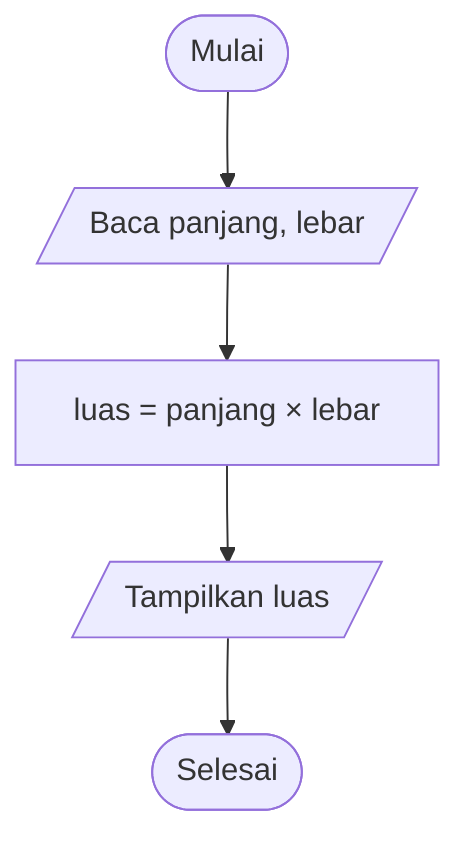
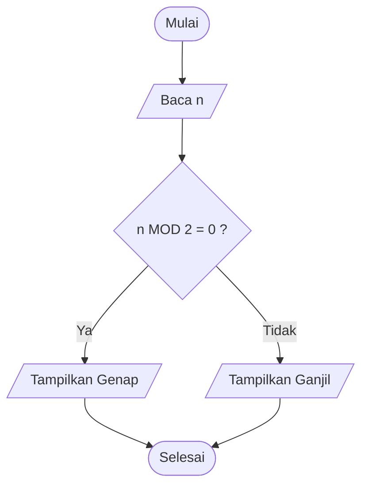

> **Level:** Beginner | **Estimasi:** 4–6 minggu | **Prasyarat:** tidak ada

Banyak orang langsung belajar sintaks bahasa pemrograman, lalu bingung saat harus memecahkan masalah nyata. Padahal kemampuan terpenting seorang programmer adalah **berpikir secara algoritmik**: mengubah masalah menjadi langkah-langkah yang jelas, berurutan, dan bisa dieksekusi.

Semester 1 ini dirancang untuk membangun fondasi tersebut dan terdiri dari tiga modul:

1. **Computational Thinking**: memecahkan masalah sebelum menulis kode.
2. **Programming Fundamentals untuk Algoritma**: konsep, bukan bahasa tertentu.
3. **Mathematical Foundations**: matematika yang dibutuhkan algoritma.

**Target akhir semester:** mampu menulis algoritma sederhana dan memahami operasi matematika yang mendasarinya.

## Daftar Isi

- TOC
  {:toc}

---

# Modul 1. Computational Thinking

> **Target:** mampu menerjemahkan masalah sehari-hari menjadi langkah-langkah algoritmik.

## 1.1 Apa Itu Algoritma?

**Algoritma** adalah urutan langkah yang terhingga, jelas, dan terstruktur untuk menyelesaikan suatu masalah atau mencapai tujuan tertentu.

Contoh paling dekat adalah resep membuat mi instan:

1. Rebus 400 ml air hingga mendidih.
2. Masukkan mi ke dalam air mendidih.
3. Masak selama 3 menit.
4. Tiriskan mi, lalu masukkan ke piring.
5. Tambahkan bumbu dan aduk rata.
6. Mi siap disajikan.

### Ciri-ciri algoritma yang baik

| Ciri          | Penjelasan                                       |
| ------------- | ------------------------------------------------ |
| **Input**     | Memiliki nol atau lebih masukan                  |
| **Output**    | Menghasilkan minimal satu keluaran               |
| **Definite**  | Setiap langkah jelas dan tidak ambigu            |
| **Finite**    | Harus berhenti setelah sejumlah langkah terbatas |
| **Effective** | Setiap langkah dapat benar-benar dikerjakan      |

Perhatikan bahwa langkah "tambahkan garam secukupnya" kurang _definite_ karena "secukupnya" berbeda bagi tiap orang. Komputer membutuhkan instruksi yang pasti.

## 1.2 Input, Proses, dan Output (IPO)

Hampir semua program, sekecil atau sebesar apa pun, mengikuti pola berikut:

```
INPUT  -->  PROSES  -->  OUTPUT
(data)     (olah data)   (hasil)
```

Contoh pada ATM:

| Komponen | Contoh                                   |
| -------- | ---------------------------------------- |
| Input    | Kartu, PIN, nominal penarikan            |
| Proses   | Verifikasi PIN, cek saldo, kurangi saldo |
| Output   | Uang tunai, struk, saldo baru            |

### Tabel IPO

Sebelum menulis algoritma, biasakan membuat **tabel IPO** terlebih dahulu. Tabel ini membantu kita memastikan masalahnya sudah dipahami.

| Input          | Proses                 | Output |
| -------------- | ---------------------- | ------ |
| panjang, lebar | luas = panjang × lebar | luas   |

## 1.3 Computational Thinking

**Computational thinking** adalah cara berpikir untuk memecahkan masalah dengan metode yang dapat dikerjakan oleh manusia maupun komputer. Ada empat pilar utamanya:

| Pilar               | Pertanyaan kunci                                                    |
| ------------------- | ------------------------------------------------------------------- |
| Decomposition       | Bagaimana masalah besar ini dipecah menjadi bagian kecil?           |
| Pattern Recognition | Adakah pola atau kemiripan dengan masalah yang pernah diselesaikan? |
| Abstraction         | Detail apa yang penting, dan detail apa yang boleh diabaikan?       |
| Algorithm Design    | Apa langkah-langkah terurut untuk menyelesaikannya?                 |

### a. Decomposition (Memecah Masalah)

Masalah besar terasa menakutkan, tetapi masalah kecil bisa diselesaikan satu per satu.

**Contoh:** membuat aplikasi toko online sederhana.

```
Aplikasi Toko Online
├── Manajemen produk
│   ├── Tambah produk
│   ├── Ubah harga
│   └── Hapus produk
├── Keranjang belanja
│   ├── Tambah barang
│   └── Hitung total
└── Pembayaran
    ├── Pilih metode
    └── Konfirmasi
```

### b. Pattern Recognition (Mengenali Pola)

Cari kesamaan di dalam atau di antara masalah. Misalnya, rumus luas persegi, persegi panjang, dan segitiga sama-sama berbentuk **"ukuran × ukuran (× konstanta)"**. Pola ini membuat kita bisa merancang satu pendekatan umum.

Contoh lain: menghitung total belanja, total nilai ujian, dan total gaji semuanya memiliki pola yang sama, yaitu _menjumlahkan sekumpulan angka_.

### c. Abstraction (Abstraksi)

Abstraksi berarti **fokus pada hal penting dan mengabaikan detail yang tidak relevan**.

Peta MRT hanya menampilkan stasiun dan jalur. Peta itu tidak menampilkan lebar jalan atau warna gedung di sekitarnya karena detail tersebut tidak berguna bagi penumpang.

Dalam algoritma: untuk menghitung rata-rata nilai, kita tidak perlu peduli nama mata kuliah atau dosennya. Yang penting hanyalah **angka-angka nilainya**.

### d. Algorithm Design (Merancang Algoritma)

Setelah memecah, mengenali pola, dan mengabstraksi, susunlah langkah-langkah penyelesaiannya. Algoritma dapat dituliskan dengan tiga cara: kalimat deskriptif, pseudocode, dan flowchart.

## 1.4 Pseudocode

**Pseudocode** adalah penulisan algoritma menggunakan bahasa semi-formal yang mirip kode, tetapi tidak terikat sintaks bahasa pemrograman mana pun. Pseudocode mudah dibaca manusia.

Konvensi yang dipakai dalam seri ini:

```
BACA x             // menerima input
TULIS x            // menampilkan output
x <- 5             // memberi nilai (assignment)
JIKA kondisi MAKA ... SELAIN ITU ... SELESAI JIKA
ULANGI SELAMA kondisi ... SELESAI ULANG
UNTUK i DARI 1 SAMPAI n ... SELESAI UNTUK
FUNGSI nama(parameter) ... KEMBALIKAN nilai
```

**Contoh:**

```
ALGORITMA SapaPengguna
  BACA nama
  TULIS "Halo, " + nama + "!"
SELESAI
```

## 1.5 Flowchart

**Flowchart** adalah diagram alir yang menggambarkan algoritma secara visual.

| Simbol       | Bentuk          | Fungsi                        |
| ------------ | --------------- | ----------------------------- |
| Terminator   | Oval / kapsul   | Awal dan akhir                |
| Input/Output | Jajar genjang   | Membaca atau menampilkan data |
| Proses       | Persegi panjang | Perhitungan atau penugasan    |
| Keputusan    | Belah ketupat   | Percabangan ya/tidak          |
| Alur         | Panah           | Arah eksekusi                 |

**Contoh flowchart luas persegi panjang:**



> **Catatan Jekyll:** diagram Mermaid membutuhkan konfigurasi tambahan pada tema (lihat bagian _Catatan Teknis_ di akhir tulisan). Tanpa konfigurasi, blok ini tampil sebagai teks biasa.

## 1.6 Langkah Sistematis Memecahkan Masalah

Gunakan kerangka ini setiap kali menghadapi soal:

1. **Pahami masalah**: apa yang diminta dan apa yang diketahui?
2. **Tentukan IPO**: apa inputnya, prosesnya, dan outputnya?
3. **Pecah masalah** menjadi bagian-bagian kecil.
4. **Tulis pseudocode** atau gambar flowchart.
5. **Uji manual** (_dry run_) dengan contoh data sederhana.
6. **Perbaiki** jika hasilnya belum sesuai.

---

## Praktik Modul 1

### Praktik 1: Menghitung Luas Bangun Datar

**Tabel IPO**

| Input                            | Proses                    | Output |
| -------------------------------- | ------------------------- | ------ |
| Pilihan bangun, ukuran-ukurannya | Pilih rumus sesuai bangun | Luas   |

**Pseudocode**

```
ALGORITMA LuasBangunDatar
  TULIS "Pilih bangun: 1.Persegi  2.Persegi Panjang  3.Segitiga  4.Lingkaran"
  BACA pilihan

  JIKA pilihan = 1 MAKA
    BACA sisi
    luas <- sisi * sisi
  SELAIN ITU JIKA pilihan = 2 MAKA
    BACA panjang, lebar
    luas <- panjang * lebar
  SELAIN ITU JIKA pilihan = 3 MAKA
    BACA alas, tinggi
    luas <- 0.5 * alas * tinggi
  SELAIN ITU JIKA pilihan = 4 MAKA
    BACA jariJari
    luas <- 3.14159 * jariJari * jariJari
  SELAIN ITU
    TULIS "Pilihan tidak valid"
    SELESAI
  SELESAI JIKA

  TULIS "Luas = ", luas
SELESAI
```

**Uji manual:** pilihan = 3, alas = 10, tinggi = 6, maka luas = 0,5 × 10 × 6 = **30**.

### Praktik 2: Menentukan Bilangan Ganjil atau Genap

**Ide:** bilangan genap habis dibagi 2 (sisa bagi = 0).

| Input              | Proses                   | Output                |
| ------------------ | ------------------------ | --------------------- |
| Bilangan bulat `n` | Hitung sisa `n` dibagi 2 | "Genap" atau "Ganjil" |

```
ALGORITMA GanjilGenap
  BACA n
  JIKA n MOD 2 = 0 MAKA
    TULIS n, " adalah bilangan genap"
  SELAIN ITU
    TULIS n, " adalah bilangan ganjil"
  SELESAI JIKA
SELESAI
```



**Uji manual:** n = 7, sisa 7 dibagi 2 adalah 1, sehingga hasilnya **ganjil**.

### Praktik 3: Menghitung Rata-rata Nilai

| Input                         | Proses                                 | Output    |
| ----------------------------- | -------------------------------------- | --------- |
| Banyak nilai `n`, nilai-nilai | Jumlahkan semua nilai, bagi dengan `n` | Rata-rata |

```
ALGORITMA RataRata
  BACA n
  total <- 0
  UNTUK i DARI 1 SAMPAI n
    BACA nilai
    total <- total + nilai
  SELESAI UNTUK
  rata <- total / n
  TULIS "Rata-rata = ", rata
SELESAI
```

**Uji manual:** n = 3, nilai 80, 90, 70. Total = 240, rata-rata = 240 / 3 = **80**.

> **Perhatian:** bagaimana jika `n = 0`? Pembagian dengan nol tidak terdefinisi. Algoritma yang baik harus mengantisipasi kasus ini (tambahkan pengecekan `JIKA n > 0`).

### Praktik 4: Menentukan Nilai Tertinggi dan Terendah

**Ide:** anggap nilai pertama sebagai tertinggi _sekaligus_ terendah, lalu bandingkan dengan nilai-nilai berikutnya.

```
ALGORITMA TertinggiTerendah
  BACA n
  BACA nilai
  tertinggi <- nilai
  terendah  <- nilai

  UNTUK i DARI 2 SAMPAI n
    BACA nilai
    JIKA nilai > tertinggi MAKA
      tertinggi <- nilai
    SELESAI JIKA
    JIKA nilai < terendah MAKA
      terendah <- nilai
    SELESAI JIKA
  SELESAI UNTUK

  TULIS "Tertinggi = ", tertinggi
  TULIS "Terendah  = ", terendah
SELESAI
```

**Uji manual:** data 65, 90, 45, 78.

| Langkah | nilai | tertinggi | terendah |
| ------- | ----- | --------- | -------- |
| Awal    | 65    | 65        | 65       |
| i = 2   | 90    | 90        | 65       |
| i = 3   | 45    | 90        | 45       |
| i = 4   | 78    | 90        | 45       |

Hasil: tertinggi **90**, terendah **45**.

> **Kesalahan umum:** menginisialisasi `tertinggi <- 0`. Jika semua nilai negatif, hasilnya salah. Selalu inisialisasi dengan data pertama.

### Praktik 5: Sistem Penilaian Mahasiswa

**Aturan:**

- Nilai akhir = 30% Tugas + 30% UTS + 40% UAS
- Konversi nilai huruf:

| Nilai Akhir | Huruf |
| ----------- | ----- |
| 85 – 100    | A     |
| 70 – 84     | B     |
| 55 – 69     | C     |
| 40 – 54     | D     |
| 0 – 39      | E     |

- Mahasiswa **lulus** jika nilai huruf minimal C.

| Input                 | Proses                                                          | Output                     |
| --------------------- | --------------------------------------------------------------- | -------------------------- |
| nama, tugas, uts, uas | Hitung nilai akhir berbobot, konversi ke huruf, tentukan status | Nilai akhir, huruf, status |

```
ALGORITMA SistemPenilaian
  BACA nama, tugas, uts, uas

  nilaiAkhir <- 0.3 * tugas + 0.3 * uts + 0.4 * uas

  JIKA nilaiAkhir >= 85 MAKA
    huruf <- "A"
  SELAIN ITU JIKA nilaiAkhir >= 70 MAKA
    huruf <- "B"
  SELAIN ITU JIKA nilaiAkhir >= 55 MAKA
    huruf <- "C"
  SELAIN ITU JIKA nilaiAkhir >= 40 MAKA
    huruf <- "D"
  SELAIN ITU
    huruf <- "E"
  SELESAI JIKA

  JIKA huruf = "A" ATAU huruf = "B" ATAU huruf = "C" MAKA
    status <- "LULUS"
  SELAIN ITU
    status <- "TIDAK LULUS"
  SELESAI JIKA

  TULIS nama, nilaiAkhir, huruf, status
SELESAI
```

**Uji manual:** tugas 80, UTS 70, UAS 90. Nilai akhir = 24 + 21 + 36 = 81, huruf **B**, status **LULUS**.

---

# Modul 2. Programming Fundamentals untuk Algoritma

> Fokus pada **konsep**, bukan bahasa pemrograman tertentu. Semua contoh ditulis dalam pseudocode sehingga bisa Anda terjemahkan ke Python, JavaScript, Java, C, atau bahasa lainnya.

## 2.1 Variabel dan Konstanta

**Variabel** adalah wadah bernama untuk menyimpan data yang nilainya **dapat berubah**. **Konstanta** adalah wadah yang nilainya **tetap**.

```
KONSTANTA PI <- 3.14159
umur <- 20
umur <- umur + 1       // boleh berubah
```

Tips penamaan: gunakan nama yang bermakna (`totalBelanja`, bukan `x`), dan konsisten dalam gaya penulisan.

## 2.2 Tipe Data

| Tipe         | Contoh           | Keterangan       |
| ------------ | ---------------- | ---------------- |
| Integer      | `5`, `-12`, `0`  | Bilangan bulat   |
| Real / Float | `3.14`, `-0.5`   | Bilangan desimal |
| String       | `"Halo"`         | Teks             |
| Boolean      | `BENAR`, `SALAH` | Nilai logika     |
| Character    | `'A'`            | Satu karakter    |

Memilih tipe data yang tepat penting. Misalnya, `7 / 2` pada pembagian bilangan bulat di sebagian bahasa menghasilkan `3`, sedangkan pada bilangan real menghasilkan `3.5`.

## 2.3 Operator

### Operator aritmetika

| Operator | Arti             | Contoh    | Hasil |
| -------- | ---------------- | --------- | ----- |
| `+`      | Tambah           | `7 + 2`   | 9     |
| `-`      | Kurang           | `7 - 2`   | 5     |
| `*`      | Kali             | `7 * 2`   | 14    |
| `/`      | Bagi             | `7 / 2`   | 3.5   |
| `DIV`    | Hasil bagi bulat | `7 DIV 2` | 3     |
| `MOD`    | Sisa bagi        | `7 MOD 2` | 1     |

### Operator perbandingan

| Operator   | Arti                                         |
| ---------- | -------------------------------------------- |
| `=`        | Sama dengan                                  |
| `<>`       | Tidak sama dengan                            |
| `<`, `>`   | Lebih kecil, lebih besar                     |
| `<=`, `>=` | Lebih kecil atau sama, lebih besar atau sama |

Hasil perbandingan selalu berupa **Boolean**.

### Operator logika

| Operator      | Arti                            | Contoh                                |
| ------------- | ------------------------------- | ------------------------------------- |
| `DAN` (AND)   | Benar jika **keduanya** benar   | `umur >= 17 DAN punyaKTP`             |
| `ATAU` (OR)   | Benar jika **salah satu** benar | `hari = "Sabtu" ATAU hari = "Minggu"` |
| `TIDAK` (NOT) | Membalik nilai                  | `TIDAK hujan`                         |

**Tabel kebenaran:**

| A   | B   | A DAN B | A ATAU B |
| --- | --- | ------- | -------- |
| B   | B   | B       | B        |
| B   | S   | S       | B        |
| S   | B   | S       | B        |
| S   | S   | S       | S        |

_(B = Benar, S = Salah)_

## 2.4 Percabangan (Conditional)

Percabangan memungkinkan program mengambil keputusan.

```
JIKA suhu > 30 MAKA
  TULIS "Panas"
SELAIN ITU JIKA suhu > 20 MAKA
  TULIS "Sejuk"
SELAIN ITU
  TULIS "Dingin"
SELESAI JIKA
```

### Percabangan bersarang (nested)

Kondisi di dalam kondisi, misalnya untuk menentukan diskon:

```
JIKA anggota = BENAR MAKA
  JIKA totalBelanja >= 500000 MAKA
    diskon <- 20
  SELAIN ITU
    diskon <- 10
  SELESAI JIKA
SELAIN ITU
  diskon <- 0
SELESAI JIKA
```

> **Tips:** hindari percabangan bersarang yang terlalu dalam. Jika lebih dari 3 tingkat, pertimbangkan menyederhanakan dengan operator logika atau memecahnya menjadi fungsi.

## 2.5 Perulangan (Loop)

Perulangan menjalankan blok instruksi berkali-kali.

### a. For: jumlah pengulangan diketahui

```
UNTUK i DARI 1 SAMPAI 5
  TULIS i
SELESAI UNTUK
// Output: 1 2 3 4 5
```

### b. While: periksa kondisi _sebelum_ menjalankan

```
angka <- 1
ULANGI SELAMA angka <= 5
  TULIS angka
  angka <- angka + 1
SELESAI ULANG
```

### c. Do-While: periksa kondisi _sesudah_ menjalankan (minimal 1 kali)

```
ULANGI
  TULIS "Masukkan PIN: "
  BACA pin
SAMPAI pin = 1234
```

| Jenis    | Kapan dipakai                                                       |
| -------- | ------------------------------------------------------------------- |
| For      | Jumlah pengulangan sudah jelas                                      |
| While    | Jumlah pengulangan tidak pasti, kondisi dicek di awal               |
| Do-While | Harus dijalankan minimal sekali (misalnya menu atau validasi input) |

> **Awas infinite loop!** Pastikan ada sesuatu di dalam loop yang akhirnya membuat kondisi berhenti. Pada contoh `While` di atas, `angka <- angka + 1` itulah yang menjamin loop berakhir.

### Perulangan bersarang (nested loop)

Loop di dalam loop, cocok untuk pola dua dimensi seperti tabel dan matriks.

```
UNTUK baris DARI 1 SAMPAI 3
  UNTUK kolom DARI 1 SAMPAI 4
    TULIS "*"
  SELESAI UNTUK
  TULIS baris baru
SELESAI UNTUK
```

Output:

```
****
****
****
```

Loop dalam berjalan **penuh** untuk setiap satu putaran loop luar. Total iterasi = 3 × 4 = 12.

## 2.6 Fungsi

**Fungsi** adalah blok instruksi bernama yang dapat dipanggil berulang kali. Manfaatnya: menghindari pengulangan kode, mempermudah pengujian, dan membuat program lebih rapi (ini sejalan dengan _decomposition_).

```
FUNGSI luasPersegiPanjang(panjang, lebar)
  hasil <- panjang * lebar
  KEMBALIKAN hasil
SELESAI FUNGSI

// Pemanggilan
L <- luasPersegiPanjang(8, 5)     // L = 40
```

- **Parameter**: variabel di definisi fungsi (`panjang`, `lebar`).
- **Argumen**: nilai yang dikirim saat pemanggilan (`8`, `5`).
- **Return value**: nilai yang dikembalikan fungsi ke pemanggil.

### Scope (Cakupan Variabel)

| Jenis      | Keterangan                                           |
| ---------- | ---------------------------------------------------- |
| **Lokal**  | Hanya dikenal di dalam fungsi tempat variabel dibuat |
| **Global** | Dikenal di seluruh program                           |

```
total <- 100                  // global

FUNGSI hitung()
  bonus <- 10                 // lokal
  KEMBALIKAN total + bonus
SELESAI FUNGSI

TULIS bonus                   // ERROR: bonus tidak dikenal di luar fungsi
```

Praktik yang baik: sebisa mungkin gunakan variabel lokal dan kirim data lewat parameter agar fungsi mudah dipahami dan diuji.

## 2.7 Input/Output Dasar

```
TULIS "Masukkan nama Anda: "     // output
BACA nama                         // input
TULIS "Halo, " + nama
```

Input dari pengguna **tidak boleh dipercaya begitu saja**. Pengguna bisa mengetik huruf saat diminta angka, atau angka negatif saat diminta umur. Inilah alasan validasi input (praktik terakhir modul ini) sangat penting.

---

## Praktik Modul 2

### Praktik 1: Kalkulator Sederhana

```
ALGORITMA Kalkulator
  BACA a, operator, b

  JIKA operator = "+" MAKA
    hasil <- a + b
  SELAIN ITU JIKA operator = "-" MAKA
    hasil <- a - b
  SELAIN ITU JIKA operator = "*" MAKA
    hasil <- a * b
  SELAIN ITU JIKA operator = "/" MAKA
    JIKA b = 0 MAKA
      TULIS "Error: pembagian dengan nol"
      SELESAI
    SELESAI JIKA
    hasil <- a / b
  SELAIN ITU
    TULIS "Operator tidak dikenal"
    SELESAI
  SELESAI JIKA

  TULIS a, operator, b, " = ", hasil
SELESAI
```

### Praktik 2: FizzBuzz

**Soal:** cetak angka 1 sampai 100. Untuk kelipatan 3 cetak `Fizz`, kelipatan 5 cetak `Buzz`, dan kelipatan 3 sekaligus 5 cetak `FizzBuzz`.

```
UNTUK i DARI 1 SAMPAI 100
  JIKA i MOD 15 = 0 MAKA
    TULIS "FizzBuzz"
  SELAIN ITU JIKA i MOD 3 = 0 MAKA
    TULIS "Fizz"
  SELAIN ITU JIKA i MOD 5 = 0 MAKA
    TULIS "Buzz"
  SELAIN ITU
    TULIS i
  SELESAI JIKA
SELESAI UNTUK
```

> **Kunci:** periksa kondisi **paling spesifik** (kelipatan 15) lebih dulu. Jika kelipatan 3 diperiksa duluan, angka 15 akan keluar sebagai `Fizz`.

### Praktik 3: Menghitung Faktorial

Faktorial: $$n! = n \times (n-1) \times \dots \times 2 \times 1$$, dengan $$0! = 1$$.

```
FUNGSI faktorial(n)
  hasil <- 1
  UNTUK i DARI 2 SAMPAI n
    hasil <- hasil * i
  SELESAI UNTUK
  KEMBALIKAN hasil
SELESAI FUNGSI

TULIS faktorial(5)      // 120
```

| i    | hasil |
| ---- | ----- |
| awal | 1     |
| 2    | 2     |
| 3    | 6     |
| 4    | 24    |
| 5    | 120   |

### Praktik 4: Menentukan Bilangan Prima

Bilangan prima adalah bilangan **lebih dari 1** yang hanya habis dibagi 1 dan dirinya sendiri.

```
FUNGSI adalahPrima(n)
  JIKA n < 2 MAKA
    KEMBALIKAN SALAH
  SELESAI JIKA

  i <- 2
  ULANGI SELAMA i * i <= n
    JIKA n MOD i = 0 MAKA
      KEMBALIKAN SALAH
    SELESAI JIKA
    i <- i + 1
  SELESAI ULANG

  KEMBALIKAN BENAR
SELESAI FUNGSI
```

**Mengapa cukup sampai $$\sqrt{n}$$ (kondisi `i * i <= n`)?** Jika `n` punya pembagi yang lebih besar dari akar `n`, pasangannya pasti lebih kecil dari akar `n`. Jadi kita cukup mencari pembagi sampai akar `n`. Ini jauh lebih efisien daripada memeriksa semua angka sampai `n - 1`.

### Praktik 5: Membuat Tabel Perkalian

Contoh _nested loop_:

```
ALGORITMA TabelPerkalian
  BACA n
  UNTUK i DARI 1 SAMPAI n
    UNTUK j DARI 1 SAMPAI n
      TULIS i * j, " "
    SELESAI UNTUK
    TULIS baris baru
  SELESAI UNTUK
SELESAI
```

Output untuk `n = 4`:

```
1  2  3  4
2  4  6  8
3  6  9  12
4  8  12 16
```

### Praktik 6: Konversi Angka ke Berbagai Satuan

Contoh: konversi suhu dan panjang dengan menu.

```
ALGORITMA KonversiSatuan
  TULIS "1. Celsius ke Fahrenheit"
  TULIS "2. Kilometer ke Mil"
  TULIS "3. Kilogram ke Pon"
  BACA pilihan
  BACA nilai

  JIKA pilihan = 1 MAKA
    hasil <- nilai * 9 / 5 + 32
  SELAIN ITU JIKA pilihan = 2 MAKA
    hasil <- nilai * 0.621371
  SELAIN ITU JIKA pilihan = 3 MAKA
    hasil <- nilai * 2.20462
  SELAIN ITU
    TULIS "Pilihan tidak valid"
    SELESAI
  SELESAI JIKA

  TULIS "Hasil = ", hasil
SELESAI
```

**Tantangan tambahan:** konversi detik ke format `jam:menit:detik` menggunakan `DIV` dan `MOD`.

```
BACA totalDetik
jam   <- totalDetik DIV 3600
sisa  <- totalDetik MOD 3600
menit <- sisa DIV 60
detik <- sisa MOD 60
TULIS jam, ":", menit, ":", detik
```

Untuk `totalDetik = 3725` hasilnya `1:2:5` (1 jam 2 menit 5 detik).

### Praktik 7: Program Validasi Input

**Soal:** minta pengguna memasukkan umur yang valid (bilangan bulat 1 sampai 120). Ulangi sampai valid.

```
ALGORITMA ValidasiUmur
  ULANGI
    TULIS "Masukkan umur (1-120): "
    BACA umur
    valid <- (umur >= 1) DAN (umur <= 120)
    JIKA TIDAK valid MAKA
      TULIS "Input tidak valid, coba lagi."
    SELESAI JIKA
  SAMPAI valid

  TULIS "Umur Anda: ", umur
SELESAI
```

Ini contoh nyata penggunaan **do-while** (input harus diminta minimal sekali) dan **operator logika**.

---

# Modul 3. Mathematical Foundations

Matematika adalah "bahan baku" algoritma. Anda tidak perlu menjadi ahli matematika, tetapi konsep berikut akan sering muncul.

## 3.1 Bilangan Bulat dan Bilangan Real

- **Bilangan bulat (integer):** $$\dots, -2, -1, 0, 1, 2, \dots$$
- **Bilangan real:** mencakup bilangan bulat, pecahan, dan desimal, misalnya $$0.5$$, $$-3.14$$, dan $$\sqrt{2}$$.

**Catatan penting untuk komputer:** bilangan real disimpan secara _aproksimasi_. Pada banyak bahasa, `0.1 + 0.2` tidak persis sama dengan `0.3`. Karena itu, membandingkan bilangan real sebaiknya memakai toleransi kecil, misalnya `ABS(a - b) < 0.00001`, bukan `a = b`.

## 3.2 Pecahan dan Persentase

- Pecahan: $$\frac{a}{b}$$ dengan $$b \neq 0$$.
- Persentase: $$p\% = \frac{p}{100}$$.

**Contoh:** diskon 20% pada harga 150.000.

```
diskon <- 150000 * 20 / 100      // 30000
bayar  <- 150000 - diskon        // 120000
```

## 3.3 Pangkat dan Akar

$$a^n = \underbrace{a \times a \times \dots \times a}_{n\ \text{kali}}$$

| Aturan                       | Contoh                        |
| ---------------------------- | ----------------------------- |
| $$a^m \times a^n = a^{m+n}$$ | $$2^3 \times 2^2 = 2^5 = 32$$ |
| $$a^0 = 1$$                  | $$7^0 = 1$$                   |
| $$\sqrt{a} = a^{1/2}$$       | $$\sqrt{49} = 7$$             |

Pangkat sering muncul pada algoritma, misalnya jumlah kemungkinan kombinasi biner dari $$n$$ bit adalah $$2^n$$.

## 3.4 Aritmetika Modulo

**Modulo** adalah sisa hasil bagi: $$a \bmod n$$ adalah sisa dari $$a$$ dibagi $$n$$.

| Ekspresi       | Hasil |
| -------------- | ----- |
| $$17 \bmod 5$$ | 2     |
| $$20 \bmod 4$$ | 0     |
| $$3 \bmod 7$$  | 3     |

**Kegunaan praktis:**

- Mengecek ganjil/genap (`n MOD 2`).
- Mengecek kelipatan (`n MOD 3 = 0`).
- Mengambil digit terakhir (`n MOD 10`).
- Putaran melingkar, misalnya jam: `(jam + 5) MOD 24`; hari dalam seminggu: `(hari + 10) MOD 7`.

## 3.5 Logaritma

Logaritma adalah kebalikan dari pangkat:

$$\log_b(x) = y \iff b^y = x$$

Contoh: $$\log_2(8) = 3$$ karena $$2^3 = 8$$.

**Mengapa penting?** Logaritma menjelaskan efisiensi banyak algoritma. Jika Anda menebak angka 1 sampai 1.000.000 dengan cara membagi dua rentang setiap kali (_binary search_), cukup sekitar $$\log_2(1.000.000) \approx 20$$ tebakan saja.

## 3.6 Barisan dan Deret

- **Barisan:** urutan bilangan mengikuti suatu pola.
- **Deret:** jumlah dari suku-suku barisan.

### Aritmetika (selisih tetap $$b$$)

$$U_n = a + (n-1)b \qquad S_n = \frac{n}{2}\,(2a + (n-1)b)$$

Contoh: 2, 5, 8, 11, ... dengan $$a=2$$, $$b=3$$.

### Geometri (rasio tetap $$r$$)

$$U_n = a \cdot r^{\,n-1} \qquad S_n = \frac{a\,(r^n - 1)}{r - 1}\ \ (r \neq 1)$$

Contoh: 3, 6, 12, 24, ... dengan $$a=3$$, $$r=2$$.

## 3.7 Notasi Sigma

Notasi sigma ($$\Sigma$$) menyatakan penjumlahan berulang, dan **setara dengan loop** dalam algoritma:

$$\sum_{i=1}^{n} i = 1 + 2 + 3 + \dots + n = \frac{n(n+1)}{2}$$

```
total <- 0
UNTUK i DARI 1 SAMPAI n
  total <- total + i
SELESAI UNTUK
```

Contoh: $$\sum_{i=1}^{4} i^2 = 1 + 4 + 9 + 16 = 30$$.

Membaca sigma dapat dilakukan dalam tiga bagian: **batas bawah** (nilai awal `i`), **batas atas** (nilai akhir `i`), dan **ekspresi** (apa yang dijumlahkan tiap putaran).

## 3.8 Dasar Persamaan dan Pertidaksamaan

**Persamaan linear:** $$ax + b = c \Rightarrow x = \dfrac{c - b}{a}$$ (dengan $$a \neq 0$$).

Contoh: $$3x + 5 = 20 \Rightarrow x = 5$$.

**Pertidaksamaan:** $$2x - 4 > 6 \Rightarrow x > 5$$. Ingat, tanda pertidaksamaan **berbalik** jika kedua ruas dikalikan atau dibagi bilangan negatif.

Dalam algoritma, pertidaksamaan hadir pada kondisi percabangan dan perulangan (`nilai >= 70`, `i <= n`).

---

## Praktik Modul 3

### Praktik 1: Menghitung FPB dan KPK

**FPB** (Faktor Persekutuan Terbesar) dicari dengan **algoritma Euclid**: selama $$b \neq 0$$, ganti $$(a, b)$$ dengan $$(b, a \bmod b)$$.

```
FUNGSI fpb(a, b)
  ULANGI SELAMA b <> 0
    sisa <- a MOD b
    a <- b
    b <- sisa
  SELESAI ULANG
  KEMBALIKAN a
SELESAI FUNGSI

FUNGSI kpk(a, b)
  KEMBALIKAN (a * b) DIV fpb(a, b)
SELESAI FUNGSI
```

**Uji manual:** `fpb(48, 18)`

| a   | b   | a MOD b |
| --- | --- | ------- |
| 48  | 18  | 12      |
| 18  | 12  | 6       |
| 12  | 6   | 0       |
| 6   | 0   | selesai |

FPB = **6**, sehingga KPK = (48 × 18) / 6 = **144**.

Algoritma Euclid merupakan salah satu algoritma tertua yang masih dipakai hingga sekarang, dan ia menunjukkan bagaimana modulo menyederhanakan masalah.

### Praktik 2: Menghitung Jumlah Deret

**Soal:** hitung jumlah $$n$$ suku pertama deret aritmetika dengan suku awal $$a$$ dan beda $$b$$.

**Cara 1: dengan loop**

```
total <- 0
suku <- a
UNTUK i DARI 1 SAMPAI n
  total <- total + suku
  suku <- suku + b
SELESAI UNTUK
TULIS total
```

**Cara 2: dengan rumus**

```
total <- n * (2 * a + (n - 1) * b) / 2
```

Untuk $$a=2$$, $$b=3$$, $$n=4$$ (deret 2+5+8+11), keduanya menghasilkan **26**. Cara 2 selesai dalam satu langkah, sedangkan Cara 1 butuh $$n$$ langkah. Inilah contoh bagaimana matematika membuat algoritma lebih efisien.

### Praktik 3: Menghasilkan Pola Bilangan

**Pola segitiga bilangan:**

```
UNTUK baris DARI 1 SAMPAI n
  UNTUK kolom DARI 1 SAMPAI baris
    TULIS kolom, " "
  SELESAI UNTUK
  TULIS baris baru
SELESAI UNTUK
```

Output untuk `n = 4`:

```
1
1 2
1 2 3
1 2 3 4
```

**Barisan Fibonacci** (setiap suku adalah jumlah dua suku sebelumnya):

```
a <- 0
b <- 1
UNTUK i DARI 1 SAMPAI n
  TULIS a
  temp <- a + b
  a <- b
  b <- temp
SELESAI UNTUK
```

Output untuk `n = 8`: `0 1 1 2 3 5 8 13`.

### Praktik 4: Menghitung Digit Suatu Angka

**Ide:** pada bilangan bulat positif, `n MOD 10` mengambil digit terakhir dan `n DIV 10` membuang digit terakhir.

```
ALGORITMA AnalisisDigit
  BACA n
  banyakDigit <- 0
  jumlahDigit <- 0

  JIKA n = 0 MAKA
    banyakDigit <- 1
  SELESAI JIKA

  ULANGI SELAMA n > 0
    digit <- n MOD 10
    jumlahDigit <- jumlahDigit + digit
    banyakDigit <- banyakDigit + 1
    n <- n DIV 10
  SELESAI ULANG

  TULIS "Banyak digit  : ", banyakDigit
  TULIS "Jumlah digit  : ", jumlahDigit
SELESAI
```

**Uji manual:** n = 2548

| n    | digit   | jumlahDigit | banyakDigit |
| ---- | ------- | ----------- | ----------- |
| 2548 | 8       | 8           | 1           |
| 254  | 4       | 12          | 2           |
| 25   | 5       | 17          | 3           |
| 2    | 2       | 19          | 4           |
| 0    | selesai |             |             |

Banyak digit = 4, jumlah digit = **19**.

**Pengembangan:** membalik angka (2548 menjadi 8452) dan mengecek palindrom (121, 1331).

### Praktik 5: Algoritma Pembagian dengan Modulo

**Soal:** hitung hasil bagi dan sisa pembagian **tanpa** operator `DIV` dan `MOD`, hanya dengan pengurangan berulang.

```
ALGORITMA PembagianManual
  BACA a, b          // a dibagi b, a >= 0, b > 0
  hasilBagi <- 0
  sisa <- a

  ULANGI SELAMA sisa >= b
    sisa <- sisa - b
    hasilBagi <- hasilBagi + 1
  SELESAI ULANG

  TULIS a, " = ", b, " x ", hasilBagi, " + ", sisa
SELESAI
```

**Uji manual:** a = 17, b = 5

| sisa | hasilBagi |
| ---- | --------- |
| 17   | 0         |
| 12   | 1         |
| 7    | 2         |
| 2    | 3         |

Hasil: `17 = 5 x 3 + 2`, yaitu hasil bagi 3 dan sisa (modulo) **2**.

---

# Rencana Belajar 4–6 Minggu

| Minggu | Fokus                                                | Output yang diharapkan                          |
| ------ | ---------------------------------------------------- | ----------------------------------------------- |
| 1      | Computational thinking, IPO, pseudocode, flowchart   | Praktik 1–3 Modul 1                             |
| 2      | Menyelesaikan Modul 1, mulai variabel dan operator   | Praktik 4–5 Modul 1                             |
| 3      | Percabangan dan perulangan                           | Kalkulator, FizzBuzz, faktorial                 |
| 4      | Fungsi, scope, nested loop                           | Bilangan prima, tabel perkalian, validasi input |
| 5      | Matematika: modulo, pangkat, logaritma, deret, sigma | FPB/KPK, jumlah deret                           |
| 6      | Pola bilangan, digit, review dan proyek mini         | Semua praktik Modul 3                           |

Jika waktu Anda terbatas, 4 minggu sudah cukup dengan menggabungkan minggu 1–2 dan minggu 5–6.

# Kesalahan Umum Pemula

1. **Langsung menulis kode** tanpa memahami masalah. Mulailah dari tabel IPO.
2. **Tidak menguji manual.** Lakukan _dry run_ dengan data kecil sebelum menjalankan.
3. **Lupa kasus khusus**: nol, bilangan negatif, data kosong, pembagian dengan nol.
4. **Salah inisialisasi variabel**, misalnya `tertinggi <- 0` atau `total` belum diisi nol.
5. **Infinite loop** karena variabel kontrol tidak berubah.
6. **Off-by-one error**: salah memakai `<` dan `<=`, atau mulai dari 0 dan 1.
7. **Nama variabel tidak bermakna** sehingga algoritma sulit dibaca.

# Checklist Kelulusan Semester 1

Anda siap lanjut ke semester berikutnya jika dapat:

- [ ] Menjelaskan arti algoritma dan ciri-cirinya dengan kata-kata sendiri.
- [ ] Membuat tabel IPO untuk masalah sederhana.
- [ ] Memecah masalah menjadi sub-masalah (decomposition).
- [ ] Menulis pseudocode dan menggambar flowchart.
- [ ] Menggunakan variabel, percabangan, perulangan, dan fungsi dengan tepat.
- [ ] Melakukan _dry run_ untuk menelusuri algoritma secara manual.
- [ ] Menerapkan modulo, deret, dan sigma ke dalam algoritma.
- [ ] Menyelesaikan seluruh 17 praktik pada tiga modul tanpa melihat contoh.

# Latihan Mandiri

1. Buat algoritma untuk menentukan apakah suatu tahun adalah **tahun kabisat**.
2. Buat algoritma yang menghitung **total belanja** beserta diskon bertingkat.
3. Buat algoritma yang mengecek apakah sebuah kata/angka adalah **palindrom**.
4. Cetak semua bilangan prima antara 1 sampai 100.
5. Buat algoritma **konversi bilangan desimal ke biner** menggunakan `DIV` dan `MOD` berulang.

# Penutup

Fondasi yang kuat membuat belajar bahasa pemrograman apa pun menjadi jauh lebih cepat, karena Anda sudah tahu _apa_ yang ingin dikerjakan dan tinggal mempelajari _bagaimana_ mengungkapkannya dalam sintaks tertentu.

Setelah menyelesaikan semester ini, langkah berikutnya adalah mempelajari **struktur data** (array, list, stack, queue) dan **algoritma pencarian serta pengurutan**.

Selamat belajar, dan jangan lupa: **kerjakan praktiknya**. Algoritma hanya bisa dikuasai lewat latihan, bukan sekadar membaca.

---

## Catatan Teknis untuk Jekyll

Bagian ini bisa dihapus sebelum dipublikasikan.

- **Nama file** harus berformat `YYYY-MM-DD-judul.md` dan diletakkan di folder `_posts/`.
- **Daftar isi** menggunakan `{:toc}` bawaan kramdown (sudah berfungsi di GitHub Pages).
- **Rumus matematika** memakai sintaks `$$ ... $$` (kramdown + MathJax). Aktifkan MathJax di layout Anda, misalnya:

```html
<script
  id="MathJax-script"
  async
  src="https://cdn.jsdelivr.net/npm/mathjax@3/es5/tex-mml-chtml.js"
></script>
```

- **Diagram Mermaid** membutuhkan script tambahan dan blok `mermaid` harus dikonversi menjadi elemen `<pre class="mermaid">`. Beberapa tema (misalnya Chirpy) sudah mendukungnya lewat front matter `mermaid: true`. Jika tema Anda tidak mendukung, ganti diagram dengan gambar.
- Sesuaikan `layout`, `categories`, dan `tags` di _front matter_ dengan tema Anda.
