

Selamat datang di panduan belajar **Svelte dari nol sampai mahir**. Materi ini mengikuti roadmap **Svelte 5** berbasis proyek (*project-based learning*) yang terdiri dari **18 level (Level 0 sampai Level 17)**: mulai dari fondasi web dan JavaScript, Svelte dan **Runes**, arsitektur komponen, state management, **SvelteKit** full-stack (routing, form actions, database, autentikasi), hingga testing, deployment, dan arsitektur skala enterprise.

Setiap level berisi **dasar teori, penjelasan, contoh kode, latihan atau proyek, dan target kompetensi**.

> **Catatan versi.** Panduan ini memakai **Svelte 5** (sistem reaktivitas *Runes*) dan **SvelteKit 2**. Ekosistem ini bergerak cepat: beberapa fitur yang ditandai *(versi baru)* atau *(eksperimental)* mungkin berubah, dan nama paket atau perintah CLI dapat bergeser. Selalu cocokkan dengan dokumentasi resmi di [svelte.dev](https://svelte.dev/docs) dan [svelte.dev/docs/kit](https://svelte.dev/docs/kit).

## Peta Level

| Level | Topik | Fokus |
|---|---|---|
| 0 | Persiapan dan fundamental web | Internet, HTML, CSS, tools |
| 1 | JavaScript modern | JS, struktur data, async, TypeScript |
| 2 | Pengenalan Svelte | Konsep, instalasi, komponen |
| 3 | Svelte fundamental | Template, kondisi, list, event, binding |
| 4 | **Svelte 5 Runes** | `$state`, `$derived`, `$effect`, `$props`, `$bindable`, `$inspect` |
| 5 | Component architecture | Snippets, context, pola desain komponen |
| 6 | State management | Shared state, stores, persistence |
| 7 | Form handling dan validasi | Form, validasi, Zod, Superforms |
| 8 | Styling dan UI | CSS, transisi, UI framework, aksesibilitas |
| 9 | **SvelteKit** | Routing, load, SSR, navigasi |
| 10 | Data fetching dan API | Fetch, service layer, caching, realtime |
| 11 | Backend integration | Server routes, form actions, database |
| 12 | Autentikasi dan otorisasi | Session, RBAC, OAuth, keamanan |
| 13 | Advanced Svelte | Lifecycle, actions, attachments, compiler |
| 14 | Performance optimization | Rendering, bundle, Web Vitals |
| 15 | Testing | Vitest, Testing Library, Playwright |
| 16 | Deployment dan production | Adapter, Docker, CI/CD, monitoring |
| 17 | Advanced architecture | Feature-based, monorepo, design system |

## Cara Memakai Panduan Ini

1. **Ikuti urutan.** Level 0–1 adalah fondasi; jika sudah mahir HTML/CSS/JS, boleh memindai cepat lalu mengerjakan proyek penutupnya sebagai uji diri.
2. **Ketik sendiri semua kode** dan jalankan. Ubah sedikit lalu amati hasilnya.
3. **Setiap level punya proyek.** Proyek adalah ukuran penguasaan sesungguhnya.
4. **Simpan di Git** sejak awal; portofoliomu tumbuh bersama panduan ini.
5. Perkiraan waktu (saran, bukan angka resmi): **10–15 jam/minggu** selama kurang lebih **6–9 bulan** untuk menuntaskan seluruh level secara mendalam.

Diagram di panduan ini ditulis dengan [Mermaid](https://mermaid.js.org/). GitHub dan banyak tema merendernya otomatis. Pada Jekyll polos, tambahkan skrip berikut sekali saja ke layout:

```html
<script type="module">
  import mermaid from 'https://cdn.jsdelivr.net/npm/mermaid@11/dist/mermaid.esm.min.mjs';
  document.querySelectorAll('div.language-mermaid, pre > code.language-mermaid').forEach((el) => {
    const target = el.tagName === 'CODE' ? el.parentElement : el;
    const div = document.createElement('div');
    div.className = 'mermaid';
    div.textContent = el.textContent;
    target.replaceWith(div);
  });
  mermaid.initialize({ startOnLoad: false, securityLevel: 'strict' });
  mermaid.run();
</script>
```

* TOC
{:toc}

---

# LEVEL 0: Persiapan dan Fundamental Web Development

**Tujuan:** memahami teknologi dasar yang dipakai membangun aplikasi web sebelum mempelajari Svelte.

## 0.1 Fundamental Internet dan Web

### Internet, Client, dan Server

**Internet** adalah jaringan global yang menghubungkan jutaan perangkat lewat protokol standar. **World Wide Web** adalah salah satu layanan di atasnya: kumpulan dokumen dan aplikasi yang diakses lewat **HTTP**.

Model dasarnya adalah **client-server**:

- **Client**: pihak yang meminta (browser, aplikasi mobile).
- **Server**: pihak yang menyimpan sumber daya dan merespons permintaan.

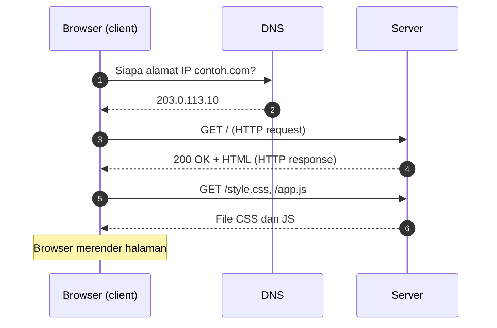

### Cara Kerja Browser

Saat HTML diterima, browser:

1. **Mem-parse HTML** menjadi **DOM** (*Document Object Model*, struktur pohon elemen).
2. **Mem-parse CSS** menjadi **CSSOM**.
3. Menggabungkan keduanya menjadi **render tree** (hanya elemen yang tampil).
4. **Layout**: menghitung ukuran dan posisi.
5. **Paint** dan **composite**: menggambar piksel ke layar.
6. Mengeksekusi **JavaScript** yang dapat mengubah DOM lagi.

Karena itu mengubah DOM berarti pekerjaan tambahan bagi browser. Framework seperti Svelte membantu mengubah **hanya bagian yang perlu**.

### HTTP dan HTTPS

**HTTP** (*HyperText Transfer Protocol*) adalah protokol permintaan-respons berbasis teks. **HTTPS** adalah HTTP di atas **TLS**: lalu lintas **dienkripsi**, identitas server **diverifikasi** lewat sertifikat, dan data tidak mudah disadap atau diubah di jalan. Produksi **wajib** HTTPS.

**HTTP Request:**

```http
POST /api/todos HTTP/1.1
Host: contoh.com
Content-Type: application/json
Authorization: Bearer eyJhbGciOi...

{"title": "Belajar Svelte"}
```

**HTTP Response:**

```http
HTTP/1.1 201 Created
Content-Type: application/json
Location: /api/todos/42

{"id": 42, "title": "Belajar Svelte", "done": false}
```

Bagian penting: **start line** (method + path / status), **headers** (metadata), baris kosong, lalu **body** (opsional).

### HTTP Methods

| Method | Fungsi | Aman (*safe*)? | Idempoten? | Contoh |
|---|---|---|---|---|
| `GET` | Mengambil sumber daya | Ya | Ya | `GET /todos` |
| `POST` | Membuat / memicu aksi | Tidak | Tidak | `POST /todos` |
| `PUT` | Mengganti seluruh sumber daya | Tidak | Ya | `PUT /todos/42` |
| `PATCH` | Mengubah sebagian | Tidak | Tidak selalu | `PATCH /todos/42` |
| `DELETE` | Menghapus | Tidak | Ya | `DELETE /todos/42` |

*Idempoten* berarti memanggil berkali-kali memberi efek akhir yang sama dengan sekali.

### HTTP Status Codes

| Kelompok | Arti | Contoh |
|---|---|---|
| `1xx` | Informasional | `101 Switching Protocols` (WebSocket) |
| `2xx` | Sukses | `200 OK`, `201 Created`, `204 No Content` |
| `3xx` | Pengalihan | `301 Moved Permanently`, `302 Found`, `303 See Other`, `304 Not Modified` |
| `4xx` | Kesalahan klien | `400 Bad Request`, `401 Unauthorized`, `403 Forbidden`, `404 Not Found`, `409 Conflict`, `422 Unprocessable Content`, `429 Too Many Requests` |
| `5xx` | Kesalahan server | `500 Internal Server Error`, `502 Bad Gateway`, `503 Service Unavailable`, `504 Gateway Timeout` |

### JSON

**JSON** (*JavaScript Object Notation*) adalah format pertukaran data berbasis teks. Tipe yang didukung: string, number, boolean, `null`, array, dan objek. Kunci **harus** berupa string berkutip ganda; tidak boleh ada komentar atau koma di akhir.

```json
{
  "id": 1,
  "nama": "Dina",
  "aktif": true,
  "skor": [90, 85],
  "alamat": { "kota": "Bandung" },
  "catatan": null
}
```

```js
const teks = JSON.stringify({ a: 1 });   // objek -> string
const objek = JSON.parse(teks);          // string -> objek
```

### REST API

**REST** adalah gaya arsitektur API di atas HTTP dengan prinsip: sumber daya diidentifikasi lewat **URL (kata benda)**, aksi lewat **HTTP method**, komunikasi **stateless** (tiap request membawa informasi yang dibutuhkan), dan representasi umumnya JSON.

| Aksi | Request | Respons umum |
|---|---|---|
| Daftar | `GET /todos?done=false&page=2` | `200` + array |
| Detail | `GET /todos/42` | `200` / `404` |
| Buat | `POST /todos` | `201` + objek baru |
| Ubah | `PATCH /todos/42` | `200` |
| Hapus | `DELETE /todos/42` | `204` |

### Domain dan DNS

**Domain** (`contoh.com`) adalah nama yang mudah diingat untuk alamat IP. **DNS** (*Domain Name System*) menerjemahkan nama ke alamat IP.

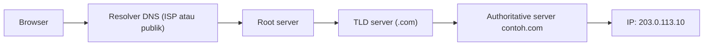

| Record | Fungsi |
|---|---|
| `A` / `AAAA` | Nama → alamat IPv4 / IPv6 |
| `CNAME` | Alias ke nama lain |
| `MX` | Server email |
| `TXT` | Teks bebas (verifikasi domain, SPF) |

### Web Hosting

| Jenis | Ciri | Cocok untuk |
|---|---|---|
| **Static hosting / CDN** (Netlify, Cloudflare Pages, GitHub Pages) | Hanya file statis, cepat, murah | Situs statis, SPA |
| **PaaS** (Vercel, Render, Fly.io) | Deploy dari Git, server dikelola | Aplikasi full-stack |
| **Serverless / edge** | Fungsi dijalankan saat dibutuhkan | API ringan, SSR di edge |
| **VPS** | Server virtual yang kamu kelola sendiri | Kendali penuh, biaya prediktabel |

## 0.2 HTML

**HTML** (*HyperText Markup Language*) mendefinisikan **struktur dan makna** konten. Dasar semua halaman web.

### Struktur Dasar, Elemen, dan Atribut

```html
<!DOCTYPE html>
<html lang="id">
  <head>
    <meta charset="UTF-8" />
    <meta name="viewport" content="width=device-width, initial-scale=1" />
    <title>Halaman Pertamaku</title>
    <link rel="stylesheet" href="style.css" />
  </head>
  <body>
    <h1>Halo, Dunia!</h1>
    <script src="app.js" defer></script>
  </body>
</html>
```

- **Elemen** = tag pembuka + konten + tag penutup (`<p>teks</p>`); ada elemen kosong seperti `` dan `<br>`.
- **Atribut** = informasi tambahan pada tag pembuka: `<a href="/tentang" class="tautan">`.
- Elemen **blok** (`div`, `p`, `h1`) membentuk baris baru; elemen **inline** (`span`, `a`, `strong`) mengalir dalam teks.

### Heading, Paragraph, Anchor, Image, List, Table

```html
<h1>Judul utama (satu per halaman)</h1>
<h2>Subjudul</h2>
<p>Paragraf berisi <strong>penekanan kuat</strong> dan <em>miring</em>.</p>

<a href="https://svelte.dev" target="_blank" rel="noopener noreferrer">Situs Svelte</a>


<ul>
  <li>Daftar tak berurut</li>
  <li>Item kedua</li>
</ul>
<ol>
  <li>Daftar berurut</li>
</ol>

<table>
  <caption>Nilai Mahasiswa</caption>
  <thead><tr><th scope="col">Nama</th><th scope="col">Nilai</th></tr></thead>
  <tbody>
    <tr><td>Dina</td><td>90</td></tr>
    <tr><td>Budi</td><td>85</td></tr>
  </tbody>
</table>
```

Catatan: heading disusun **berurutan tanpa melompat level**; atribut `alt` **wajib** dan deskriptif (kosongkan `alt=""` untuk gambar dekoratif); tautan `target="_blank"` sebaiknya menyertakan `rel="noopener noreferrer"`; tabel hanya untuk **data tabular**, bukan tata letak.

### Forms dan Input

```html
<form action="/daftar" method="post">
  <label for="nama">Nama lengkap</label>
  <input id="nama" name="nama" type="text" required minlength="3" autocomplete="name" />

  <label for="email">Email</label>
  <input id="email" name="email" type="email" required autocomplete="email" />

  <label for="umur">Umur</label>
  <input id="umur" name="umur" type="number" min="17" max="120" />

  <label for="kota">Kota</label>
  <select id="kota" name="kota">
    <option value="bdg">Bandung</option>
    <option value="jkt">Jakarta</option>
  </select>

  <fieldset>
    <legend>Jenis kelamin</legend>
    <label><input type="radio" name="jk" value="p" /> Pria</label>
    <label><input type="radio" name="jk" value="w" /> Wanita</label>
  </fieldset>

  <label><input type="checkbox" name="setuju" required /> Saya setuju syarat dan ketentuan</label>

  <textarea name="pesan" rows="4" placeholder="Pesan"></textarea>
  <button type="submit">Kirim</button>
</form>
```

Tipe input umum: `text`, `email`, `password`, `number`, `date`, `tel`, `url`, `checkbox`, `radio`, `file`, `range`, `search`. Validasi bawaan: `required`, `min`, `max`, `minlength`, `maxlength`, `pattern`. **Validasi HTML tidak menggantikan validasi di server.**

### Semantic HTML dan HTML5

**Semantic HTML** memakai elemen yang **bermakna**, bukan `div` untuk semuanya. Manfaatnya: aksesibilitas (pembaca layar memahami struktur), SEO, dan keterbacaan.

```html
<header><nav aria-label="Utama">...</nav></header>
<main>
  <article>
    <h1>Judul artikel</h1>
    <section><h2>Bagian</h2>...</section>
  </article>
  <aside>Konten pendamping</aside>
</main>
<footer>© 2026</footer>
```

| Elemen | Makna |
|---|---|
| `header` / `footer` | Kepala / kaki halaman atau bagian |
| `nav` | Navigasi utama |
| `main` | Konten utama (satu per halaman) |
| `article` | Konten mandiri (artikel, kartu produk) |
| `section` | Bagian bertema dengan heading |
| `aside` | Konten pendamping |
| `button` | Aksi (bukan `div onclick`) |

Fitur **HTML5** lain: `<video>`, `<audio>`, `<canvas>`, `<dialog>`, `<details>`/`<summary>`, `localStorage`, tipe input baru, dan API (Geolocation, Drag and Drop, Web Workers).

### Accessibility Dasar

- Gunakan **elemen semantik** dan **label** pada setiap input.
- **Teks alternatif** pada gambar bermakna.
- Pastikan seluruh fungsi dapat dipakai dengan **keyboard** (Tab, Enter, Esc) dan **fokus terlihat jelas**.
- **Kontras warna** memadai (rasio 4,5:1 untuk teks normal menurut WCAG).
- Gunakan `aria-*` **hanya bila elemen semantik tidak cukup** ("tidak ada ARIA lebih baik daripada ARIA salah").
- Uji dengan pembaca layar dan *Lighthouse accessibility audit*.

## 0.3 CSS

**CSS** (*Cascading Style Sheets*) mengatur **tampilan**.

### Syntax, Selector, dan Specificity

```css
selector {
  property: value;   /* deklarasi */
}

p { color: #333; }                 /* elemen */
.kartu { padding: 1rem; }          /* class */
#header { height: 60px; }          /* id */
a[target="_blank"] { color: red; } /* atribut */
ul > li { margin: 0; }             /* anak langsung */
h2 + p { margin-top: 0; }          /* saudara berikutnya */
```

**Specificity** menentukan aturan mana yang menang saat bentrok (dari lemah ke kuat): selector elemen < class/atribut/pseudo-class < id < `style` inline < `!important`. Bila setara, **yang paling akhir** menang. Hindari `!important` dan selector terlalu spesifik; andalkan class sederhana.

### Box Model

Setiap elemen adalah kotak: **content → padding → border → margin**.

```css
*, *::before, *::after { box-sizing: border-box; }   /* lebar/tinggi sudah termasuk padding dan border */

.kotak {
  width: 300px;
  padding: 16px;          /* ruang di dalam border */
  border: 2px solid #ccc;
  margin: 24px auto;      /* ruang di luar; auto pada kiri-kanan = tengah */
}
```

Shorthand `margin: atas kanan bawah kiri`; dua nilai = `vertikal horizontal`. Margin vertikal antar elemen blok bisa **menyatu** (*margin collapse*).

### Display dan Position

| `display` | Perilaku |
|---|---|
| `block` | Memenuhi lebar, baris baru |
| `inline` | Mengalir dalam teks; tanpa width/height |
| `inline-block` | Inline tetapi bisa diberi ukuran |
| `none` | Tidak dirender |
| `flex`, `grid` | Mengaktifkan tata letak fleksibel (di bawah) |

| `position` | Perilaku |
|---|---|
| `static` | Default, alur normal |
| `relative` | Tetap di alur; bisa digeser; menjadi acuan anak `absolute` |
| `absolute` | Keluar dari alur; diposisikan terhadap leluhur ber-position terdekat |
| `fixed` | Terhadap viewport; tidak ikut scroll |
| `sticky` | Normal sampai ambang scroll, lalu menempel |

### Flexbox (Satu Dimensi)

```css
.bar {
  display: flex;
  justify-content: space-between;  /* sumbu utama */
  align-items: center;             /* sumbu silang */
  gap: 1rem;
  flex-wrap: wrap;
}
.bar .tumbuh { flex: 1; }          /* mengisi sisa ruang */
```

### CSS Grid (Dua Dimensi)

```css
.galeri {
  display: grid;
  grid-template-columns: repeat(auto-fill, minmax(220px, 1fr));  /* responsif tanpa media query */
  gap: 1rem;
}
.layout {
  display: grid;
  grid-template-areas:
    "header header"
    "sidebar main"
    "footer footer";
  grid-template-columns: 220px 1fr;
}
.layout > header { grid-area: header; }
```

Aturan praktis: **Flexbox** untuk satu baris/kolom (navbar, tombol berjajar); **Grid** untuk tata letak halaman dan kartu dua dimensi.

### Responsive Design dan Media Queries

Pendekatan **mobile-first**: tulis gaya untuk layar kecil, lalu tambah untuk layar lebih besar.

```html
<meta name="viewport" content="width=device-width, initial-scale=1" />
```

```css
.kartu-grid { display: grid; gap: 1rem; grid-template-columns: 1fr; }

@media (min-width: 640px)  { .kartu-grid { grid-template-columns: repeat(2, 1fr); } }
@media (min-width: 1024px) { .kartu-grid { grid-template-columns: repeat(4, 1fr); } }

@media (prefers-color-scheme: dark)   { :root { --bg: #111; --fg: #eee; } }
@media (prefers-reduced-motion: reduce) { * { animation: none !important; transition: none !important; } }
```

Gunakan satuan relatif (`rem`, `%`, `vw`, `fr`), `clamp()` untuk tipografi fluid (`font-size: clamp(1rem, 2.5vw, 1.5rem)`), dan gambar `max-width: 100%`.

### CSS Variables

```css
:root {
  --warna-utama: #ff3e00;
  --jarak: 1rem;
}
.tombol {
  background: var(--warna-utama);
  padding: var(--jarak, 0.5rem);      /* nilai cadangan */
}
.tema-gelap { --warna-utama: #ff7a45; }   /* override dalam cakupan tertentu */
```

Variabel CSS bersifat **dinamis** (bisa diubah JavaScript dan mengikuti pewarisan), sehingga jadi dasar sistem tema, dan nanti sangat berguna di Svelte.

### Animation dan Transition

```css
.tombol { transition: transform 0.2s ease, background 0.2s ease; }
.tombol:hover { transform: translateY(-2px); }

@keyframes berdenyut {
  0%, 100% { transform: scale(1); }
  50%      { transform: scale(1.1); }
}
.badge { animation: berdenyut 1.5s ease-in-out infinite; }
```

Animasikan properti yang murah (**`transform`** dan **`opacity`**) agar mulus; hindari menganimasikan `width`/`top` yang memicu layout.

### Pseudo-class dan Pseudo-element

```css
a:hover, a:focus-visible { text-decoration: underline; }
li:nth-child(odd) { background: #f5f5f5; }
input:invalid { border-color: crimson; }
button:disabled { opacity: 0.5; }

.catatan::before { content: "ℹ "; }       /* pseudo-element */
p::first-line { font-weight: 600; }
```

Pseudo-class (satu titik dua) memilih **keadaan**; pseudo-element (dua titik dua) memilih **bagian** elemen.

## 0.4 Tools Development

| Tool | Fungsi dan catatan |
|---|---|
| **Node.js** | Runtime JavaScript di luar browser; dibutuhkan semua tooling modern. Pasang versi **LTS**; kelola banyak versi dengan `nvm` atau `fnm`. |
| **npm** | Package manager bawaan Node |
| **pnpm** | Alternatif lebih hemat disk dan cepat (`corepack enable` lalu `pnpm -v`) |
| **Git** | Version control lokal |
| **GitHub** | Hosting repositori, kolaborasi, Pull Request, CI |
| **DevTools** | Inspeksi dan debugging di browser |
| **Editor** | VS Code (ekstensi **Svelte for VS Code**) atau Neovim (language server `svelte` dan parser Tree-sitter `svelte`) |
| **Terminal** | Antarmuka baris perintah |

**Perintah npm dan pnpm:**

| Tujuan | npm | pnpm |
|---|---|---|
| Pasang semua dependensi | `npm install` | `pnpm install` |
| Tambah paket | `npm install zod` | `pnpm add zod` |
| Tambah paket dev | `npm install -D vitest` | `pnpm add -D vitest` |
| Jalankan skrip | `npm run dev` | `pnpm dev` |
| Jalankan paket sekali pakai | `npx sv create app` | `pnpm dlx sv create app` |

**Git dasar:**

```bash
git init
git add .
git commit -m "feat: halaman pertama"
git branch -M main
git remote add origin https://github.com/USERNAME/proyek.git
git push -u origin main

git switch -c fitur/navbar     # cabang baru
git switch main && git merge fitur/navbar
git status && git log --oneline
```

**Browser DevTools** (tekan `F12`): tab *Elements* (DOM dan CSS), *Console* (log dan error), *Network* (request dan respons, waktu muat), *Sources* (debugger dan breakpoint), *Performance*, *Lighthouse*, *Application* (storage, cookie, service worker).

**Terminal dasar:**

| Perintah | Fungsi |
|---|---|
| `pwd` / `ls` / `cd dir` | Lokasi / isi / pindah folder |
| `mkdir x` / `touch f` | Buat folder / file |
| `cp`, `mv`, `rm -r` | Salin, pindah/ganti nama, hapus |
| `cat f` / `less f` | Lihat isi file |
| `echo $PATH` | Lihat variabel lingkungan |

## Project Level 0

1. **Personal Portfolio (HTML + CSS):** header dengan navigasi, bagian *tentang*, daftar proyek (kartu dengan CSS Grid), kontak. Gunakan HTML semantik dan CSS variables.
2. **Responsive Landing Page:** hero, fitur (grid 1/2/3 kolom), testimoni, CTA; mobile-first, tanpa library.
3. **Form Registrasi:** nama, email, password, kota, persetujuan; validasi bawaan HTML; gaya status `:invalid`/`:focus-visible`.

Cuplikan CSS untuk kartu responsif pada proyek 1:

```css
.proyek-grid {
  display: grid;
  gap: 1.25rem;
  grid-template-columns: repeat(auto-fill, minmax(260px, 1fr));
}
.proyek-kartu {
  border: 1px solid color-mix(in srgb, currentColor 15%, transparent);
  border-radius: 12px;
  padding: 1.25rem;
  transition: transform 0.2s ease, box-shadow 0.2s ease;
}
.proyek-kartu:hover { transform: translateY(-4px); box-shadow: 0 8px 24px rgb(0 0 0 / 0.12); }
```

## Target Kompetensi Level 0

- [ ] Menjelaskan alur request-response, DNS, dan peran HTTP/HTTPS.
- [ ] Menulis halaman HTML semantik dan form yang aksesibel.
- [ ] Menata tampilan responsif dengan Flexbox, Grid, dan media query.
- [ ] Memakai Node, npm/pnpm, Git, GitHub, dan DevTools dengan nyaman.

---

# LEVEL 1: Fundamental JavaScript Modern

**Tujuan:** memahami JavaScript sebagai bahasa utama yang dipakai Svelte. Semua kode di komponen Svelte adalah JavaScript (atau TypeScript) biasa.

## 1.1 JavaScript Basic

### Variable, Data Types, dan Operators

```js
const nama = 'Dina';        // tidak bisa di-assign ulang
let umur = 20;              // bisa diubah
umur = 21;
// var: lama, hindari (cakupan fungsi, hoisting membingungkan)
```

| Tipe | Contoh | Catatan |
|---|---|---|
| `number` | `42`, `3.14`, `NaN`, `Infinity` | Semua angka berupa float 64-bit |
| `bigint` | `123n` | Bilangan bulat besar |
| `string` | `'a'`, `"b"`, `` `c` `` | Immutable |
| `boolean` | `true`, `false` | |
| `undefined` | `undefined` | Belum diberi nilai |
| `null` | `null` | Ketiadaan nilai yang disengaja |
| `symbol` | `Symbol('id')` | Pengenal unik |
| `object` | `{}`, `[]`, `function(){}` | Semua yang bukan primitif |

```js
typeof 42;            // 'number'
typeof 'x';           // 'string'
typeof null;          // 'object' (bug historis)
Array.isArray([]);    // true
```

**Primitive vs Reference types:** primitif disalin **berdasarkan nilai**; objek dan array disalin **berdasarkan referensi**. Konsep ini sangat penting untuk memahami reaktivitas dan mutasi state.

```js
let a = 1; let b = a; b = 2;
console.log(a);                 // 1  (terpisah)

const x = { n: 1 }; const y = x; y.n = 2;
console.log(x.n);               // 2  (objek yang sama)
```

**Operators:** aritmatika (`+ - * / % **`), perbandingan (`=== !== < >`; **selalu pakai `===`**, bukan `==`), logika (`&& || !`), penugasan (`+= -= ??=`), ternary (`kond ? a : b`).

**Truthy/falsy:** nilai falsy hanya `false`, `0`, `-0`, `0n`, `''`, `null`, `undefined`, `NaN`. Sisanya truthy (termasuk `[]` dan `{}`).

### Conditional dan Looping

```js
if (skor >= 85) grade = 'A';
else if (skor >= 70) grade = 'B';
else grade = 'C';

switch (hari) {
  case 'sabtu':
  case 'minggu': console.log('libur'); break;
  default: console.log('kerja');
}

for (let i = 0; i < 3; i++) console.log(i);
let n = 3; while (n--) console.log(n);
for (const buah of ['apel', 'jeruk']) console.log(buah);   // nilai iterable
for (const kunci in { a: 1, b: 2 }) console.log(kunci);    // kunci objek
```

### Function, Arrow Function, Scope, Hoisting, Closure

```js
function jumlah(a, b = 0) { return a + b; }      // deklarasi (di-hoist penuh)
const kali = function (a, b) { return a * b; };  // ekspresi
const kurang = (a, b) => a - b;                  // arrow function
const kuadrat = (x) => x * x;                    // satu ekspresi: return implisit
const buatObj = () => ({ ok: true });            // mengembalikan objek: bungkus kurung
```

**Scope:** `let`/`const` berlaku di **blok** `{}`; `var` di fungsi. Variabel di scope luar terlihat dari dalam (*lexical scope*).

**Hoisting:** deklarasi "diangkat" ke atas scope. `var` terangkat dengan nilai `undefined`; `let`/`const` terangkat tetapi berada di *temporal dead zone* (mengaksesnya sebelum deklarasi menghasilkan error); deklarasi `function` terangkat lengkap.

```js
console.log(a);   // undefined (var)
var a = 1;
// console.log(b); // ReferenceError (let di TDZ)
let b = 2;
sapa();           // jalan, deklarasi function di-hoist
function sapa() { console.log('halo'); }
```

**Closure:** function yang "mengingat" variabel dari scope tempat ia dibuat, bahkan setelah scope itu selesai.

```js
function buatCounter() {
  let hitung = 0;
  return () => ++hitung;     // menutup (close over) variabel hitung
}
const c = buatCounter();
c(); c();                    // 1, 2
```

Closure muncul di mana-mana pada Svelte: event handler, `$effect`, dan fungsi di dalam komponen semuanya menutup variabel komponen.

## 1.2 JavaScript Data Structures

### Array dan Array Methods

```js
const angka = [1, 2, 3, 4, 5];
angka.push(6); angka.pop(); angka.length;     // mutasi (mengubah array asli)

angka.map((n) => n * 2);                       // [2,4,6,8,10]   -> array baru
angka.filter((n) => n % 2 === 0);              // [2,4]
angka.reduce((total, n) => total + n, 0);      // 15
angka.find((n) => n > 3);                      // 4 (elemen pertama)
angka.some((n) => n > 4);                      // true
angka.every((n) => n > 0);                     // true
angka.forEach((n) => console.log(n));          // tanpa return
angka.includes(3); angka.indexOf(3);
angka.slice(1, 3);                             // [2,3] salinan sebagian
[...angka].sort((a, b) => b - a);              // urut menurun pada SALINAN
```

Metode tak-mengubah (`map`, `filter`, `slice`, `toSorted`, `toSpliced`, `with`) memudahkan pola *immutable*; metode yang mengubah (`push`, `splice`, `sort`, `reverse`) memodifikasi array asli. Pada Svelte 5 keduanya aman dipakai dengan `$state` (dibahas di Level 4).

### Object dan Object Methods

```js
const user = { id: 1, nama: 'Sari', kota: 'Bandung', 'kunci-khusus': true };
user.nama;  user['kunci-khusus'];

Object.keys(user);        // ['id','nama','kota','kunci-khusus']
Object.values(user);
Object.entries(user);     // [['id',1], ['nama','Sari'], ...]
Object.fromEntries([['a', 1], ['b', 2]]);   // { a:1, b:2 }
Object.assign({}, user, { kota: 'Jakarta' });
structuredClone(user);    // salinan dalam (deep copy)
```

### Destructuring, Spread, Rest, Optional Chaining, Nullish Coalescing, Template Literals

```js
const { nama, kota = 'Tidak diketahui' } = user;        // destructuring objek
const [pertama, , ketiga] = [10, 20, 30];               // destructuring array
const { alamat: { jalan } = {} } = user;                // bersarang + default

const salin = { ...user, kota: 'Jakarta' };             // spread objek (salinan dangkal)
const gabung = [...[1, 2], ...[3, 4]];                  // spread array

function total(...angka) { return angka.reduce((a, b) => a + b, 0); }   // rest parameters
const { id, ...sisa } = user;                           // rest pada objek

user.alamat?.kota;                                      // optional chaining: undefined, bukan error
user.getNama?.();                                       // panggil jika ada
const port = config.port ?? 3000;                       // ?? hanya untuk null/undefined
const p2 = config.port || 3000;                         // || juga mengganti 0 dan '' (hati-hati)

const pesan = `Halo, ${nama}! 2 + 3 = ${2 + 3}`;        // template literal
```

## 1.3 JavaScript Advanced

### ES Modules: Import dan Export

```js
// util.js
export const PI = 3.14;
export function luas(r) { return PI * r * r; }
export default function sapa(n) { return `Halo ${n}`; }

// main.js
import sapa, { PI, luas as hitungLuas } from './util.js';
import * as util from './util.js';
const modul = await import('./berat.js');       // dynamic import (lazy load)
```

Modul punya scope sendiri, dieksekusi sekali, dan dipakai bersama oleh seluruh pengimpor. SvelteKit dan Vite memakai ES Modules sepenuhnya.

### Promise, Async/Await, Error Handling

```js
const tunggu = (ms) => new Promise((resolve) => setTimeout(resolve, ms));

tunggu(500).then(() => console.log('selesai')).catch(console.error).finally(() => {});

async function ambilUser(id) {
  try {
    const res = await fetch(`https://jsonplaceholder.typicode.com/users/${id}`);
    if (!res.ok) throw new Error(`HTTP ${res.status}`);   // fetch tidak melempar untuk 4xx/5xx
    return await res.json();
  } catch (err) {
    console.error('Gagal:', err.message);
    throw err;                                            // lempar ulang bila pemanggil perlu tahu
  } finally {
    console.log('selalu dijalankan');
  }
}

const [a, b] = await Promise.all([ambilUser(1), ambilUser(2)]);   // paralel
const hasil = await Promise.allSettled([ambilUser(1), ambilUser(999)]);  // tunggu semua, tanpa gagal total
const tercepat = await Promise.race([ambilUser(1), tunggu(3000)]);
```

Error handling: `throw new Error('pesan')`, `try/catch/finally`, subclass `class ValidationError extends Error {}` untuk jenis error khusus.

### Event Loop, Call Stack, Microtask dan Macrotask

JavaScript **single-threaded**. **Call stack** mengeksekusi kode sinkron; pekerjaan asinkron (timer, jaringan) ditangani browser/runtime lalu callback-nya masuk antrean. **Event loop** memindahkan callback ke stack saat stack kosong.

- **Microtask**: callback `Promise.then`, `await`, `queueMicrotask`. Dijalankan **setelah** kode sinkron saat ini selesai, **sebelum** macrotask berikutnya.
- **Macrotask**: `setTimeout`, `setInterval`, event DOM, I/O.

```js
console.log('1 sinkron');
setTimeout(() => console.log('4 macrotask'), 0);
Promise.resolve().then(() => console.log('3 microtask'));
console.log('2 sinkron');
// Urutan: 1, 2, 3, 4
```

Pemahaman ini menjelaskan mengapa pembaruan DOM Svelte "ditunda ke microtask" (dan mengapa ada `tick()`).

### Fetch API dan JSON Processing

```js
const res = await fetch('/api/todos', {
  method: 'POST',
  headers: { 'Content-Type': 'application/json' },
  body: JSON.stringify({ title: 'Belajar' }),
});
if (!res.ok) throw new Error(await res.text());
const data = await res.json();       // juga res.text(), res.blob(), res.formData()
```

### LocalStorage dan SessionStorage

```js
localStorage.setItem('tema', 'gelap');           // bertahan setelah browser ditutup
localStorage.getItem('tema');                    // null bila tidak ada
sessionStorage.setItem('draf', JSON.stringify({ a: 1 }));   // hanya selama tab terbuka
localStorage.removeItem('tema');
```

Hanya menyimpan **string** (gunakan `JSON.stringify/parse`), ±5 MB, sinkron, dan **dapat dibaca skrip apa pun di halaman**, sehingga **jangan simpan rahasia/token sensitif** di sana.

### DOM Manipulation dan Event Handling

```js
const tombol = document.querySelector('#tombol');
const daftar = document.querySelector('ul');

tombol.addEventListener('click', (e) => {
  const li = document.createElement('li');
  li.textContent = 'Item baru';
  daftar.append(li);
});

// event delegation: satu listener untuk banyak anak
daftar.addEventListener('click', (e) => {
  const item = e.target.closest('li');
  if (item) item.classList.toggle('selesai');
});

form.addEventListener('submit', (e) => {
  e.preventDefault();                       // cegah perilaku bawaan
  const data = Object.fromEntries(new FormData(form));
});
```

Event *bubbling* (naik ke leluhur) dan `e.stopPropagation()` akan terus muncul di Svelte.

## 1.4 TypeScript (Direkomendasikan)

TypeScript menambah **tipe statis** pada JavaScript; tipe **dihapus** saat kompilasi. Svelte dan SvelteKit mendukungnya penuh (`<script lang="ts">`).

```ts
// Anotasi dan tipe primitif
let nama: string = 'Dina';
let umur: number = 20;
let aktif: boolean = true;
let tak: null | undefined;

// Array dan objek
const angka: number[] = [1, 2, 3];
const pasangan: [string, number] = ['a', 1];          // tuple
const user: { id: number; nama: string; email?: string } = { id: 1, nama: 'Sari' };

// Interface vs type alias
interface Todo { id: number; title: string; done: boolean }
type ID = string | number;
type Pengguna = { id: ID; peran: 'admin' | 'user' };   // literal types

// Union dan intersection
type Hasil = { ok: true; data: Todo } | { ok: false; error: string };
type Bertanda = Todo & { createdAt: Date };

// Generics
function pertama<T>(arr: T[]): T | undefined { return arr[0]; }
const p = pertama([1, 2, 3]);                           // T disimpulkan: number

interface Respons<T> { data: T; status: number }
```

**Utility types** yang sering dipakai:

| Utility | Hasil |
|---|---|
| `Partial<T>` | Semua properti opsional |
| `Required<T>` | Semua properti wajib |
| `Readonly<T>` | Semua properti read-only |
| `Pick<T, Keys>` | Ambil sebagian properti (mis. `Pick<Todo, 'id'>`) |
| `Omit<T, 'a'>` | Buang sebagian properti |
| `Record<K, V>` | Objek dengan kunci K dan nilai V |
| `ReturnType<typeof fn>` | Tipe kembalian fungsi |

**Type narrowing dan type guards:**

```ts
function proses(x: string | number) {
  if (typeof x === 'string') return x.toUpperCase();   // narrowing: di sini x adalah string
  return x.toFixed(2);                                 // di sini number
}

function adalahTodo(v: unknown): v is Todo {           // user-defined type guard
  return typeof v === 'object' && v !== null && 'title' in v;
}

function tangani(h: Hasil) {
  if (h.ok) console.log(h.data.title);                 // discriminated union
  else console.error(h.error);
}
```

Gunakan `unknown` (bukan `any`) untuk nilai yang belum diketahui, lalu persempit. Aktifkan `"strict": true` di `tsconfig.json`.

TypeScript dengan modul: `import type { Todo } from './tipe';` (impor hanya tipe, dihapus saat build) dan `export type { Todo };`.

## Project Level 1

### 1. Todo List (Vanilla JavaScript)

```html
<form id="form"><input id="judul" placeholder="Tugas baru" required /><button>Tambah</button></form>
<ul id="daftar"></ul>
<script type="module">
  const form = document.querySelector('#form');
  const input = document.querySelector('#judul');
  const daftar = document.querySelector('#daftar');
  let todos = JSON.parse(localStorage.getItem('todos') ?? '[]');

  function simpan() { localStorage.setItem('todos', JSON.stringify(todos)); }

  function render() {
    daftar.innerHTML = '';
    for (const t of todos) {
      const li = document.createElement('li');
      li.dataset.id = t.id;
      li.innerHTML = `<label><input type="checkbox" ${t.done ? 'checked' : ''} /> <span></span></label>
                      <button data-hapus>Hapus</button>`;
      li.querySelector('span').textContent = t.title;     // textContent: aman dari XSS
      if (t.done) li.style.textDecoration = 'line-through';
      daftar.append(li);
    }
  }

  form.addEventListener('submit', (e) => {
    e.preventDefault();
    todos.push({ id: crypto.randomUUID(), title: input.value.trim(), done: false });
    input.value = ''; simpan(); render();
  });

  daftar.addEventListener('click', (e) => {
    const id = e.target.closest('li')?.dataset.id;
    if (!id) return;
    if (e.target.matches('[data-hapus]')) todos = todos.filter((t) => t.id !== id);
    else if (e.target.matches('input[type=checkbox]')) {
      todos = todos.map((t) => (t.id === id ? { ...t, done: !t.done } : t));
    }
    simpan(); render();
  });

  render();
</script>
```

Perhatikan betapa banyak kode **manual** untuk menyinkronkan data dan DOM (`render()` dipanggil di mana-mana). Itulah masalah yang diselesaikan Svelte di Level 2.

### 2. Weather Application (Fetch API)

Memakai API Open-Meteo (gratis, tanpa kunci) untuk geocoding dan prakiraan.

```js
async function cuaca(kota) {
  const geo = await (await fetch(
    `https://geocoding-api.open-meteo.com/v1/search?name=${encodeURIComponent(kota)}&count=1&language=id`
  )).json();
  const lokasi = geo.results?.[0];
  if (!lokasi) throw new Error('Kota tidak ditemukan');

  const url = new URL('https://api.open-meteo.com/v1/forecast');
  url.search = new URLSearchParams({
    latitude: lokasi.latitude,
    longitude: lokasi.longitude,
    current: 'temperature_2m,wind_speed_10m',
  });
  const data = await (await fetch(url)).json();
  return { kota: lokasi.name, suhu: data.current.temperature_2m, angin: data.current.wind_speed_10m };
}

cuaca('Bandung').then(console.log).catch((e) => console.error(e.message));
```

Tantangan: tampilkan *loading* dan error di UI, simpan kota terakhir di `localStorage`.

### 3. CRUD Application (REST API)

Gunakan `https://jsonplaceholder.typicode.com/posts` (API palsu untuk latihan: perubahan tidak benar-benar tersimpan). Implementasikan daftar, tambah, ubah (`PUT`/`PATCH`), dan hapus (`DELETE`), lengkap dengan penanganan `res.ok`.

### 4. Dashboard Sederhana (JavaScript)

Kartu ringkasan (total, rata-rata, terbesar) dihitung dari array data dengan `reduce`/`map`, tabel yang dapat diurutkan dan difilter, serta grafik batang sederhana memakai `div` atau `<canvas>`.

## Target Kompetensi Level 1

- [ ] Memakai `let/const`, function, closure, dan memahami scope serta hoisting.
- [ ] Mengolah data dengan array methods, destructuring, spread, dan optional chaining.
- [ ] Menulis kode asinkron dengan Promise dan `async/await`, termasuk error handling.
- [ ] Menjelaskan event loop dan perbedaan microtask/macrotask.
- [ ] Membaca dan menulis TypeScript dasar (interface, union, generics, narrowing).

---

# LEVEL 2: Pengenalan Svelte

**Tujuan:** memahami konsep dasar Svelte dan bagaimana ia berbeda dari framework frontend lain.

## 2.1 Pengenalan Svelte

### Apa itu Svelte?

**Svelte** adalah framework (sekaligus *compiler*) untuk membangun antarmuka pengguna. Kamu menulis komponen dalam file `.svelte` yang tampak seperti HTML biasa dengan sedikit tambahan, lalu **compiler Svelte mengubahnya menjadi JavaScript murni yang efisien** saat build.

```svelte
<script>
  let count = $state(0);
</script>

<button onclick={() => count++}>
  Diklik {count} kali
</button>
```

Hanya itu satu komponen utuh: state, markup, dan perilaku.

### Sejarah Singkat

| Tahun | Peristiwa |
|---|---|
| 2016 | **Rich Harris** merilis Svelte (v1), terinspirasi pengalamannya membuat visualisasi interaktif di media berita |
| 2019 | **Svelte 3**: reaktivitas berbasis penugasan (`count += 1`) yang membuat Svelte populer |
| 2020–2022 | Pengembangan **SvelteKit** (framework aplikasi); Rich Harris bergabung dengan Vercel |
| 2022–2023 | **SvelteKit 1.0** (Des 2022) dan **Svelte 4** (2023) |
| 2024 | **Svelte 5** stabil (Okt 2024): **Runes**, snippets, atribut event; **SvelteKit 2** sudah hadir sejak akhir 2023 |

### Filosofi Svelte

- **Tulis lebih sedikit kode**: sedikit *boilerplate*, komponen terbaca seperti HTML/CSS/JS standar.
- **Kerjakan di waktu kompilasi, bukan di browser**: sebagian besar kerja framework dipindahkan ke tahap build sehingga yang dikirim ke browser kecil dan cepat. Karena itu Svelte sering disebut *"disappearing framework"* (kerangkanya "menghilang" setelah dikompilasi).
- **Tanpa Virtual DOM**: Svelte tidak membandingkan dua pohon virtual; ia menghasilkan kode yang **langsung memperbarui bagian DOM yang bergantung pada state yang berubah**.
- **Fitur bawaan**: scoped CSS, transisi/animasi, store, dan binding tersedia tanpa library tambahan.

### Cara Kerja Svelte Compiler

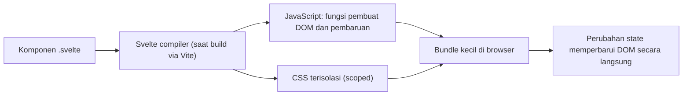

Compiler menganalisis komponenmu, mengetahui **state mana dipakai di mana**, dan menghasilkan kode pembaruan yang tepat sasaran. Pada Svelte 5, pelacakan itu memakai sistem **signals** (*fine-grained reactivity*) yang akan kamu pelajari di Level 4.

### Svelte vs React, Vue, dan Angular

| Aspek | **Svelte** | **React** | **Vue** | **Angular** |
|---|---|---|---|---|
| Jenis | Compiler + framework | Library UI | Framework progresif | Framework lengkap |
| Template | HTML + `{ }` | JSX | HTML-based | HTML + direktif |
| Reaktivitas | Signals via Runes (`$state`) | State + render ulang (`useState`) | Proxy (`ref`, `reactive`) | Signals / RxJS |
| Virtual DOM | Tidak | Ya | Ya (dioptimasi) | Tidak (incremental DOM) |
| Update | Langsung ke DOM terkait | Render ulang komponen lalu *diff* | Render ulang terkontrol | Change detection |
| CSS | Scoped bawaan | Pilihan eksternal | Scoped bawaan (SFC) | View encapsulation |
| Kurva belajar | Landai | Sedang | Landai | Curam |
| Framework aplikasi | **SvelteKit** | Next.js, Remix | Nuxt | Angular CLI/SSR bawaan |
| Bahasa | JS/TS | JS/TS (JSX) | JS/TS | TypeScript |

Tidak ada yang "terbaik mutlak"; pilih sesuai kebutuhan, tim, dan ekosistem. Konsep komponen, props, state, dan routing yang kamu pelajari di Svelte **dapat dipindahkan** ke framework lain.

### Svelte vs Runtime Framework

| | Runtime framework | Svelte (compiler) |
|---|---|---|
| Pekerjaan utama | Dilakukan di browser (diffing, scheduling) | Dilakukan saat build |
| Ukuran dasar | Library runtime ikut dikirim | Hanya kode yang dipakai (runtime kecil) |
| Kelebihan | Fleksibel dinamis, ekosistem besar | Bundle kecil, update langsung |
| Pertimbangan | Overhead runtime | Kompilasi menjadi bagian alur kerja; ekosistem lebih kecil |

### Svelte 4 vs Svelte 5

| Fitur | Svelte 4 | **Svelte 5** |
|---|---|---|
| State | `let count = 0` (implisit, hanya top-level komponen) | `let count = $state(0)` (eksplisit, bisa di mana saja) |
| Turunan | `$: double = count * 2` | `let double = $derived(count * 2)` |
| Efek samping | `$: { ... }` | `$effect(() => { ... })` |
| Props | `export let name` | `let { name } = $props()` |
| Event DOM | `on:click={fn}` | `onclick={fn}` |
| Event komponen | `createEventDispatcher` | Callback props |
| Konten anak | `<slot />` | `{@render children()}` + snippets |
| Modul | `<script context="module">` | `<script module>` |
| Instansiasi | `new App({ target })` | `mount(App, { target })` |
| Reaktivitas di luar komponen | Hanya stores | `$state` di file `.svelte.js/.ts` |

Sintaks lama masih berjalan di Svelte 5 (mode *legacy*), tetapi **kode baru ditulis dengan Runes**. Panduan migrasi otomatis: `npx sv migrate svelte-5`.

### Konsep Reactive UI

Pemikiran dasarnya: **UI adalah fungsi dari state**, `UI = f(state)`. Kamu tidak memerintahkan "ubah teks elemen ini"; kamu **mengubah state** dan framework memperbarui tampilan.

Pada Todo vanilla (Level 1), kamu memanggil `render()` manual. Pada Svelte:

```svelte
<script>
  let todos = $state([]);
</script>

<ul>
  {#each todos as todo}<li>{todo.title}</li>{/each}
</ul>
<button onclick={() => todos.push({ title: 'Baru' })}>Tambah</button>
```

Tidak ada `render()`: `todos.push` saja sudah cukup.

## 2.2 Instalasi dan Development Environment

### Persiapan

1. Pasang **Node.js LTS** terbaru (cek `node -v`). Periksa versi minimum yang dibutuhkan oleh versi Vite/SvelteKit-mu di dokumentasi resmi.
2. Pilih package manager: `npm` (bawaan) atau `pnpm`.
3. Editor: VS Code + ekstensi **Svelte for VS Code**.

### Opsi A: Svelte + Vite (tanpa SvelteKit), untuk Level 2–8

```bash
npm create vite@latest belajar-svelte -- --template svelte-ts
cd belajar-svelte
npm install
npm run dev          # buka http://localhost:5173
```

Pilih template `svelte` untuk JavaScript atau `svelte-ts` untuk TypeScript. Dengan opsi ini kamu mendapat aplikasi satu halaman (SPA) tanpa routing; cocok untuk fokus ke Svelte itu sendiri.

### Opsi B: SvelteKit via CLI resmi `sv`, untuk Level 9+

```bash
npx sv create belajar-kit
```

CLI interaktif menanyakan template (mis. *SvelteKit minimal*), dukungan TypeScript, dan *add-on* (Prettier, ESLint, Vitest, Playwright, Tailwind CSS, Drizzle, dan lain-lain). Setelahnya:

```bash
cd belajar-kit
npm install
npm run dev -- --open
```

Add-on dapat ditambahkan belakangan dengan `npx sv add` (mis. `npx sv add tailwindcss`).

### Struktur Folder Proyek Svelte + Vite

```text
belajar-svelte/
├── index.html           # titik masuk HTML (memuat src/main.ts)
├── package.json         # dependensi dan skrip
├── vite.config.ts       # konfigurasi Vite
├── svelte.config.js     # konfigurasi Svelte (preprocessor, opsi compiler)
├── tsconfig.json        # konfigurasi TypeScript
├── public/              # aset statis apa adanya
└── src/
    ├── main.ts          # mount aplikasi
    ├── App.svelte       # komponen root
    ├── app.css          # CSS global
    └── lib/             # komponen dan modul buatan sendiri
```

`src/main.ts`:

```ts
import { mount } from 'svelte';
import './app.css';
import App from './App.svelte';

const app = mount(App, { target: document.getElementById('app')! });

export default app;
```

`vite.config.ts` dan `svelte.config.js`:

```ts
// vite.config.ts
import { defineConfig } from 'vite';
import { svelte } from '@sveltejs/vite-plugin-svelte';

export default defineConfig({ plugins: [svelte()] });
```

```js
// svelte.config.js
import { vitePreprocess } from '@sveltejs/vite-plugin-svelte';

export default {
  preprocess: vitePreprocess(),        // memungkinkan TypeScript, SCSS, dll. di komponen
};
```

### Memahami `package.json`

```json
{
  "name": "belajar-svelte",
  "private": true,
  "type": "module",
  "scripts": {
    "dev": "vite",
    "build": "vite build",
    "preview": "vite preview",
    "check": "svelte-check --tsconfig ./tsconfig.json"
  },
  "devDependencies": {
    "@sveltejs/vite-plugin-svelte": "...",
    "svelte": "...",
    "svelte-check": "...",
    "typescript": "...",
    "vite": "..."
  }
}
```

| Bagian | Arti |
|---|---|
| `"type": "module"` | File `.js` diperlakukan sebagai ES Module |
| `scripts` | Perintah yang dijalankan lewat `npm run <nama>` |
| `dependencies` | Paket yang dibutuhkan saat aplikasi berjalan |
| `devDependencies` | Paket untuk pengembangan/build (compiler, tooling) |

### Dev Server dan Production Build

| Perintah | Fungsi |
|---|---|
| `npm run dev` | Dev server dengan **HMR** (Hot Module Replacement): perubahan tampil tanpa muat ulang penuh |
| `npm run build` | Build produksi (minifikasi, tree-shaking, hashing) ke `dist/` |
| `npm run preview` | Menyajikan hasil build secara lokal untuk diuji |
| `npm run check` | Pemeriksaan tipe dan peringatan Svelte |

## 2.3 Svelte Component

### Apa itu Component?

**Komponen** adalah blok UI mandiri yang menggabungkan **markup, logika, dan gaya**, serta dapat dipakai ulang. Aplikasi adalah pohon komponen.

### Struktur File `.svelte`

```svelte
<script lang="ts">
  // 1. LOGIKA: state, fungsi, import
  let nama = $state('Dunia');
</script>

<!-- 2. MARKUP: HTML + ekspresi { } -->
<h1 class="judul">Halo, {nama}!</h1>

<style>
  /* 3. STYLE: otomatis ter-scope ke komponen ini */
  .judul { color: #ff3e00; }
</style>
```

- Ketiga bagian **opsional** dan boleh berurutan apa saja (kebiasaan umum: script, markup, style).
- Markup adalah HTML valid; bagian dinamis memakai kurung kurawal `{ }`.
- CSS di `<style>` **hanya berlaku di komponen itu** (Svelte menambahkan class unik saat kompilasi).
- Nama file komponen diawali **huruf kapital** (`ProductCard.svelte`) agar jelas pemakaiannya sebagai komponen.

### Import dan Komposisi Komponen

```svelte
<!-- ProductCard.svelte -->
<script>
  let { nama, harga } = $props();
</script>

<article class="kartu">
  <h3>{nama}</h3>
  <p>Rp {harga.toLocaleString('id-ID')}</p>
</article>

<style>
  .kartu { border: 1px solid #ddd; padding: 1rem; border-radius: 8px; }
</style>
```

```svelte
<!-- App.svelte -->
<script>
  import ProductCard from './lib/ProductCard.svelte';
</script>

<ProductCard nama="Keyboard" harga={350000} />
<ProductCard nama="Mouse" harga={150000} />
```

Komponen dipakai seperti tag HTML kapital. Nilai non-string dikirim dengan kurung kurawal (`harga={350000}`), sedangkan string literal boleh tanpa (`nama="Keyboard"`).

### Component Reusability dan Composition

Komposisi berarti menyusun komponen kecil menjadi komponen besar (dan mengirim konten ke dalamnya, dibahas di Level 5 lewat *snippets*).

```text
App
└── Dashboard
    ├── Header
    ├── StatCard (x3)
    └── ProductList
        └── ProductCard (xN)
```

### Module Script: Export dan Kode Level Modul

Blok `<script module>` berjalan **sekali per modul** (bukan per instansi komponen) dan dapat mengekspor nilai:

```svelte
<script module>
  let jumlahInstansi = 0;                 // dibagi oleh semua instansi komponen ini
  export const VERSI = '1.0';             // dapat diimpor: import { VERSI } from './X.svelte'
</script>

<script>
  jumlahInstansi += 1;
  let { judul } = $props();
</script>

<h2>{judul} (instansi ke-{jumlahInstansi})</h2>
```

> Pada Svelte 4, penulisannya `<script context="module">`. Pada Svelte 5 gunakan `<script module>`. Pada **mode runes**, export default dari komponen tidak dipakai untuk props; props selalu lewat `$props()`.

## Project Level 2

**1. Hello World**

```svelte
<script>
  let nama = $state('Dunia');
</script>

<input bind:value={nama} placeholder="Nama kamu" />
<h1>Halo, {nama || 'Tamu'}!</h1>
```

**2. Counter Application**

```svelte
<script>
  let count = $state(0);
</script>

<div class="counter">
  <button onclick={() => count--} aria-label="Kurangi">−</button>
  <output>{count}</output>
  <button onclick={() => count++} aria-label="Tambah">+</button>
  <button onclick={() => (count = 0)}>Reset</button>
</div>

<style>
  .counter { display: flex; gap: 0.5rem; align-items: center; }
  output { min-width: 3ch; text-align: center; font-variant-numeric: tabular-nums; }
</style>
```

**3. Simple Profile Card**

```svelte
<!-- ProfileCard.svelte -->
<script>
  let { nama, jabatan, foto, kota = 'Indonesia' } = $props();
</script>

<article class="profil">
  
  <h2>{nama}</h2>
  <p>{jabatan} · {kota}</p>
</article>

<style>
  .profil { text-align: center; padding: 1.5rem; border-radius: 16px; box-shadow: 0 2px 12px rgb(0 0 0 / 0.1); }
  img { border-radius: 50%; object-fit: cover; }
</style>
```

**4. Product Card:** perluas `ProductCard` dengan gambar, harga coret (diskon), badge "Baru" bersyarat (`{#if}`), dan tombol *Tambah ke keranjang*.

**5. Simple Dashboard:** `App.svelte` yang menyusun `Header`, tiga `StatCard`, dan `ProductList` (komponen berbeda); data dummy berupa array di `App.svelte` dikirim lewat props.

## Target Kompetensi Level 2

- [ ] Menjelaskan perbedaan Svelte (compiler) dengan framework berbasis runtime/virtual DOM.
- [ ] Membuat proyek Svelte, menjalankan dev server dan build produksi.
- [ ] Menulis komponen `.svelte` (script, markup, style) dan memakainya ulang.
- [ ] Memahami perbedaan garis besar Svelte 4 dan Svelte 5.

---

# LEVEL 3: Svelte Fundamental

**Tujuan:** menguasai fitur dasar Svelte untuk membangun antarmuka aplikasi.

## 3.1 Template Syntax

### Text Interpolation dan Expression

```svelte
<script>
  let nama = 'Dina';
  let harga = 25000;
</script>

<p>Halo, {nama}!</p>
<p>Total: {harga * 2}</p>
<p>{nama.toUpperCase()} · {harga > 20000 ? 'Mahal' : 'Murah'}</p>
<p>{`Rp ${harga.toLocaleString('id-ID')}`}</p>
```

Di dalam `{ }` boleh **satu ekspresi JavaScript** (bukan statement seperti `if` atau `for`).

### HTML Attributes dan Dynamic Attributes

```svelte
<script>
  let url = 'https://svelte.dev';
  let gambar = '/kucing.jpg';
  let sedangMemuat = $state(false);
  let props = { type: 'email', placeholder: 'Email', required: true };
</script>

<a href={url}>Situs Svelte</a>

<button disabled={sedangMemuat}>Kirim</button>   <!-- atribut boolean -->
<input {...props} />                              <!-- spread -->

<!-- shorthand: nama atribut sama dengan nama variabel -->
   <!-- sama dengan gambar={gambar}; hanya jika nama atribut = nama variabel -->
```

Atribut yang bernilai `false`, `null`, atau `undefined` **dihapus** dari DOM (cocok untuk atribut boolean).

### Class Directive dan Style Directive

```svelte
<script>
  let aktif = $state(false);
  let ukuran = $state(18);
  let warna = $state('tomato');
</script>

<!-- class directive: tambah class jika kondisi benar -->
<button class="tombol" class:aktif onclick={() => (aktif = !aktif)}>Toggle</button>
<p class:besar={ukuran > 16} class:tebal={aktif}>Teks</p>

<!-- style directive -->
<p style:color={warna} style:font-size="{ukuran}px" style:--aksen="#ff3e00">Teks berwarna</p>

<style>
  .tombol.aktif { background: #ff3e00; color: white; }
  .besar { line-height: 1.6; }
  .tebal { font-weight: 700; }
</style>
```

`class:aktif` (tanpa `={...}`) adalah shorthand untuk `class:aktif={aktif}`. **Svelte versi baru** (5.16+) juga mendukung atribut `class` berbentuk objek atau array (diolah seperti `clsx`):

```svelte
<div class={['kartu', aktif && 'aktif', { besar: ukuran > 16 }]}>...</div>
```

Gaya yang ditulis di `<style>` komponen **tidak menjangkau** class yang hanya muncul dinamis lewat variabel string; Svelte menghapus selector yang tidak ditemukan di markup. Gunakan `class:` atau `:global()` bila perlu.

### Event Attributes

Pada Svelte 5, event DOM ditulis sebagai **atribut biasa** berawalan `on`:

```svelte
<button onclick={() => alert('Halo')}>Klik</button>
<input oninput={(e) => console.log(e.currentTarget.value)} />
```

Pembahasan lengkap di 3.5.

### Rendering HTML dengan `{@html}`

```svelte
<script>
  let isi = '<strong>Tebal</strong> dan <em>miring</em>';
</script>

{@html isi}
```

> **Peringatan keamanan (XSS):** `{@html}` **tidak membersihkan** string. **Jangan pernah** memasukkan HTML dari pengguna tanpa disanitasi (mis. DOMPurify di sisi yang tepat). Untuk teks biasa selalu pakai `{ }` yang otomatis di-*escape*.

### `{@const}` dan `{@debug}`

```svelte
{#each kotak as k}
  {@const luas = k.lebar * k.tinggi}
  <p>{k.lebar} × {k.tinggi} = {luas}</p>
{/each}

{@debug nama, umur}    <!-- menghentikan eksekusi di debugger (devtools terbuka) -->
```

## 3.2 Conditional Rendering

```svelte
<script>
  let nilai = $state(75);
  let login = $state(false);
</script>

{#if nilai >= 85}
  <p>Grade A</p>
{:else if nilai >= 70}
  <p>Grade B</p>
{:else}
  <p>Grade C</p>
{/if}

{#if login}
  {#if nilai >= 70}
    <p>Selamat, lulus!</p>     <!-- kondisi bersarang -->
  {/if}
{/if}
```

**`{#key}`** menghancurkan dan membuat ulang isinya setiap kali ekspresinya berubah; berguna untuk memicu transisi/animasi atau mereset komponen:

```svelte
{#key halamanAktif}
  <section in:fade>{konten}</section>
{/key}
```

> Karena kondisi `{#if}` **menambah/menghapus** elemen dari DOM (bukan menyembunyikan), state di dalam blok akan hilang saat blok dihapus. Untuk sekadar menyembunyikan, pakai CSS (`display: none`, atribut `hidden`).

## 3.3 List Rendering

```svelte
<script>
  let buah = $state(['Apel', 'Jeruk', 'Mangga']);
  let profil = { nama: 'Sari', kota: 'Bandung', umur: 25 };
  let produk = $state([
    { id: 1, nama: 'Keyboard', stok: 5 },
    { id: 2, nama: 'Mouse', stok: 0 },
  ]);
</script>

<!-- iterasi array dengan index -->
<ul>
  {#each buah as item, i}
    <li>{i + 1}. {item}</li>
  {/each}
</ul>

<!-- keyed each: identitas stabil (disarankan bila data bisa berubah urutan) -->
{#each produk as p (p.id)}
  <p>{p.nama}: {p.stok > 0 ? p.stok : 'habis'}</p>
{:else}
  <p>Belum ada produk</p>      <!-- empty state: dirender bila daftar kosong -->
{/each}

<!-- iterasi objek -->
{#each Object.entries(profil) as [kunci, nilai]}
  <dt>{kunci}</dt><dd>{nilai}</dd>
{/each}

<!-- destructuring di each -->
{#each produk as { id, nama } (id)}
  <span>{nama}</span>
{/each}

<!-- nested each -->
{#each kategori as k (k.id)}
  <h3>{k.nama}</h3>
  <ul>{#each k.item as it (it.id)}<li>{it.nama}</li>{/each}</ul>
{/each}
```

**Mengapa `key`?** Tanpa key, Svelte memperbarui item **berdasarkan posisi**. Dengan key unik (mis. `id`), Svelte melacak **identitas** item sehingga state di dalam item (input, animasi) tetap menempel pada item yang benar saat daftar diurutkan, difilter, atau dihapus. Gunakan nilai **unik dan stabil**, bukan index.

Svelte juga menyediakan `{#await promise}...{:then nilai}...{:catch error}...{/await}` untuk menampilkan hasil Promise (dipakai di Level 9–10).

## 3.4 Reactive Statements dan Expressions

### Konsep Reactive Programming

**Reactive programming**: kamu mendeklarasikan **hubungan** antar nilai, dan sistem menjaga hubungan itu tetap benar saat nilai berubah. Seperti sel rumus pada spreadsheet: `C1 = A1 + B1`; ubah `A1`, `C1` ikut berubah.

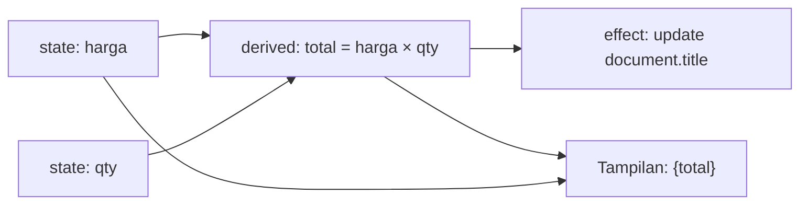

- **Reactive dependencies**: nilai yang dibaca oleh sebuah ekspresi menjadi *dependensi*-nya.
- **Derived values**: nilai yang dihitung dari nilai lain.
- Saat dependensi berubah, hanya bagian yang bergantung yang diperbarui.

### Svelte 4 vs Svelte 5

```svelte
<!-- SVELTE 4 (legacy) -->
<script>
  let count = 0;                 // reaktif karena dideklarasikan di top-level komponen
  $: double = count * 2;         // reactive statement (dihitung ulang saat count berubah)
  $: if (count > 5) alert('Besar');
</script>
<button on:click={() => count++}>{count} → {double}</button>
```

```svelte
<!-- SVELTE 5 (Runes, direkomendasikan) -->
<script>
  let count = $state(0);
  let double = $derived(count * 2);
  $effect(() => { if (count > 5) alert('Besar'); });
</script>
<button onclick={() => count++}>{count} → {double}</button>
```

| Aspek | `$:` (Svelte 4) | Runes (Svelte 5) |
|---|---|---|
| Deklarasi | Implisit | Eksplisit (`$state`, `$derived`, `$effect`) |
| Berlaku di | Hanya `.svelte` top-level | Di mana saja, termasuk `.svelte.js/.ts` dan class |
| Dependensi | Ditentukan **secara statis** oleh compiler | Dilacak **saat runtime** |
| Mutasi array/objek | Perlu penugasan ulang (`arr = arr`) | `arr.push(x)` langsung reaktif (deep) |
| Urutan eksekusi | Diurutkan topologis | Mengikuti grafik dependensi |

### Reactive Collections

Dengan Runes, array dan objek biasa yang dibungkus `$state` menjadi **reaktif secara dalam (deep)**:

```svelte
<script>
  let daftar = $state([1, 2, 3]);
  let user = $state({ nama: 'Dina', alamat: { kota: 'Bandung' } });
  let total = $derived(daftar.reduce((a, b) => a + b, 0));
</script>

<button onclick={() => daftar.push(daftar.length + 1)}>Tambah</button>
<button onclick={() => (user.alamat.kota = 'Jakarta')}>Pindah</button>
<p>{daftar.join(', ')} | total {total} | {user.alamat.kota}</p>
```

Detail mendalam tentang `$state`, `$derived`, dan `$effect` ada di Level 4.

## 3.5 Event Handling

Event ditulis sebagai atribut `on<namaevent>={handler}`; nilainya adalah **fungsi**:

```svelte
<script>
  let teks = $state('');
  let x = $state(0), y = $state(0);

  function tambah() { console.log('tambah'); }
</script>

<!-- Click -->
<button onclick={tambah}>Klik (referensi fungsi)</button>
<button onclick={() => console.log('inline')}>Klik (arrow)</button>

<!-- Input dan change -->
<input oninput={(e) => (teks = e.currentTarget.value)} />
<select onchange={(e) => console.log(e.currentTarget.value)}>...</select>

<!-- Submit -->
<form onsubmit={(e) => { e.preventDefault(); console.log('kirim', teks); }}>
  <button>Kirim</button>
</form>

<!-- Keyboard -->
<input onkeydown={(e) => e.key === 'Enter' && tambah()} />

<!-- Mouse -->
<div onmousemove={(e) => { x = e.clientX; y = e.clientY; }} role="presentation">
  Posisi: {x}, {y}
</div>
```

**Shorthand:** `<button {onclick}>` jika variabel bernama `onclick`; event juga bisa disebar lewat `{...props}`.

### Event Modifiers

Svelte 4 memiliki modifier (`on:submit|preventDefault`). **Pada Svelte 5 modifier dihapus**; lakukan langsung di handler atau bungkus dengan fungsi bantu:

```svelte
<script>
  function preventDefault(fn) {
    return function (event) {
      event.preventDefault();
      fn.call(this, event);
    };
  }
</script>

<form onsubmit={preventDefault(() => console.log('kirim'))}>...</form>

<!-- capture: tambahkan akhiran -->
<div onclickcapture={() => console.log('fase capture')}>...</div>
```

Modifier Svelte 4 lain dan padanannya: `stopPropagation` → `e.stopPropagation()`, `once` → hapus handler setelah pertama (atau pakai `on` dari `svelte/events`), `passive`/`nonpassive` → gunakan `on()` dari `svelte/events`.

### Event Propagation

Event DOM **menggelembung** (*bubbling*) dari elemen terdalam ke leluhur. Handler pada elemen anak dapat memanggil `e.stopPropagation()` untuk menghentikannya.

```svelte
<div onclick={() => console.log('div')}>
  <button onclick={(e) => { e.stopPropagation(); console.log('button saja'); }}>Klik</button>
</div>
```

Catatan implementasi: Svelte 5 menerapkan **event delegation** untuk event umum (`click`, `input`, `keydown`, dll.) dengan memasang satu listener di root. Biasanya transparan, tetapi `stopPropagation` pada listener yang dipasang **manual** di level lebih tinggi (mis. `document`) dapat berinteraksi tak terduga; gunakan `on` dari `svelte/events` untuk menjaga urutan yang benar.

### Custom Event Patterns

Pada Svelte 5, komponen berkomunikasi ke atas lewat **callback props** (menggantikan `createEventDispatcher`):

```svelte
<!-- Tombol.svelte -->
<script>
  let { label, onpilih } = $props();
</script>
<button onclick={() => onpilih?.(label)}>{label}</button>
```

```svelte
<!-- App.svelte -->
<Tombol label="Simpan" onpilih={(nama) => console.log('dipilih', nama)} />
```

## 3.6 Binding

**Binding dua arah**: perubahan state memperbarui elemen, dan input pengguna memperbarui state.

```svelte
<script>
  let nama = $state('');
  let umur = $state(20);
  let setuju = $state(false);
  let warna = $state('merah');
  let hobi = $state([]);
  let kota = $state('bandung');
  let pesan = $state('');
  let files = $state();
  let kanvas;           // bind:this
  let lebar = $state(0);
</script>

<!-- bind:value -->
<input bind:value={nama} />
<input type="number" bind:value={umur} />        <!-- otomatis jadi number -->
<input type="range" min="0" max="100" bind:value={umur} />

<!-- bind:checked -->
<label><input type="checkbox" bind:checked={setuju} /> Setuju</label>

<!-- bind:group: radio (nilai tunggal) dan checkbox (array) -->
<label><input type="radio" bind:group={warna} value="merah" /> Merah</label>
<label><input type="radio" bind:group={warna} value="biru" /> Biru</label>
<label><input type="checkbox" bind:group={hobi} value="baca" /> Baca</label>
<label><input type="checkbox" bind:group={hobi} value="game" /> Game</label>

<!-- select dan textarea -->
<select bind:value={kota}>
  <option value="bandung">Bandung</option>
  <option value="jakarta">Jakarta</option>
</select>
<textarea bind:value={pesan}></textarea>

<!-- bind:files -->
<input type="file" accept="image/*" bind:files />
{#if files?.[0]}<p>{files[0].name} ({files[0].size} byte)</p>{/if}

<!-- bind:this: referensi ke elemen DOM (tersedia setelah mount) -->
<canvas bind:this={kanvas}></canvas>

<!-- bind pada dimensi elemen (read-only) -->
<div bind:clientWidth={lebar}>Lebar: {lebar}px</div>

<pre>{JSON.stringify({ nama, umur, setuju, warna, hobi, kota })}</pre>
```

| Binding | Fungsi |
|---|---|
| `bind:value` | Nilai `input`, `textarea`, `select` (number otomatis untuk `type=number/range`) |
| `bind:checked` | Status checkbox |
| `bind:group` | Kelompok radio/checkbox |
| `bind:files` | `FileList` dari `input type=file` |
| `bind:this` | Referensi elemen DOM atau instansi komponen |
| `bind:clientWidth`, `bind:clientHeight`, `bind:offsetWidth`, ... | Dimensi elemen (read-only) |
| `bind:innerHTML`, `bind:textContent` | Pada elemen `contenteditable` |
| `<svelte:window bind:innerWidth bind:scrollY />` | Properti window |

**Function bindings** (Svelte versi baru, 5.9+) memberi kendali atas getter dan setter, berguna untuk transformasi:

```svelte
<input bind:value={() => nama, (v) => (nama = v.trim())} />
```

**Binding pada komponen** dilakukan dengan `bind:prop` pada pemakaian komponen, dengan syarat prop ditandai `$bindable()` di komponen anak (Level 4.6):

```svelte
<InputTeks bind:value={nama} />
```

## Project Level 3

### 1. Todo List

```svelte
<script lang="ts">
  type Todo = { id: number; title: string; done: boolean };

  let todos = $state<Todo[]>([]);
  let judul = $state('');
  let idBerikut = 1;

  let sisa = $derived(todos.filter((t) => !t.done).length);

  function tambah(e: SubmitEvent) {
    e.preventDefault();
    const t = judul.trim();
    if (!t) return;
    todos.push({ id: idBerikut++, title: t, done: false });
    judul = '';
  }

  function hapus(id: number) {
    todos = todos.filter((t) => t.id !== id);
  }
</script>

<h1>Todo ({sisa} tersisa)</h1>

<form onsubmit={tambah}>
  <input bind:value={judul} placeholder="Tugas baru..." />
  <button>Tambah</button>
</form>

<ul>
  {#each todos as todo (todo.id)}
    <li class:selesai={todo.done}>
      <label>
        <input type="checkbox" bind:checked={todo.done} />
        {todo.title}
      </label>
      <button onclick={() => hapus(todo.id)} aria-label="Hapus {todo.title}">×</button>
    </li>
  {:else}
    <li>Belum ada tugas</li>
  {/each}
</ul>

<style>
  .selesai label { text-decoration: line-through; opacity: 0.6; }
  ul { list-style: none; padding: 0; }
  li { display: flex; justify-content: space-between; padding: 0.25rem 0; }
</style>
```

### 2. Calculator

```svelte
<script lang="ts">
  let tampil = $state('0');
  let sebelumnya: number | null = null;
  let operator: string | null = null;
  let barumasuk = true;

  function angka(d: string) {
    tampil = barumasuk || tampil === '0' ? d : tampil + d;
    barumasuk = false;
  }

  function hitung(a: number, op: string, b: number) {
    return op === '+' ? a + b : op === '-' ? a - b : op === '×' ? a * b : b === 0 ? NaN : a / b;
  }

  function pilihOperator(op: string) {
    if (operator && !barumasuk) sama();
    sebelumnya = Number(tampil);
    operator = op;
    barumasuk = true;
  }

  function sama() {
    if (operator === null || sebelumnya === null) return;
    const hasil = hitung(sebelumnya, operator, Number(tampil));
    tampil = Number.isNaN(hasil) ? 'Error' : String(+hasil.toFixed(10));
    sebelumnya = null; operator = null; barumasuk = true;
  }

  function bersihkan() { tampil = '0'; sebelumnya = null; operator = null; barumasuk = true; }
</script>

<div class="kalkulator">
  <output>{tampil}</output>
  {#each ['7','8','9','÷','4','5','6','×','1','2','3','-','0','.','=','+'] as t}
    <button
      onclick={() => (t === '=' ? sama() : '+-×÷'.includes(t) ? pilihOperator(t) : angka(t))}
    >{t}</button>
  {/each}
  <button class="lebar" onclick={bersihkan}>C</button>
</div>

<style>
  .kalkulator { display: grid; grid-template-columns: repeat(4, 3.5rem); gap: 0.4rem; }
  output { grid-column: 1 / -1; text-align: right; padding: 0.5rem; font-size: 1.5rem; background: #f3f3f3; }
  .lebar { grid-column: 1 / -1; }
</style>
```

### 3. Product Filtering

```svelte
<script lang="ts">
  const semua = [
    { id: 1, nama: 'Keyboard', kategori: 'aksesoris', harga: 350000 },
    { id: 2, nama: 'Laptop', kategori: 'komputer', harga: 9500000 },
    { id: 3, nama: 'Mouse', kategori: 'aksesoris', harga: 150000 },
    { id: 4, nama: 'Monitor', kategori: 'komputer', harga: 2200000 },
  ];

  let kategori = $state('semua');
  let cari = $state('');
  let maksHarga = $state(10_000_000);
  let urut = $state<'nama' | 'termurah'>('nama');

  let tampil = $derived(
    semua
      .filter((p) => kategori === 'semua' || p.kategori === kategori)
      .filter((p) => p.nama.toLowerCase().includes(cari.toLowerCase()))
      .filter((p) => p.harga <= maksHarga)
      .toSorted((a, b) => (urut === 'nama' ? a.nama.localeCompare(b.nama) : a.harga - b.harga))
  );
</script>

<input bind:value={cari} placeholder="Cari..." />
<select bind:value={kategori}>
  <option value="semua">Semua</option><option value="aksesoris">Aksesoris</option><option value="komputer">Komputer</option>
</select>
<label>Maks: Rp {maksHarga.toLocaleString('id-ID')}
  <input type="range" min="100000" max="10000000" step="100000" bind:value={maksHarga} />
</label>
<select bind:value={urut}><option value="nama">Nama</option><option value="termurah">Termurah</option></select>

<ul>
  {#each tampil as p (p.id)}
    <li>{p.nama}: Rp {p.harga.toLocaleString('id-ID')}</li>
  {:else}
    <li>Tidak ada produk yang cocok</li>
  {/each}
</ul>
```

### 4. Searchable Table

```svelte
<script lang="ts">
  let { data }: { data: { id: number; nama: string; kota: string; umur: number }[] } = $props();

  let cari = $state('');
  let kolom = $state<'nama' | 'kota' | 'umur'>('nama');
  let arah = $state<1 | -1>(1);

  let baris = $derived(
    data
      .filter((r) => Object.values(r).join(' ').toLowerCase().includes(cari.toLowerCase()))
      .toSorted((a, b) => (a[kolom] > b[kolom] ? 1 : a[kolom] < b[kolom] ? -1 : 0) * arah)
  );

  function urutkan(k: typeof kolom) {
    if (kolom === k) arah = arah === 1 ? -1 : 1;
    else { kolom = k; arah = 1; }
  }
</script>

<input type="search" bind:value={cari} placeholder="Cari di seluruh kolom" />
<table>
  <thead>
    <tr>
      {#each ['nama', 'kota', 'umur'] as k (k)}
        <th aria-sort={kolom === k ? (arah === 1 ? 'ascending' : 'descending') : 'none'}>
          <button onclick={() => urutkan(k as typeof kolom)}>{k}{kolom === k ? (arah === 1 ? ' ▲' : ' ▼') : ''}</button>
        </th>
      {/each}
    </tr>
  </thead>
  <tbody>
    {#each baris as r (r.id)}
      <tr><td>{r.nama}</td><td>{r.kota}</td><td>{r.umur}</td></tr>
    {:else}
      <tr><td colspan="3">Tidak ada data</td></tr>
    {/each}
  </tbody>
</table>
```

### 5. Pagination Component

```svelte
<!-- Pagination.svelte -->
<script lang="ts">
  let { total, ukuran = 10, halaman = $bindable(1) }: { total: number; ukuran?: number; halaman?: number } = $props();

  let jumlahHalaman = $derived(Math.max(1, Math.ceil(total / ukuran)));
  let daftar = $derived(Array.from({ length: jumlahHalaman }, (_, i) => i + 1));

  $effect(() => {                                 // jaga agar halaman tetap valid jika total berubah
    if (halaman > jumlahHalaman) halaman = jumlahHalaman;
  });
</script>

<nav aria-label="Paginasi">
  <button onclick={() => halaman--} disabled={halaman <= 1}>‹</button>
  {#each daftar as n (n)}
    <button aria-current={n === halaman ? 'page' : undefined} onclick={() => (halaman = n)}>{n}</button>
  {/each}
  <button onclick={() => halaman++} disabled={halaman >= jumlahHalaman}>›</button>
</nav>
```

```svelte
<!-- Pemakaian -->
<script>
  import Pagination from './Pagination.svelte';
  let halaman = $state(1);
  const data = Array.from({ length: 53 }, (_, i) => `Item ${i + 1}`);
  let potong = $derived(data.slice((halaman - 1) * 10, halaman * 10));
</script>

<ul>{#each potong as item}<li>{item}</li>{/each}</ul>
<Pagination total={data.length} bind:halaman />
```

### 6. Dynamic Form

Formulir yang daftar bidangnya berubah: tambah dan hapus baris, pilih tipe bidang. Gunakan `$state` array berisi `{ id, label, tipe, nilai }`, `{#each}` berkunci, `bind:value`, dan tampilkan hasil JSON. Tantangan: validasi bidang wajib.

## Target Kompetensi Level 3

- [ ] Memakai interpolasi, atribut dinamis, class/style directive, dan `{@html}` dengan aman.
- [ ] Merender kondisi dan daftar (berkunci) serta menangani empty state.
- [ ] Menjelaskan perbedaan reaktivitas Svelte 4 (`$:`) dan Svelte 5 (Runes).
- [ ] Menangani berbagai event dan memakai binding pada input, group, file, dan elemen.
- [ ] Membangun aplikasi kecil (todo, kalkulator, filter, tabel) dari komponen.

---

# LEVEL 4: Svelte 5 Runes

**Materi inti Svelte 5.** **Tujuan:** menguasai sistem reaktivitas modern Svelte 5 menggunakan Runes.

## 4.1 Pengenalan Runes

**Runes** adalah *simbol berawalan `$`* yang menjadi kata kunci compiler Svelte untuk mengendalikan reaktivitas. Mereka tampak seperti fungsi tetapi **bukan** fungsi biasa: tidak perlu di-import, tidak bisa disimpan di variabel atau dikirim sebagai argumen, dan hanya valid pada posisi tertentu.

| Rune | Fungsi |
|---|---|
| `$state` | Menyatakan state reaktif |
| `$derived` | Nilai turunan dari state lain |
| `$effect` | Efek samping saat state berubah |
| `$props` | Menerima props komponen |
| `$bindable` | Menandai prop yang dapat di-*bind* dua arah |
| `$inspect` | Debugging perubahan state |
| `$host` | Akses elemen host pada custom element |

### Mengapa Svelte 5 Menggunakan Runes?

Masalah pada Svelte 4:

- Reaktivitas **implisit**: `let x = 0` reaktif di komponen tetapi tidak di file `.js`, sehingga membingungkan dan sulit di-*refactor*.
- Reaktivitas hanya bekerja di **top-level komponen**; berbagi logika reaktif harus memakai stores.
- `$:` mengandalkan analisis statis dependensi yang rapuh, dan mutasi (`arr.push`) tidak terdeteksi tanpa penugasan ulang.
- Sulit untuk TypeScript dan komposisi.

Runes memberi **reaktivitas eksplisit, universal, dan dapat dikomposisi**: sama di komponen, file `.svelte.js/.ts`, dan class.

### Fine-grained Reactivity dan Deep Reactivity

- **Fine-grained**: Svelte 5 melacak **nilai individual** (signals). Jika hanya `user.nama` berubah, hanya teks yang membaca `user.nama` yang diperbarui, bukan seluruh komponen.
- **Deep reactivity**: objek dan array `$state` dibungkus **Proxy**, sehingga perubahan di kedalaman berapa pun (`user.alamat.kota = '...'`, `list.push(x)`) terdeteksi.

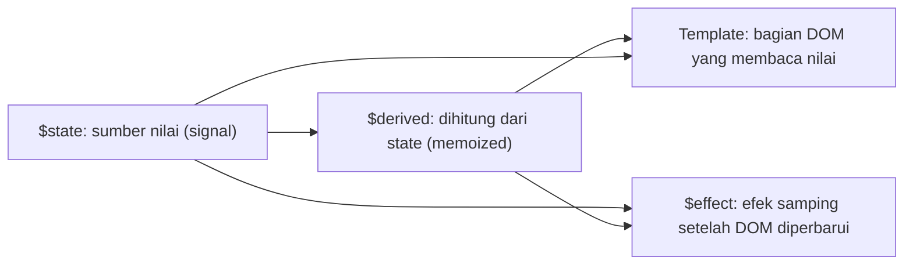

## 4.2 `$state`

### Primitive State

```svelte
<script>
  let count = $state(0);
  let nama = $state('Dina');
  let aktif = $state(false);
</script>

<button onclick={() => count++}>{count}</button>
```

`$state(0)` bukan objek pembungkus: `count` tetap berupa **angka biasa** yang kamu baca dan tulis langsung (`count++`). Compiler yang mengurus pelacakannya.

### Object dan Array State (Deep)

```svelte
<script>
  let user = $state({ nama: 'Dina', umur: 25, alamat: { kota: 'Bandung' } });
  let todos = $state([{ judul: 'Belajar', done: false }]);

  function ubah() {
    user.umur += 1;                       // mutasi properti
    user.alamat.kota = 'Jakarta';         // mutasi bersarang
    todos.push({ judul: 'Baru', done: false });   // method array
    todos[0].done = true;
  }
</script>
```

**Hanya objek polos (*plain object*) dan array** yang diubah menjadi proxy reaktif. Instansi class, `Map`, `Set`, `Date`, dan sebagainya **tidak** otomatis reaktif. Untuk itu gunakan field `$state` di dalam class, atau `SvelteMap`/`SvelteSet`/`SvelteDate` dari `svelte/reactivity` (Level 13).

### Updating dan Mutation

```js
let user = $state({ nama: 'Dina' });

user.nama = 'Sari';        // mutasi: reaktif
user = { nama: 'Budi' };   // penugasan ulang: juga reaktif (objek baru kembali dibungkus proxy)
```

Keduanya valid. Mutasi lebih ringkas; penugasan ulang berguna untuk mengganti seluruh nilai.

### Perilaku Penting: Destructuring dan Menyalin Nilai

Karena `$state` objek adalah proxy, **destructuring menyalin nilai saat itu** dan memutus koneksi reaktif:

```js
let user = $state({ umur: 25 });
let { umur } = user;      // umur hanya angka 25, tidak reaktif lagi
user.umur++;              // umur (variabel salinan) tetap 25
```

Begitu pula mengirim primitif state ke fungsi:

```js
function logCount(n) { console.log(n); }   // menerima salinan nilai
logCount(count);

// Jika fungsi perlu nilai TERBARU, kirim getter atau objek:
function pantau(ambil) { $effect(() => console.log(ambil())); }
pantau(() => count);
```

Compiler juga memberi peringatan `state_referenced_locally` bila kamu membaca state di tempat yang hanya menangkap nilai awalnya.

### `$state.raw`

`$state.raw` menyimpan nilai **tanpa proxy dalam**; hanya **penugasan ulang** yang memicu pembaruan. Cocok untuk data besar yang tidak akan dimutasi (hasil API, ribuan baris) agar hemat biaya proxy:

```js
let data = $state.raw([]);
data = await ambilBanyakData();       // OK: penugasan ulang memicu update
// data.push(x);                      // TIDAK memicu update (dan tidak di-proxy)
data = [...data, x];                  // lakukan ini bila perlu menambah
```

### `$state.snapshot`

Mengambil salinan statis (non-proxy) dari state, berguna saat mengirim data ke API/library eksternal yang tidak bersahabat dengan Proxy (mis. `structuredClone`, `postMessage`, IndexedDB):

```js
let form = $state({ nama: 'Dina', tag: ['a', 'b'] });

console.log($state.snapshot(form));              // objek biasa, mudah dibaca di console
const salinan = structuredClone($state.snapshot(form));
await fetch('/api', { method: 'POST', body: JSON.stringify(form) });  // JSON.stringify sudah aman
```

### `$state.eager` *(versi baru)*

Pembaruan DOM Svelte biasanya **dikelompokkan (batched)**. `$state.eager(value)` membuat tampilan yang membacanya diperbarui **segera** (bukan menunggu batch), berguna untuk umpan balik UI instan (mis. status navigasi aktif). Fitur ini relatif baru dan jarang dibutuhkan; periksa dokumentasi versi Svelte-mu sebelum memakainya.

### State di Class dan Modul

```js
// counter.svelte.js  (ekstensi .svelte.js/.svelte.ts WAJIB agar Runes berfungsi di file non-komponen)
export class Counter {
  count = $state(0);
  double = $derived(this.count * 2);
  naik = () => { this.count++; };       // arrow function agar `this` tetap terikat saat dipakai sebagai handler
}
```

```svelte
<script>
  import { Counter } from './counter.svelte.js';
  const c = new Counter();
</script>
<button onclick={c.naik}>{c.count} → {c.double}</button>
```

## 4.3 `$derived`

### Derived State dan Expressions

```svelte
<script>
  let harga = $state(10000);
  let qty = $state(2);

  let total = $derived(harga * qty);
  let label = $derived(total > 50000 ? 'Besar' : 'Kecil');
  let rupiah = $derived(`Rp ${total.toLocaleString('id-ID')}`);
</script>

<p>{rupiah} ({label})</p>
```

`$derived(ekspresi)` dihitung ulang **hanya ketika** nilai yang dibacanya berubah dan **hanya ketika nilainya dipakai**. Hasilnya di-cache (*memoized*).

### Derived Objects dan Arrays

```js
let items = $state([
  { nama: 'A', harga: 100, qty: 2 },
  { nama: 'B', harga: 200, qty: 1 },
]);

let jumlahItem  = $derived(items.length);
let subtotal    = $derived(items.reduce((s, i) => s + i.harga * i.qty, 0));
let termahal    = $derived(items.toSorted((a, b) => b.harga - a.harga)[0]);
let daftarNama  = $derived(items.map((i) => i.nama));
let ringkasan   = $derived({ jumlah: items.length, subtotal });     // objek turunan
let { jumlah, subtotal: st } = $derived(ringkasan);                  // destructuring derived tetap reaktif
```

### `$derived.by()`: Logika Kompleks

Untuk perhitungan yang membutuhkan beberapa baris, gunakan `$derived.by` dengan fungsi:

```js
let statistik = $derived.by(() => {
  if (nilai.length === 0) return null;
  const total = nilai.reduce((a, b) => a + b, 0);
  return {
    rata: total / nilai.length,
    tertinggi: Math.max(...nilai),
    terendah: Math.min(...nilai),
  };
});
```

`$derived(expr)` setara dengan `$derived.by(() => expr)`.

### Dependency Tracking

Svelte mencatat dependensi **saat fungsi/ekspresi berjalan** (runtime): setiap state yang *dibaca* menjadi dependensi.

```js
let a = $state(1), b = $state(2), pakaiB = $state(false);
let hasil = $derived(pakaiB ? a + b : a);   // b hanya menjadi dependensi ketika pakaiB bernilai true
```

Aturan emas `$derived`: **harus murni** (tanpa efek samping). **Jangan mengubah state di dalam derived**; compiler/runtime akan menghasilkan error `state_unsafe_mutation`. Jika kamu perlu efek samping, gunakan `$effect` atau event handler.

```js
// SALAH
let total = $derived.by(() => { riwayat.push(x); return x * 2; });
```

Pada versi Svelte yang lebih baru (5.25+), nilai `$derived` dapat **ditimpa sementara** dengan penugasan (berguna untuk *optimistic UI*); nilai kembali dihitung ulang saat dependensinya berubah.

## 4.4 `$effect`

### Pengenalan

`$effect` menjalankan fungsi sebagai **efek samping** ketika dependensinya berubah, untuk berinteraksi dengan **dunia di luar Svelte**: DOM API, canvas, library pihak ketiga, timer, logging, `localStorage`.

```svelte
<script>
  let count = $state(0);

  $effect(() => {
    document.title = `Count: ${count}`;       // count adalah dependensi
  });
</script>
```

### Lifecycle dan Kapan Berjalan

- Berjalan **setelah komponen dipasang ke DOM** dan setelah DOM diperbarui; jadi aman mengakses elemen.
- Berjalan **di browser saja**, **tidak** saat SSR (server-side rendering).
- Pembaruan efek **dikelompokkan** (di-*batch*) dalam microtask.
- Efek dibersihkan dan dijalankan ulang tiap dependensinya berubah, dan dibersihkan saat komponen dilepas.

### Dependencies

Dependensi adalah **nilai reaktif yang dibaca secara sinkron** di dalam efek. Nilai yang dibaca **setelah `await`** atau di dalam `setTimeout` **tidak** terlacak.

```js
$effect(() => {
  console.log(a);              // terlacak
  setTimeout(() => console.log(b), 100);   // b TIDAK terlacak
});
```

Untuk membaca state **tanpa** menjadikannya dependensi, bungkus dengan `untrack`:

```js
import { untrack } from 'svelte';

$effect(() => {
  console.log(count);                       // dependensi
  const t = untrack(() => tema);            // dibaca tanpa menjadi dependensi
});
```

### Cleanup

Efek boleh mengembalikan **fungsi pembersih**; dijalankan sebelum efek dijalankan ulang dan saat komponen dilepas.

```svelte
<script>
  let aktif = $state(true);
  let detik = $state(0);

  $effect(() => {
    if (!aktif) return;
    const id = setInterval(() => detik++, 1000);
    return () => clearInterval(id);          // cleanup: mencegah timer bocor
  });
</script>
```

```js
// listener event dengan cleanup
$effect(() => {
  const handler = (e) => (lebar = e.target.innerWidth);
  window.addEventListener('resize', handler);
  return () => window.removeEventListener('resize', handler);
});
```

### Nested Effects, `$effect.pre`, `$effect.root`

- **Nested effects**: efek di dalam efek dibuat ulang saat efek induk berjalan ulang; jarang dibutuhkan.
- **`$effect.pre`**: berjalan **sebelum** DOM diperbarui; berguna mis. untuk membaca posisi scroll sebelum konten berubah:

```js
// import { tick } from 'svelte';
$effect.pre(() => {
  if (!kontainer) return;
  messages;                                  // jadikan dependensi
  const dekatDasar = kontainer.scrollHeight - kontainer.scrollTop - kontainer.clientHeight < 50;
  if (dekatDasar) {
    tick().then(() => (kontainer.scrollTop = kontainer.scrollHeight));
  }
});
```

- **`$effect.root`**: membuat efek **di luar** siklus hidup komponen (tidak dibersihkan otomatis); mengembalikan fungsi `cleanup` manual. Dipakai di file `.svelte.js` atau pengujian:

```js
const cleanup = $effect.root(() => {
  $effect(() => console.log(count));
});
// ... nanti:
cleanup();
```

### `$effect.tracking()` dan `$effect.pending()`

- **`$effect.tracking()`** mengembalikan `true` jika kode sedang berjalan di dalam *konteks pelacakan* (efek atau template). Berguna bagi penulis library (mis. memulai langganan hanya bila ada yang mengamati).
- **`$effect.pending()`** terkait fitur **`await` di komponen** (async Svelte) yang masih eksperimental pada saat panduan ini ditulis; mengembalikan jumlah promise yang sedang tertunda pada boundary. Periksa dokumentasi sebelum memakainya.

### Menghindari Infinite Effect Loop

Efek yang **membaca dan menulis state yang sama** dapat menyebabkan loop tak berujung.

```js
// BERBAHAYA
$effect(() => { count = count + 1; });          // membaca count lalu mengubahnya -> loop

// Solusi: jangan jadikan sebagai dependensi
$effect(() => {
  const nilai = untrack(() => count);
  // ...
});
```

Jika menemui `effect_update_depth_exceeded`, itu tanda ada loop seperti ini. Seringkali solusi sebenarnya adalah **tidak memakai efek** (lihat bawah).

### Kapan (Tidak) Menggunakan Effect

`$effect` adalah **jalan keluar darurat (*escape hatch*)**, bukan alat utama.

| Kebutuhan | Gunakan | Jangan |
|---|---|---|
| Nilai yang dihitung dari state lain | **`$derived`** | `$effect` yang menulis ke state lain |
| Reaksi atas aksi pengguna (klik, input) | **Event handler** | `$effect` yang mengamati flag |
| Menyinkronkan input dengan transformasi | **Function binding / `$derived`** | Dua efek saling menimpa |
| Memuat data untuk halaman | **`load` di SvelteKit** | `$effect` + `fetch` (rentan race condition) |
| Menyentuh DOM, canvas, library eksternal | **`$effect`** atau **attachment** | — |
| Menyimpan ke `localStorage`, analytics, logging | **`$effect`** | — |
| Menghubungkan/memutus langganan, timer | **`$effect` dengan cleanup** | — |

```js
// BURUK: efek untuk turunan
let double = $state(0);
$effect(() => { double = count * 2; });

// BAIK
let double = $derived(count * 2);
```

## 4.5 `$props`

### Pengenalan, Passing, dan Destructuring

```svelte
<!-- Sapa.svelte -->
<script>
  let { nama, umur = 18, ...sisa } = $props();
</script>

<p {...sisa}>Halo {nama}, umur {umur}</p>
```

```svelte
<Sapa nama="Dina" umur={25} class="tebal" id="sapa-1" />
<Sapa nama="Budi" />                            <!-- umur memakai default 18 -->
<Sapa {...{ nama: 'Sari', umur: 30 }} />        <!-- spread objek sebagai props -->
```

- **Default props**: `umur = 18` dipakai jika prop tidak diberikan (atau `undefined`).
- **Rest props**: `...sisa` menampung props yang tidak dideklarasikan; sering diteruskan ke elemen asli.
- **Rename**: `let { class: kelas, for: untuk } = $props();` untuk kata kunci JavaScript.
- Props bersifat **reaktif**: saat induk mengubah nilai, anak ikut diperbarui.

### Typed Props (TypeScript)

```svelte
<script lang="ts">
  import type { Snippet } from 'svelte';
  import type { HTMLButtonAttributes } from 'svelte/elements';

  interface Props extends HTMLButtonAttributes {
    varian?: 'primer' | 'sekunder';
    ukuran?: 'sm' | 'md' | 'lg';
    children: Snippet;
  }

  let { varian = 'primer', ukuran = 'md', children, ...rest }: Props = $props();
</script>

<button class="btn {varian} {ukuran}" {...rest}>
  {@render children()}
</button>
```

`HTMLButtonAttributes` (dan padanan elemen lain di `svelte/elements`) memberi tipe untuk seluruh atribut native sehingga `onclick`, `disabled`, dan lainnya tersedia otomatis lewat `...rest`.

### Updating Props

Prop **dapat ditimpa sementara** di dalam komponen (penugasan ulang), tetapi nilai akan kembali sesuai induk saat induk memperbarui prop itu. **Memutasi objek** yang diterima sebagai prop dari induk tidak dianjurkan (Svelte memberi peringatan `ownership_invalid_mutation`): komunikasikan perubahan lewat **callback** atau `$bindable`.

```svelte
<script>
  let { nilai, onubah } = $props();
  // SALAH:   nilai.jumlah++         (memutasi data milik induk)
  // BENAR:   onubah({ ...nilai, jumlah: nilai.jumlah + 1 })
</script>
```

### `$props.id()` *(versi baru, 5.20+)*

Menghasilkan **ID unik per instansi komponen** yang stabil antara server dan klien; berguna untuk menghubungkan `label` dengan `input` atau atribut `aria-*` tanpa bentrok pada komponen yang dipakai berulang.

```svelte
<script>
  const uid = $props.id();
  let { label } = $props();
</script>

<label for="{uid}-input">{label}</label>
<input id="{uid}-input" />
```

## 4.6 `$bindable`

Props biasanya **satu arah** (induk → anak). `$bindable` mengizinkan induk memakai `bind:` agar perubahan di anak juga memperbarui induk.

```svelte
<!-- InputTeks.svelte -->
<script lang="ts">
  let { value = $bindable(''), label }: { value?: string; label: string } = $props();
</script>

<label>
  {label}
  <input bind:value />
</label>
```

```svelte
<!-- Induk -->
<script>
  import InputTeks from './InputTeks.svelte';
  let nama = $state('Dina');
</script>

<InputTeks label="Nama" bind:value={nama} />
<p>Halo, {nama}</p>
```

- `$bindable('')` memberi **nilai default** bila induk tidak mem-bind.
- Induk **boleh** tetap memakai prop biasa (`value="x"`) tanpa `bind:`.
- **Best practices:** gunakan `$bindable` hemat, terutama untuk komponen bergaya *form control* (input kustom, toggle, slider). Untuk logika aplikasi, **callback props** lebih eksplisit dan mudah ditelusuri. Hindari rantai binding yang dalam karena membuat aliran data sulit dilacak.

## 4.7 `$inspect`

### Debugging State

`$inspect` mencetak nilai ke console **setiap kali nilainya berubah**, dan **tidak melakukan apa-apa pada build produksi**.

```svelte
<script>
  let count = $state(0);
  let user = $state({ nama: 'Dina' });

  $inspect(count, user);                       // log: 'init', lalu 'update' saat berubah

  $inspect(count).with((type, nilai) => {      // type: 'init' | 'update'
    if (type === 'update') console.trace('berubah menjadi', nilai);   // lihat siapa yang mengubah
  });
</script>
```

### `$inspect.trace()` *(5.14+)*

Letakkan di **baris pertama** fungsi efek/derived untuk mencatat **dependensi mana yang memicu** eksekusi ulang:

```js
$effect(() => {
  $inspect.trace('efek-sinkronisasi');
  simpanKeServer(data);
});
```

Sangat membantu memahami "mengapa efek ini terus berjalan?".

## Project Level 4

### 1. Reactive Todo Application (class-based)

```js
// todo.svelte.ts
export type Filter = 'semua' | 'aktif' | 'selesai';

export class Todo {
  id = crypto.randomUUID();
  judul = $state('');
  selesai = $state(false);
  constructor(judul: string) { this.judul = judul; }
}

export class TodoStore {
  daftar = $state<Todo[]>([]);
  filter = $state<Filter>('semua');

  terlihat = $derived.by(() => {
    if (this.filter === 'aktif') return this.daftar.filter((t) => !t.selesai);
    if (this.filter === 'selesai') return this.daftar.filter((t) => t.selesai);
    return this.daftar;
  });
  sisa = $derived(this.daftar.filter((t) => !t.selesai).length);

  tambah(judul: string) { if (judul.trim()) this.daftar.push(new Todo(judul.trim())); }
  hapus(id: string) { this.daftar = this.daftar.filter((t) => t.id !== id); }
  bersihkanSelesai() { this.daftar = this.daftar.filter((t) => !t.selesai); }
}
```

```svelte
<script lang="ts">
  import { TodoStore } from './todo.svelte';
  const store = new TodoStore();
  let judul = $state('');
</script>

<form onsubmit={(e) => { e.preventDefault(); store.tambah(judul); judul = ''; }}>
  <input bind:value={judul} /><button>Tambah</button>
</form>

{#each ['semua', 'aktif', 'selesai'] as f}
  <button class:aktif={store.filter === f} onclick={() => (store.filter = f as any)}>{f}</button>
{/each}

<ul>
  {#each store.terlihat as t (t.id)}
    <li><label><input type="checkbox" bind:checked={t.selesai} /> {t.judul}</label>
        <button onclick={() => store.hapus(t.id)}>×</button></li>
  {/each}
</ul>
<p>{store.sisa} tersisa</p>
```

### 2. Shopping Cart

```svelte
<script lang="ts">
  type Item = { id: number; nama: string; harga: number; qty: number };
  const katalog = [
    { id: 1, nama: 'Buku', harga: 50000 },
    { id: 2, nama: 'Pena', harga: 5000 },
  ];

  let keranjang = $state<Item[]>([]);

  let totalItem = $derived(keranjang.reduce((n, i) => n + i.qty, 0));
  let subtotal = $derived(keranjang.reduce((n, i) => n + i.harga * i.qty, 0));
  let diskon = $derived(subtotal >= 100000 ? subtotal * 0.1 : 0);
  let bayar = $derived(subtotal - diskon);

  function tambah(p: { id: number; nama: string; harga: number }) {
    const ada = keranjang.find((i) => i.id === p.id);
    if (ada) ada.qty++;
    else keranjang.push({ ...p, qty: 1 });
  }
  function ubahQty(i: Item, delta: number) {
    i.qty += delta;
    if (i.qty <= 0) keranjang = keranjang.filter((x) => x.id !== i.id);
  }
</script>

{#each katalog as p (p.id)}
  <button onclick={() => tambah(p)}>+ {p.nama}</button>
{/each}

<ul>
  {#each keranjang as i (i.id)}
    <li>{i.nama} × {i.qty}
      <button onclick={() => ubahQty(i, -1)}>−</button>
      <button onclick={() => ubahQty(i, +1)}>+</button></li>
  {/each}
</ul>
<p>{totalItem} item · subtotal Rp {subtotal.toLocaleString('id-ID')}
   {#if diskon > 0}· diskon Rp {diskon.toLocaleString('id-ID')}{/if}
   · <strong>bayar Rp {bayar.toLocaleString('id-ID')}</strong></p>
```

### 3. Dynamic Product Filter

Kembangkan filter Level 3 dengan `$derived.by`, **filter yang disimpan di URL** (`URLSearchParams`), serta tombol "reset" memakai `$state.snapshot` untuk menyimpan nilai awal.

### 4. Real-time Dashboard

```svelte
<script lang="ts">
  let titik = $state<number[]>([]);
  let berjalan = $state(true);

  let rata = $derived(titik.length ? titik.reduce((a, b) => a + b, 0) / titik.length : 0);
  let maks = $derived(titik.length ? Math.max(...titik) : 0);

  $effect(() => {
    if (!berjalan) return;
    const id = setInterval(() => {
      titik.push(Math.round(40 + Math.random() * 60));
      if (titik.length > 30) titik.shift();
    }, 1000);
    return () => clearInterval(id);
  });
</script>

<button onclick={() => (berjalan = !berjalan)}>{berjalan ? 'Jeda' : 'Lanjut'}</button>
<p>Rata-rata {rata.toFixed(1)} · Maks {maks}</p>
<svg viewBox="0 0 300 100" width="100%">
  {#each titik as v, i}
    <rect x={i * 10} y={100 - v} width="8" height={v} fill="#ff3e00" />
  {/each}
</svg>
```

### 5. Multi-step Form

```svelte
<script lang="ts">
  let langkah = $state(1);
  let data = $state({ nama: '', email: '', paket: 'basic', setuju: false });

  let valid = $derived(
    langkah === 1 ? data.nama.trim().length >= 3 :
    langkah === 2 ? /^\S+@\S+\.\S+$/.test(data.email) :
    data.setuju
  );
</script>

<progress max="3" value={langkah}></progress>

{#if langkah === 1}
  <label>Nama <input bind:value={data.nama} /></label>
{:else if langkah === 2}
  <label>Email <input type="email" bind:value={data.email} /></label>
  <select bind:value={data.paket}><option value="basic">Basic</option><option value="pro">Pro</option></select>
{:else}
  <pre>{JSON.stringify(data, null, 2)}</pre>
  <label><input type="checkbox" bind:checked={data.setuju} /> Saya setuju</label>
{/if}

<button onclick={() => langkah--} disabled={langkah === 1}>Kembali</button>
{#if langkah < 3}
  <button onclick={() => langkah++} disabled={!valid}>Lanjut</button>
{:else}
  <button disabled={!valid} onclick={() => alert('Terkirim: ' + JSON.stringify(data))}>Kirim</button>
{/if}
```

## Target Kompetensi Level 4

- [ ] Menjelaskan alasan Runes dan perbedaan fine-grained vs deep reactivity.
- [ ] Memakai `$state` (termasuk `.raw` dan `.snapshot`) dan menghindari jebakan destructuring.
- [ ] Menurunkan nilai dengan `$derived` / `$derived.by` yang murni.
- [ ] Menulis `$effect` dengan cleanup, dan tahu kapan **tidak** memakainya.
- [ ] Mendefinisikan props bertipe dengan `$props`, `$bindable`, dan men-debug dengan `$inspect`.

---

# LEVEL 5: Component Architecture

**Tujuan:** membangun aplikasi dari komponen yang *reusable*, *scalable*, dan mudah dipelihara.

## 5.1 Component Fundamentals

### Struktur, Reusability, dan Composition

Komponen yang baik: **satu tanggung jawab**, **antarmuka jelas** (props dan callback), dan **tidak mengetahui detail komponen lain**. Komposisi, bukan pewarisan, adalah cara Svelte menyusun UI.

### Komunikasi Antar Komponen

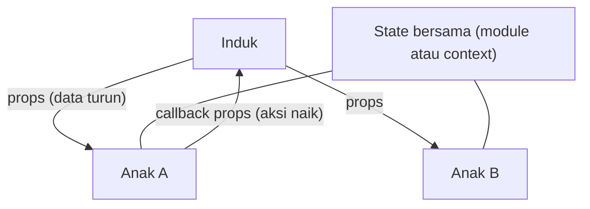

| Arah | Mekanisme | Contoh |
|---|---|---|
| **Induk → Anak** | Props | `<Kartu judul="X" />` |
| **Anak → Induk** | Callback props | `<Tombol onklik={...} />` |
| **Dua arah (form control)** | `$bindable` + `bind:` | `<InputTeks bind:value />` |
| **Antar saudara (sibling)** | *Angkat state* ke induk bersama, atau shared state (module/context) | Dua komponen membaca state yang sama |
| **Leluhur → Keturunan jauh** | Context | Tema, sesi pengguna |

**Mengangkat state ke induk (*lifting state up*):**

```svelte
<!-- Induk.svelte -->
<script>
  import Daftar from './Daftar.svelte';
  import Ringkasan from './Ringkasan.svelte';

  let items = $state([{ id: 1, nama: 'Buku', qty: 2 }]);
  function hapus(id) { items = items.filter((i) => i.id !== id); }
</script>

<Daftar {items} onhapus={hapus} />        <!-- anak 1: menampilkan dan memicu aksi -->
<Ringkasan {items} />                     <!-- anak 2: hanya membaca -->
```

## 5.2 Component Advanced

### Snippets dan `{@render}`

**Snippet** adalah potongan markup yang dapat diberi parameter, dipakai ulang di komponen yang sama, atau **dikirim ke komponen lain sebagai props**. Snippet menggantikan `<slot>`.

```svelte
<script>
  const produk = [{ nama: 'Buku', harga: 50000 }, { nama: 'Pena', harga: 5000 }];
</script>

{#snippet baris(item, i)}
  <tr><td>{i + 1}</td><td>{item.nama}</td><td>Rp {item.harga.toLocaleString('id-ID')}</td></tr>
{/snippet}

<table>
  <tbody>
    {#each produk as p, i}
      {@render baris(p, i)}
    {/each}
  </tbody>
</table>
```

### Konten Anak: `children` dan Named Snippets

Konten yang ditulis di antara tag komponen otomatis menjadi snippet bernama **`children`**:

```svelte
<!-- Kartu.svelte -->
<script lang="ts">
  import type { Snippet } from 'svelte';

  let { judul, children, aksi }: { judul: string; children: Snippet; aksi?: Snippet } = $props();
</script>

<article class="kartu">
  <h3>{judul}</h3>
  {@render children()}
  {#if aksi}
    <footer>{@render aksi()}</footer>
  {/if}
</article>
```

```svelte
<!-- Pemakaian -->
<Kartu judul="Profil">
  <p>Ini isi utama (children).</p>

  {#snippet aksi()}
    <button>Simpan</button>
  {/snippet}
</Kartu>
```

Snippet yang dideklarasikan langsung di dalam tag komponen otomatis menjadi **props bernama** sesuai namanya. Snippet dapat menerima parameter (setara *slot props*):

```svelte
<!-- Daftar.svelte (generik) -->
<script lang="ts" generics="T">
  import type { Snippet } from 'svelte';
  let { items, item, kosong }: { items: T[]; item: Snippet<[T, number]>; kosong?: Snippet } = $props();
</script>

{#each items as it, i}
  {@render item(it, i)}
{:else}
  {@render kosong?.()}
{/each}
```

```svelte
<Daftar items={['Apel', 'Jeruk']}>
  {#snippet item(buah, i)}<li>{i + 1}. {buah}</li>{/snippet}
  {#snippet kosong()}<p>Kosong</p>{/snippet}
</Daftar>
```

### Component Slots (Legacy)

Sintaks lama yang masih berjalan di mode kompatibilitas dan akan sering kamu temui di kode atau library lama:

```svelte
<!-- Svelte 4 -->
<div class="kartu">
  <slot name="header">Judul bawaan</slot>
  <slot />                                  <!-- slot default -->
  <slot name="footer" {data} />             <!-- slot props -->
</div>

<!-- pemakaian: -->
<Kartu>
  <h3 slot="header">Judul</h3>
  Isi
  <p slot="footer" let:data>{data}</p>
</Kartu>
```

| Svelte 4 (`<slot>`) | Svelte 5 (snippet) |
|---|---|
| `<slot />` | `{@render children?.()}` |
| `<slot name="x" />` | `{@render x?.()}` |
| `<slot prop={v} />` + `let:prop` | `{@render x(v)}` + `{#snippet x(prop)}` |

### Dynamic Component Rendering

Pada Svelte 5, komponen adalah **nilai biasa**; cukup render variabel berawalan huruf kapital:

```svelte
<script>
  import Beranda from './Beranda.svelte';
  import Profil from './Profil.svelte';

  const halaman = { beranda: Beranda, profil: Profil };
  let aktif = $state('beranda');
  let Komponen = $derived(halaman[aktif]);
</script>

<nav>
  {#each Object.keys(halaman) as nama}
    <button onclick={() => (aktif = nama)}>{nama}</button>
  {/each}
</nav>

<Komponen judul="Halo" />
```

(`<svelte:component this={...}>` dari Svelte 4 tidak lagi diperlukan di mode runes.) Untuk elemen HTML dinamis gunakan `<svelte:element this={tag}>`:

```svelte
<svelte:element this={level === 1 ? 'h1' : 'h2'} class="judul">Judul</svelte:element>
```

### Component Lifecycle dan Component References

Komponen dibuat → dipasang (`onMount`) → diperbarui → dilepas (`onDestroy`). Detail dan API-nya dibahas di Level 13.

Mengakses **instansi komponen** lewat `bind:this`; komponen anak mengekspor fungsi agar dapat dipanggil induk:

```svelte
<!-- Pemutar.svelte -->
<script>
  let audio;
  export function putar() { audio.play(); }
  export function jeda() { audio.pause(); }
</script>
<audio bind:this={audio} src="/lagu.mp3"></audio>
```

```svelte
<script>
  import Pemutar from './Pemutar.svelte';
  let pemutar;
</script>

<Pemutar bind:this={pemutar} />
<button onclick={() => pemutar.putar()}>Putar</button>
```

Gunakan sebagai **jalan terakhir**; lebih baik kendalikan komponen lewat props/state.

## 5.3 Context API

**Context** memungkinkan sebuah komponen menyediakan nilai untuk **semua keturunannya** tanpa mengoper props lewat setiap level (*prop drilling*). Berbeda dengan state global di modul, context **terikat pada pohon komponen**, sehingga aman untuk SSR dan dapat berbeda di tiap subtree.

```svelte
<!-- TemaProvider.svelte -->
<script lang="ts">
  import { setContext, type Snippet } from 'svelte';

  let { children }: { children: Snippet } = $props();

  const tema = $state({ mode: 'terang' as 'terang' | 'gelap' });
  setContext('tema', {
    get mode() { return tema.mode; },
    toggle() { tema.mode = tema.mode === 'terang' ? 'gelap' : 'terang'; },
  });
</script>

<div data-tema={tema.mode}>{@render children()}</div>
```

```svelte
<!-- TombolTema.svelte (keturunan di kedalaman berapa pun) -->
<script lang="ts">
  import { getContext, hasContext } from 'svelte';

  if (!hasContext('tema')) throw new Error('TombolTema harus berada di dalam TemaProvider');
  const tema = getContext<{ mode: string; toggle(): void }>('tema');
</script>

<button onclick={tema.toggle}>Mode: {tema.mode}</button>
```

Aturan penting:

- `setContext`, `getContext`, dan `hasContext` **hanya boleh dipanggil saat inisialisasi komponen** (di level atas `<script>`), bukan di handler atau efek.
- Context **tidak otomatis reaktif**. Agar reaktif, sediakan **objek berisi state** (atau getter/setter seperti di atas); **jangan** menaruh primitif yang lalu ditimpa.
- Pakai **kunci unik** (disarankan `Symbol`, atau string yang spesifik) agar tidak bentrok.

### Pola Provider dan Consumer dengan TypeScript

```ts
// tema.svelte.ts
import { getContext, setContext } from 'svelte';

const KUNCI = Symbol('tema');

export class TemaState {
  mode = $state<'terang' | 'gelap'>('terang');
  toggle = () => { this.mode = this.mode === 'terang' ? 'gelap' : 'terang'; };
}

export function sediakanTema() {
  const tema = new TemaState();
  setContext(KUNCI, tema);       // dipanggil di komponen provider
  return tema;
}

export function pakaiTema() {
  const tema = getContext<TemaState>(KUNCI);
  if (!tema) throw new Error('pakaiTema() dipanggil di luar provider');
  return tema;
}
```

```svelte
<!-- Provider: -->  <script>import { sediakanTema } from './tema.svelte'; sediakanTema();</script>
<!-- Consumer: -->  <script>import { pakaiTema } from './tema.svelte'; const tema = pakaiTema();</script>
```

Versi Svelte yang lebih baru juga menyediakan helper `createContext` yang menghasilkan pasangan *getter/setter* bertipe sehingga tidak perlu menulis kunci dan *casting* sendiri; periksa dokumentasi versimu.

**Kapan memakai context vs module state?** Context untuk data **spesifik pohon/instansi** (tema suatu widget, form yang sedang dirender, data pengguna **per request** di SSR); module state untuk **singleton sisi klien** yang aman (dibahas di Level 6, termasuk bahaya state modul di server).

## 5.4 Component Design Pattern

| Pola | Ide | Contoh |
|---|---|---|
| **Container & Presentational** | Container mengambil/mengelola data; presentational hanya menerima props dan menggambar | `ProdukPage` (container) → `ProdukList`, `ProdukCard` |
| **Compound Components** | Beberapa komponen bekerja sebagai satu (berbagi state lewat context) | `Tabs`, `Tab`, `TabPanel` |
| **Controlled** | Induk memiliki state, komponen hanya menampilkan dan melapor | `<Toggle checked={x} onchange={...} />` |
| **Uncontrolled** | Komponen mengelola state internal sendiri | `<Toggle defaultChecked />` |
| **Headless** | Menyediakan **perilaku dan aksesibilitas**, tanpa gaya | Dropdown logic + snippet tampilan |
| **Reusable UI** | Primitif konsisten (Button, Input, Card) | Design system |

**Controlled + uncontrolled dalam satu komponen** (`$bindable` dengan nilai awal):

```svelte
<!-- Toggle.svelte -->
<script lang="ts">
  let { checked = $bindable(false), onchange, label }: { checked?: boolean; onchange?: (v: boolean) => void; label: string } = $props();
</script>

<label>
  <input type="checkbox" bind:checked onchange={() => onchange?.(checked)} />
  {label}
</label>
```

Dipakai **uncontrolled** (`<Toggle label="A" />`), **bind** (`<Toggle bind:checked={x} />`), atau **controlled** (`<Toggle checked={x} onchange={(v) => (x = v)} />`).

**Headless via snippet:** komponen mengatur logika dan memberi data ke snippet tampilan.

```svelte
<!-- Disclosure.svelte -->
<script lang="ts">
  import type { Snippet } from 'svelte';
  let { children }: { children: Snippet<[{ buka: boolean; toggle: () => void }]> } = $props();
  let buka = $state(false);
  const toggle = () => (buka = !buka);
</script>

{@render children({ buka, toggle })}
```

```svelte
<Disclosure>
  {#snippet children({ buka, toggle })}
    <button aria-expanded={buka} onclick={toggle}>Detail</button>
    {#if buka}<p>Isi tersembunyi</p>{/if}
  {/snippet}
</Disclosure>
```

## Project Level 5

### 1. Reusable Modal (elemen `<dialog>` bawaan)

```svelte
<!-- Modal.svelte -->
<script lang="ts">
  import type { Snippet } from 'svelte';

  let { open = $bindable(false), judul, children, footer }: {
    open?: boolean; judul: string; children: Snippet; footer?: Snippet;
  } = $props();

  let dialog = $state<HTMLDialogElement>();

  $effect(() => {                                    // sinkronkan state dengan elemen <dialog>
    if (!dialog) return;
    if (open && !dialog.open) dialog.showModal();    // fokus terjebak dan Esc ditangani browser
    else if (!open && dialog.open) dialog.close();
  });
</script>

<dialog
  bind:this={dialog}
  onclose={() => (open = false)}
  onclick={(e) => { if (e.target === dialog) open = false; }}   // klik backdrop
  aria-labelledby="judul-modal"
>
  <h2 id="judul-modal">{judul}</h2>
  {@render children()}
  <div class="aksi">
    {#if footer}{@render footer()}{:else}<button onclick={() => (open = false)}>Tutup</button>{/if}
  </div>
</dialog>

<style>
  dialog { border: 0; border-radius: 12px; padding: 1.5rem; max-width: min(90vw, 480px); }
  dialog::backdrop { background: rgb(0 0 0 / 0.5); }
  .aksi { margin-top: 1rem; text-align: right; }
</style>
```

### 2. Dropdown Component

```svelte
<!-- Dropdown.svelte -->
<script lang="ts">
  let { label, pilihan, onpilih }: { label: string; pilihan: string[]; onpilih: (v: string) => void } = $props();
  let buka = $state(false);
  let akar: HTMLDivElement;
  const uid = $props.id();

  function pilih(v: string) { onpilih(v); buka = false; }
</script>

<svelte:window
  onclick={(e) => { if (buka && !akar.contains(e.target as Node)) buka = false; }}
  onkeydown={(e) => { if (e.key === 'Escape') buka = false; }}
/>

<div class="dropdown" bind:this={akar}>
  <button aria-haspopup="listbox" aria-expanded={buka} aria-controls="{uid}-menu" onclick={() => (buka = !buka)}>
    {label} ▾
  </button>
  {#if buka}
    <ul id="{uid}-menu" role="listbox">
      {#each pilihan as p (p)}
        <li role="option" aria-selected="false">
          <button onclick={() => pilih(p)}>{p}</button>
        </li>
      {/each}
    </ul>
  {/if}
</div>

<style>
  .dropdown { position: relative; display: inline-block; }
  ul { position: absolute; margin: 0.25rem 0 0; padding: 0.25rem; list-style: none; background: white; border: 1px solid #ddd; border-radius: 8px; min-width: 10rem; }
  li button { width: 100%; text-align: left; background: none; border: 0; padding: 0.4rem 0.6rem; }
  li button:hover, li button:focus-visible { background: #f3f3f3; }
</style>
```

Peningkatan aksesibilitas: navigasi panah atas/bawah (*roving tabindex*), kembalikan fokus ke tombol saat menutup.

### 3. Tabs Component (Compound)

```svelte
<!-- Tabs.svelte -->
<script lang="ts">
  import { setContext, type Snippet } from 'svelte';
  let { nilai = $bindable(), children }: { nilai?: string; children: Snippet } = $props();

  setContext('tabs', {
    get aktif() { return nilai; },
    pilih(id: string) { nilai = id; },
  });
</script>
<div class="tabs">{@render children()}</div>
```

```svelte
<!-- Tab.svelte -->
<script lang="ts">
  import { getContext, type Snippet } from 'svelte';
  let { id, children }: { id: string; children: Snippet } = $props();
  const tabs = getContext<{ aktif: string; pilih(id: string): void }>('tabs');
</script>

<button role="tab" aria-selected={tabs.aktif === id} class:aktif={tabs.aktif === id} onclick={() => tabs.pilih(id)}>
  {@render children()}
</button>
```

```svelte
<!-- TabPanel.svelte -->
<script lang="ts">
  import { getContext, type Snippet } from 'svelte';
  let { id, children }: { id: string; children: Snippet } = $props();
  const tabs = getContext<{ aktif: string }>('tabs');
</script>
{#if tabs.aktif === id}<div role="tabpanel">{@render children()}</div>{/if}
```

```svelte
<Tabs bind:nilai={tab}>
  <div role="tablist"><Tab id="a">Profil</Tab><Tab id="b">Pengaturan</Tab></div>
  <TabPanel id="a">Isi profil</TabPanel>
  <TabPanel id="b">Isi pengaturan</TabPanel>
</Tabs>
```

### 4. Accordion

Gunakan elemen semantik `<details name="grup">` (atribut `name` membuat hanya satu yang terbuka pada grup yang sama di browser modern) atau bangun sendiri dengan `button` + `aria-expanded` + `aria-controls` dan state `$state` berisi id yang terbuka:

```svelte
<script lang="ts">
  let { item }: { item: { id: string; judul: string; isi: string }[] } = $props();
  let terbuka = $state<string | null>(null);
</script>

{#each item as it (it.id)}
  <h3>
    <button aria-expanded={terbuka === it.id} aria-controls="p-{it.id}"
            onclick={() => (terbuka = terbuka === it.id ? null : it.id)}>{it.judul}</button>
  </h3>
  <div id="p-{it.id}" role="region" hidden={terbuka !== it.id}>{it.isi}</div>
{/each}
```

### 5. Reusable Data Table (generik, berbasis snippet)

```svelte
<!-- DataTable.svelte -->
<script lang="ts" generics="T extends { id: string | number }">
  import type { Snippet } from 'svelte';

  type Kolom = { kunci: keyof T & string; judul: string };

  let { data, kolom, sel, kosong }: {
    data: T[]; kolom: Kolom[];
    sel?: Snippet<[T, Kolom]>;           // kustomisasi isi sel
    kosong?: Snippet;
  } = $props();
</script>

<table>
  <thead><tr>{#each kolom as k (k.kunci)}<th>{k.judul}</th>{/each}</tr></thead>
  <tbody>
    {#each data as baris (baris.id)}
      <tr>
        {#each kolom as k (k.kunci)}
          <td>{#if sel}{@render sel(baris, k)}{:else}{baris[k.kunci]}{/if}</td>
        {/each}
      </tr>
    {:else}
      <tr><td colspan={kolom.length}>{#if kosong}{@render kosong()}{:else}Tidak ada data{/if}</td></tr>
    {/each}
  </tbody>
</table>
```

### 6. Design System Sederhana

Mulailah dari **design tokens** berupa CSS variables, lalu komponen primitif yang memakainya:

```css
/* tokens.css */
:root {
  --warna-utama: #ff3e00;
  --warna-teks: #1a1a1a;
  --warna-latar: #ffffff;
  --radius: 8px;
  --jarak-1: 0.25rem; --jarak-2: 0.5rem; --jarak-3: 1rem; --jarak-4: 1.5rem;
  --font: system-ui, sans-serif;
}
[data-tema='gelap'] { --warna-teks: #f2f2f2; --warna-latar: #121212; }
```

Buat `Button` (varian dan ukuran), `Input` (label, error, `$bindable`), `Card`, `Badge`, lalu dokumentasikan di satu halaman *style guide*. Detail lanjut di Level 17 (Storybook dan paket bersama).

## Target Kompetensi Level 5

- [ ] Merancang komunikasi komponen (props, callback, `$bindable`, context) yang tepat.
- [ ] Memakai snippets, `children`, dan `{@render}` termasuk versi generik dan bertipe.
- [ ] Menyediakan dan mengonsumsi context dengan aman (reaktif, bertipe, SSR-aware).
- [ ] Menerapkan pola controlled/uncontrolled, compound, dan headless.

---

# LEVEL 6: State Management

**Tujuan:** mengelola state dari aplikasi sederhana hingga berskala besar.

## 6.1 Local State

State yang hanya dipakai satu komponen (atau anak-anaknya lewat props) cukup berupa `$state` dan `$derived` lokal.

```svelte
<script>
  let terbuka = $state(false);                 // state UI lokal
  let query = $state('');
  let hasil = $derived(data.filter((d) => d.includes(query)));
</script>
```

**Aturan praktis:** mulai **selokal mungkin**; naikkan scope hanya ketika dua komponen yang berjauhan butuh data yang sama. State yang terlalu global membuat aplikasi sulit dilacak.

## 6.2 Shared State

### Shared State Menggunakan Module

File `.svelte.js` atau `.svelte.ts` dapat berisi Runes. Ekspor **objek** state yang kamu mutasi:

```ts
// keranjang.svelte.ts
export const keranjang = $state({
  items: [] as { id: number; nama: string; qty: number }[],
});

export function tambah(id: number, nama: string) {
  const ada = keranjang.items.find((i) => i.id === id);
  if (ada) ada.qty++;
  else keranjang.items.push({ id, nama, qty: 1 });
}
```

```svelte
<script>
  import { keranjang, tambah } from './keranjang.svelte';
</script>
<p>{keranjang.items.length} item</p>
<button onclick={() => tambah(1, 'Buku')}>Tambah</button>
```

> **Batasan penting:** kamu **tidak bisa mengekspor `$state` primitif yang ditimpa** (`export let count = $state(0); count = 1`), karena pengimpor hanya menerima nilai saat itu. Ekspor **objek** (dan mutasi propertinya) atau sediakan **fungsi/getter**.

### State Factory Pattern dan Encapsulation

```ts
// counter.svelte.ts
export function createCounter(awal = 0) {
  let count = $state(awal);
  let double = $derived(count * 2);

  return {
    get count() { return count; },       // getter menjaga reaktivitas dan melindungi dari penimpaan
    get double() { return double; },
    naik: () => count++,
    reset: () => (count = awal),
  };
}
```

**Class dengan field privat** memberi enkapsulasi yang lebih kuat:

```ts
export class Keranjang {
  #items = $state<Item[]>([]);                 // privat: hanya bisa diubah lewat method
  total = $derived(this.#items.reduce((n, i) => n + i.harga * i.qty, 0));

  get items() { return this.#items; }
  tambah(item: Item) { /* validasi dan aturan bisnis di sini */ this.#items.push(item); }
}
export const keranjang = new Keranjang();      // singleton
```

### Global State, dan Bahayanya di Server

State di level modul adalah **singleton per proses**. Di browser itu bagus (satu state per tab). Di **server (SSR)**, modul yang sama dipakai oleh **semua permintaan**, sehingga state pengguna A dapat **bocor** ke pengguna B.

> **Aturan SvelteKit:** jangan menyimpan **data spesifik pengguna/permintaan** di state modul yang dijalankan di server. Gunakan `event.locals`, `load`, atau **context** (dibuat per render). State modul hanya aman untuk data yang benar-benar global dan tidak sensitif, atau yang hanya diubah di browser.

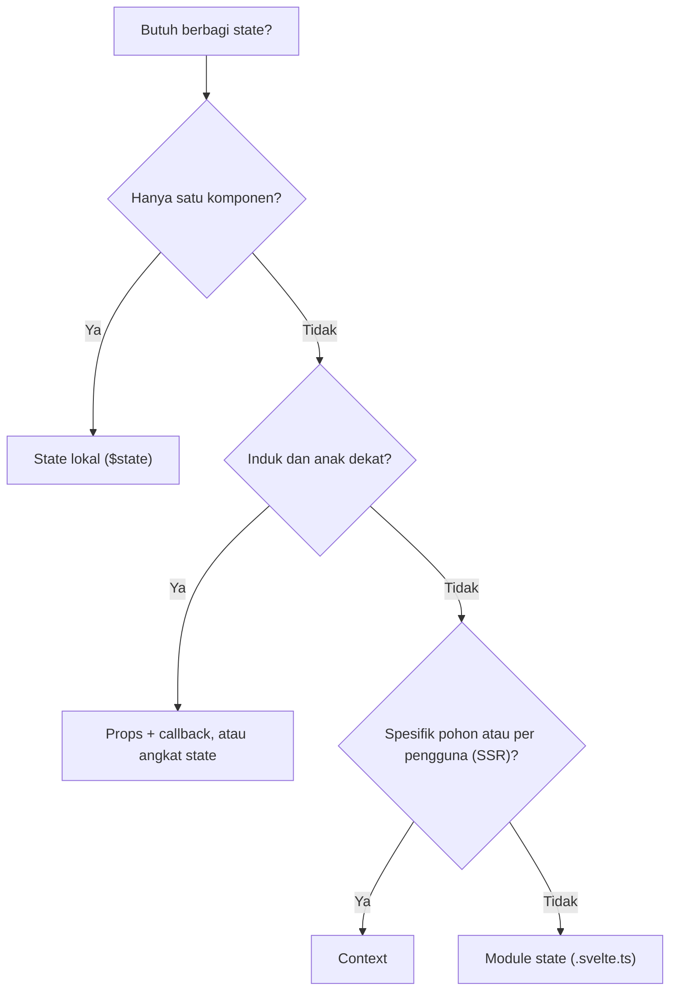

## 6.3 Svelte Stores

**Stores** adalah mekanisme reaktivitas bersama sejak Svelte 3. Pada Svelte 5 mereka **masih didukung penuh** dan berguna untuk kompatibilitas dengan kode/library lama, serta untuk aliran data asinkron.

**Kontrak store:** objek dengan method `subscribe(callback)` yang mengembalikan fungsi `unsubscribe`. (Store yang dapat ditulis juga punya `set` dan `update`.)

```ts
// stores.ts
import { writable, readable, derived, get } from 'svelte/store';

export const hitung = writable(0);

export const waktu = readable(new Date(), (set) => {      // dipanggil saat subscriber pertama
  const id = setInterval(() => set(new Date()), 1000);
  return () => clearInterval(id);                          // dipanggil saat subscriber terakhir pergi
});

export const dobel = derived(hitung, ($h) => $h * 2);
export const jumlah = derived([hitung, dobel], ([$a, $b]) => $a + $b);

hitung.set(5);
hitung.update((n) => n + 1);
console.log(get(hitung));        // baca sekali tanpa subscribe
```

**Auto-subscription dengan `$`:** di dalam komponen, awalan `$` pada nama store otomatis berlangganan, membaca nilai, dan berhenti berlangganan saat komponen dilepas.

```svelte
<script>
  import { hitung, waktu } from './stores';
</script>

<button onclick={() => $hitung++}>{$hitung}</button>     <!-- $hitung = ... memanggil hitung.set -->
<p>{$waktu.toLocaleTimeString('id-ID')}</p>
```

### Custom Store

```ts
// todos.ts
import { writable, derived } from 'svelte/store';

function buatTodos() {
  const { subscribe, update, set } = writable<{ id: number; judul: string; selesai: boolean }[]>([]);
  let id = 1;
  return {
    subscribe,                                             // wajib agar memenuhi kontrak store
    tambah: (judul: string) => update((l) => [...l, { id: id++, judul, selesai: false }]),
    toggle: (i: number) => update((l) => l.map((t) => (t.id === i ? { ...t, selesai: !t.selesai } : t))),
    reset: () => set([]),
  };
}
export const todos = buatTodos();
export const sisa = derived(todos, ($t) => $t.filter((t) => !t.selesai).length);
```

Store tidak mendeteksi mutasi dalam; **selalu hasilkan nilai baru** (`update` yang mengembalikan salinan).

### Stores vs Runes

| Aspek | Stores | Runes (`$state` di module/class) |
|---|---|---|
| Penulisan | `subscribe/set/update`, `$store` | Objek dan properti biasa |
| Mutasi bersarang | Perlu salinan baru | Mutasi langsung |
| Di luar komponen | Perlu `get()` / `subscribe()` | Baca langsung |
| Aliran asinkron (timer, WebSocket) | **Sangat cocok** (`readable` dengan start/stop) | Perlu `$effect.root` atau `createSubscriber` |
| Kompatibilitas library (RxJS dan lain-lain) | Kontrak store sederhana | Perlu adaptor |
| Rekomendasi kode baru | Untuk kasus di atas | **Default** |

Adaptor tersedia: `fromStore()` dan `toStore()` dari `svelte/store` mengubah antara store dan state berbasis rune.

**Kapan memakai stores?** Memelihara aplikasi/library lama, mengonsumsi library yang mengekspos store, atau model *event stream* yang butuh siklus hidup start/stop otomatis.

## 6.4 Advanced State Management

### State Architecture

Pisahkan jenis state:

| Jenis | Contoh | Tempat |
|---|---|---|
| **UI state** | Modal terbuka, tab aktif | Lokal |
| **Form state** | Nilai input, error | Lokal / library form |
| **Server state** | Daftar produk dari API | `load` SvelteKit atau lapisan fetching/cache |
| **Client global state** | Tema, keranjang, notifikasi | Module/class/context |
| **URL state** | Filter, halaman, sort | **URL** (`searchParams`): bisa dibagikan dan tahan refresh |

### State Normalization

Simpan entitas dalam bentuk **dikunci berdasarkan ID**, hindari duplikasi bersarang:

```ts
type State = {
  byId: Record<number, { id: number; judul: string; penulisId: number }>;
  semuaId: number[];
};

let artikel = $state<State>({ byId: {}, semuaId: [] });

function simpan(a: { id: number; judul: string; penulisId: number }) {
  artikel.byId[a.id] = a;
  if (!artikel.semuaId.includes(a.id)) artikel.semuaId.push(a.id);
}
let daftar = $derived(artikel.semuaId.map((id) => artikel.byId[id]));
```

Ubah satu entitas di satu tempat, dan semua tampilan yang memakainya ikut berubah.

### State Persistence: LocalStorage dan SessionStorage

```ts
// persisted.svelte.ts
export function persistedState<T>(
  kunci: string,
  awal: T,
  storage: Storage | undefined = typeof window !== 'undefined' ? window.localStorage : undefined,
) {
  let nilai = $state<T>(awal);

  if (storage) {
    try {
      const tersimpan = storage.getItem(kunci);
      if (tersimpan !== null) nilai = JSON.parse(tersimpan);
    } catch { /* abaikan data rusak */ }
  }

  $effect.root(() => {
    $effect(() => {
      storage?.setItem(kunci, JSON.stringify(nilai));      // JSON.stringify membaca seluruh isi sehingga terlacak
    });
  });

  return {
    get value() { return nilai; },
    set value(v: T) { nilai = v; },
  };
}
```

```ts
export const tema = persistedState<'terang' | 'gelap'>('tema', 'terang');
export const draf = persistedState('draf', '', typeof window !== 'undefined' ? window.sessionStorage : undefined);   // hanya selama tab terbuka
```

Perhatian: `localStorage` **tidak ada di server** (SSR). Pemeriksaan `typeof window` di atas aman, tetapi nilai yang dibaca di klien dapat **berbeda dari HTML hasil server** sehingga muncul *hydration mismatch* atau kedip. Untuk tema, biasanya diatur lewat cookie atau skrip kecil di `<head>` (lihat Level 8).

### Cross-component State dan Synchronization

**Antar tab** (state yang sama di beberapa tab browser):

```ts
window.addEventListener('storage', (e) => {                // dipicu di tab LAIN saat localStorage berubah
  if (e.key === 'keranjang' && e.newValue) keranjang.items = JSON.parse(e.newValue);
});

const kanal = new BroadcastChannel('app');                  // alternatif: pesan lintas tab
kanal.onmessage = (e) => console.log('pesan dari tab lain', e.data);
kanal.postMessage({ jenis: 'logout' });
```

### Optimistic Updates

Perbarui UI **seketika**, kirim ke server di belakang layar, dan **batalkan** bila gagal:

```ts
async function hapusTodo(id: number) {
  const cadangan = $state.snapshot(todos);                  // simpan salinan
  todos = todos.filter((t) => t.id !== id);                 // optimistis
  try {
    const res = await fetch(`/api/todos/${id}`, { method: 'DELETE' });
    if (!res.ok) throw new Error();
  } catch {
    todos = cadangan;                                       // rollback
    toast.error('Gagal menghapus. Dibatalkan.');
  }
}
```

### Undo dan Redo

```ts
// history.svelte.ts
export class Riwayat<T> {
  #lalu: T[] = $state([]);
  #depan: T[] = $state([]);
  sekarang = $state<T>() as T;

  constructor(awal: T) { this.sekarang = awal; }

  set(baru: T) {
    this.#lalu.push($state.snapshot(this.sekarang) as T);
    this.#depan = [];
    this.sekarang = baru;
  }
  undo() { const p = this.#lalu.pop(); if (p !== undefined) { this.#depan.push($state.snapshot(this.sekarang) as T); this.sekarang = p; } }
  redo() { const n = this.#depan.pop(); if (n !== undefined) { this.#lalu.push($state.snapshot(this.sekarang) as T); this.sekarang = n; } }

  canUndo = $derived(this.#lalu.length > 0);
  canRedo = $derived(this.#depan.length > 0);
}
```

### State Reset

```ts
const AWAL = { nama: '', email: '', setuju: false };
let form = $state(structuredClone(AWAL));

function reset() { form = structuredClone(AWAL); }          // salinan baru agar AWAL tidak termutasi
```

## Project Level 6

### 1. Shopping Cart Management

Class `Keranjang` (singleton) dengan `tambah`, `kurangi`, `hapus`, `total`, `jumlahItem`, **persistensi** ke `localStorage` (`persistedState`), dan sinkronisasi lintas tab lewat event `storage`.

### 2. Global Notification System

```ts
// toast.svelte.ts
type Jenis = 'info' | 'sukses' | 'error';
type Toast = { id: number; pesan: string; jenis: Jenis };

class ToastStore {
  daftar = $state<Toast[]>([]);
  #id = 0;

  tambah(pesan: string, jenis: Jenis = 'info', durasi = 4000) {
    const id = ++this.#id;
    this.daftar.push({ id, pesan, jenis });
    if (durasi > 0) setTimeout(() => this.hapus(id), durasi);
  }
  hapus(id: number) { this.daftar = this.daftar.filter((t) => t.id !== id); }

  info = (m: string) => this.tambah(m, 'info');
  sukses = (m: string) => this.tambah(m, 'sukses');
  error = (m: string) => this.tambah(m, 'error', 6000);
}
export const toast = new ToastStore();
```

```svelte
<!-- ToastContainer.svelte: letakkan sekali di layout -->
<script>
  import { fly } from 'svelte/transition';
  import { flip } from 'svelte/animate';
  import { toast } from './toast.svelte';
</script>

<div class="toasts" role="region" aria-live="polite" aria-label="Notifikasi">
  {#each toast.daftar as t (t.id)}
    <div class="toast {t.jenis}" in:fly={{ y: 20, duration: 200 }} out:fly={{ x: 40, duration: 200 }} animate:flip={{ duration: 200 }}>
      {t.pesan}
      <button onclick={() => toast.hapus(t.id)} aria-label="Tutup">×</button>
    </div>
  {/each}
</div>

<style>
  .toasts { position: fixed; right: 1rem; bottom: 1rem; display: grid; gap: 0.5rem; z-index: 1000; }
  .toast { padding: 0.75rem 1rem; border-radius: 8px; background: #333; color: #fff; }
  .toast.sukses { background: #1b7f3b; } .toast.error { background: #b3261e; }
</style>
```

### 3. User Session Management

State sesi (pengguna, status muat, `isLoggedIn` sebagai `$derived`), fungsi `login`/`logout`/`pulihkan`, dan penyimpanan token dengan benar (**cookie HttpOnly di Level 12**, bukan `localStorage`).

### 4. Theme Management (Light/Dark)

```ts
// tema.svelte.ts
type Mode = 'terang' | 'gelap' | 'sistem';

export class Tema {
  mode = $state<Mode>('sistem');
  #gelapSistem = $state(false);
  efektif = $derived<'terang' | 'gelap'>(this.mode === 'sistem' ? (this.#gelapSistem ? 'gelap' : 'terang') : this.mode);

  constructor() {
    if (typeof window === 'undefined') return;
    const mq = window.matchMedia('(prefers-color-scheme: dark)');
    this.#gelapSistem = mq.matches;
    mq.addEventListener('change', (e) => (this.#gelapSistem = e.matches));
    this.mode = (localStorage.getItem('tema') as Mode) ?? 'sistem';
  }

  setMode(m: Mode) { this.mode = m; localStorage.setItem('tema', m); }
}
```

Terapkan dengan `$effect(() => { document.documentElement.dataset.tema = tema.efektif; })` pada layout, dan gunakan CSS `[data-tema='gelap']` seperti design tokens Level 5.

### 5. Multi-page State Management

Bangun wizard checkout 3 halaman (data diri → pengiriman → pembayaran) yang berbagi state di modul dan **bertahan saat berpindah halaman**. Pada SvelteKit (Level 9), state modul klien bertahan selama navigasi klien, tetapi **hilang saat refresh**, sehingga kombinasikan dengan persistensi.

## Target Kompetensi Level 6

- [ ] Memilih tempat state yang tepat (lokal, props, context, modul, URL, server).
- [ ] Membuat shared state dengan module, factory, dan class yang terenkapsulasi.
- [ ] Memahami stores, `$store`, custom store, dan kapan memakainya dibanding Runes.
- [ ] Menerapkan persistensi, normalisasi, optimistic update, undo/redo, dan reset.
- [ ] Menyadari risiko state global di server (SSR).

---

# LEVEL 7: Form Handling dan Validation

**Tujuan:** membuat sistem form yang kompleks dengan validasi dan pengelolaan data.

## 7.1 Form Fundamentals

Form di Svelte adalah **HTML biasa** dengan binding. Semua binding dari 3.6 berlaku:

```svelte
<script lang="ts">
  let data = $state({
    nama: '', umur: 18, setuju: false, jk: 'p', hobi: [] as string[], kota: 'bandung', pesan: '',
  });
  let berkas = $state<FileList>();

  function kirim(e: SubmitEvent) {
    e.preventDefault();
    console.log($state.snapshot(data));              // objek biasa (bukan proxy)
  }
</script>

<form onsubmit={kirim}>
  <label>Nama <input type="text" bind:value={data.nama} required /></label>
  <label>Umur <input type="number" min="0" bind:value={data.umur} /></label>
  <label><input type="checkbox" bind:checked={data.setuju} /> Setuju</label>

  <fieldset>
    <legend>Jenis kelamin</legend>
    <label><input type="radio" bind:group={data.jk} value="p" /> Pria</label>
    <label><input type="radio" bind:group={data.jk} value="w" /> Wanita</label>
  </fieldset>

  <fieldset>
    <legend>Hobi</legend>
    {#each ['baca', 'game', 'musik'] as h (h)}
      <label><input type="checkbox" bind:group={data.hobi} value={h} /> {h}</label>
    {/each}
  </fieldset>

  <select bind:value={data.kota}><option value="bandung">Bandung</option><option value="jakarta">Jakarta</option></select>
  <textarea bind:value={data.pesan}></textarea>
  <input type="file" bind:files={berkas} />
  <button type="submit">Kirim</button>
</form>
```

**Dynamic form fields:** tambah dan hapus bidang dengan memanipulasi array state (lihat 7.3).

## 7.2 Form Validation

### Pola Validasi Reaktif

```svelte
<script lang="ts">
  let nilai = $state({ email: '', password: '', umur: '' });
  let tersentuh = $state({ email: false, password: false, umur: false });   // touched
  let sedangKirim = $state(false);
  let pesanServer = $state('');

  const aturan = {
    email: (v: string) =>
      !v ? 'Email wajib diisi' : !/^\S+@\S+\.\S+$/.test(v) ? 'Format email tidak valid' : '',
    password: (v: string) =>
      !v ? 'Password wajib diisi' : v.length < 8 ? 'Minimal 8 karakter' : v.length > 64 ? 'Maksimal 64 karakter' : '',
    umur: (v: string) => {
      if (!v) return '';
      const n = Number(v);
      return !Number.isInteger(n) ? 'Harus bilangan bulat' : n < 17 || n > 120 ? 'Umur 17 sampai 120' : '';
    },
  };

  let errors = $derived({
    email: aturan.email(nilai.email),
    password: aturan.password(nilai.password),
    umur: aturan.umur(nilai.umur),
  });
  let valid = $derived(Object.values(errors).every((e) => !e));

  async function kirim(e: SubmitEvent) {
    e.preventDefault();
    tersentuh = { email: true, password: true, umur: true };      // tampilkan semua error
    if (!valid) return;
    sedangKirim = true;
    try {
      const res = await fetch('/api/daftar', {
        method: 'POST',
        headers: { 'Content-Type': 'application/json' },
        body: JSON.stringify(nilai),
      });
      if (!res.ok) pesanServer = (await res.json()).pesan ?? 'Gagal mendaftar';
    } finally {
      sedangKirim = false;
    }
  }
</script>

<form onsubmit={kirim} novalidate>
  <div>
    <label for="email">Email</label>
    <input id="email" type="email" bind:value={nilai.email}
           onblur={() => (tersentuh.email = true)}
           aria-invalid={tersentuh.email && !!errors.email}
           aria-describedby="err-email" />
    {#if tersentuh.email && errors.email}
      <p id="err-email" role="alert" class="error">{errors.email}</p>
    {/if}
  </div>
  <!-- password dan umur dibuat serupa -->

  {#if pesanServer}<p role="alert" class="error">{pesanServer}</p>{/if}
  <button disabled={sedangKirim}>{sedangKirim ? 'Mengirim...' : 'Daftar'}</button>
</form>
```

**Aturan validasi yang baik:**

- **Required, email, number, min/max length, custom**: kombinasikan dalam satu fungsi per bidang.
- **Real-time validation**: tampilkan error **setelah bidang disentuh** (`blur`) atau setelah submit pertama, bukan saat pengguna baru mulai mengetik.
- **Server-side validation**: **wajib**. Validasi klien hanya untuk kenyamanan; server tidak boleh percaya data klien. Server mengembalikan error per bidang (SvelteKit: `fail(400, { errors })`).
- **Aksesibilitas error**: `aria-invalid`, `aria-describedby`, dan `role="alert"` agar pembaca layar mengumumkannya; fokuskan bidang pertama yang salah saat submit gagal.
- **Submission state**: nonaktifkan tombol dan tampilkan indikator saat mengirim untuk mencegah submit ganda.

## 7.3 Advanced Form

### Multi-step Form

Simpan seluruh data wizard di satu objek `$state` (atau module/context bila lintas halaman), validasi **per langkah**, dan izinkan kembali tanpa kehilangan data (lihat contoh Level 4).

### Dynamic, Nested, dan Array Form Fields

```svelte
<script lang="ts">
  let karyawan = $state({
    nama: '',
    keahlian: [''] as string[],
    kontak: [{ jenis: 'email', nilai: '' }] as { jenis: string; nilai: string }[],
  });
</script>

{#each karyawan.keahlian as _, i (i)}
  <div>
    <input bind:value={karyawan.keahlian[i]} placeholder="Keahlian {i + 1}" />
    <button type="button" onclick={() => karyawan.keahlian.splice(i, 1)} disabled={karyawan.keahlian.length === 1}>Hapus</button>
  </div>
{/each}
<button type="button" onclick={() => karyawan.keahlian.push('')}>Tambah keahlian</button>

{#each karyawan.kontak as k, i}
  <select bind:value={k.jenis}><option>email</option><option>telepon</option></select>
  <input bind:value={k.nilai} />
  <button type="button" onclick={() => karyawan.kontak.splice(i, 1)}>×</button>
{/each}
<button type="button" onclick={() => karyawan.kontak.push({ jenis: 'email', nilai: '' })}>Tambah kontak</button>
```

> Untuk daftar yang urutannya bisa berubah, beri tiap baris `id` unik (mis. `crypto.randomUUID()`) dan pakai sebagai key, supaya fokus dan state input tidak "melompat" saat baris dihapus atau diurutkan.

### File Upload, Multiple Upload, Drag and Drop

```svelte
<script lang="ts">
  let berkas = $state<File[]>([]);
  let menyeret = $state(false);
  let status = $state('');

  function tambahFile(daftar: FileList | null) {
    if (!daftar) return;
    const diizinkan = ['image/png', 'image/jpeg'];
    for (const f of daftar) {
      if (!diizinkan.includes(f.type)) { status = `${f.name}: tipe tidak didukung`; continue; }
      if (f.size > 2 * 1024 * 1024) { status = `${f.name}: maksimal 2 MB`; continue; }
      berkas.push(f);
    }
  }

  async function unggah() {
    const fd = new FormData();
    for (const f of berkas) fd.append('berkas', f);          // beberapa file dengan nama sama
    const res = await fetch('/api/unggah', { method: 'POST', body: fd });   // jangan set Content-Type manual
    status = res.ok ? 'Berhasil' : 'Gagal';
  }
</script>

<div
  class="dropzone" class:menyeret
  role="button" tabindex="0"
  ondragover={(e) => { e.preventDefault(); menyeret = true; }}
  ondragleave={() => (menyeret = false)}
  ondrop={(e) => { e.preventDefault(); menyeret = false; tambahFile(e.dataTransfer?.files ?? null); }}
>
  Seret file ke sini atau
  <input type="file" multiple accept="image/png,image/jpeg" onchange={(e) => tambahFile(e.currentTarget.files)} />
</div>

<ul>{#each berkas as f, i (f.name + i)}<li>{f.name} ({Math.round(f.size / 1024)} KB)</li>{/each}</ul>
<button onclick={unggah} disabled={!berkas.length}>Unggah</button>
<p>{status}</p>
```

Validasi tipe dan ukuran di klien hanya kenyamanan; **server wajib memeriksa ulang** (tipe sebenarnya, ukuran, nama file aman). Untuk progres unggah gunakan `XMLHttpRequest` dengan `upload.onprogress` (Fetch belum menyediakan progres unggah yang sederhana).

### Form Reset, Dirty State, dan Submission Loading

```ts
const awal = { nama: 'Dina', email: 'dina@contoh.com' };
let form = $state(structuredClone(awal));

let dirty = $derived(JSON.stringify($state.snapshot(form)) !== JSON.stringify(awal));
const reset = () => (form = structuredClone(awal));

// peringatkan sebelum meninggalkan halaman
$effect(() => {
  if (!dirty) return;
  const h = (e: BeforeUnloadEvent) => { e.preventDefault(); };
  window.addEventListener('beforeunload', h);
  return () => window.removeEventListener('beforeunload', h);
});
```

## 7.4 Form Libraries

| Library | Catatan |
|---|---|
| **Svelte Forms Lib** | Library lama dengan store; periksa kompatibilitas dengan Svelte 5 sebelum memakainya |
| **Superforms** (`sveltekit-superforms`) | Pilihan populer untuk **SvelteKit**: satu skema untuk validasi server dan klien, integrasi `use:enhance`, bertipe penuh |
| **Zod** | Skema validasi berbasis TypeScript, tipe disimpulkan dari skema |
| **Valibot** | Alternatif lebih ringan dan modular |

### Schema-based Validation dengan Zod

```bash
npm install zod
```

```ts
// skema.ts
import { z } from 'zod';

export const skemaDaftar = z.object({
  nama: z.string().trim().min(3, 'Minimal 3 karakter'),
  email: z.string().email('Email tidak valid'),
  password: z.string().min(8, 'Minimal 8 karakter'),
  umur: z.coerce.number().int('Harus bulat').min(17, 'Minimal 17').max(120),
  setuju: z.literal(true, { errorMap: () => ({ message: 'Harus disetujui' }) }),
});

export type Daftar = z.infer<typeof skemaDaftar>;       // tipe TypeScript otomatis dari skema

export function validasi(data: unknown) {
  const hasil = skemaDaftar.safeParse(data);
  if (hasil.success) return { data: hasil.data, errors: {} as Record<string, string> };

  const errors: Record<string, string> = {};
  for (const isu of hasil.error.issues) {
    const kunci = String(isu.path[0] ?? '_');
    errors[kunci] ??= isu.message;                       // pesan pertama per bidang
  }
  return { data: null, errors };
}
```

> API Zod (pesan error khusus, `errorMap`, `z.email()` pada versi baru) bergeser antar versi mayor. Cocokkan dengan dokumentasi versi yang kamu pasang.

**Skema yang sama dipakai di klien dan server**: itulah keunggulan *schema-based validation*: satu sumber kebenaran, tipe aman (*type-safe form*).

### Valibot (alternatif)

```ts
import * as v from 'valibot';

const Skema = v.object({
  email: v.pipe(v.string(), v.email('Email tidak valid')),
  password: v.pipe(v.string(), v.minLength(8, 'Minimal 8 karakter')),
});
const hasil = v.safeParse(Skema, data);
if (!hasil.success) console.log(hasil.issues);
type Input = v.InferOutput<typeof Skema>;
```

### Superforms (dipakai penuh bersama SvelteKit di Level 11)

```ts
// +page.server.ts
import { superValidate, message } from 'sveltekit-superforms';
import { zod } from 'sveltekit-superforms/adapters';
import { fail } from '@sveltejs/kit';
import { skemaDaftar } from '$lib/skema';

export const load = async () => ({ form: await superValidate(zod(skemaDaftar)) });

export const actions = {
  default: async ({ request }) => {
    const form = await superValidate(request, zod(skemaDaftar));
    if (!form.valid) return fail(400, { form });          // error per bidang otomatis
    // simpan ke database...
    return message(form, 'Pendaftaran berhasil!');
  },
};
```

```svelte
<!-- +page.svelte -->
<script lang="ts">
  import { superForm } from 'sveltekit-superforms';
  let { data } = $props();
  const { form, errors, enhance, message, submitting } = superForm(data.form);
</script>

<form method="POST" use:enhance>
  <input name="email" bind:value={$form.email} aria-invalid={$errors.email ? 'true' : undefined} />
  {#if $errors.email}<span class="error">{$errors.email}</span>{/if}
  <button disabled={$submitting}>Daftar</button>
  {#if $message}<p>{$message}</p>{/if}
</form>
```

> Nama adaptor dan opsi Superforms bergantung versi library validasi (Zod, Valibot, dll.) yang dipakai. Ikuti dokumentasi [superforms.rocks](https://superforms.rocks) untuk kombinasi versi yang kamu gunakan.

## Project Level 7

1. **Registration Form:** skema Zod, validasi real-time dengan *touched*, pesan error aksesibel, indikator kekuatan password.
2. **Login Form:** error generik, tombol *show password*, state `submitting`.
3. **Employee Management Form:** field array (keahlian dan kontak), unggah foto dengan validasi, tombol reset dan *dirty warning*.
4. **Dynamic Survey Form:** pertanyaan dengan tipe berbeda (pilihan, skala, teks) dirender dengan `{#each}` + komponen dinamis; pertanyaan bersyarat.
5. **Multi-step Checkout Form:** tiga langkah, validasi per langkah, ringkasan, persistensi draf di `sessionStorage`.

## Target Kompetensi Level 7

- [ ] Membuat form dengan berbagai jenis input dan binding yang benar.
- [ ] Menerapkan validasi real-time, aksesibel, dan **selalu** memvalidasi ulang di server.
- [ ] Membuat form dinamis (array/nested), unggah file, dirty state, dan reset.
- [ ] Memakai validasi berbasis skema (Zod/Valibot) dan memahami peran Superforms.

---

# LEVEL 8: Styling dan UI Development

**Tujuan:** membangun antarmuka modern, responsif, dan konsisten.

## 8.1 Svelte Styling

### Scoped CSS dan Global CSS

CSS di `<style>` komponen **otomatis ter-scope**: Svelte menambahkan class unik (mis. `svelte-1abc2d`) pada elemen dan selector. Hasilnya aman dari bentrok antar komponen, dan selector yang tidak terpakai dibuang (disertai peringatan).

```svelte
<h1>Judul</h1>
<div class="konten">{@html isiHtml}</div>

<style>
  h1 { color: #ff3e00; }                 /* hanya h1 di komponen ini */

  :global(body) { margin: 0; }           /* selector global */
  .konten :global(a) { color: teal; }    /* anak dari konten yang dirender {@html} */

  :global {                              /* blok global */
    .utilitas { text-align: center; }
  }
</style>
```

**CSS global aplikasi** ditaruh di file biasa (`src/app.css`) dan diimpor sekali di `main.ts` atau layout root.

### CSS Variables dan Custom Properties

Properti kustom dapat diteruskan ke komponen sebagai **props gaya** langsung dari pemakaian:

```svelte
<!-- Pemakaian -->
<Tombol --warna="tomato" --radius="999px">Simpan</Tombol>

<!-- Tombol.svelte -->
<script>
  let { children } = $props();
</script>
<button>{@render children?.()}</button>
<style>
  button { background: var(--warna, #ff3e00); border-radius: var(--radius, 8px); color: white; border: 0; padding: 0.5rem 1rem; }
</style>
```

Svelte membungkus komponen dengan elemen berisi custom property (dengan `display: contents`), sehingga umumnya tidak mengubah tata letak, tetapi perhatikan bila memakai selector anak langsung atau SVG.

### Class Directive, Dynamic Styling, CSS Modules, Responsive, Animation

```svelte
<script>
  let aktif = $state(false);
  let kemajuan = $state(40);
</script>

<div class="bar" class:aktif style:--persen="{kemajuan}%">
  <div class="isi"></div>
</div>

<style>
  .bar { height: 8px; background: #eee; border-radius: 4px; overflow: hidden; }
  .isi { width: var(--persen); height: 100%; background: #ff3e00; transition: width 0.3s; }
  .aktif .isi { background: seagreen; }

  @media (max-width: 600px) { .bar { height: 12px; } }

  @keyframes berdenyut { 50% { opacity: 0.4; } }     /* @keyframes juga ter-scope */
  .memuat { animation: berdenyut 1.2s ease-in-out infinite; }
</style>
```

- **CSS Modules**: impor `*.module.css` sebagai objek class (didukung Vite); jarang diperlukan karena scoped CSS sudah bawaan.
- Untuk keyframes global yang dipakai komponen lain, awali nama dengan `-global-`: `@keyframes -global-muncul { ... }`.

## 8.2 Svelte Transitions

Svelte menyediakan sistem transisi bawaan lewat direktif.

```svelte
<script>
  import { fade, fly, slide, scale, blur, draw } from 'svelte/transition';
  import { flip } from 'svelte/animate';
  import { quintOut, elasticOut } from 'svelte/easing';

  let tampil = $state(true);
  let daftar = $state([1, 2, 3, 4]);
</script>

<button onclick={() => (tampil = !tampil)}>Toggle</button>

{#if tampil}
  <p transition:fade={{ duration: 300 }}>Muncul dan hilang (dua arah)</p>
  <p in:fly={{ y: 20, duration: 400, easing: quintOut }} out:fade>Masuk dan keluar berbeda</p>
  <div transition:slide>Geser tinggi</div>
{/if}

<!-- animate:flip: reorder halus (WAJIB di dalam keyed each) -->
<ul>
  {#each daftar as n (n)}
    <li animate:flip={{ duration: 300 }}>{n}</li>
  {/each}
</ul>
<button onclick={() => (daftar = daftar.toSorted(() => Math.random() - 0.5))}>Acak</button>
```

| Direktif | Fungsi |
|---|---|
| `transition:fn` | Transisi saat elemen masuk **dan** keluar (dapat dibalik di tengah jalan) |
| `in:fn` / `out:fn` | Transisi hanya saat masuk / keluar |
| `animate:fn` | Animasi perubahan posisi item di keyed each |

**Built-in transitions:** `fade`, `blur`, `fly`, `slide`, `scale`, `draw` (SVG stroke), `crossfade` (elemen berpindah antar dua daftar). **Easing** dari `svelte/easing`.

**Transisi bersifat lokal secara default**: hanya berjalan ketika blok `{#if}`/`{#each}` **terdekat** yang langsung memuat elemen itu berubah. Gunakan `transition:fade|global` agar juga berjalan saat blok induk berubah.

**Event siklus hidup transisi:** `onintrostart`, `onintroend`, `onoutrostart`, `onoutroend`.

### Custom Transitions

Fungsi transisi menerima `(node, params)` dan mengembalikan objek `{ delay, duration, easing, css, tick }`. `css(t, u)` mengembalikan string CSS dengan `t` dari 0 ke 1 (`u = 1 - t`):

```js
function ketik(node, { kecepatan = 40 }) {
  const teks = node.textContent;
  return {
    duration: teks.length * kecepatan,
    tick: (t) => { node.textContent = teks.slice(0, Math.trunc(teks.length * t)); },
  };
}

function putar(node, { duration = 400 }) {
  return {
    duration,
    css: (t) => `transform: rotate(${(1 - t) * 180}deg) scale(${t}); opacity: ${t}`,
  };
}
```

```svelte
<p in:ketik={{ kecepatan: 30 }}>Halo dunia</p>
```

Utamakan `css` (berjalan di thread terpisah browser) daripada `tick` untuk performa.

### Motion dan Easing: `Tween` dan `Spring`

Untuk nilai numerik yang bergerak halus:

```svelte
<script>
  import { Tween, Spring } from 'svelte/motion';
  import { cubicOut } from 'svelte/easing';

  const progres = new Tween(0, { duration: 600, easing: cubicOut });
  const posisi = new Spring({ x: 0, y: 0 }, { stiffness: 0.1, damping: 0.25 });
</script>

<progress value={progres.current} max="100"></progress>
<button onclick={() => (progres.target = 100)}>Isi</button>

<div onmousemove={(e) => (posisi.target = { x: e.clientX, y: e.clientY })} role="presentation">
  <span style="transform: translate({posisi.current.x}px, {posisi.current.y}px)">●</span>
</div>
```

(`Tween` dan `Spring` berbasis class adalah API Svelte 5 versi baru; API lama `tweened`/`spring` berupa store.)

### FLIP Animation

**FLIP** = *First, Last, Invert, Play*: catat posisi awal, ukur posisi akhir setelah DOM berubah, balikkan dengan `transform`, lalu animasikan ke posisi akhir. `animate:flip` melakukannya otomatis.

### Hormati Preferensi Pengguna

```css
@media (prefers-reduced-motion: reduce) {
  * { animation-duration: 0.01ms !important; transition-duration: 0.01ms !important; }
}
```

Di JavaScript gunakan `prefersReducedMotion` dari `svelte/motion` (versi baru) atau `window.matchMedia` untuk menonaktifkan transisi besar.

## 8.3 UI Framework

> Pelajari beberapa saja; tidak perlu semuanya sekaligus. Pilih satu pendekatan utama per proyek.

| Pilihan | Karakter |
|---|---|
| **Tailwind CSS** | *Utility-first*; sangat fleksibel; integrasi resmi lewat `sv add tailwindcss` |
| **Skeleton UI** | Toolkit UI berbasis Tailwind untuk Svelte |
| **shadcn-svelte** | Komponen yang **disalin ke proyekmu** (bukan dependensi), dibangun di atas Bits UI + Tailwind; mudah dikustomisasi |
| **DaisyUI** | Plugin Tailwind berisi class komponen (`btn`, `card`) |
| **Flowbite Svelte** | Komponen berbasis Tailwind |
| **Bootstrap** | Pakai CSS Bootstrap biasa atau pustaka Svelte pihak ketiga; periksa kompatibilitas Svelte 5 |
| **Custom Design System** | Tokens CSS + komponen sendiri (Level 5 dan 17) |

**Tailwind pada proyek Svelte + Vite** (Tailwind v4 memakai plugin Vite; cek panduan terbaru karena langkah instalasi berubah antar versi):

```bash
npm install tailwindcss @tailwindcss/vite
# atau pada SvelteKit: npx sv add tailwindcss
```

```ts
// vite.config.ts
import tailwindcss from '@tailwindcss/vite';
export default defineConfig({ plugins: [tailwindcss(), svelte()] });
```

```css
/* src/app.css */
@import 'tailwindcss';
```

```svelte
<button class="rounded-lg bg-orange-600 px-4 py-2 font-semibold text-white hover:bg-orange-700 disabled:opacity-50">
  Simpan
</button>
```

**Tips:** untuk class dinamis gunakan nama **utuh** (`class={aktif ? 'bg-orange-600' : 'bg-gray-200'}`), jangan merangkai potongan string, agar scanner Tailwind menemukannya; ekstrak komponen (`Button.svelte`) alih-alih mengulang deretan class panjang.

## 8.4 Advanced UI

### Responsive Layout dan Mobile-first

Gunakan Grid/Flex, `clamp()`, dan media query seperti Level 0. Svelte menyediakan `MediaQuery` reaktif (versi baru) atau `<svelte:window bind:innerWidth>`:

```svelte
<script>
  import { MediaQuery } from 'svelte/reactivity';
  const besar = new MediaQuery('min-width: 768px');
</script>

{#if besar.current}<Sidebar />{:else}<MenuHamburger />{/if}
```

### Dark Mode dan Theme System

```css
:root { color-scheme: light dark; --bg: #fff; --fg: #111; }
[data-tema='gelap'] { --bg: #111; --fg: #eee; }
@media (prefers-color-scheme: dark) { :root:not([data-tema='terang']) { --bg: #111; --fg: #eee; } }
body { background: var(--bg); color: var(--fg); }
```

Untuk menghindari **kedip tema** (*flash of wrong theme*) pada SSR, atur atribut `data-tema` **sebelum render** (skrip inline kecil di `app.html`, atau baca cookie di server dan tulis ke HTML).

### Icon, Typography, Aksesibilitas (ARIA), Keyboard, dan Fokus

- **Ikon:** SVG inline, `unplugin-icons`, atau pustaka seperti Lucide untuk Svelte. Ikon dekoratif diberi `aria-hidden="true"`; tombol hanya-ikon diberi `aria-label`.
- **Tipografi:** skala ukuran konsisten, `line-height` 1.5, panjang baris ±60-75 karakter, `font-display: swap`.
- **ARIA:** pakai elemen semantik dulu; tambahkan `role`/`aria-*` hanya bila perlu (`aria-expanded`, `aria-controls`, `aria-live`, `aria-current`).
- **Navigasi keyboard:** semua interaksi harus bisa dicapai lewat Tab, Enter/Spasi, Esc, dan panah (pola *roving tabindex* untuk menu/tab).
- **Manajemen fokus:** saat modal terbuka, fokus masuk ke dalam dan **terjebak** (elemen `<dialog>` modal melakukannya otomatis); saat tertutup, **kembalikan** fokus ke pemicu. Setelah navigasi halaman SPA, pindahkan fokus ke judul halaman.
- Compiler Svelte memberi **peringatan a11y** (mis. `a11y_click_events_have_key_events`, `a11y_missing_attribute`); jangan diabaikan dengan `svelte-ignore` tanpa alasan.

### Modal, Toast, Tooltip

Modal dan toast sudah dibuat di Level 5 dan 6. **Tooltip** sederhana yang aksesibel:

```svelte
<span class="tip">
  <button aria-describedby="tip-1">?</button>
  <span id="tip-1" role="tooltip">Penjelasan singkat</span>
</span>

<style>
  .tip { position: relative; }
  [role='tooltip'] { position: absolute; left: 0; top: 120%; background: #222; color: #fff; padding: 0.3rem 0.5rem; border-radius: 6px; font-size: 0.8rem; opacity: 0; pointer-events: none; transition: opacity 0.15s; }
  .tip:hover [role='tooltip'], .tip:focus-within [role='tooltip'] { opacity: 1; }
</style>
```

(Untuk popover kompleks yang butuh penempatan otomatis, pertimbangkan atribut HTML `popover` atau library seperti Floating UI.)

### Data Table dan Infinite Scroll

Infinite scroll memakai `IntersectionObserver` pada elemen "sentinel":

```svelte
<script lang="ts">
  let items = $state<number[]>(Array.from({ length: 20 }, (_, i) => i));
  let sentinel = $state<HTMLElement>();
  let memuat = $state(false);

  async function muatLagi() {
    if (memuat) return;
    memuat = true;
    await new Promise((r) => setTimeout(r, 400));          // pura-pura memanggil API
    items.push(...Array.from({ length: 20 }, (_, i) => items.length + i));
    memuat = false;
  }

  $effect(() => {
    if (!sentinel) return;
    const obs = new IntersectionObserver((e) => e[0].isIntersecting && muatLagi(), { rootMargin: '200px' });
    obs.observe(sentinel);
    return () => obs.disconnect();
  });
</script>

<ul>{#each items as n (n)}<li>Item {n}</li>{/each}</ul>
<div bind:this={sentinel}>{memuat ? 'Memuat...' : ''}</div>
```

Untuk daftar yang sangat panjang, gabungkan dengan **virtual scrolling** (Level 14).

## Project Level 8

1. **Admin Dashboard:** *app shell* dengan Grid (sidebar + header + konten), sidebar yang menyusut di mobile, kartu statistik, tabel data, mode gelap.
2. **Responsive Landing Page:** hero, fitur, harga, testimoni, FAQ (accordion), animasi masuk dengan `in:fly`.
3. **E-commerce UI:** grid produk, filter samping, halaman detail dengan galeri, keranjang geser (drawer).
4. **Analytics Dashboard:** komponen grafik garis dan batang dengan SVG (skala dihitung `$derived`), tooltip, filter rentang tanggal.
5. **Reusable UI Component Library:** kumpulkan komponen Level 5 dan 8 (Button, Input, Modal, Tabs, Toast, DataTable) dengan dokumentasi dan tipe lengkap; dipaketkan di Level 17.

Cuplikan *app shell* responsif:

```svelte
<div class="shell">
  <header>...</header>
  <nav class:buka={menuBuka} aria-label="Utama">...</nav>
  <main>{@render children?.()}</main>
</div>

<style>
  .shell { display: grid; min-height: 100dvh; grid-template: 'header' auto 'main' 1fr / 1fr; }
  @media (min-width: 900px) {
    .shell { grid-template: 'nav header' auto 'nav main' 1fr / 240px 1fr; }
  }
  header { grid-area: header; } nav { grid-area: nav; } main { grid-area: main; }
</style>
```

## Target Kompetensi Level 8

- [ ] Memahami scoped CSS, `:global`, CSS variables, dan class/style directive.
- [ ] Memakai transisi, animasi, `animate:flip`, serta membuat transisi kustom.
- [ ] Memilih dan mengintegrasikan UI framework (mis. Tailwind) dengan tepat.
- [ ] Membangun UI responsif, aksesibel (ARIA, keyboard, fokus), dan mendukung dark mode.

---

# LEVEL 9: SvelteKit

**Full-stack Svelte.** **Tujuan:** menguasai SvelteKit sebagai framework untuk membangun aplikasi web modern, termasuk routing, server-side rendering, dan backend.

## 9.1 Pengenalan SvelteKit

### Apa itu SvelteKit?

**SvelteKit** adalah framework aplikasi resmi untuk Svelte. Jika Svelte adalah **pustaka komponen**, SvelteKit adalah **seluruh aplikasi**: routing berbasis file, pemuatan data, rendering di server (SSR), *prerendering*, endpoint API, form actions, hooks, dan *adapter* untuk berbagai platform deployment. Di bawahnya berjalan **Vite**.

| | **Svelte** | **SvelteKit** |
|---|---|---|
| Fokus | Membuat komponen UI | Membangun aplikasi lengkap |
| Routing | Tidak ada | Berbasis file di `src/routes` |
| Rendering | Klien (atau SSR manual) | SSR, CSR, prerender, SPA |
| Backend | Tidak ada | Endpoint, form actions, hooks |
| Deployment | Hasil build statis | Adapter per platform |

### Arsitektur

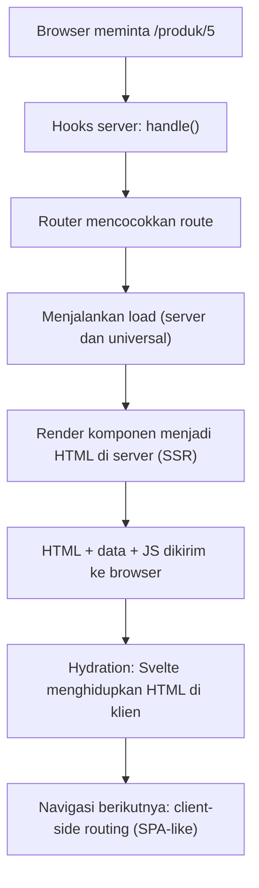

### Instalasi dan Struktur Folder

```bash
npx sv create belajar-kit
cd belajar-kit
npm install
npm run dev -- --open
```

```text
belajar-kit/
├── src/
│   ├── app.html              # template HTML dasar (%sveltekit.head%, %sveltekit.body%)
│   ├── app.d.ts              # tipe global (App.Locals, App.PageData, ...)
│   ├── hooks.server.ts       # hook sisi server (handle, handleError, handleFetch)
│   ├── hooks.client.ts       # hook sisi klien (handleError)
│   ├── lib/                  # kode bersama, alias $lib
│   │   └── server/           # HANYA bisa diimpor oleh kode server ($lib/server)
│   ├── params/               # matcher parameter route
│   └── routes/               # struktur URL aplikasi
│       ├── +layout.svelte
│       └── +page.svelte
├── static/                   # aset statis apa adanya (favicon, robots.txt)
├── svelte.config.js          # konfigurasi Svelte dan SvelteKit (adapter, alias, dll.)
├── vite.config.ts
├── tsconfig.json
└── package.json
```

`svelte.config.js`:

```js
import adapter from '@sveltejs/adapter-auto';
import { vitePreprocess } from '@sveltejs/vite-plugin-svelte';

/** @type {import('@sveltejs/kit').Config} */
export default {
  preprocess: vitePreprocess(),
  kit: {
    adapter: adapter(),
    alias: { $components: 'src/components' },    // alias tambahan (selain $lib)
  },
};
```

Konsep penting:

- **`$lib`** adalah alias ke `src/lib`; impor dengan `import { x } from '$lib/x'`.
- **`$lib/server`** (atau file `*.server.ts`) **tidak akan pernah** dikirim ke browser. SvelteKit melarang mengimpornya dari kode klien, sehingga rahasia (kunci API, akses database) aman.
- Jalankan `npm run dev` (HMR), `npm run build`, dan `npm run preview` untuk menguji hasil build.

## 9.2 File-based Routing

Struktur folder di `src/routes` **adalah** peta URL. Setiap folder = segmen URL; file khusus berawalan `+` menentukan perilakunya.

| File | Berjalan di | Fungsi |
|---|---|---|
| `+page.svelte` | Server (SSR) dan klien | Komponen halaman |
| `+page.ts` | **Universal** (server saat SSR, klien saat navigasi) | `load` universal dan opsi halaman |
| `+page.server.ts` | **Hanya server** | `load` server dan **form actions** |
| `+layout.svelte` | Server dan klien | Kerangka yang membungkus halaman anak |
| `+layout.ts` / `+layout.server.ts` | Universal / server | `load` untuk layout |
| `+error.svelte` | Server dan klien | Halaman error untuk subtree itu |
| `+server.ts` | **Hanya server** | Endpoint API (GET, POST, ...) |

```text
src/routes/
├── +layout.svelte              →  kerangka seluruh situs
├── +page.svelte                →  /
├── tentang/+page.svelte        →  /tentang
├── blog/
│   ├── +page.svelte            →  /blog
│   └── [slug]/+page.svelte     →  /blog/apa-itu-svelte
└── api/todos/+server.ts        →  endpoint /api/todos
```

### Layout dan Layout Nesting

```svelte
<!-- src/routes/+layout.svelte -->
<script lang="ts">
  import '../app.css';
  import { page } from '$app/state';

  let { children } = $props();
  const menu = [{ href: '/', label: 'Beranda' }, { href: '/blog', label: 'Blog' }, { href: '/tentang', label: 'Tentang' }];
</script>

<nav aria-label="Utama">
  {#each menu as m (m.href)}
    <a href={m.href} aria-current={page.url.pathname === m.href ? 'page' : undefined}>{m.label}</a>
  {/each}
</nav>

<main>{@render children()}</main>
<footer>© 2026</footer>
```

Layout **bersarang**: `+layout.svelte` di `blog/` membungkus semua halaman di bawah `/blog`, di dalam layout root.

> Navigasi memakai `<a href>` biasa; SvelteKit mencegat klik dan melakukan *client-side routing*. Tidak ada komponen `<Link>` khusus.

### Halaman Error

```svelte
<!-- src/routes/+error.svelte -->
<script>
  import { page } from '$app/state';
</script>

<h1>{page.status}</h1>
<p>{page.error?.message}</p>
<a href="/">Kembali ke beranda</a>
```

### Dynamic Routes, Parameters, Optional, dan Rest

| Pola folder | Contoh URL | `params` |
|---|---|---|
| `blog/[slug]` | `/blog/halo` | `{ slug: 'halo' }` |
| `toko/[kategori]/[id]` | `/toko/baju/12` | `{ kategori: 'baju', id: '12' }` |
| `[[lang]]/tentang` | `/tentang` dan `/id/tentang` | `lang` opsional |
| `docs/[...path]` | `/docs/a/b/c` | `{ path: 'a/b/c' }` |
| `produk/[id=integer]` | `/produk/5` (bukan `/produk/abc`) | cocok hanya bila *matcher* lolos |

```ts
// src/params/integer.ts   (matcher)
import type { ParamMatcher } from '@sveltejs/kit';
export const match: ParamMatcher = (param) => /^\d+$/.test(param);
```

### Route Groups dan Layout Reset

- **Route group** `(nama)`: folder dalam tanda kurung **tidak muncul di URL**, tetapi dapat memiliki `+layout.svelte` sendiri. Berguna untuk memisahkan area (mis. `(publik)` dan `(app)`).
- **Layout reset**: sebuah halaman dapat "keluar" dari layout induknya dengan nama file `+page@.svelte` (reset ke root) atau `+page@(app).svelte` (pakai layout grup `(app)`); layout juga dapat memakai `+layout@.svelte`.

```text
src/routes/
├── (publik)/
│   ├── +layout.svelte          # navbar publik
│   ├── +page.svelte            # /
│   └── harga/+page.svelte      # /harga
└── (app)/
    ├── +layout.svelte          # sidebar dashboard
    ├── dashboard/+page.svelte  # /dashboard
    └── pengaturan/+page.svelte # /pengaturan
```

## 9.3 Loading Data

**`load`** adalah fungsi yang mengambil data **sebelum** halaman dirender. Hasilnya tersedia sebagai prop `data`.

### Universal Load (`+page.ts`)

Berjalan di **server saat SSR** dan di **klien saat navigasi**. Cocok untuk data publik dan API eksternal. Nilai kembalian bisa berupa objek apa saja (termasuk fungsi/class), karena tidak diserialisasi di klien.

```ts
// src/routes/blog/[slug]/+page.ts
import { error } from '@sveltejs/kit';
import type { PageLoad } from './$types';

export const load: PageLoad = async ({ params, fetch }) => {
  const res = await fetch(`/api/posts/${params.slug}`);       // fetch khusus SvelteKit
  if (res.status === 404) error(404, 'Artikel tidak ditemukan');
  if (!res.ok) error(500, 'Gagal memuat artikel');
  return { post: await res.json() };
};
```

### Server Load (`+page.server.ts`)

Berjalan **hanya di server**; boleh memakai database, rahasia, `cookies`, dan `locals`. Datanya **diserialisasi** ke klien.

```ts
// src/routes/produk/+page.server.ts
import type { PageServerLoad } from './$types';
import { db } from '$lib/server/db';

export const load: PageServerLoad = async ({ url, locals }) => {
  const halaman = Number(url.searchParams.get('halaman') ?? 1);
  const produk = await db.ambilProduk({ halaman, ukuran: 20 });
  return { produk, halaman, pengguna: locals.user };
};
```

| | Universal (`+page.ts`) | Server (`+page.server.ts`) |
|---|---|---|
| Berjalan di | Server + klien | Hanya server |
| Akses DB/rahasia | Tidak | **Ya** |
| `cookies`, `locals` | Tidak | Ya |
| Nilai kembalian | Bebas (class, fungsi) | Harus bisa diserialisasi |
| Dipakai saat | Data publik, komponen sebagai data | Data sensitif, DB |

Jika keduanya ada, `load` server berjalan dulu dan hasilnya menjadi `data` untuk `load` universal.

### Memakai Data di Halaman

```svelte
<!-- +page.svelte -->
<script lang="ts">
  import type { PageProps } from './$types';
  let { data }: PageProps = $props();      // PageProps tersedia pada SvelteKit versi baru; sebelumnya: { data: PageData }
</script>

<h1>{data.post.judul}</h1>
{#each data.produk as p (p.id)}<p>{p.nama}</p>{/each}
```

Props `data` bersifat reaktif: saat navigasi ke URL yang sama komponennya (mis. `/blog/a` ke `/blog/b`), `data` diperbarui, dan nilai `$derived` yang bergantung padanya ikut berubah. Jangan menyalin `data` ke `$state` kecuali perlu mengeditnya.

### Parent Data, Layout Load, dan `depends`

```ts
// +layout.server.ts
export const load = async ({ locals }) => ({ pengguna: locals.user });

// halaman anak
export const load = async ({ parent }) => {
  const { pengguna } = await parent();        // data dari layout induk
  return { sapaan: `Halo ${pengguna?.nama ?? 'tamu'}` };
};
```

> `await parent()` membuat pemuatan **berurutan** (waterfall). Panggil di akhir atau setelah fetch independen dimulai agar tetap paralel.

**Dependensi dan invalidasi:** SvelteKit melacak `fetch(url)` dan `url`/`params` yang dipakai `load`. Kamu dapat mendaftarkan dependensi kustom dan memicu muat ulang:

```ts
export const load = async ({ depends }) => {
  depends('app:todos');
  return { todos: await ambilTodos() };
};
```

```ts
import { invalidate, invalidateAll } from '$app/navigation';
await invalidate('app:todos');     // jalankan ulang load yang bergantung pada 'app:todos'
await invalidateAll();             // jalankan ulang semua load
```

### Error Handling, Redirect, dan Serialisasi

```ts
import { error, redirect } from '@sveltejs/kit';

export const load = async ({ locals, params }) => {
  if (!locals.user) redirect(303, '/login');                 // pada SvelteKit 2 tidak perlu `throw`
  const data = await cari(params.id);
  if (!data) error(404, { message: 'Data tidak ditemukan' });
  return { data };
};
```

- **Redirect:** gunakan `303` setelah form POST, `307/308` untuk mempertahankan method, `301/302` untuk perpindahan permanen/sementara.
- **Serialisasi data server:** SvelteKit memakai pustaka *devalue*, sehingga selain JSON juga mendukung `Date`, `Map`, `Set`, `BigInt`, `RegExp`, dan `undefined`. **Tidak** mendukung fungsi dan instansi class.
- **Streaming:** `load` server dapat mengembalikan **Promise di dalam objek** (bukan promise tingkat atas); data penting langsung dirender, sisanya dialirkan:

```ts
export const load = async () => ({
  ringkasan: await ambilRingkasan(),         // ditunggu
  rekomendasi: ambilRekomendasi(),           // Promise: dialirkan kemudian
});
```

```svelte
{#await data.rekomendasi}
  <p>Memuat rekomendasi...</p>
{:then daftar}
  {#each daftar as r (r.id)}<p>{r.judul}</p>{/each}
{:catch}
  <p>Gagal memuat</p>
{/await}
```

- **`fetch` khusus di `load`:** meneruskan cookie dan header otorisasi untuk permintaan same-origin, boleh memakai URL relatif di server, dan respons dapat di-*inline* ke HTML agar tidak di-fetch ulang saat hydration.

## 9.4 Server-side Rendering

### SSR, CSR, Static, dan Hydration

| Mode | Cara kerja | Kelebihan | Pertimbangan |
|---|---|---|---|
| **SSR** (default) | Server membuat HTML tiap request, klien lalu *hydrate* | SEO baik, konten cepat tampil | Butuh server |
| **CSR / SPA** | Server kirim cangkang kosong, klien merender | Hosting statis sederhana | SEO dan *first paint* lebih lemah |
| **Prerender (SSG)** | HTML dibuat **saat build** | Sangat cepat, murah, bisa di CDN | Konten statis/jarang berubah |

**Hydration**: Svelte "menghidupkan" HTML yang sudah ada dari server (memasang event dan state) tanpa membuat ulang DOM.

### Konfigurasi per Halaman atau Layout

```ts
// +page.ts atau +layout.ts (juga +page.server.ts / +layout.server.ts)
export const prerender = true;       // HTML dibuat saat build (juga 'auto' untuk menyaring otomatis)
export const ssr = false;            // nonaktifkan SSR: halaman dirender hanya di klien
export const csr = false;            // nonaktifkan JS klien: halaman murni HTML
export const trailingSlash = 'never';
```

**Prerender halaman dinamis:** SvelteKit mengikuti tautan saat build; untuk rute tanpa tautan, tentukan `entries`:

```ts
// src/routes/blog/[slug]/+page.server.ts
export const prerender = true;
export function entries() {
  return [{ slug: 'halo-svelte' }, { slug: 'belajar-runes' }];
}
```

**Mode SPA penuh:** `export const ssr = false;` di `+layout.ts` root, dan pakai `adapter-static` dengan halaman fallback.

### Hydration Mismatch

Terjadi ketika HTML dari server berbeda dengan yang dihasilkan klien saat hydration. Penyebab umum: `Date.now()`/`Math.random()` pada render, `window`/`localStorage` yang menghasilkan konten berbeda, HTML tidak valid (mis. `<div>` di dalam `<p>`), atau ekstensi browser yang mengubah DOM.

**Perbaikan:** render nilai yang stabil dahulu, lalu perbarui di klien setelah mount:

```svelte
<script>
  import { onMount } from 'svelte';
  let waktu = $state('');                 // nilai awal sama di server dan klien
  onMount(() => { waktu = new Date().toLocaleTimeString('id-ID'); });
</script>
<p>{waktu || '...'}</p>
```

Kode yang hanya boleh jalan di browser: `onMount`, `$effect`, atau pengecekan `browser` dari `$app/environment`.

### Memilih Strategi Rendering

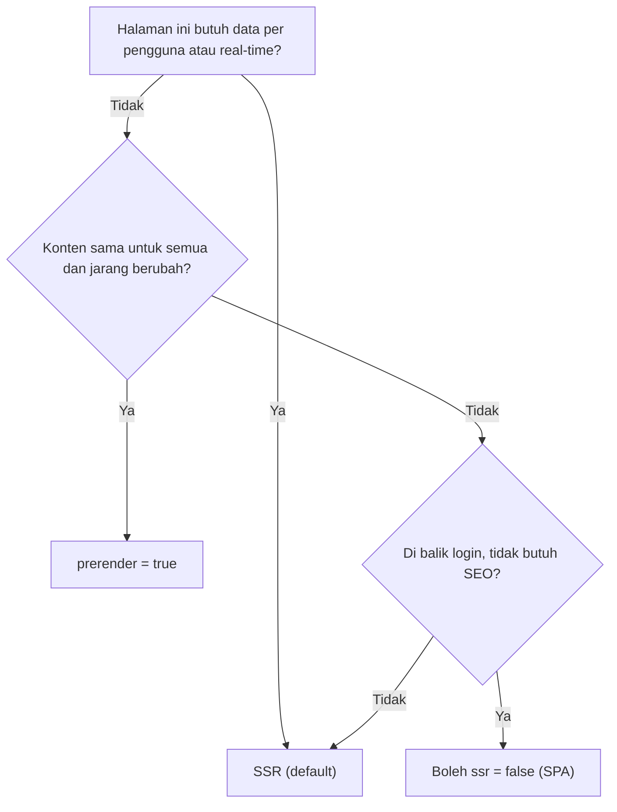

## 9.5 SvelteKit Advanced Routing

### Matcher dan Route Matching Lanjut

Matcher memvalidasi parameter (lihat 9.2). Urutan prioritas rute: rute lebih **spesifik** menang atas dinamis, dan parameter dinamis menang atas *rest*. Bila ada ambigu, atur dengan matcher atau struktur folder.

### Navigation API

```ts
import { goto, invalidate, invalidateAll, beforeNavigate, afterNavigate, onNavigate, preloadData } from '$app/navigation';

await goto('/dashboard');                                         // navigasi programatik
await goto('/cari?q=svelte', { replaceState: true, keepFocus: true, noScroll: true });
await goto('/login', { invalidateAll: true });

beforeNavigate(({ cancel, to }) => {                              // mis. peringatan draf belum disimpan
  if (dirty && !confirm('Tinggalkan halaman? Perubahan belum disimpan.')) cancel();
});

afterNavigate(({ from, to, type }) => { /* analytics, fokus ke heading */ });

onNavigate((navigasi) => {                                        // View Transitions API (jika didukung browser)
  if (!document.startViewTransition) return;
  return new Promise((resolve) => {
    document.startViewTransition(async () => { resolve(); await navigasi.complete; });
  });
});
```

`beforeNavigate`, `afterNavigate`, dan `onNavigate` dipanggil saat inisialisasi komponen.

**Atribut data pada elemen** untuk mengatur perilaku tautan:

| Atribut | Efek |
|---|---|
| `data-sveltekit-preload-data="hover"` | Memuat data halaman saat kursor di atas tautan (`"tap"` saat disentuh) |
| `data-sveltekit-preload-code` | Memuat kode saja |
| `data-sveltekit-reload` | Paksa muat ulang penuh (bukan client-side) |
| `data-sveltekit-noscroll` | Jangan scroll ke atas |
| `data-sveltekit-replacestate` | Ganti entri riwayat |

### `page` State dan Info Navigasi

```svelte
<script>
  import { page, navigating } from '$app/state';
  // page.url, page.params, page.route.id, page.data, page.form, page.status, page.error, page.state
</script>

{#if navigating.to}<div class="bar-memuat"></div>{/if}
<p>Rute: {page.route.id} · Param: {JSON.stringify(page.params)}</p>
```

> `$app/state` (objek reaktif berbasis rune) tersedia pada SvelteKit versi baru (2.12+). Pada versi sebelumnya dan kode lama, gunakan store `page` dari `$app/stores` (`$page.url`).

### Shallow Routing

Mengubah URL dan membuat entri riwayat **tanpa berpindah halaman**, mis. membuka foto dalam modal dengan URL sendiri, yang dapat ditutup dengan tombol *back*:

```svelte
<script lang="ts">
  import { pushState, goto, preloadData } from '$app/navigation';
  import { page } from '$app/state';

  async function bukaFoto(e: MouseEvent & { currentTarget: HTMLAnchorElement }) {
    if (e.metaKey || e.ctrlKey) return;                     // biarkan buka di tab baru
    e.preventDefault();
    const { href } = e.currentTarget;
    const hasil = await preloadData(href);                  // ambil data halaman target
    if (hasil.type === 'loaded' && hasil.status === 200) {
      pushState(href, { foto: hasil.data });                // ubah URL tanpa navigasi
    } else {
      goto(href);
    }
  }
</script>

<a href="/foto/12" onclick={bukaFoto}>Foto 12</a>

{#if page.state.foto}
  <Modal onclose={() => history.back()}>...{page.state.foto.judul}</Modal>
{/if}
```

Tambahkan tipe state di `app.d.ts` (`App.PageState`). `replaceState` memperbarui entri sekarang tanpa menambah riwayat.

## Project Level 9

### 1. Multi-page Website

Beranda, tentang, kontak, layanan, dengan **layout bersama**, navigasi yang menandai halaman aktif (`aria-current`), halaman 404 kustom, dan `<svelte:head>` untuk `<title>` dan meta tiap halaman:

```svelte
<svelte:head>
  <title>Tentang Kami | Contoh</title>
  <meta name="description" content="Profil perusahaan." />
</svelte:head>
```

### 2. Blog Application (Markdown dengan mdsvex)

```bash
npx sv add mdsvex
```

```md
<!-- src/posts/halo-svelte.md -->
---
judul: Halo Svelte
tanggal: 2026-10-31
---

# Selamat datang

Ini artikel pertama.
```

```ts
// src/routes/blog/+page.ts
export const load = async () => {
  const modul = import.meta.glob<{ metadata: { judul: string; tanggal: string } }>('/src/posts/*.md', { eager: true });
  const posts = Object.entries(modul)
    .map(([path, m]) => ({ slug: path.split('/').pop()!.replace('.md', ''), ...m.metadata }))
    .sort((a, b) => +new Date(b.tanggal) - +new Date(a.tanggal));
  return { posts };
};
```

```ts
// src/routes/blog/[slug]/+page.ts
import { error } from '@sveltejs/kit';
export const load = async ({ params }) => {
  try {
    const post = await import(`../../../posts/${params.slug}.md`);
    return { Konten: post.default, meta: post.metadata };
  } catch {
    error(404, 'Artikel tidak ditemukan');
  }
};
```

```svelte
<!-- src/routes/blog/[slug]/+page.svelte -->
<script>
  let { data } = $props();
</script>
<h1>{data.meta.judul}</h1>
<data.Konten />
```

### 3. Documentation Website

Sidebar dibangkitkan dari struktur file `import.meta.glob`, navigasi *sebelumnya/berikutnya*, *table of contents* dari heading, pencarian, dan `prerender = true` agar situs sepenuhnya statis.

### 4. Product Catalog

Daftar produk dengan filter, urutan, dan paginasi yang disimpan di **URL** (`?kategori=x&halaman=2`), dibaca di `load` lewat `url.searchParams` sehingga bisa dibagikan, tahan refresh, dan SEO-friendly:

```svelte
<form method="GET" data-sveltekit-keepfocus>
  <input name="q" value={data.q} />
  <select name="kategori">...</select>
  <button>Cari</button>
</form>
```

Form `GET` biasa otomatis menjadi navigasi dengan *search params*.

### 5. Admin Dashboard dengan SvelteKit

Dua route group: `(auth)` untuk login/daftar (layout minimal) dan `(app)` untuk dashboard (sidebar). `+layout.server.ts` di `(app)` memeriksa sesi (dibangun di Level 12) dan mengarahkan ke `/login` bila perlu.

## Target Kompetensi Level 9

- [ ] Menjelaskan arsitektur SvelteKit dan perbedaannya dari Svelte.
- [ ] Membuat route statis, dinamis, bersarang, dan grup, lengkap dengan layout dan halaman error.
- [ ] Memuat data dengan `load` universal/server, `parent`, `depends`, dan menangani error/redirect.
- [ ] Memilih strategi rendering (SSR, prerender, SPA) dan mengatasi hydration mismatch.
- [ ] Memakai Navigation API, preload, dan shallow routing.

---

# LEVEL 10: Data Fetching dan API Integration

**Tujuan:** menghubungkan Svelte dengan backend melalui REST API dan layanan eksternal.

## 10.1 Fetch API

```ts
// GET dengan query parameter
const params = new URLSearchParams({ halaman: '2', urut: 'terbaru', q: 'svelte' });
const res = await fetch(`/api/artikel?${params}`);

// POST dengan JSON
await fetch('/api/artikel', {
  method: 'POST',
  headers: { 'Content-Type': 'application/json', Authorization: `Bearer ${token}` },
  body: JSON.stringify({ judul: 'Baru' }),
});

// PUT/PATCH/DELETE
await fetch(`/api/artikel/${id}`, { method: 'PATCH', headers: { 'Content-Type': 'application/json' }, body: JSON.stringify({ judul: 'Ubah' }) });
await fetch(`/api/artikel/${id}`, { method: 'DELETE' });

// FormData (unggah file; jangan set Content-Type manual)
const fd = new FormData(); fd.append('berkas', file);
await fetch('/api/unggah', { method: 'POST', body: fd });
```

### Response Handling dan Error Handling

`fetch` hanya menolak (*reject*) pada kegagalan jaringan; status 4xx/5xx **tetap dianggap sukses**, jadi cek `res.ok`.

```ts
export class ApiError extends Error {
  constructor(public status: number, message: string, public detail?: unknown) { super(message); }
}

async function ambil<T>(url: string, init?: RequestInit): Promise<T> {
  const res = await fetch(url, init);
  if (!res.ok) {
    let detail: unknown;
    try { detail = await res.json(); } catch { /* bukan JSON */ }
    throw new ApiError(res.status, `Permintaan gagal (${res.status})`, detail);
  }
  return res.status === 204 ? (undefined as T) : ((await res.json()) as T);
}
```

### Timeout dan AbortController

```ts
// Timeout sederhana (dukungan luas pada browser modern dan Node baru)
const res = await fetch(url, { signal: AbortSignal.timeout(8000) });

// Pembatalan manual (mis. permintaan usang)
const kontrol = new AbortController();
fetch(url, { signal: kontrol.signal }).catch((e) => { if (e.name !== 'AbortError') throw e; });
kontrol.abort();

// Gabungkan beberapa sinyal
const sinyal = AbortSignal.any([kontrol.signal, AbortSignal.timeout(8000)]);
```

### Pencarian dengan Debounce dan Pembatalan (menghindari *race condition*)

```svelte
<script lang="ts">
  let q = $state('');
  let hasil = $state<{ id: number; nama: string }[]>([]);
  let memuat = $state(false);
  let galat = $state('');

  $effect(() => {
    const kata = q.trim();
    if (!kata) { hasil = []; return; }

    const kontrol = new AbortController();
    const timer = setTimeout(async () => {                       // debounce 300 ms
      memuat = true; galat = '';
      try {
        const res = await fetch(`/api/cari?q=${encodeURIComponent(kata)}`, { signal: kontrol.signal });
        if (!res.ok) throw new Error(`HTTP ${res.status}`);
        hasil = await res.json();
      } catch (e) {
        if ((e as Error).name !== 'AbortError') galat = (e as Error).message;
      } finally {
        memuat = false;
      }
    }, 300);

    return () => { clearTimeout(timer); kontrol.abort(); };      // cleanup: batalkan yang usang
  });
</script>

<input type="search" bind:value={q} placeholder="Cari..." />
{#if memuat}<p>Mencari...</p>{:else if galat}<p role="alert">{galat}</p>{/if}
<ul>{#each hasil as h (h.id)}<li>{h.nama}</li>{/each}</ul>
```

> Di SvelteKit, untuk data yang menentukan isi halaman, **utamakan `load`** (SSR, tanpa *loading flicker*, otomatis dibatalkan saat navigasi). Pola `$effect` + fetch cocok untuk interaksi sisi klien seperti pencarian instan.

## 10.2 API Integration

### API Service Layer dan HTTP Client Architecture

Pisahkan pemanggilan jaringan dari komponen:

```ts
// src/lib/api/client.ts
import { PUBLIC_API_URL } from '$env/static/public';       // Vite murni: import.meta.env.VITE_API_URL

type Opsi = RequestInit & { params?: Record<string, string | number | undefined>; fetch?: typeof fetch };

export async function api<T>(path: string, { params, fetch: f = fetch, ...init }: Opsi = {}): Promise<T> {
  const url = new URL(path, PUBLIC_API_URL);
  for (const [k, v] of Object.entries(params ?? {})) if (v !== undefined) url.searchParams.set(k, String(v));

  const headers = new Headers(init.headers);
  if (init.body && !(init.body instanceof FormData) && !headers.has('Content-Type')) {
    headers.set('Content-Type', 'application/json');
  }

  const res = await f(url, { ...init, headers, signal: init.signal ?? AbortSignal.timeout(10_000) });
  if (!res.ok) throw new ApiError(res.status, res.statusText, await res.json().catch(() => undefined));
  return res.status === 204 ? (undefined as T) : res.json();
}
```

```ts
// src/lib/api/artikel.ts
import { api } from './client';
import type { Artikel } from '$lib/types';

export const artikelApi = {
  daftar: (params: { halaman?: number; q?: string }, fetch?: typeof globalThis.fetch) =>
    api<{ data: Artikel[]; total: number }>('/artikel', { params, fetch }),
  detail: (id: number, fetch?: typeof globalThis.fetch) => api<Artikel>(`/artikel/${id}`, { fetch }),
  buat: (data: Omit<Artikel, 'id'>) => api<Artikel>('/artikel', { method: 'POST', body: JSON.stringify(data) }),
  hapus: (id: number) => api<void>(`/artikel/${id}`, { method: 'DELETE' }),
};
```

Di `load`, teruskan `fetch` khusus SvelteKit: `artikelApi.daftar({ halaman: 1 }, fetch)`.

### Environment Variables

| Modul | Berlaku di | Waktu | Catatan |
|---|---|---|---|
| `$env/static/private` | Server | Build | Tidak boleh diimpor kode klien |
| `$env/dynamic/private` | Server | Runtime | Untuk nilai yang diatur saat deploy |
| `$env/static/public` | Server + klien | Build | **Wajib** berawalan `PUBLIC_` |
| `$env/dynamic/public` | Server + klien | Runtime | Berawalan `PUBLIC_` |

Simpan di `.env` (jangan di-commit; sertakan `.env.example`). **Segala sesuatu yang bisa dibaca klien dapat dilihat siapa pun.**

### Authentication Headers dan Error Interceptor Pattern

Di klien, bungkus `fetch` dengan satu fungsi tempat menambahkan header otorisasi dan menangani 401 secara terpusat. Di SvelteKit, tempat terbaik untuk itu di **server** adalah hook `handleFetch` (menyisipkan kredensial pada `fetch` server-ke-server):

```ts
// src/hooks.server.ts
import type { HandleFetch } from '@sveltejs/kit';
import { API_TOKEN } from '$env/static/private';

export const handleFetch: HandleFetch = async ({ request, fetch }) => {
  if (request.url.startsWith('https://api.contoh.com/')) {
    request.headers.set('Authorization', `Bearer ${API_TOKEN}`);
  }
  return fetch(request);
};
```

### Request Retry

```ts
export async function denganRetry<T>(fn: () => Promise<T>, { maks = 3, dasar = 300 } = {}): Promise<T> {
  for (let percobaan = 1; ; percobaan++) {
    try {
      return await fn();
    } catch (e) {
      const sementara = !(e instanceof ApiError) || e.status >= 500 || e.status === 429;
      if (!sementara || percobaan >= maks) throw e;
      await new Promise((r) => setTimeout(r, dasar * 2 ** (percobaan - 1) + Math.random() * 100));  // backoff + jitter
    }
  }
}
```

Hanya ulangi kegagalan **sementara** (jaringan, 5xx, 429), dan hanya untuk operasi **idempoten** (GET; POST hanya bila memakai kunci idempotensi).

### Pagination, Search, Filtering, Sorting, dan Transformasi Data

| Pola | Parameter | Catatan |
|---|---|---|
| **Offset** | `?halaman=2&ukuran=20` | Sederhana; kurang stabil bila data sering berubah |
| **Cursor** | `?cursor=abc&limit=20` | Stabil untuk feed dan infinite scroll |
| **Pencarian** | `?q=svelte` | Debounce di klien |
| **Filter** | `?kategori=buku&harga_maks=100000` | Simpan di URL |
| **Urut** | `?urut=-tanggal` | Awalan `-` untuk menurun (konvensi) |

**Transformasi data:** petakan respons API (DTO) ke model domain di satu tempat (`snake_case` → `camelCase`, string tanggal → `Date`, nilai default) sehingga komponen tidak bergantung pada bentuk API.

```ts
const keArtikel = (d: ArtikelDTO): Artikel => ({
  id: d.id,
  judul: d.title,
  tanggal: new Date(d.created_at),
  penulis: d.author?.name ?? 'Anonim',
});
```

## 10.3 Advanced Data Fetching

### Parallel, Sequential, dan Dependent Requests

```ts
// Paralel: tidak saling bergantung
const [pengguna, pesanan] = await Promise.all([ambilPengguna(id), ambilPesanan(id)]);

// Sequential/dependent: yang kedua butuh hasil pertama
const toko = await ambilToko(slug);
const produk = await ambilProduk(toko.id);

// Toleran sebagian gagal
const hasil = await Promise.allSettled([a(), b(), c()]);
const berhasil = hasil.filter((h) => h.status === 'fulfilled').map((h) => h.value);
```

Hindari *waterfall* yang tidak perlu: mulai semua permintaan independen sekaligus.

### Data Caching dan Cache Invalidation

**Cache memori sederhana dengan TTL:**

```ts
const cache = new Map<string, { nilai: unknown; kedaluwarsa: number }>();

export async function denganCache<T>(kunci: string, ttlMs: number, ambil: () => Promise<T>): Promise<T> {
  const ada = cache.get(kunci);
  if (ada && ada.kedaluwarsa > Date.now()) return ada.nilai as T;
  const nilai = await ambil();
  cache.set(kunci, { nilai, kedaluwarsa: Date.now() + ttlMs });
  return nilai;
}
export const hapusCache = (kunci: string) => cache.delete(kunci);       // invalidasi
```

Lapisan cache lain: **HTTP cache** (`Cache-Control`, `ETag`), cache CDN, dan Redis (Level 11). Di SvelteKit atur header respons dengan `setHeaders({ 'cache-control': 'public, max-age=60' })` di `load` server. Invalidasi data `load` memakai `invalidate()` (Level 9).

> "Ada dua hal sulit dalam ilmu komputer: invalidasi cache dan penamaan." Rancang **kapan data dianggap basi** sejak awal.

**Library server-state:** untuk aplikasi yang banyak berinteraksi dengan API di klien, **TanStack Query** (adaptor Svelte) menyediakan cache, deduplikasi, refetch otomatis, retry, dan invalidasi. API-nya berbeda antar versi adaptor, jadi ikuti dokumentasi resmi. Contoh gaya terbaru untuk Svelte 5:

```svelte
<script lang="ts">
  import { createQuery } from '@tanstack/svelte-query';

  const todos = createQuery(() => ({
    queryKey: ['todos'],
    queryFn: () => fetch('/api/todos').then((r) => r.json()),
  }));
</script>

{#if todos.isPending}Memuat...{:else if todos.isError}Error: {todos.error.message}
{:else}{#each todos.data as t (t.id)}<p>{t.judul}</p>{/each}{/if}
```

### Optimistic UI

Pola dan kode rollback telah dibahas di Level 6. Pada SvelteKit, `use:enhance` dengan callback memudahkan pembaruan optimistis saat memakai form actions (Level 11).

### Infinite Query Pattern (Cursor)

```svelte
<script lang="ts">
  type Halaman = { data: { id: number; judul: string }[]; berikutnya: string | null };
  let item = $state<Halaman['data']>([]);
  let kursor = $state<string | null>(null);
  let selesai = $state(false);
  let memuat = $state(false);

  async function muat() {
    if (memuat || selesai) return;
    memuat = true;
    const p = new URLSearchParams(kursor ? { kursor } : {});
    const res: Halaman = await (await fetch(`/api/feed?${p}`)).json();
    item.push(...res.data);
    kursor = res.berikutnya;
    selesai = res.berikutnya === null;
    memuat = false;
  }
  muat();                      // halaman pertama
</script>
```

Hubungkan `muat()` dengan `IntersectionObserver` (Level 8) agar otomatis memuat saat sentinel terlihat.

### Polling

```svelte
<script lang="ts">
  let status = $state('...');

  $effect(() => {
    let batal = false;
    async function tanya() {
      if (document.visibilityState !== 'visible') return;           // hemat sumber daya saat tab tersembunyi
      const r = await fetch('/api/status');
      if (!batal && r.ok) status = (await r.json()).status;
    }
    tanya();
    const id = setInterval(tanya, 5000);
    return () => { batal = true; clearInterval(id); };
  });
</script>
```

### Real-time: WebSocket dan Server-Sent Events

| | **WebSocket** | **SSE (Server-Sent Events)** |
|---|---|---|
| Arah | Dua arah | Server → klien saja |
| Protokol | `ws://`/`wss://` | HTTP biasa (`text/event-stream`) |
| Reconnect otomatis | Tidak (buat sendiri) | **Ya** (bawaan `EventSource`) |
| Cocok untuk | Chat, game, kolaborasi | Notifikasi, feed, dashboard monitoring |

**Klien WebSocket dengan reconnect (backoff):**

```ts
// ws.svelte.ts
export function buatSocket(url: string) {
  let ws: WebSocket | undefined;
  let tunda = 500;
  let pesan = $state<string[]>([]);
  let terhubung = $state(false);
  let tutup = false;

  function hubungkan() {
    ws = new WebSocket(url);
    ws.onopen = () => { terhubung = true; tunda = 500; };
    ws.onmessage = (e) => pesan.push(e.data);
    ws.onclose = () => {
      terhubung = false;
      if (!tutup) setTimeout(hubungkan, (tunda = Math.min(tunda * 2, 15000)));
    };
  }
  hubungkan();

  return {
    get pesan() { return pesan; },
    get terhubung() { return terhubung; },
    kirim: (d: string) => ws?.readyState === WebSocket.OPEN && ws.send(d),
    tutup: () => { tutup = true; ws?.close(); },
  };
}
```

> Server dev SvelteKit tidak menyediakan endpoint WebSocket bawaan; gunakan server terpisah (mis. pustaka `ws`) atau plugin/adaptor yang mendukungnya, dan perhatikan dukungan platform deployment.

**SSE: endpoint di SvelteKit dan klien:**

```ts
// src/routes/api/stream/+server.ts
import type { RequestHandler } from './$types';

export const GET: RequestHandler = () => {
  let timer: ReturnType<typeof setInterval>;
  const stream = new ReadableStream({
    start(controller) {
      const enc = new TextEncoder();
      timer = setInterval(() => {
        const data = JSON.stringify({ t: Date.now(), cpu: Math.round(Math.random() * 100) });
        controller.enqueue(enc.encode(`data: ${data}\n\n`));       // format SSE: "data: ...\n\n"
      }, 1000);
    },
    cancel() { clearInterval(timer); },                              // klien menutup koneksi
  });

  return new Response(stream, {
    headers: { 'Content-Type': 'text/event-stream', 'Cache-Control': 'no-cache', Connection: 'keep-alive' },
  });
};
```

```svelte
<script lang="ts">
  let cpu = $state(0);
  $effect(() => {
    const es = new EventSource('/api/stream');
    es.onmessage = (e) => (cpu = JSON.parse(e.data).cpu);
    es.onerror = () => { /* EventSource mencoba menyambung ulang otomatis */ };
    return () => es.close();
  });
</script>
<p>CPU: {cpu}%</p>
```

## Project Level 10

1. **REST API Client:** antarmuka CRUD generik terhadap JSONPlaceholder dengan service layer, `ApiError`, loading/error/empty state, dan optimistic delete.
2. **GitHub Repository Explorer:** cari pengguna → daftar repositori (`https://api.github.com/users/{nama}/repos?per_page=30&page=1`), paginasi, urut berdasarkan bintang, detail repositori. Perhatikan **batas laju** API tanpa autentikasi dan tangani respons `403/429` dengan pesan yang jelas.
3. **Employee Management Dashboard:** tabel dengan paginasi sisi server, filter dan urut tersimpan di URL, formulir tambah/ubah, konfirmasi hapus.
4. **Real-time Monitoring Dashboard:** SSE (atau WebSocket) untuk metrik langsung, grafik SVG bergulir, indikator status koneksi, dan polling sebagai *fallback*.
5. **Search Engine dengan API:** pencarian dengan debounce dan `AbortController`, penyorotan kata kunci, riwayat pencarian, dan navigasi keyboard pada hasil.

## Target Kompetensi Level 10

- [ ] Memakai Fetch API dengan benar (header, query, body, error, timeout, abort).
- [ ] Merancang service layer, konfigurasi environment, retry, pagination, dan transformasi data.
- [ ] Mengelola request paralel/berurutan, caching dan invalidasi, optimistic UI, serta infinite query.
- [ ] Mengimplementasikan polling, WebSocket, dan SSE untuk data real-time.

---

# LEVEL 11: Backend Integration

**Tujuan:** memanfaatkan fitur server SvelteKit untuk membangun aplikasi full-stack.

## 11.1 Server Routes

**Server route** (`+server.ts`) adalah endpoint HTTP di dalam aplikasi SvelteKit, dipakai untuk API JSON, webhook, unduhan file, atau proxy.

```ts
// src/routes/api/todos/+server.ts
import { json, error } from '@sveltejs/kit';
import type { RequestHandler } from './$types';
import { db } from '$lib/server/db';
import { todo } from '$lib/server/db/schema';
import { eq } from 'drizzle-orm';

export const GET: RequestHandler = async ({ url, locals }) => {
  if (!locals.user) error(401, 'Perlu login');
  const selesai = url.searchParams.get('selesai');
  const rows = await db.select().from(todo).where(eq(todo.userId, locals.user.id));
  return json(selesai === null ? rows : rows.filter((r) => r.done === (selesai === 'true')));
};

export const POST: RequestHandler = async ({ request, locals }) => {
  if (!locals.user) error(401, 'Perlu login');

  const body = await request.json().catch(() => null);
  const title = typeof body?.title === 'string' ? body.title.trim() : '';
  if (title.length < 1 || title.length > 200) error(422, 'Judul 1-200 karakter');

  const [baru] = await db.insert(todo).values({ title, userId: locals.user.id }).returning();
  return json(baru, { status: 201, headers: { Location: `/api/todos/${baru.id}` } });
};
```

```ts
// src/routes/api/todos/[id]/+server.ts
export const PATCH: RequestHandler = async ({ params, request, locals }) => { /* ubah */ };
export const DELETE: RequestHandler = async ({ params, locals }) => {
  /* hapus */
  return new Response(null, { status: 204 });
};
```

| Elemen | Keterangan |
|---|---|
| Handler | `GET`, `POST`, `PUT`, `PATCH`, `DELETE`, `OPTIONS`, `HEAD`, atau `fallback` |
| Argumen | `request`, `url`, `params`, `cookies`, `locals`, `fetch`, `setHeaders`, `platform`, `getClientAddress()` |
| Respons | `json(data, init)`, `text()`, atau `new Response(...)` (stream, file, redirect) |
| Error | `error(status, pesan)`; error tak terduga ditangani hook `handleError` |

**Status code yang tepat:** `201` + `Location` untuk pembuatan, `204` untuk hapus, `400` input rusak, `401` belum login, `403` tidak berhak, `404` tidak ada, `409` konflik, `422` validasi bisnis gagal.

> Jika halaman dan endpoint ada di route yang sama (`+page.svelte` dan `+server.ts`), SvelteKit membedakan berdasarkan header `Accept` dan method. Untuk aplikasi yang hanya dipakai oleh UI sendiri, **form actions dan `load`** biasanya lebih sederhana daripada membuat API terpisah.

## 11.2 Form Actions

**Form actions** adalah cara SvelteKit menangani pengiriman form di server (`+page.server.ts`), dengan **progressive enhancement**: berfungsi **tanpa JavaScript** (form HTML biasa), lalu ditingkatkan dengan `use:enhance` tanpa memuat ulang halaman.

```ts
// src/routes/todos/+page.server.ts
import { fail, redirect } from '@sveltejs/kit';
import type { Actions, PageServerLoad } from './$types';
import { db } from '$lib/server/db';
import { todo } from '$lib/server/db/schema';
import { and, eq } from 'drizzle-orm';

export const load: PageServerLoad = async ({ locals }) => {
  if (!locals.user) redirect(303, '/login');
  return { todos: await db.select().from(todo).where(eq(todo.userId, locals.user.id)) };
};

export const actions: Actions = {
  tambah: async ({ request, locals }) => {
    if (!locals.user) return fail(401, { pesan: 'Perlu login' });

    const data = await request.formData();
    const title = String(data.get('title') ?? '').trim();

    if (!title) return fail(400, { title, galat: { title: 'Judul wajib diisi' } });
    if (title.length > 200) return fail(400, { title, galat: { title: 'Maksimal 200 karakter' } });

    await db.insert(todo).values({ title, userId: locals.user.id });
    return { sukses: true };                                  // tersedia sebagai prop `form`
  },

  hapus: async ({ request, locals }) => {
    const id = Number((await request.formData()).get('id'));
    if (!locals.user || !Number.isInteger(id)) return fail(400);
    await db.delete(todo).where(and(eq(todo.id, id), eq(todo.userId, locals.user.id)));   // cek kepemilikan!
    return { sukses: true };
  },
};
```

```svelte
<!-- src/routes/todos/+page.svelte -->
<script lang="ts">
  import { enhance } from '$app/forms';
  import type { PageProps } from './$types';

  let { data, form }: PageProps = $props();
  let mengirim = $state(false);
</script>

<form
  method="POST"
  action="?/tambah"
  use:enhance={() => {
    mengirim = true;
    return async ({ update }) => {           // `update` menerapkan hasil (reset form, invalidasi data)
      await update();
      mengirim = false;
    };
  }}
>
  <input name="title" value={form?.title ?? ''} aria-invalid={!!form?.galat?.title} />
  {#if form?.galat?.title}<p role="alert">{form.galat.title}</p>{/if}
  <button disabled={mengirim}>{mengirim ? 'Menyimpan...' : 'Tambah'}</button>
</form>

<ul>
  {#each data.todos as t (t.id)}
    <li>
      {t.title}
      <form method="POST" action="?/hapus" use:enhance style="display:inline">
        <input type="hidden" name="id" value={t.id} />
        <button aria-label="Hapus {t.title}">×</button>
      </form>
    </li>
  {/each}
</ul>
```

**Konsep kunci:**

| Konsep | Penjelasan |
|---|---|
| **Default action** | `actions = { default: ... }`; form `method="POST"` tanpa `action` |
| **Named actions** | `actions = { tambah, hapus }`; form memakai `action="?/tambah"` |
| `request.formData()` | Membaca nilai form (`data.get('nama')`) |
| `fail(status, data)` | Mengembalikan error validasi **tanpa** membuang input; data ada di `form` |
| Mengembalikan objek | Tersedia sebagai prop `form` (dan `page.form`) |
| `redirect(303, url)` | Alihkan setelah sukses (pola *POST-redirect-GET*) |
| `use:enhance` | Mengirim via `fetch`, memperbarui `form`, **invalidasi otomatis** data `load`, tanpa muat ulang halaman |
| Callback `enhance` | Atur loading, batalkan (`cancel()`), pembaruan optimistis, perilaku reset (`update({ reset: false })`) |
| Progressive enhancement | Tanpa JS, form tetap bekerja lewat navigasi penuh |

**Perlindungan CSRF:** SvelteKit memeriksa header `Origin` pada pengiriman form lintas-situs secara default. Saat berada di belakang reverse proxy, pastikan origin yang diteruskan benar (lihat Level 16).

**Validasi:** gunakan skema (Zod/Valibot) di action, atau **Superforms** (Level 7) untuk validasi server+klien yang menyatu.

> SvelteKit versi baru memperkenalkan *remote functions* (fungsi server yang dapat dipanggil langsung dari komponen) sebagai fitur **eksperimental**. Fitur ini masih berkembang; pelajari setelah menguasai `load`, form actions, dan endpoint di atas, dan periksa dokumentasi terbaru.

## 11.3 Database Integration

### Database Fundamentals

**Database relasional** menyimpan data dalam **tabel** (baris dan kolom) yang dihubungkan oleh **kunci** (*primary key*, *foreign key*). Bahasa kuerinya adalah **SQL**.

```sql
CREATE TABLE pengguna (
  id        INTEGER PRIMARY KEY,
  email     TEXT NOT NULL UNIQUE,
  nama      TEXT NOT NULL,
  dibuat    TEXT NOT NULL DEFAULT CURRENT_TIMESTAMP
);

CREATE TABLE todo (
  id        INTEGER PRIMARY KEY,
  user_id   INTEGER NOT NULL REFERENCES pengguna(id) ON DELETE CASCADE,
  judul     TEXT NOT NULL,
  selesai   INTEGER NOT NULL DEFAULT 0
);
CREATE INDEX idx_todo_user ON todo(user_id);          -- mempercepat pencarian berdasarkan user_id

INSERT INTO pengguna (email, nama) VALUES ('dina@contoh.com', 'Dina');
SELECT t.id, t.judul, p.nama
  FROM todo t JOIN pengguna p ON p.id = t.user_id
 WHERE t.selesai = 0 AND p.email = ?
 ORDER BY t.id DESC LIMIT 20;
UPDATE todo SET selesai = 1 WHERE id = ?;
DELETE FROM todo WHERE id = ?;
SELECT user_id, COUNT(*) AS jumlah FROM todo GROUP BY user_id HAVING COUNT(*) > 5;
```

**Keamanan: selalu pakai *parameterized query*** (placeholder `?`/`$1`), **jangan** menyambung string SQL dari input pengguna, karena itu membuka celah **SQL injection**. ORM dan query builder otomatis memakai parameter.

| Konsep | Penjelasan |
|---|---|
| **Connection** | Koneksi aplikasi ke database; mahal dibuat |
| **Connection pooling** | Menyimpan sejumlah koneksi untuk dipakai ulang (mis. `Pool` pada `pg`) |
| **ORM** | Memetakan tabel ke objek/tipe (Prisma, Drizzle) |
| **Query builder** | Menyusun SQL dengan API bertipe (Drizzle, Kysely) |
| **Transaksi** | Beberapa operasi atomik (ACID): semua berhasil atau semua dibatalkan |
| **Migrasi** | Perubahan skema yang diversikan dan dapat diulang |
| **Seeding** | Mengisi data awal/contoh |

### Error Handling Database

Tangkap pelanggaran constraint (mis. email duplikat) dan ubah menjadi pesan validasi yang ramah, **jangan bocorkan pesan SQL mentah** ke klien.

```ts
try {
  await db.insert(pengguna).values({ email, nama });
} catch (e: any) {
  if (e?.code === 'SQLITE_CONSTRAINT' || e?.code === '23505') {      // kode bergantung driver/database
    return fail(409, { galat: { email: 'Email sudah terdaftar' } });
  }
  throw e;                                                            // biarkan handleError menangani sisanya
}
```

## 11.4 Database Tools

### Drizzle ORM (contoh utama, SQLite via libSQL)

```bash
npx sv add drizzle         # atau pasang manual:
npm install drizzle-orm @libsql/client
npm install -D drizzle-kit
```

```ts
// src/lib/server/db/schema.ts
import { sqliteTable, integer, text } from 'drizzle-orm/sqlite-core';

export const pengguna = sqliteTable('pengguna', {
  id: text('id').primaryKey(),                                  // ID acak (string)
  email: text('email').notNull().unique(),
  passwordHash: text('password_hash').notNull(),
  peran: text('peran', { enum: ['admin', 'user'] }).notNull().default('user'),
});

export const todo = sqliteTable('todo', {
  id: integer('id').primaryKey({ autoIncrement: true }),
  userId: text('user_id').notNull().references(() => pengguna.id, { onDelete: 'cascade' }),
  title: text('title').notNull(),
  done: integer('done', { mode: 'boolean' }).notNull().default(false),
  createdAt: integer('created_at', { mode: 'timestamp' }).notNull().$defaultFn(() => new Date()),
});
```

```ts
// src/lib/server/db/index.ts   (satu instansi untuk seluruh aplikasi)
import { drizzle } from 'drizzle-orm/libsql';
import { createClient } from '@libsql/client';
import { env } from '$env/dynamic/private';
import * as schema from './schema';

if (!env.DATABASE_URL) throw new Error('DATABASE_URL belum diatur');
const client = createClient({ url: env.DATABASE_URL });          // mis. file:local.db
export const db = drizzle(client, { schema });
```

```ts
// drizzle.config.ts
import { defineConfig } from 'drizzle-kit';
export default defineConfig({
  schema: './src/lib/server/db/schema.ts',
  dialect: 'sqlite',
  dbCredentials: { url: process.env.DATABASE_URL! },
  strict: true,
});
```

```bash
# .env
DATABASE_URL=file:local.db

npx drizzle-kit generate     # membuat file migrasi SQL dari perubahan skema
npx drizzle-kit migrate      # menjalankan migrasi
npx drizzle-kit push         # (pengembangan) langsung sinkronkan skema tanpa file migrasi
npx drizzle-kit studio       # antarmuka web untuk melihat data
```

**Kueri:**

```ts
import { eq, and, desc, like, count, sql } from 'drizzle-orm';

const semua = await db.select().from(todo).where(eq(todo.userId, uid)).orderBy(desc(todo.createdAt)).limit(20).offset(0);
const [satu] = await db.select().from(todo).where(and(eq(todo.id, id), eq(todo.userId, uid))).limit(1);
const [baru] = await db.insert(todo).values({ userId: uid, title }).returning();
await db.update(todo).set({ done: true }).where(eq(todo.id, id));
await db.delete(todo).where(eq(todo.id, id));
const [{ total }] = await db.select({ total: count() }).from(todo).where(eq(todo.userId, uid));
const cari = await db.select().from(todo).where(like(todo.title, `%${kata}%`));

// Transaksi
await db.transaction(async (tx) => {
  await tx.update(rekening).set({ saldo: sql`${rekening.saldo} - ${jumlah}` }).where(eq(rekening.id, dari));
  await tx.update(rekening).set({ saldo: sql`${rekening.saldo} + ${jumlah}` }).where(eq(rekening.id, ke));
});
```

> Detail API Drizzle (nama modul driver, bentuk `drizzle(...)`, perilaku transaksi per driver) berubah antar versi. Gunakan `npx sv add drizzle` untuk konfigurasi yang sudah teruji, dan rujuk dokumentasi Drizzle.

### Prisma (alternatif)

```bash
npm install -D prisma
npm install @prisma/client
npx prisma init
```

```prisma
// prisma/schema.prisma
datasource db {
  provider = "postgresql"
  url      = env("DATABASE_URL")
}
generator client {
  provider = "prisma-client-js"
}

model User {
  id    Int    @id @default(autoincrement())
  email String @unique
  name  String?
  todos Todo[]
}
model Todo {
  id     Int     @id @default(autoincrement())
  title  String
  done   Boolean @default(false)
  userId Int
  user   User    @relation(fields: [userId], references: [id], onDelete: Cascade)
  @@index([userId])
}
```

```bash
npx prisma migrate dev --name init     # buat dan jalankan migrasi (pengembangan)
npx prisma generate                    # hasilkan client bertipe
npx prisma studio
```

```ts
import { PrismaClient } from '@prisma/client';
export const prisma = new PrismaClient();

const todos = await prisma.todo.findMany({ where: { userId }, orderBy: { id: 'desc' }, take: 20 });
await prisma.$transaction([prisma.todo.deleteMany({ where: { userId } }), prisma.user.delete({ where: { id: userId } })]);
```

> Konfigurasi generator dan cara membuat client pada Prisma versi terbaru dapat berbeda dari contoh ini; ikuti panduan resmi versi yang kamu pasang.

### Memilih Database

| Database | Cocok untuk | Catatan |
|---|---|---|
| **SQLite** | Prototipe, aplikasi kecil/sedang, edge (Turso/libSQL, D1) | Satu file; sangat mudah |
| **PostgreSQL** | Pilihan serba guna untuk produksi | Fitur kaya (JSONB, full-text, ekstensi) |
| **MySQL / MariaDB** | Ekosistem hosting luas | Dukungan di hampir semua hosting |
| **Redis** | Cache, sesi, antrean, rate limiting | Penyimpanan key-value di memori |

### Redis

```ts
// src/lib/server/redis.ts
import Redis from 'ioredis';
import { env } from '$env/dynamic/private';
export const redis = new Redis(env.REDIS_URL);

// Cache-aside
export async function cached<T>(kunci: string, ttlDetik: number, ambil: () => Promise<T>): Promise<T> {
  const hit = await redis.get(kunci);
  if (hit) return JSON.parse(hit) as T;
  const nilai = await ambil();
  await redis.set(kunci, JSON.stringify(nilai), 'EX', ttlDetik);
  return nilai;
}

// Rate limiting sederhana (fixed window)
export async function batasLaju(kunci: string, maks: number, jendelaDetik: number) {
  const n = await redis.incr(kunci);
  if (n === 1) await redis.expire(kunci, jendelaDetik);
  return n <= maks;
}
```

### Database Connection Management

- Buat **satu instansi** klien/pool di modul server (`$lib/server`) dan impor di mana saja; jangan membuat koneksi baru di setiap request.
- Pada platform **serverless/edge**, pilih driver yang sesuai (HTTP/WebSocket-based) atau layanan pooling, karena koneksi TCP persisten sering tidak cocok.
- Simpan kredensial di **environment variable**, bukan di kode.
- Tutup koneksi dengan benar saat proses berhenti (*graceful shutdown*) pada deployment Node.

## 11.5 Backend Architecture

Pisahkan tanggung jawab agar kode mudah diuji dan diubah:

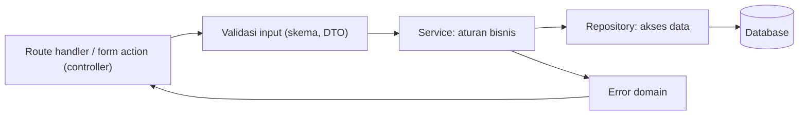

| Lapisan | Tanggung jawab | Tidak boleh |
|---|---|---|
| **Controller** (`+server.ts`, action, `load`) | Membaca request, memvalidasi, memanggil service, memetakan hasil/error ke respons | Berisi aturan bisnis atau SQL |
| **Service** | Aturan bisnis, orkestrasi, transaksi | Mengetahui HTTP (request/response) |
| **Repository** | Kueri database | Berisi aturan bisnis |
| **DTO** | Bentuk data yang masuk/keluar (dengan skema) | Membocorkan kolom internal (mis. `passwordHash`) |

```ts
// src/lib/server/errors.ts
export class AppError extends Error {
  constructor(public status: number, public kode: string, message: string) { super(message); }
}
export const NotFound = (what: string) => new AppError(404, 'NOT_FOUND', `${what} tidak ditemukan`);
export const Forbidden = () => new AppError(403, 'FORBIDDEN', 'Tidak berhak mengakses sumber daya ini');
export const Conflict = (msg: string) => new AppError(409, 'CONFLICT', msg);
```

```ts
// src/lib/server/todo/repository.ts
import { db as dbDefault } from '$lib/server/db';
import { todo } from '$lib/server/db/schema';
import { and, eq } from 'drizzle-orm';

export const todoRepo = (db = dbDefault) => ({
  daftar: (userId: string) => db.select().from(todo).where(eq(todo.userId, userId)),
  cari: async (id: number, userId: string) =>
    (await db.select().from(todo).where(and(eq(todo.id, id), eq(todo.userId, userId))).limit(1))[0],
  buat: async (userId: string, title: string) => (await db.insert(todo).values({ userId, title }).returning())[0],
  hapus: (id: number, userId: string) => db.delete(todo).where(and(eq(todo.id, id), eq(todo.userId, userId))),
});
```

```ts
// src/lib/server/todo/service.ts
import { todoRepo } from './repository';
import { NotFound, AppError } from '$lib/server/errors';

export const todoService = (repo = todoRepo()) => ({
  async buat(userId: string, title: string) {
    const t = title.trim();
    if (!t) throw new AppError(422, 'VALIDATION', 'Judul wajib diisi');
    return repo.buat(userId, t);
  },
  async hapus(userId: string, id: number) {
    if (!(await repo.cari(id, userId))) throw NotFound('Todo');
    await repo.hapus(id, userId);
  },
});
```

Dependensi **diinjeksikan** lewat parameter default (`repo = todoRepo()`), sehingga pengujian dapat menyuntikkan repo palsu tanpa database.

**Penanganan error terpusat** di `hooks.server.ts` agar controller tetap ringkas dan detail internal tidak bocor:

```ts
// src/hooks.server.ts
import type { HandleServerError } from '@sveltejs/kit';
import { AppError } from '$lib/server/errors';

export const handleError: HandleServerError = ({ error, event, status, message }) => {
  const id = crypto.randomUUID();
  if (error instanceof AppError) return { message: error.message, kode: error.kode };
  console.error(`[${id}] ${event.request.method} ${event.url.pathname}`, error);   // log lengkap di server
  return { message: 'Terjadi kesalahan pada server', kode: 'INTERNAL', id };       // pesan generik ke klien
};
```

Tambahkan tipe `App.Error` (`message`, `kode`, `id?`) di `app.d.ts`. Catatan: `handleError` dipanggil untuk **error tak terduga**; error yang dilempar lewat `error(...)` dari SvelteKit sudah dianggap error yang diharapkan.

## Project Level 11

1. **REST API menggunakan SvelteKit:** resource `todos` (atau `artikel`) lengkap dengan CRUD, validasi Zod, kode status benar, paginasi, dan dokumentasi (OpenAPI singkat).
2. **CRUD Application dengan Database:** halaman daftar, tambah, ubah, hapus memakai **form actions + Drizzle**, `use:enhance`, pesan error per bidang.
3. **Employee Management System:** tabel `departemen` dan `karyawan` (relasi satu-ke-banyak), pencarian dan filter server-side, ekspor CSV lewat `+server.ts`.
4. **Blog CMS:** `artikel`, `kategori`, `tag` (banyak-ke-banyak), editor markdown dengan pratinjau, status draf/terbit, slug unik.
5. **Inventory Management System:** `produk`, `stok_masuk`, `stok_keluar`; **transaksi** database saat mutasi stok; peringatan stok minimum; riwayat audit.

Model data contoh (Inventory):

```text
kategori (id, nama)
produk   (id, kode UNIQUE, nama, kategori_id → kategori.id, stok_minimum)
mutasi   (id, produk_id → produk.id, jenis ENUM('masuk','keluar'), jumlah, dibuat_oleh, dibuat)
-- stok saat ini = SUM(masuk) - SUM(keluar), atau kolom stok yang diperbarui dalam transaksi yang sama
```

## Target Kompetensi Level 11

- [ ] Membuat endpoint dengan `+server.ts` dan kode status yang tepat.
- [ ] Menggunakan form actions dengan `use:enhance` dan progressive enhancement.
- [ ] Menjelaskan SQL dasar, transaksi, migrasi, pooling, dan memakai ORM (Drizzle/Prisma).
- [ ] Menerapkan arsitektur berlapis (controller, service, repository, DTO) dengan error handling terpusat.

---

# LEVEL 12: Authentication dan Authorization

**Tujuan:** membangun sistem autentikasi dan keamanan aplikasi.

> **Peringatan:** autentikasi adalah area yang mudah salah dan berisiko tinggi. Untuk produk nyata, pertimbangkan library/layanan yang sudah teruji dan *di-audit* (mis. Better Auth, Auth.js, atau penyedia identitas terkelola), dan baca [OWASP Cheat Sheet Series](https://cheatsheetseries.owasp.org/). Implementasi manual di bawah ini bertujuan **memahami cara kerjanya**, dan mengikuti praktik yang umum dianjurkan. Landscape library autentikasi berubah cepat (misalnya proyek Lucia yang dulu populer kini lebih diposisikan sebagai materi belajar), jadi cek status terbaru sebelum memilih.

## 12.1 Authentication Fundamentals

| Konsep | Pertanyaan yang dijawab | Contoh |
|---|---|---|
| **Authentication (autentikasi)** | *Siapa kamu?* | Login dengan email dan password |
| **Authorization (otorisasi)** | *Apa yang boleh kamu lakukan?* | Hanya admin boleh menghapus pengguna |

### Session-based vs Token-based

| Aspek | **Session (server-side)** | **Token (mis. JWT, stateless)** |
|---|---|---|
| Yang disimpan klien | ID sesi acak (opaque) di cookie | Token berisi klaim, bertanda tangan |
| Yang disimpan server | Tabel/penyimpanan sesi | (Hampir) tidak ada |
| Pencabutan (logout/paksa keluar) | **Mudah**: hapus sesi | Sulit sebelum kedaluwarsa (butuh daftar cabut) |
| Skala horizontal | Perlu penyimpanan sesi bersama | Mudah |
| Cocok untuk | **Aplikasi web SvelteKit satu domain** | API antar layanan, aplikasi mobile, pihak ketiga |

**Rekomendasi untuk aplikasi SvelteKit biasa:** sesi di sisi server dengan **token acak opaque di cookie `HttpOnly`**. Sederhana, aman, dan bisa dicabut seketika.

### JWT, Access Token, dan Refresh Token

**JWT** (*JSON Web Token*) terdiri dari tiga bagian base64url: `header.payload.signature`. Payload memuat **klaim** (`sub` pengguna, `exp` kedaluwarsa, `iat`, `iss`, `aud`, dan klaim kustom). Tanda tangan menjamin **keaslian dan integritas**, **bukan kerahasiaan**: payload dapat dibaca siapa pun.

```text
eyJhbGciOiJIUzI1NiJ9.eyJzdWIiOiI0MiIsImV4cCI6MTc5MzAwMDAwMH0.<tanda-tangan>
```

Pola dua token pada API:

| Token | Umur | Fungsi |
|---|---|---|
| **Access token** | Pendek (menit) | Dikirim di setiap request API |
| **Refresh token** | Panjang (hari/minggu), disimpan aman, **dirotasi** | Meminta access token baru; dapat dicabut |

Jebakan JWT: menerima algoritma `none`/algoritma yang tidak diharapkan, tidak memverifikasi `exp`/`aud`/`iss`, menaruh data sensitif di payload, dan menyimpan token di tempat yang dapat dibaca skrip (`localStorage`) sehingga rentan XSS.

### Cookie Authentication dan Atributnya

| Atribut | Fungsi |
|---|---|
| **`HttpOnly`** | Cookie **tidak dapat dibaca JavaScript** (`document.cookie`), mengurangi dampak XSS |
| **`Secure`** | Hanya dikirim lewat HTTPS |
| **`SameSite=Lax`** | Tidak dikirim pada permintaan lintas-situs kecuali navigasi aman (GET); mengurangi CSRF; **default yang baik** |
| `SameSite=Strict` | Tidak pernah dikirim lintas-situs (bisa mengganggu tautan masuk) |
| `SameSite=None; Secure` | Dikirim lintas-situs (untuk embed/layanan pihak ketiga) |
| `Path`, `Domain` | Cakupan cookie |
| `Max-Age` / `Expires` | Masa berlaku |
| Prefiks `__Host-` | Memaksa `Secure`, `Path=/`, tanpa `Domain` (lebih ketat) |

## 12.2 SvelteKit Authentication

### Alur Sesi

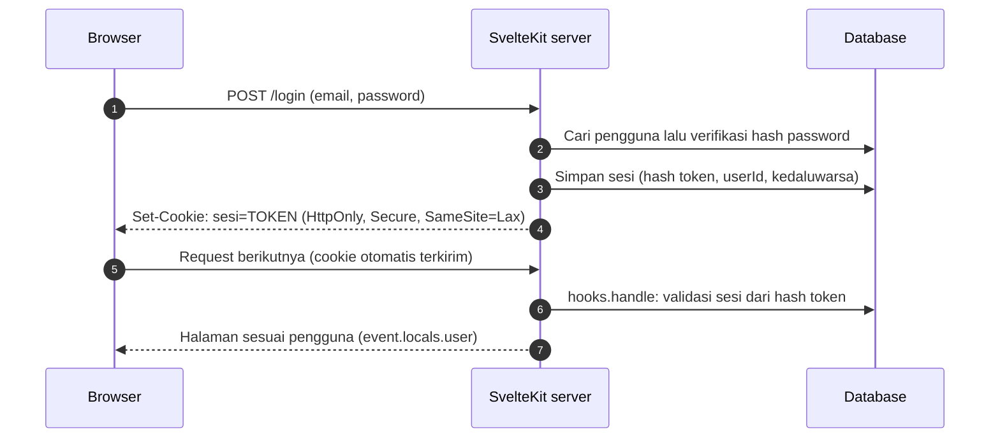

### Skema Database

```ts
// src/lib/server/db/schema.ts (tambahan)
export const sesi = sqliteTable('sesi', {
  id: text('id').primaryKey(),                                        // SHA-256 dari token (token asli TIDAK disimpan)
  userId: text('user_id').notNull().references(() => pengguna.id, { onDelete: 'cascade' }),
  kedaluwarsa: integer('kedaluwarsa', { mode: 'timestamp' }).notNull(),
});
```

### Password Hashing

**Jangan pernah menyimpan password asli atau hash cepat** (MD5/SHA-256 polos). Gunakan algoritma hash **lambat dan bergaram** untuk password: **Argon2id** (disarankan), scrypt, atau bcrypt.

```bash
npm install @node-rs/argon2
```

```ts
// src/lib/server/password.ts
import { hash, verify } from '@node-rs/argon2';

// parameter selaras dengan konfigurasi minimum yang dianjurkan OWASP untuk Argon2id
const opsi = { memoryCost: 19456, timeCost: 2, outputLen: 32, parallelism: 1 };

export const hashPassword = (password: string) => hash(password, opsi);
export const cekPassword = (hashTersimpan: string, password: string) => verify(hashTersimpan, password);
```

(Salt dibuat dan disimpan otomatis di dalam string hasil hash.)

### Pembuatan dan Validasi Sesi

```ts
// src/lib/server/auth.ts
import { createHash, randomBytes } from 'node:crypto';
import { eq } from 'drizzle-orm';
import type { RequestEvent } from '@sveltejs/kit';
import { db } from '$lib/server/db';
import { sesi, pengguna } from '$lib/server/db/schema';

const HARI = 24 * 60 * 60 * 1000;
export const NAMA_COOKIE = 'sesi';

export const buatToken = () => randomBytes(32).toString('base64url');           // 256 bit acak dari CSPRNG
const idDariToken = (token: string) => createHash('sha256').update(token).digest('hex');

export async function buatSesi(token: string, userId: string) {
  const baris = { id: idDariToken(token), userId, kedaluwarsa: new Date(Date.now() + 30 * HARI) };
  await db.insert(sesi).values(baris);
  return baris;
}

export async function validasiSesi(token: string) {
  const id = idDariToken(token);
  const [r] = await db
    .select({ user: { id: pengguna.id, email: pengguna.email, peran: pengguna.peran }, sesi })
    .from(sesi)
    .innerJoin(pengguna, eq(sesi.userId, pengguna.id))
    .where(eq(sesi.id, id));

  if (!r) return { sesi: null, user: null };

  if (Date.now() >= r.sesi.kedaluwarsa.getTime()) {                               // kedaluwarsa
    await db.delete(sesi).where(eq(sesi.id, id));
    return { sesi: null, user: null };
  }
  if (Date.now() >= r.sesi.kedaluwarsa.getTime() - 15 * HARI) {                   // perpanjang (sliding expiration)
    r.sesi.kedaluwarsa = new Date(Date.now() + 30 * HARI);
    await db.update(sesi).set({ kedaluwarsa: r.sesi.kedaluwarsa }).where(eq(sesi.id, id));
  }
  return r;
}

export const hapusSesi = (id: string) => db.delete(sesi).where(eq(sesi.id, id));
export const hapusSemuaSesiUser = (userId: string) => db.delete(sesi).where(eq(sesi.userId, userId));

export function setCookieSesi(event: RequestEvent, token: string, kedaluwarsa: Date) {
  event.cookies.set(NAMA_COOKIE, token, { path: '/', httpOnly: true, sameSite: 'lax', secure: event.url.protocol === 'https:', expires: kedaluwarsa });
}
export function hapusCookieSesi(event: RequestEvent) {
  event.cookies.delete(NAMA_COOKIE, { path: '/' });
}
```

> **Mengapa menyimpan hash token?** Jika database bocor, penyerang tidak bisa memakai ID sesi tersimpan untuk menyamar, karena yang tersimpan hanya hash dari token yang hanya dimiliki browser pengguna.

### `hooks.server.ts` dan `event.locals`

```ts
// src/app.d.ts
declare global {
  namespace App {
    interface Locals {
      user: { id: string; email: string; peran: 'admin' | 'user' } | null;
      sesi: { id: string; userId: string; kedaluwarsa: Date } | null;
    }
  }
}
export {};
```

```ts
// src/hooks.server.ts
import type { Handle } from '@sveltejs/kit';
import { NAMA_COOKIE, validasiSesi, setCookieSesi, hapusCookieSesi } from '$lib/server/auth';

export const handle: Handle = async ({ event, resolve }) => {
  const token = event.cookies.get(NAMA_COOKIE);

  if (!token) {
    event.locals.user = null;
    event.locals.sesi = null;
  } else {
    const { sesi, user } = await validasiSesi(token);
    if (sesi) setCookieSesi(event, token, sesi.kedaluwarsa);     // segarkan masa berlaku cookie
    else hapusCookieSesi(event);
    event.locals.user = user;
    event.locals.sesi = sesi;
  }

  const response = await resolve(event);
  response.headers.set('X-Content-Type-Options', 'nosniff');       // (header keamanan lain: 12.3)
  return response;
};
```

### Registration, Login, dan Logout

```ts
// src/routes/(auth)/daftar/+page.server.ts
import { fail, redirect } from '@sveltejs/kit';
import { z } from 'zod';
import { eq } from 'drizzle-orm';
import { db } from '$lib/server/db';
import { pengguna } from '$lib/server/db/schema';
import { hashPassword } from '$lib/server/password';
import { buatToken, buatSesi, setCookieSesi } from '$lib/server/auth';
import type { Actions } from './$types';

const skema = z.object({
  email: z.string().trim().toLowerCase().email().max(254),
  password: z.string().min(10, 'Minimal 10 karakter').max(128),
});

export const actions: Actions = {
  default: async (event) => {
    const data = Object.fromEntries(await event.request.formData());
    const hasil = skema.safeParse(data);
    if (!hasil.success) {
      return fail(400, { email: String(data.email ?? ''), galat: hasil.error.issues[0]?.message ?? 'Input tidak valid' });
    }
    const { email, password } = hasil.data;

    const ada = await db.select({ id: pengguna.id }).from(pengguna).where(eq(pengguna.email, email)).limit(1);
    if (ada.length) return fail(409, { email, galat: 'Email tidak dapat digunakan' });

    const id = crypto.randomUUID();
    await db.insert(pengguna).values({ id, email, passwordHash: await hashPassword(password) });

    const token = buatToken();
    const sesi = await buatSesi(token, id);             // buat sesi BARU saat login (cegah session fixation)
    setCookieSesi(event, token, sesi.kedaluwarsa);
    redirect(303, '/dashboard');
  },
};
```

```ts
// src/routes/(auth)/login/+page.server.ts
import { fail, redirect } from '@sveltejs/kit';
import { eq } from 'drizzle-orm';
import { db } from '$lib/server/db';
import { pengguna } from '$lib/server/db/schema';
import { cekPassword, hashPassword } from '$lib/server/password';
import { buatToken, buatSesi, setCookieSesi, hapusSesi, hapusCookieSesi } from '$lib/server/auth';
import type { Actions } from './$types';

let hashPalsu: Promise<string> | undefined;               // meratakan waktu respons saat email tidak ditemukan
const dapatkanHashPalsu = () => (hashPalsu ??= hashPassword('password-palsu-untuk-timing'));

const amanKembali = (v: string | null) => (v && v.startsWith('/') && !v.startsWith('//') ? v : '/dashboard');   // cegah open redirect

export const actions: Actions = {
  masuk: async (event) => {
    const data = await event.request.formData();
    const email = String(data.get('email') ?? '').trim().toLowerCase();
    const password = String(data.get('password') ?? '');

    // Rate limiting di sini (mis. 5 percobaan/15 menit per IP dan per email); lihat 12.3

    const [user] = await db.select().from(pengguna).where(eq(pengguna.email, email)).limit(1);
    const benar = user ? await cekPassword(user.passwordHash, password) : (await cekPassword(await dapatkanHashPalsu(), password), false);

    if (!user || !benar) return fail(400, { email, galat: 'Email atau password salah' });   // pesan SAMA untuk kedua kasus

    const token = buatToken();
    const sesi = await buatSesi(token, user.id);
    setCookieSesi(event, token, sesi.kedaluwarsa);
    redirect(303, amanKembali(event.url.searchParams.get('kembali')));
  },

  keluar: async (event) => {
    if (event.locals.sesi) await hapusSesi(event.locals.sesi.id);
    hapusCookieSesi(event);
    redirect(303, '/login');
  },
};
```

```svelte
<!-- src/routes/(auth)/login/+page.svelte -->
<script lang="ts">
  import { enhance } from '$app/forms';
  let { form } = $props();
  let mengirim = $state(false);
</script>

<form method="POST" action="?/masuk" use:enhance={() => { mengirim = true; return async ({ update }) => { await update({ reset: false }); mengirim = false; }; }}>
  <label>Email <input name="email" type="email" autocomplete="username" value={form?.email ?? ''} required /></label>
  <label>Password <input name="password" type="password" autocomplete="current-password" required /></label>
  {#if form?.galat}<p role="alert">{form.galat}</p>{/if}
  <button disabled={mengirim}>Masuk</button>
</form>
```

Logout dilakukan lewat **POST** (form), bukan tautan GET, agar tidak dapat dipicu situs lain.

### Protected Routes

```ts
// src/routes/(app)/+layout.server.ts   → melindungi SEMUA halaman di grup (app)
import { redirect } from '@sveltejs/kit';
import type { LayoutServerLoad } from './$types';

export const load: LayoutServerLoad = async ({ locals, url }) => {
  if (!locals.user) redirect(303, `/login?kembali=${encodeURIComponent(url.pathname + url.search)}`);
  return { user: locals.user };
};
```

> **Penting:** guard di `load` layout **tidak melindungi** form actions dan endpoint `+server.ts` (action dijalankan tanpa menjalankan `load` layout terlebih dahulu). **Setiap action dan endpoint harus memeriksa `locals.user` sendiri**, atau gunakan guard terpusat di `handle` berdasarkan path. Prinsip: *otorisasi diperiksa di titik yang mengakses data*.

### Role-based Access Control (RBAC) dan Permission-based

```ts
// src/lib/server/izin.ts
import { error, redirect } from '@sveltejs/kit';

type Peran = 'admin' | 'user';
type Pengguna = { id: string; peran: Peran } | null;

export function wajibLogin(user: Pengguna) {
  if (!user) redirect(303, '/login');
  return user;
}
export function wajibPeran(user: Pengguna, ...peran: Peran[]) {
  const u = wajibLogin(user);
  if (!peran.includes(u.peran)) error(403, 'Anda tidak berhak mengakses halaman ini');
  return u;
}

// Permission-based: peran → kumpulan izin granular
const IZIN: Record<Peran, string[]> = {
  admin: ['pengguna:baca', 'pengguna:ubah', 'pengguna:hapus', 'todo:*'],
  user: ['todo:baca', 'todo:buat', 'todo:ubah-milik-sendiri'],
};
export function bisa(user: Pengguna, izin: string) {
  if (!user) return false;
  const daftar = IZIN[user.peran] ?? [];
  const [sumber] = izin.split(':');
  return daftar.includes(izin) || daftar.includes(`${sumber}:*`);
}
```

```ts
// pemakaian di action
if (!bisa(locals.user, 'pengguna:hapus')) error(403, 'Dilarang');
```

Untuk sistem yang izinnya dapat diatur admin, simpan **peran** dan **izin** di tabel (`peran`, `izin`, `peran_izin`, `pengguna_peran`) dan cache hasilnya. Selalu periksa **kepemilikan objek** (IDOR): `WHERE id = ? AND user_id = ?`.

### OAuth 2.0 dan Google Authentication

**OAuth 2.0 / OpenID Connect** (*Authorization Code Flow* + **PKCE**) memungkinkan "Masuk dengan Google" tanpa menangani password.

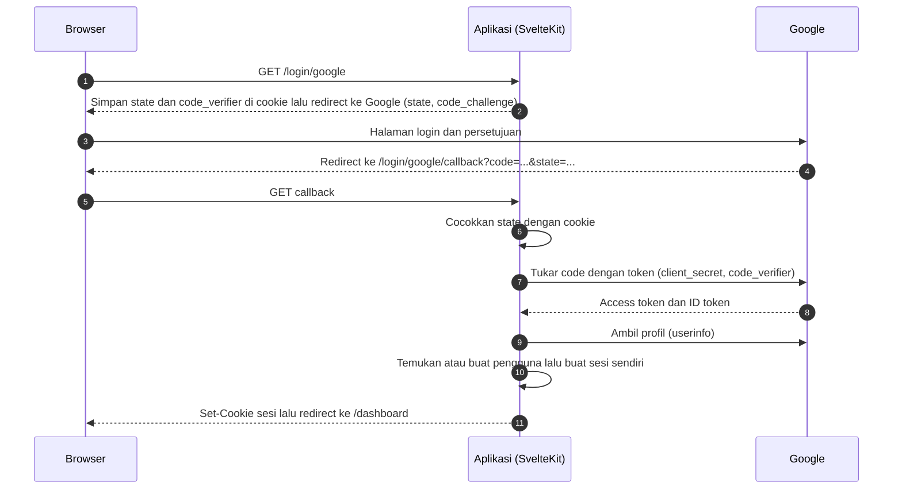

```ts
// src/routes/login/google/+server.ts
import { redirect } from '@sveltejs/kit';
import { createHash, randomBytes } from 'node:crypto';
import { GOOGLE_CLIENT_ID } from '$env/static/private';
import type { RequestHandler } from './$types';

export const GET: RequestHandler = ({ cookies, url }) => {
  const state = randomBytes(16).toString('base64url');
  const verifier = randomBytes(32).toString('base64url');
  const challenge = createHash('sha256').update(verifier).digest('base64url');

  const opsi = { path: '/', httpOnly: true, sameSite: 'lax' as const, maxAge: 600, secure: url.protocol === 'https:' };
  cookies.set('oauth_state', state, opsi);
  cookies.set('oauth_verifier', verifier, opsi);

  const auth = new URL('https://accounts.google.com/o/oauth2/v2/auth');
  auth.search = new URLSearchParams({
    client_id: GOOGLE_CLIENT_ID,
    redirect_uri: `${url.origin}/login/google/callback`,
    response_type: 'code',
    scope: 'openid email profile',
    state,
    code_challenge: challenge,
    code_challenge_method: 'S256',
  }).toString();
  redirect(302, auth);
};
```

```ts
// src/routes/login/google/callback/+server.ts
import { error, redirect } from '@sveltejs/kit';
import { GOOGLE_CLIENT_ID, GOOGLE_CLIENT_SECRET } from '$env/static/private';
import type { RequestHandler } from './$types';

export const GET: RequestHandler = async (event) => {
  const { url, cookies } = event;
  const code = url.searchParams.get('code');
  const state = url.searchParams.get('state');
  const stateTersimpan = cookies.get('oauth_state');
  const verifier = cookies.get('oauth_verifier');
  cookies.delete('oauth_state', { path: '/' });
  cookies.delete('oauth_verifier', { path: '/' });

  if (!code || !state || !verifier || state !== stateTersimpan) error(400, 'Permintaan OAuth tidak valid');

  const tokenRes = await fetch('https://oauth2.googleapis.com/token', {
    method: 'POST',
    headers: { 'Content-Type': 'application/x-www-form-urlencoded' },
    body: new URLSearchParams({
      code, client_id: GOOGLE_CLIENT_ID, client_secret: GOOGLE_CLIENT_SECRET,
      redirect_uri: `${url.origin}/login/google/callback`, grant_type: 'authorization_code', code_verifier: verifier,
    }),
  });
  if (!tokenRes.ok) error(400, 'Gagal menukar kode otorisasi');
  const { access_token } = await tokenRes.json();

  const profil = await (await fetch('https://openidconnect.googleapis.com/v1/userinfo', {
    headers: { Authorization: `Bearer ${access_token}` },
  })).json();                                              // { sub, email, email_verified, name, picture }

  if (!profil.email_verified) error(403, 'Email Google belum terverifikasi');

  // 1. Cari akun berdasarkan googleId (profil.sub). 2. Jika tidak ada, buat akun baru.
  //    Hubungkan ke akun email yang sudah ada HANYA setelah verifikasi tambahan (hindari pengambilalihan akun).
  // 3. Buat sesi sendiri (buatToken, buatSesi, setCookieSesi), lalu:
  redirect(302, '/dashboard');
};
```

Catatan: simpan `google_id` (nilai `sub`, stabil) dan jangan mengandalkan email semata sebagai identitas. Untuk produksi, pertimbangkan library OAuth (mis. Arctic) atau solusi auth lengkap; sesuaikan dengan versi dokumentasinya. Daftarkan **Authorized redirect URI** persis sama di Google Cloud Console.

## 12.3 Security

| Ancaman | Penjelasan | Pertahanan |
|---|---|---|
| **XSS** (Cross-Site Scripting) | Penyerang menyuntikkan skrip yang berjalan di browser korban | Svelte **meng-escape `{ }` otomatis**; hindari `{@html}` untuk data tak tepercaya (sanitasi dengan DOMPurify); **CSP**; cookie `HttpOnly` |
| **CSRF** | Situs lain membuat browser korban mengirim request ber-cookie | `SameSite=Lax`; SvelteKit memeriksa header `Origin` pada submit form; untuk endpoint API tambahan, periksa Origin atau gunakan token |
| **SQL Injection** | Input pengguna menjadi bagian dari SQL | **Parameterized query**/ORM; tidak pernah menyambung string |
| **CORS salah konfigurasi** | Situs lain bisa membaca respons API | Izinkan **origin spesifik**; jangan `*` bersama kredensial |
| **Brute force / credential stuffing** | Menebak password massal | Rate limiting, lockout, MFA, deteksi anomali |
| **IDOR** | Mengakses objek orang lain dengan mengganti ID | Selalu cek kepemilikan/izin di server |
| **Pencurian sesi** | Token dicuri | HTTPS, cookie `HttpOnly`/`Secure`, rotasi dan kedaluwarsa, cabut sesi |

### Content Security Policy

CSP membatasi sumber yang boleh dimuat; SvelteKit dapat menambahkan *nonce/hash* otomatis untuk skrip inline miliknya:

```js
// svelte.config.js
export default {
  kit: {
    csp: {
      mode: 'auto',
      directives: {
        'default-src': ['self'],
        'script-src': ['self'],
        'style-src': ['self', 'unsafe-inline'],
        'img-src': ['self', 'data:', 'https:'],
        'connect-src': ['self'],
        'frame-ancestors': ['none'],
        'base-uri': ['self'],
        'form-action': ['self'],
      },
    },
  },
};
```

Mulailah dengan `reportOnly` untuk melihat pelanggaran sebelum memberlakukan.

### CORS pada Endpoint API

Untuk endpoint yang memang dipakai situs lain, tangani `OPTIONS` (preflight) dan header secara eksplisit:

```ts
// src/routes/api/publik/+server.ts
const ORIGIN_DIIZINKAN = new Set(['https://aplikasi-mitra.com']);

function cors(origin: string | null) {
  const h = new Headers({ Vary: 'Origin' });
  if (origin && ORIGIN_DIIZINKAN.has(origin)) {
    h.set('Access-Control-Allow-Origin', origin);
    h.set('Access-Control-Allow-Methods', 'GET, POST, OPTIONS');
    h.set('Access-Control-Allow-Headers', 'Content-Type, Authorization');
  }
  return h;
}

export const OPTIONS = ({ request }) => new Response(null, { status: 204, headers: cors(request.headers.get('origin')) });
export const GET = ({ request }) => new Response(JSON.stringify({ ok: true }), {
  headers: { 'Content-Type': 'application/json', ...Object.fromEntries(cors(request.headers.get('origin'))) },
});
```

### Security Headers, Rate Limiting, Input Sanitization

```ts
// dalam hooks.server.ts → handle
const response = await resolve(event);
response.headers.set('X-Content-Type-Options', 'nosniff');
response.headers.set('Referrer-Policy', 'strict-origin-when-cross-origin');
response.headers.set('Permissions-Policy', 'camera=(), microphone=(), geolocation=()');
// HSTS (Strict-Transport-Security) sebaiknya diatur di reverse proxy/CDN setelah HTTPS stabil
return response;
```

**Rate limiting login** memakai fungsi Redis (Level 11) atau penyimpanan lain:

```ts
if (!(await batasLaju(`login:${event.getClientAddress()}`, 10, 15 * 60))) {
  return fail(429, { galat: 'Terlalu banyak percobaan. Coba lagi beberapa menit lagi.' });
}
```

> Di belakang reverse proxy, `getClientAddress()` perlu konfigurasi header IP yang tepercaya (mis. `ADDRESS_HEADER` pada adapter-node); salah konfigurasi membuat semua pengguna terlihat dari IP yang sama atau membuat IP bisa dipalsukan.

**Sanitasi dan validasi input:** validasi bentuk (skema), batasi panjang, gunakan *allowlist*, normalisasi (trim, lowercase email), dan **encode saat output** (Svelte melakukannya untuk teks). Sanitasi HTML hanya bila benar-benar harus menerima HTML.

### Password Policy

- Panjang minimal yang wajar (8 minimum; **10-12+ lebih baik**), izinkan hingga 64-128 karakter dan **semua karakter** termasuk spasi; izinkan *paste* dan pengelola password.
- Hindari aturan komposisi kaku ("harus ada simbol"); lebih efektif **memeriksa password yang bocor/umum** (mis. layanan *Have I Been Pwned* dengan model k-anonymity) dan mendorong **MFA**.
- Simpan hanya hash Argon2id/scrypt/bcrypt. Pada ganti password, **cabut seluruh sesi lain**.
- Alur **reset password**: token acak sekali pakai, disimpan sebagai hash, kedaluwarsa singkat (mis. 15-60 menit), respons yang sama untuk email terdaftar atau tidak.

### Secure Environment Variables

- Rahasia hanya di variabel lingkungan **privat** (`$env/*/private`), tidak pernah di repositori; sertakan `.env.example` tanpa nilai asli.
- Hanya variabel berawalan `PUBLIC_` yang boleh sampai ke klien.
- Rotasi rahasia secara berkala dan segera bila bocor; gunakan *secret manager* di produksi.

### Authentication Best Practices (Ringkasan)

- [ ] HTTPS di mana-mana; cookie `HttpOnly`, `Secure`, `SameSite`.
- [ ] Token sesi acak panjang (≥128 bit), simpan hash, kedaluwarsa, rotasi saat login.
- [ ] Pesan error generik; rate limiting; pertimbangkan MFA.
- [ ] Otorisasi diperiksa **di server** pada setiap titik akses data (termasuk actions dan endpoint).
- [ ] Logout benar-benar mencabut sesi di server.
- [ ] Catat peristiwa keamanan (login gagal, ganti password, perubahan peran) tanpa mencatat rahasia.
- [ ] Jaga dependensi tetap diperbarui (`npm audit`), dan lakukan tinjauan keamanan berkala.

## Project Level 12

1. **Authentication System:** daftar, login, logout, sesi di database, pelindung rute, halaman profil, ganti password (mencabut sesi lain), rate limiting login.
2. **Role-based Dashboard:** `admin` dan `user` melihat menu dan data berbeda; guard di layout **dan** di setiap action/endpoint; halaman 403 kustom.
3. **User Management:** admin melihat daftar pengguna, mengubah peran, menonaktifkan akun, dan **memaksa keluar** (hapus semua sesi pengguna); pencatatan audit.
4. **OAuth Login:** "Masuk dengan Google" (atau GitHub) dengan state + PKCE, penautan akun yang aman, dan penanganan kasus email belum terverifikasi.
5. **Permission Management System:** tabel `peran`, `izin`, `peran_izin`, `pengguna_peran`; UI untuk mengatur izin; fungsi `bisa(user, izin)` dengan cache; uji otorisasi per endpoint.

## Target Kompetensi Level 12

- [ ] Membedakan autentikasi dan otorisasi, serta memilih session vs token.
- [ ] Mengimplementasikan registrasi, login, logout, hashing password, dan sesi aman di SvelteKit.
- [ ] Melindungi route, action, dan endpoint dengan RBAC/permission dan pemeriksaan kepemilikan.
- [ ] Memahami dan menerapkan pertahanan terhadap XSS, CSRF, SQL injection, CORS, serta header keamanan.

---

# LEVEL 13: Advanced Svelte

**Tujuan:** menguasai fitur-fitur lanjutan untuk membangun aplikasi yang kompleks.

## 13.1 Lifecycle dan DOM

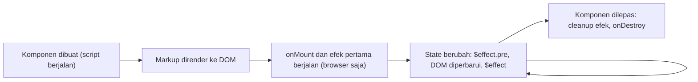

### `onMount`, `onDestroy`

```svelte
<script>
  import { onMount, onDestroy } from 'svelte';

  let kanvas;

  onMount(() => {
    // hanya berjalan di BROWSER, setelah komponen dipasang ke DOM
    const ctx = kanvas.getContext('2d');
    const id = setInterval(gambar, 16);
    return () => clearInterval(id);        // fungsi yang dikembalikan = cleanup saat dilepas
  });

  onDestroy(() => {
    // berjalan saat dilepas; SATU-SATUNYA lifecycle yang juga berjalan di SSR
  });
</script>

<canvas bind:this={kanvas}></canvas>
```

- `onMount` yang diberi fungsi **`async`** mengembalikan Promise sehingga **cleanup tidak dikenali**; pisahkan pekerjaan async dari fungsi cleanup.
- Di Svelte 5, `$effect` mencakup sebagian besar kebutuhan `onMount`; `onMount` tetap berguna untuk logika "sekali setelah mount di browser".
- `beforeUpdate` dan `afterUpdate` sudah **usang di mode runes**; gantikan dengan `$effect.pre` dan `$effect`.

### `tick`, `flushSync`, dan `settled`

Pembaruan DOM **ditunda (batched)** ke microtask. `await tick()` menunggu hingga DOM mencerminkan perubahan state terbaru:

```svelte
<script>
  import { tick } from 'svelte';
  let teks = $state('');
  let input;

  async function sisipkan() {
    teks += ' [sisip]';
    await tick();                  // tunggu DOM diperbarui
    input.setSelectionRange(0, input.value.length);   // aman: value sudah terbarui
  }
</script>
<input bind:this={input} bind:value={teks} />
```

`flushSync()` memaksa penerapan pembaruan **secara sinkron** (berguna dalam pengujian dan integrasi library). `settled()` menunggu hingga seluruh pembaruan, termasuk operasi async pada fitur `await` komponen yang masih eksperimental, selesai; periksa dokumentasi sebelum memakainya.

### `mount`, `unmount`, `hydrate`

Menyisipkan komponen Svelte secara **imperatif** (mis. ke dalam konten popup library peta, atau aplikasi lama non-Svelte):

```ts
import { mount, unmount } from 'svelte';
import Popup from './Popup.svelte';

const target = document.createElement('div');
const popup = mount(Popup, { target, props: { judul: 'Halo' } });

// nanti:
await unmount(popup, { outro: true });    // jalankan transisi keluar bila ada
```

`mount` dipakai di `main.ts` untuk aplikasi Svelte murni; `hydrate` (internal bagi SvelteKit) menghidupkan HTML hasil SSR.

### DOM Manipulation dan Lifecycle Management

Gunakan Svelte untuk DOM yang ia kelola; sentuh DOM langsung **hanya** melalui `bind:this` dan hanya setelah mount, untuk hal yang tak dapat diungkapkan secara deklaratif (fokus, ukuran, library pihak ketiga). Selalu **bersihkan** listener, timer, observer, dan instansi library di cleanup.

## 13.2 Actions dan Attachments

### Actions (`use:`)

**Action** adalah fungsi yang dijalankan saat elemen dipasang, menerima **elemen DOM** dan parameter opsional, dan boleh mengembalikan `{ update, destroy }`:

```ts
// aksi.ts
import type { Action } from 'svelte/action';

export const clickOutside: Action<HTMLElement, () => void> = (node, callback) => {
  const handler = (e: MouseEvent) => {
    if (!node.contains(e.target as Node)) callback?.();
  };
  document.addEventListener('click', handler, true);
  return {
    update(baru) { callback = baru; },                    // dipanggil bila parameter berubah
    destroy() { document.removeEventListener('click', handler, true); },
  };
};

export const autofocus: Action<HTMLElement> = (node) => { node.focus(); };

export const lazySrc: Action<HTMLImageElement, string> = (img, src) => {
  const obs = new IntersectionObserver(([e]) => {
    if (e.isIntersecting) { img.src = src; obs.disconnect(); }
  });
  obs.observe(img);
  return { destroy: () => obs.disconnect() };
};
```

```svelte
<script>
  import { clickOutside, autofocus, lazySrc } from './aksi';
  let buka = $state(true);
</script>

{#if buka}
  <div class="menu" use:clickOutside={() => (buka = false)}>
    <input use:autofocus />
  </div>
{/if}

```

Lifecycle action: dijalankan **sekali** saat elemen dipasang; `update` dipanggil ketika parameter berubah; `destroy` saat elemen dilepas.

### Attachments (`{@attach}`) *(Svelte versi baru, 5.29+)*

**Attachment** adalah evolusi action: sebuah fungsi `(element) => cleanup?` yang berjalan di dalam **efek**, sehingga **otomatis dijalankan ulang** ketika state reaktif yang dibacanya berubah (tanpa mekanisme `update` terpisah), dan dapat dibuat dengan *factory*.

```svelte
<script lang="ts">
  import type { Attachment } from 'svelte/attachments';

  let warna = $state('tomato');

  const sorot: Attachment<HTMLElement> = (el) => {
    el.style.outline = `3px solid ${warna}`;          // warna dibaca => dependensi; dijalankan ulang saat berubah
    return () => (el.style.outline = '');             // cleanup
  };

  // factory: menerima parameter, mengembalikan attachment
  function tooltip(teks: string): Attachment<HTMLElement> {
    return (el) => {
      el.title = teks;
      return () => el.removeAttribute('title');
    };
  }
</script>

<button {@attach sorot} {@attach tooltip('Simpan perubahan')}>Simpan</button>
```

| Aspek | Action (`use:`) | Attachment (`{@attach}`) |
|---|---|---|
| Reaktivitas | Parameter lewat `update` | **Otomatis** (berjalan di efek) |
| Dapat disebar ke komponen (`{...props}`) | Tidak | **Ya** (lewat props) |
| Beberapa pada satu elemen | Ya | Ya |
| Status | Stabil, luas dipakai | Lebih baru; periksa dokumentasi versi |

Fungsi `fromAction` (dari `svelte/attachments`) mengonversi action lama menjadi attachment. **Integrasi DOM library pihak ketiga** (grafik, peta, editor) adalah kasus pakai utama:

```svelte
<script lang="ts">
  import Chart from 'chart.js/auto';
  let { label, data }: { label: string; data: number[] } = $props();

  const grafik = (canvas: HTMLCanvasElement) => {
    const c = new Chart(canvas, { type: 'line', data: { labels: data.map((_, i) => i + 1), datasets: [{ label, data: [...data] }] } });
    return () => c.destroy();                           // dibuat ulang saat label/data berubah
  };
</script>

<canvas {@attach grafik}></canvas>
```

## 13.3 Advanced Component Features

### Snippet Composition dan Rekursi

Snippet dapat dikirim ke bawah, dipakai ulang, dan **memanggil dirinya sendiri** (cocok untuk struktur pohon):

```svelte
<script lang="ts">
  type Node = { nama: string; anak?: Node[] };
  let { akar }: { akar: Node } = $props();
</script>

{#snippet pohon(n: Node)}
  <li>
    {n.nama}
    {#if n.anak?.length}
      <ul>{#each n.anak as a (a.nama)}{@render pohon(a)}{/each}</ul>
    {/if}
  </li>
{/snippet}

<ul>{@render pohon(akar)}</ul>
```

### Dynamic Component, Component Bindings, dan Abstraksi

**Polimorfik `as`:** satu komponen yang dapat menjadi `button`, `a`, atau elemen lain:

```svelte
<!-- Kotak.svelte -->
<script lang="ts">
  import type { Snippet } from 'svelte';
  let { as = 'div', children, ...rest }: { as?: string; children: Snippet; [k: string]: unknown } = $props();
</script>
<svelte:element this={as} {...rest}>{@render children()}</svelte:element>
```

**Meneruskan props dan event ke elemen dasar** dengan `...rest` agar komponen UI tetap fleksibel:

```svelte
<script lang="ts">
  import type { HTMLInputAttributes } from 'svelte/elements';
  let { label, value = $bindable(''), ...rest }: { label: string } & HTMLInputAttributes = $props();
</script>
<label>{label}<input bind:value {...rest} /></label>
```

### Event Delegation dan `svelte/events`

Svelte 5 mendelegasikan event umum ke root. Bila kamu perlu memasang listener manual yang **menjaga urutan** dengan handler Svelte, gunakan `on`:

```ts
import { on } from 'svelte/events';

$effect(() => {
  return on(window, 'keydown', (e) => { if (e.key === 'Escape') tutup(); });   // mengembalikan fungsi cleanup
});
```

### Error Boundary dan Pending (`<svelte:boundary>`)

```svelte
<svelte:boundary onerror={(error, reset) => laporkan(error)}>
  <KomponenBerisiko />

  {#snippet failed(error, reset)}
    <p>Terjadi kesalahan: {error.message}</p>
    <button onclick={reset}>Coba lagi</button>
  {/snippet}
</svelte:boundary>
```

`<svelte:boundary>` menangkap error **saat render dan efek** pada subtree-nya (bukan di event handler atau kode async di luar render). Strategi penerapannya dibahas di Level 17.

## 13.4 Advanced Reactivity

### Dependency Graph dan Fine-grained Updates

Svelte 5 membangun **grafik dependensi** (*signals*): `$state` adalah sumber, `$derived` adalah simpul turunan (di-*cache*, dihitung **malas** saat dibaca), `$effect` dan bagian template adalah **konsumen**. Saat sumber berubah, simpul bergantung ditandai "kotor" lalu hanya yang benar-benar dibaca yang dihitung ulang dan DOM terkait diperbarui. Karena itu, mengubah `user.nama` tidak merender ulang bagian yang hanya membaca `user.umur`.

### Reactive Class dan Class Fields

```ts
export class Kotak {
  lebar = $state(10);
  tinggi = $state(5);
  luas = $derived(this.lebar * this.tinggi);
  #log = $state<string[]>([]);                      // field privat reaktif

  constructor(awal?: { lebar: number; tinggi: number }) {
    if (awal) { this.lebar = awal.lebar; this.tinggi = awal.tinggi; }
  }
  perbesar(faktor: number) { this.lebar *= faktor; this.tinggi *= faktor; this.#log.push(`x${faktor}`); }
  get riwayat() { return this.#log; }
}
```

- `$state` dan `$derived` dapat dipakai sebagai **inisialisasi field** (dan pada penugasan pertama di `constructor`).
- Compiler mengubah field menjadi getter/setter pada prototipe, sehingga method yang dipakai sebagai handler perlu **arrow function** atau `.bind(this)`.
- Instansi class **tidak** di-proxy; hanya field `$state`-nya yang reaktif.

### Reactive Built-ins

Dari `svelte/reactivity`: versi reaktif dari objek bawaan yang bukan objek polos.

```svelte
<script lang="ts">
  import { SvelteMap, SvelteSet, SvelteDate, SvelteURL, SvelteURLSearchParams, MediaQuery } from 'svelte/reactivity';

  const cache = new SvelteMap<string, number>();
  const terpilih = new SvelteSet<number>();
  const sekarang = new SvelteDate();
  const url = new SvelteURL('https://contoh.com/cari?q=svelte');
  const params = new SvelteURLSearchParams('q=svelte&halaman=1');
  const gelap = new MediaQuery('prefers-color-scheme: dark');

  $effect(() => {
    const id = setInterval(() => sekarang.setTime(Date.now()), 1000);      // memicu pembaruan jam
    return () => clearInterval(id);
  });
</script>

<button onclick={() => cache.set('a', (cache.get('a') ?? 0) + 1)}>Cache a = {cache.get('a') ?? 0} ({cache.size} kunci)</button>
<button onclick={() => (terpilih.has(1) ? terpilih.delete(1) : terpilih.add(1))}>Pilih 1 ({[...terpilih].join(',')})</button>
<p>{sekarang.toLocaleTimeString('id-ID')} · mode gelap: {gelap.current}</p>
<button onclick={() => params.set('halaman', String(Number(params.get('halaman')) + 1))}>{params.toString()}</button>
```

Utilitas tambahan: `untrack` (baca tanpa dependensi), `createSubscriber` (menjembatani sumber event eksternal menjadi nilai reaktif yang hanya aktif saat ada pengamat).

```ts
import { createSubscriber } from 'svelte/reactivity';
import { on } from 'svelte/events';

export class UkuranJendela {
  #berlangganan = createSubscriber((update) => on(window, 'resize', update));
  get lebar() { this.#berlangganan(); return window.innerWidth; }       // pelanggan dibuat hanya saat dibaca di konteks reaktif
}
```

## 13.5 Svelte Compiler

### Fundamentals dan Compile-time Transformation

`svelte/compiler` mengubah source `.svelte` menjadi modul JavaScript (dan CSS). Biasanya dipanggil oleh plugin Vite, tetapi dapat dipakai langsung:

```js
import { compile } from 'svelte/compiler';

const { js, css, warnings } = compile(
  `<script>let count = $state(0);</script><button onclick={() => count++}>{count}</button>`,
  { filename: 'Counter.svelte', generate: 'client' }
);
console.log(js.code);                  // JS hasil kompilasi
warnings.forEach((w) => console.log(w.code, w.message));
```

Gambaran konseptual: `let count = $state(0)` menjadi pembuatan *signal*, pembacaan `count` menjadi `get(count)`, dan `count++` menjadi `set(count, ...)`; template menjadi fungsi yang membuat node DOM dan mendaftarkan efek pembaruan bagian dinamis. **Bentuk keluaran persisnya berbeda antar versi**; amati hasil nyatanya di tab **JS output** pada [Svelte Playground](https://svelte.dev/playground) untuk memahami apa yang dilakukan compiler.

### Warnings dan Errors

| Jenis | Contoh | Tindakan |
|---|---|---|
| **Error kompilasi** | Sintaks salah, rune di tempat tidak valid | Perbaiki; build gagal |
| **Peringatan a11y** | `a11y_click_events_have_key_events`, `a11y_missing_attribute` | Perbaiki semantik (jangan sekadar membungkam) |
| **Peringatan reaktivitas** | `state_referenced_locally`, `non_reactive_update` | Periksa apakah state seharusnya `$state`/`$derived` |
| **CSS** | `css_unused_selector` | Hapus selector atau gunakan `:global` |

```svelte
<!-- svelte-ignore a11y_no_static_element_interactions -->
<div onclick={...}>...</div>          <!-- bungkam HANYA dengan alasan jelas -->
```

### Compiler Options

```js
// svelte.config.js
export default {
  compilerOptions: {
    runes: true,                       // paksa mode runes untuk semua komponen
    css: 'external',                   // 'injected' menyisipkan CSS lewat JS
    dev: false,
  },
};
```

Per komponen: `<svelte:options runes customElement="x-kartu" />` (mode runes, atau mengompilasi sebagai *Web Component*).

### Preprocessor

Preprocessor mengubah source **sebelum** Svelte mengompilasinya (TypeScript, SCSS/PostCSS, Markdown, dll.).

- **`vitePreprocess()`** dari `@sveltejs/vite-plugin-svelte`: standar untuk TypeScript dan CSS preprocessors.
- **`svelte-preprocess`**: alternatif lama dengan fitur lebih banyak.

**Custom preprocessor:**

```js
// svelte.config.js
const ganti = {
  name: 'ganti-versi',
  markup({ content, filename }) {
    return { code: content.replaceAll('__VERSI__', '1.0.0') };
  },
  // script({ content, attributes }) {...}  style({ content, attributes }) {...}
};

export default { preprocess: [vitePreprocess(), ganti] };
```

Urutan preprocessor berpengaruh (dijalankan berurutan).

## 13.6 Advanced Browser Features

### Web Workers

Memindahkan pekerjaan berat dari thread UI:

```ts
// hitung.worker.ts
self.onmessage = (e: MessageEvent<number>) => {
  let hasil = 0;
  for (let i = 0; i < e.data; i++) hasil += Math.sqrt(i);
  self.postMessage(hasil);
};
```

```svelte
<script lang="ts">
  let hasil = $state<number | null>(null);

  function hitung() {
    const w = new Worker(new URL('./hitung.worker.ts', import.meta.url), { type: 'module' });   // sintaks yang dipahami Vite
    w.onmessage = (e) => { hasil = e.data; w.terminate(); };
    w.postMessage(5e8);
  }
</script>
<button onclick={hitung}>Hitung (UI tetap responsif)</button>
{#if hasil !== null}<p>{hasil}</p>{/if}
```

Data dikirim lewat *structured clone*; gunakan `$state.snapshot()` untuk state reaktif sebelum `postMessage`.

### Service Workers (PWA/Offline)

SvelteKit otomatis mendaftarkan `src/service-worker.ts` dan menyediakan modul `$service-worker`:

```ts
/// <reference lib="webworker" />
import { build, files, version } from '$service-worker';

const sw = self as unknown as ServiceWorkerGlobalScope;
const CACHE = `cache-${version}`;
const ASET = [...build, ...files];                   // berkas hasil build dan berkas static

sw.addEventListener('install', (e) => {
  e.waitUntil(caches.open(CACHE).then((c) => c.addAll(ASET)));
});

sw.addEventListener('activate', (e) => {
  e.waitUntil(caches.keys().then((ks) => Promise.all(ks.filter((k) => k !== CACHE).map((k) => caches.delete(k)))));
});

sw.addEventListener('fetch', (e) => {
  if (e.request.method !== 'GET') return;
  e.respondWith(caches.match(e.request).then((hit) => hit ?? fetch(e.request)));   // cache-first sederhana
});
```

Service worker butuh HTTPS (kecuali `localhost`) dan strategi cache yang hati-hati (jangan men-cache respons API ber-autentikasi sembarangan).

### Notifications, Clipboard, Geolocation

```ts
// Notifikasi
if ('Notification' in window && (await Notification.requestPermission()) === 'granted') {
  new Notification('Pesanan baru', { body: 'Ada 1 pesanan masuk' });
}

// Clipboard (butuh secure context dan biasanya aksi pengguna)
await navigator.clipboard.writeText('Teks yang disalin');
const teks = await navigator.clipboard.readText();            // meminta izin

// Geolocation
navigator.geolocation.getCurrentPosition(
  (p) => console.log(p.coords.latitude, p.coords.longitude),
  (err) => console.warn(err.message),
  { enableHighAccuracy: false, timeout: 10_000 }
);
```

Selalu minta izin **sebagai respons aksi pengguna**, jelaskan alasannya, dan tangani penolakan dengan anggun.

### File API dan IndexedDB

```ts
// Pratinjau gambar tanpa mengunggah
const url = URL.createObjectURL(file);        // jangan lupa: URL.revokeObjectURL(url) saat tak dipakai

// Membaca teks
const teks = await file.text();
// Membaca bertahap file besar
const reader = file.stream().getReader();
```

**IndexedDB** adalah database di browser untuk data terstruktur dalam jumlah besar. API aslinya berbasis event; pustaka kecil `idb` membungkusnya dengan Promise:

```ts
import { openDB } from 'idb';

const db = await openDB('aplikasi', 1, {
  upgrade(d) { d.createObjectStore('catatan', { keyPath: 'id' }).createIndex('judul', 'judul'); },
});

await db.put('catatan', { id: crypto.randomUUID(), judul: 'Halo', isi: '...' });
const semua = await db.getAll('catatan');
await db.delete('catatan', id);
```

### WebSocket dan BroadcastChannel

WebSocket sudah dibahas di Level 10. **BroadcastChannel** mengirim pesan antar tab/jendela satu origin:

```ts
const kanal = new BroadcastChannel('sesi');
kanal.onmessage = (e) => { if (e.data === 'logout') location.href = '/login'; };
kanal.postMessage('logout');           // tab lain ikut keluar
```

## Project Level 13

1. **Rich Text Editor:** untuk produksi, bangun di atas library editor (mis. Tiptap/ProseMirror atau Lexical) yang dibungkus **attachment** (inisialisasi dan *cleanup*); toolbar dengan state aktif (`$state`), kunci pintasan, sanitasi keluaran HTML, dan simpan otomatis ke IndexedDB. (Hindari `document.execCommand`, yang sudah usang.)
2. **File Manager:** pohon folder (snippet rekursif), unggah drag-and-drop, pratinjau (`createObjectURL`), penyimpanan di IndexedDB, rename/hapus/pindah, pencarian.
3. **Drag and Drop Builder:** palet komponen dan kanvas; HTML5 DnD atau Pointer Events; state terstruktur untuk tata letak; undo/redo (Level 6); ekspor JSON.
4. **Real-time Chat Application:** WebSocket atau SSE+POST, daftar pesan dengan *auto-scroll* (`$effect.pre` + `tick`), status koneksi, pengiriman optimistis, notifikasi browser, sinkronisasi antar tab.
5. **Kanban Board:** kolom dan kartu dengan state ternormalisasi, drag antar kolom, persistensi, dan atribut ARIA.

Cuplikan drag antar kolom (HTML5 DnD):

```svelte
<script lang="ts">
  type Kartu = { id: string; judul: string; kolom: string };
  let kartu = $state<Kartu[]>([{ id: 'a', judul: 'Rancang UI', kolom: 'todo' }]);
  const kolom = [{ id: 'todo', nama: 'To Do' }, { id: 'doing', nama: 'Dikerjakan' }, { id: 'done', nama: 'Selesai' }];

  function pindah(id: string, ke: string) {
    const k = kartu.find((x) => x.id === id);
    if (k) k.kolom = ke;
  }
</script>

<div class="papan">
  {#each kolom as k (k.id)}
    <section ondragover={(e) => e.preventDefault()} ondrop={(e) => pindah(e.dataTransfer?.getData('text/plain') ?? '', k.id)} aria-label={k.nama}>
      <h2>{k.nama}</h2>
      {#each kartu.filter((x) => x.kolom === k.id) as c (c.id)}
        <article draggable="true" ondragstart={(e) => e.dataTransfer?.setData('text/plain', c.id)}>{c.judul}</article>
      {/each}
    </section>
  {/each}
</div>
```

Drag-and-drop HTML5 tidak aksesibel dengan keyboard secara bawaan; sediakan alternatif (tombol "Pindahkan ke...").

## Target Kompetensi Level 13

- [ ] Memakai `onMount`, `tick`, `mount/unmount`, dan `flushSync` dengan benar.
- [ ] Menulis actions dan attachments, serta mengintegrasikan library DOM pihak ketiga.
- [ ] Menerapkan snippet rekursif, abstraksi komponen, dan error boundary.
- [ ] Menguasai reactive class dan built-ins reaktif (`SvelteMap`, `SvelteSet`, `MediaQuery`, dll.).
- [ ] Membaca peringatan compiler, mengatur opsi compiler, dan menulis preprocessor sederhana.
- [ ] Memakai Web Workers, Service Workers, IndexedDB, Clipboard, Geolocation, dan BroadcastChannel.

---

# LEVEL 14: Performance Optimization

**Tujuan:** mengoptimalkan aplikasi Svelte agar cepat, efisien, dan *scalable*.

> **Aturan utama: ukur dulu, optimasi kemudian.** Svelte sudah cepat secara bawaan (tanpa virtual DOM, pembaruan langsung ke DOM terkait). Sebagian besar masalah kinerja nyata berasal dari **data terlalu banyak, JavaScript/aset terlalu besar, jaringan, dan kueri database**, bukan dari framework.

## 14.1 Rendering Optimization

### Memahami Rendering Svelte

- Template dikompilasi menjadi kode yang membuat DOM **sekali**, lalu mendaftarkan **efek kecil** per bagian dinamis.
- Saat `$state` berubah, hanya efek yang membacanya yang dijadwalkan, lalu dijalankan **dalam batch** (microtask).
- Tidak ada "render ulang komponen" seperti pada React. Fungsi `<script>` komponen berjalan **sekali** saat dibuat.

### Optimasi Pembaruan Reaktif

```svelte
<script>
  let { items } = $props();
  let kata = $state('');

  // BAIK: dihitung sekali dan di-cache sampai items/kata berubah
  let hasil = $derived(items.filter((i) => i.nama.includes(kata)));

  // KURANG BAIK: fungsi di template dijalankan setiap kali ada dependensinya berubah, tanpa cache bersama
  // {#each saring(items, kata) as i}
</script>
```

- Gunakan `$derived` untuk hasil komputasi mahal yang dipakai berkali-kali.
- Jangan membaca state yang tidak perlu di dalam `$derived`/`$effect`/template; setiap bacaan menambah dependensi.
- **Granularitas state:** pisahkan state yang berubah pada frekuensi berbeda. Satu objek besar yang sering diubah di sebagian kecil tetap efisien berkat reaktivitas per-properti, tetapi **proxy dalam** pada struktur sangat besar punya biaya; gunakan `$state.raw` untuk data besar yang tidak dimutasi:

```ts
let barisBesar = $state.raw<Baris[]>([]);       // 50.000 baris dari API, tidak di-proxy
barisBesar = await muatSemua();                  // penugasan ulang memicu pembaruan
```

### Menghindari Efek yang Tidak Perlu

Setiap `$effect` adalah biaya dan sumber bug. Ganti dengan `$derived`, event handler, atau function binding (Level 4). Saat efek memang perlu, jaga **dependensinya sempit** (`untrack` untuk bacaan yang tidak relevan).

### Large List, Virtual Scrolling, dan Lazy Rendering

Merender 10.000 baris DOM lambat meski Svelte cepat. Solusi berjenjang: **paginasi**, **filter di server**, lalu **virtual scrolling** (hanya merender baris yang terlihat):

```svelte
<!-- VirtualList.svelte -->
<script lang="ts">
  let { items, tinggiBaris = 36, tinggi = 400 }: { items: string[]; tinggiBaris?: number; tinggi?: number } = $props();

  let scrollTop = $state(0);
  const overscan = 5;

  let mulai = $derived(Math.max(0, Math.floor(scrollTop / tinggiBaris) - overscan));
  let akhir = $derived(Math.min(items.length, Math.ceil((scrollTop + tinggi) / tinggiBaris) + overscan));
  let terlihat = $derived(items.slice(mulai, akhir));
</script>

<div class="viewport" style:height="{tinggi}px" onscroll={(e) => (scrollTop = e.currentTarget.scrollTop)}>
  <div style:height="{items.length * tinggiBaris}px" style:position="relative">
    <div style:transform="translateY({mulai * tinggiBaris}px)">
      {#each terlihat as item, i (mulai + i)}
        <div class="baris" style:height="{tinggiBaris}px">{item}</div>
      {/each}
    </div>
  </div>
</div>

<style>
  .viewport { overflow: auto; border: 1px solid #ddd; }
</style>
```

Untuk baris dengan tinggi bervariasi, gunakan library seperti `@tanstack/svelte-virtual`.

**Lazy rendering:**

```svelte
<script>
  let Berat = $state();
  async function muat() { Berat = (await import('./GrafikBerat.svelte')).default; }   // kode dimuat saat dibutuhkan
</script>

<button onclick={muat}>Tampilkan grafik</button>
{#if Berat}<Berat />{/if}
```

```css
.kartu-besar { content-visibility: auto; contain-intrinsic-size: auto 400px; }   /* browser melewatkan render di luar layar */
```

## 14.2 Bundle Optimization

| Teknik | Penjelasan |
|---|---|
| **Tree shaking** | Vite/Rollup membuang kode ESM yang tidak dipakai; impor spesifik (`import { format } from 'date-fns'`), hindari impor seluruh library |
| **Code splitting** | SvelteKit otomatis memecah per route; `import()` dinamis untuk komponen/library berat |
| **Lazy loading** | Muat bagian di luar layar atau jarang dipakai belakangan |
| **Bundle analysis** | Lihat apa yang memenuhi bundle |
| **Dependency optimization** | Ganti library besar dengan alternatif ringan atau API bawaan (`Intl`, `structuredClone`, `fetch`) |
| **Asset optimization** | Font, ikon, gambar, video |

```bash
npx vite-bundle-visualizer         # peta treemap ukuran bundle
# atau: npm i -D rollup-plugin-visualizer dan tambahkan sebagai plugin Vite
```

Kebiasaan sehat: periksa ukuran paket **sebelum** menambahkannya (mis. di bundlephobia.com), dan hindari paket ikon yang diimpor utuh.

### Optimasi Gambar dan Aset

```bash
npm i -D @sveltejs/enhanced-img
```

```ts
// vite.config.ts
import { enhancedImages } from '@sveltejs/enhanced-img';
export default defineConfig({ plugins: [enhancedImages(), sveltekit()] });   // sebelum sveltekit()
```

```svelte
<!-- menghasilkan AVIF/WebP, srcset berbagai ukuran, dan width/height otomatis -->
<enhanced:img src="./foto-hero.jpg" alt="Tim kami sedang bekerja" sizes="min(1280px, 100vw)" fetchpriority="high" />
```

- Gambar LCP: `fetchpriority="high"` dan **jangan** `loading="lazy"`; gambar lain: `loading="lazy"`.
- Selalu tentukan `width`/`height` (atau `aspect-ratio`) agar tidak ada **layout shift**.
- **Font:** format `woff2`, subset karakter, `font-display: swap`, `preload` font kritis.
- Kompresi (gzip/brotli) diaktifkan oleh CDN/reverse proxy; aset ber-hash di `_app/immutable` di-cache lama.

## 14.3 Performance Measurement

### Core Web Vitals

| Metrik | Mengukur | Target "baik" |
|---|---|---|
| **LCP** (*Largest Contentful Paint*) | Kecepatan elemen terbesar tampil | ≤ 2,5 detik |
| **INP** (*Interaction to Next Paint*) | Responsivitas terhadap interaksi (menggantikan FID) | ≤ 200 ms |
| **CLS** (*Cumulative Layout Shift*) | Stabilitas visual | ≤ 0,1 |

Ambang diukur pada persentil ke-75 pengguna nyata. Periksa [web.dev/vitals](https://web.dev/vitals) untuk definisi terbaru.

### Alat Pengukuran

| Alat | Kegunaan |
|---|---|
| **Lighthouse** (DevTools atau `npx lighthouse https://contoh.com --view`) | Audit performa, aksesibilitas, SEO; hasil laboratorium |
| **DevTools Performance** | Rekam interaksi: *long task*, *flame chart*, layout/paint |
| **DevTools Memory** | *Heap snapshot*: cari kebocoran (DOM terlepas, listener/timer tak dibersihkan) |
| **DevTools Network** | Waterfall, ukuran, cache, kompresi |
| **`web-vitals`** | Mengukur metrik pada pengguna nyata (RUM) |
| **Vitest bench / `performance.measure`** | Benchmark fungsi |

```ts
// src/hooks.client.ts atau layout: kirim metrik ke endpoint analitik sendiri
import { onLCP, onINP, onCLS } from 'web-vitals';

const kirim = (m: { name: string; value: number; id: string }) =>
  navigator.sendBeacon('/api/vitals', JSON.stringify({ n: m.name, v: m.value, id: m.id, path: location.pathname }));

onLCP(kirim); onINP(kirim); onCLS(kirim);
```

```ts
// benchmark sederhana
performance.mark('mulai');
hitungBerat();
performance.mark('selesai');
performance.measure('hitungBerat', 'mulai', 'selesai');
console.log(performance.getEntriesByName('hitungBerat')[0].duration);
```

Selalu uji pada **perangkat dan jaringan yang realistis** (throttling CPU 4x dan "Slow 4G" di DevTools), karena laptop pengembang jauh lebih cepat dari ponsel pengguna.

## 14.4 Advanced Optimization

### SSR dan Hydration

- **SSR cepat:** jalankan pengambilan data independen **paralel** (`Promise.all`), kembalikan data non-kritis sebagai **promise yang di-stream**, hindari kerja berat sinkron di `load`.
- **Prerender** halaman yang bisa statis, dan `csr = false` untuk halaman murni konten (tanpa hydration).
- **Hydration:** kurangi ukuran DOM dan JavaScript awal; tunda komponen non-kritis (muat lambat setelah interaksi); hindari mismatch (Level 9).
- `data-sveltekit-preload-data="hover"` (default pada template) mempercepat navigasi dengan memuat awal saat kursor mendekat.

### Caching Strategy, HTTP Caching, CDN

| Sumber daya | Strategi |
|---|---|
| Aset ber-hash (`_app/immutable/*`) | `Cache-Control: public, max-age=31536000, immutable` (diatur SvelteKit) |
| HTML dinamis | `no-cache` atau umur sangat pendek; validasi dengan `ETag` |
| HTML/halaman prerender | CDN dengan `s-maxage` dan invalidasi saat deploy |
| Respons API publik | `Cache-Control: public, s-maxage=60, stale-while-revalidate=300` |
| Data per pengguna | `private` atau `no-store` |

```ts
// +page.server.ts
export const load = async ({ setHeaders }) => {
  setHeaders({ 'cache-control': 'public, max-age=60, s-maxage=300, stale-while-revalidate=600' });
  return { artikel: await ambilArtikel() };
};
```

**CDN** menyajikan konten dari lokasi terdekat pengguna; **image CDN** (mis. layanan transformasi gambar milik platform atau penyedia khusus) mengubah ukuran dan format gambar sesuai perangkat.

### Database Query dan API Response Optimization

```ts
// MASALAH N+1: 1 kueri daftar + N kueri penulis
for (const a of artikel) a.penulis = await db.select().from(pengguna).where(eq(pengguna.id, a.penulisId));

// SOLUSI: satu kueri dengan JOIN (atau ambil semua id sekaligus)
const baris = await db
  .select({ id: artikel.id, judul: artikel.judul, penulis: pengguna.nama })
  .from(artikel).innerJoin(pengguna, eq(pengguna.id, artikel.penulisId))
  .limit(20);                                              // hanya kolom yang dibutuhkan + paginasi
```

- **Indeks** pada kolom yang dipakai di `WHERE`, `JOIN`, `ORDER BY`; periksa dengan `EXPLAIN` (`EXPLAIN QUERY PLAN SELECT ...` pada SQLite).
- Ambil **hanya kolom** yang dibutuhkan, **paginasi** hasil, hindari `SELECT *` pada tabel lebar.
- **Respons API:** kompresi, bidang opsional/parsial, paginasi, hindari mengirim data yang tidak dipakai UI, dan gunakan cache.

### Web Vitals Monitoring

Kumpulkan metrik pengguna nyata (RUM) secara terus-menerus, pantau **persentil ke-75**, buat anggaran kinerja (*performance budget*: mis. JS awal ≤ 170 KB terkompresi, LCP ≤ 2,5 s), dan jalankan **Lighthouse CI** pada setiap Pull Request agar regresi terdeteksi dini.

## Project Level 14

| Proyek | Masalah dan sasaran | Teknik utama |
|---|---|---|
| **Dashboard dengan ribuan data** | 20.000 baris membuat UI macet; target: scroll 60 fps, INP ≤ 200 ms | `$state.raw`, virtual scrolling, `$derived`, pencarian di Web Worker, paginasi server |
| **Optimasi E-commerce** | Halaman produk lambat; target LCP ≤ 2,5 s | `enhanced:img`, preload hero, cache `load`, split kode galeri, `content-visibility` |
| **Optimasi Large Data Table** | Filter/urut lambat | Indeks DB, filter/sort di server, debounce, kolom dimuat bertahap |
| **Optimasi SSR Website** | TTFB tinggi dan hydration berat | Fetch paralel, streaming, prerender, `csr=false` untuk halaman statis, CDN |

Untuk setiap proyek, buat **tabel sebelum/sesudah** (LCP, INP, CLS, ukuran JS, TTFB) dan jelaskan perubahan yang paling berdampak.

## Target Kompetensi Level 14

- [ ] Menjelaskan model rendering Svelte dan mengoptimalkan `$derived`/`$effect`/granularitas state.
- [ ] Menangani daftar besar (paginasi, virtual scrolling, lazy loading).
- [ ] Menganalisis dan mengecilkan bundle serta mengoptimalkan gambar dan font.
- [ ] Mengukur dengan Lighthouse, DevTools, dan Web Vitals, lalu menetapkan anggaran kinerja.
- [ ] Menerapkan strategi caching/CDN dan mengoptimalkan kueri database serta respons API.

---

# LEVEL 15: Testing

**Tujuan:** memastikan aplikasi berjalan dengan benar dan meminimalkan bug.

## 15.1 Testing Fundamentals

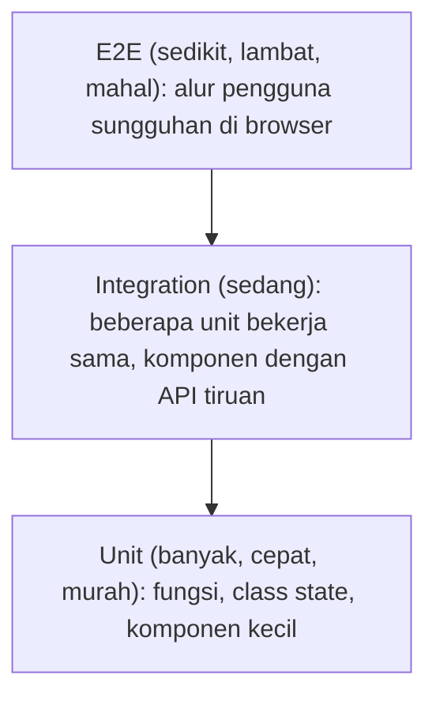

| Jenis | Menguji | Alat |
|---|---|---|
| **Unit** | Fungsi/modul/komponen terisolasi | Vitest |
| **Integration** | Interaksi beberapa bagian (form + validasi + API tiruan) | Vitest + Testing Library + MSW |
| **End-to-End** | Alur lengkap seperti pengguna | Playwright |
| **Regression** | Memastikan bug lama tidak kembali | Semua di atas (tambah tes untuk tiap bug) |
| **Coverage** | Persentase kode yang dijalankan tes | `vitest --coverage` |

**TDD** (*Test-Driven Development*): *Red* (tulis tes yang gagal) → *Green* (kode minimal agar lulus) → *Refactor*. Prinsip pengujian: uji **perilaku yang dilihat pengguna**, bukan detail implementasi; satu tes satu perilaku; tes harus cepat, deterministik, dan independen. Coverage tinggi bukan jaminan kualitas; fokus pada logika bisnis dan alur kritis.

## 15.2 Testing Tools

```bash
npx sv add vitest playwright        # menambahkan konfigurasi siap pakai pada proyek SvelteKit
# atau manual:
npm i -D vitest jsdom @testing-library/svelte @testing-library/jest-dom @testing-library/user-event
npm i -D @playwright/test msw
```

```ts
// vite.config.ts  (Vitest memakai konfigurasi Vite)
import { sveltekit } from '@sveltejs/kit/vite';
import { svelteTesting } from '@testing-library/svelte/vite';
import { defineConfig } from 'vitest/config';

export default defineConfig({
  plugins: [sveltekit(), svelteTesting()],             // membuat Svelte dikompilasi untuk browser + auto-cleanup
  test: {
    environment: 'jsdom',                              // atau 'happy-dom'
    include: ['src/**/*.{test,spec}.{js,ts}'],
    setupFiles: ['./vitest-setup.ts'],
  },
});
```

```ts
// vitest-setup.ts
import '@testing-library/jest-dom/vitest';              // matcher seperti toBeInTheDocument()
```

| Konsep | Penjelasan |
|---|---|
| **Vitest** | Test runner cepat berbasis Vite; API mirip Jest (`describe`, `it`, `expect`, `vi`) |
| **Testing Library** (`@testing-library/svelte`) | Render komponen dan cari elemen **seperti pengguna** (`getByRole`, `getByLabelText`) |
| **Playwright** | Otomasi browser nyata (Chromium, Firefox, WebKit) untuk E2E |
| **Mocking** | `vi.fn()`, `vi.spyOn()`, `vi.mock('modul')`; **MSW** menirukan API di level jaringan |
| **Fixtures** | Data/lingkungan uji yang disiapkan ulang (di Playwright dan Vitest) |
| **Test environment** | jsdom/happy-dom (simulasi browser), atau *browser mode* Vitest dengan browser sungguhan (opsi yang makin direkomendasikan untuk komponen; cek dokumentasi `vitest-browser-svelte`) |

## 15.3 Svelte Testing

### Component, Props, dan Events

```svelte
<!-- Counter.svelte -->
<script lang="ts">
  let { awal = 0, onubah }: { awal?: number; onubah?: (n: number) => void } = $props();
  let n = $state(awal);
  function tambah() { n++; onubah?.(n); }
</script>
<p>Hitungan: <output>{n}</output></p>
<button onclick={tambah}>Tambah</button>
```

```ts
// Counter.test.ts
import { render, screen } from '@testing-library/svelte';
import userEvent from '@testing-library/user-event';
import { describe, it, expect, vi } from 'vitest';
import Counter from './Counter.svelte';

describe('Counter', () => {
  it('menampilkan nilai awal dari props', () => {
    render(Counter, { props: { awal: 5 } });
    expect(screen.getByText('5')).toBeInTheDocument();
  });

  it('menambah hitungan dan memanggil callback saat diklik', async () => {
    const user = userEvent.setup();
    const onubah = vi.fn();
    render(Counter, { props: { onubah } });

    await user.click(screen.getByRole('button', { name: 'Tambah' }));

    expect(screen.getByText('1')).toBeInTheDocument();
    expect(onubah).toHaveBeenCalledWith(1);
  });
});
```

Gunakan `await` pada interaksi pengguna dan `findBy*` / `waitFor` untuk hasil asinkron.

### Testing Runes (State, Derived, Effect)

File uji untuk kode yang memakai Runes harus berekstensi **`.svelte.test.ts`** agar compiler memproses runes:

```ts
// todo.svelte.test.ts
import { flushSync } from 'svelte';
import { describe, it, expect } from 'vitest';
import { TodoStore } from './todo.svelte';

describe('TodoStore', () => {
  it('menghitung sisa dengan $derived', () => {
    const s = new TodoStore();
    s.tambah('A'); s.tambah('B');
    s.daftar[0].selesai = true;
    expect(s.sisa).toBe(1);                       // derived dihitung saat dibaca
  });

  it('menjalankan $effect (dibungkus $effect.root)', () => {
    const log: number[] = [];
    let count = $state(0);

    const cleanup = $effect.root(() => {
      $effect(() => { log.push(count); });
    });

    flushSync();                                   // jalankan efek awal
    count = 1;
    flushSync();                                   // jalankan efek setelah perubahan
    expect(log).toEqual([0, 1]);
    cleanup();
  });
});
```

Efek hanya berjalan di dalam *root* efek; di luar komponen gunakan `$effect.root` dan `flushSync()`.

### Testing Stores

```ts
import { get } from 'svelte/store';
import { todos, sisa } from './stores';

it('menambah todo', () => {
  todos.reset();
  todos.tambah('A');
  expect(get(todos)).toHaveLength(1);
  expect(get(sisa)).toBe(1);
});
```

### Testing Form dan User Interaction

```ts
it('menampilkan error validasi dan mengirim bila valid', async () => {
  const user = userEvent.setup();
  const kirim = vi.fn();
  render(FormLogin, { props: { onkirim: kirim } });

  await user.click(screen.getByRole('button', { name: 'Masuk' }));
  expect(await screen.findByRole('alert')).toHaveTextContent('Email wajib diisi');
  expect(kirim).not.toHaveBeenCalled();

  await user.type(screen.getByLabelText('Email'), 'dina@contoh.com');
  await user.type(screen.getByLabelText('Password'), 'rahasia-panjang');
  await user.click(screen.getByRole('button', { name: 'Masuk' }));

  expect(kirim).toHaveBeenCalledWith({ email: 'dina@contoh.com', password: 'rahasia-panjang' });
});
```

Mencari elemen dengan **role dan label** sekaligus memverifikasi aksesibilitas.

### Testing Navigation (Modul `$app/*`)

```ts
import { vi } from 'vitest';

vi.mock('$app/navigation', () => ({ goto: vi.fn(), invalidate: vi.fn(), invalidateAll: vi.fn() }));
vi.mock('$app/state', () => ({ page: { url: new URL('http://localhost/blog'), params: {} } }));

import { goto } from '$app/navigation';

it('mengarahkan ke dashboard', async () => {
  // ... picu aksi komponen
  expect(goto).toHaveBeenCalledWith('/dashboard');
});
```

### Testing API Integration dengan MSW

```ts
// src/mocks/server.ts
import { setupServer } from 'msw/node';
import { http, HttpResponse } from 'msw';

export const server = setupServer(
  http.get('/api/todos', () => HttpResponse.json([{ id: 1, judul: 'Belajar', selesai: false }])),
);

// vitest-setup.ts
import { server } from './src/mocks/server';
beforeAll(() => server.listen({ onUnhandledRequest: 'error' }));
afterEach(() => server.resetHandlers());
afterAll(() => server.close());
```

```ts
it('menampilkan daftar dari API', async () => {
  render(DaftarTodo);
  expect(await screen.findByText('Belajar')).toBeInTheDocument();
});

it('menampilkan error saat API gagal', async () => {
  server.use(http.get('/api/todos', () => new HttpResponse(null, { status: 500 })));
  render(DaftarTodo);
  expect(await screen.findByRole('alert')).toBeInTheDocument();
});
```

> Pada lingkungan jsdom, URL relatif pada `fetch` perlu base URL; atur `test.environmentOptions.jsdom.url` atau gunakan URL absolut di handler.

### Testing Server Load dan Form Actions

`load` dan action hanyalah fungsi; panggil dengan *event* tiruan dan database/service yang disuntikkan atau di-mock:

```ts
// +page.server.test.ts
import { describe, it, expect, vi } from 'vitest';
import { load, actions } from './+page.server';

vi.mock('$lib/server/db', () => ({ db: { select: () => ({ from: () => ({ where: async () => [{ id: 1, title: 'A' }] }) }) } }));

it('load memerlukan login', async () => {
  await expect(load({ locals: { user: null } } as any)).rejects.toMatchObject({ status: 303 });   // redirect dilempar
});

it('action menolak judul kosong', async () => {
  const fd = new FormData(); fd.set('title', '   ');
  const request = new Request('http://localhost/todos', { method: 'POST', body: fd });
  const hasil = await actions.tambah({ request, locals: { user: { id: 'u1' } } } as any);
  expect(hasil).toMatchObject({ status: 400 });                       // fail(400, ...) memberi { status, data }
  expect(hasil.data.galat.title).toBeTruthy();
});
```

Lebih baik lagi: pindahkan logika ke **service** (Level 11) dan uji service dengan repositori palsu, sehingga tes tidak bergantung pada bentuk event SvelteKit.

## 15.4 Advanced Testing

### Database Testing

```ts
// test/db.ts: database SQLite in-memory untuk tiap file uji
import { drizzle } from 'drizzle-orm/libsql';
import { createClient } from '@libsql/client';
import { migrate } from 'drizzle-orm/libsql/migrator';
import * as schema from '$lib/server/db/schema';

export async function buatDbUji() {
  const db = drizzle(createClient({ url: ':memory:' }), { schema });
  await migrate(db, { migrationsFolder: './drizzle' });
  return db;
}
```

```ts
it('todoRepo membuat dan membaca data', async () => {
  const db = await buatDbUji();
  const repo = todoRepo(db);
  await repo.buat('u1', 'Tes');
  expect(await repo.daftar('u1')).toHaveLength(1);
});
```

Untuk PostgreSQL/MySQL gunakan kontainer sementara (mis. Testcontainers) atau database uji terpisah yang dibersihkan antar tes. Jangan pernah menjalankan tes terhadap database produksi.

### Authentication Testing

- **Unit/integrasi:** uji fungsi sesi (`buatSesi`, `validasiSesi`, kedaluwarsa, perpanjangan) dengan DB uji; uji `bisa(user, izin)`.
- **Otorisasi:** untuk setiap endpoint/action terlindungi, ada tes **tanpa login → 401/redirect**, **peran salah → 403**, **objek milik orang lain → 404/403**.
- **E2E:** login sekali lewat UI, simpan `storageState`, pakai ulang di tes lain:

```ts
// e2e/auth.setup.ts
import { test as setup, expect } from '@playwright/test';
export const FILE = 'playwright/.auth/user.json';          // tambahkan ke .gitignore

setup('login', async ({ page }) => {
  await page.goto('/login');
  await page.getByLabel('Email').fill('uji@contoh.com');
  await page.getByLabel('Password').fill('kata-sandi-uji-123');
  await page.getByRole('button', { name: 'Masuk' }).click();
  await expect(page).toHaveURL('/dashboard');
  await page.context().storageState({ path: FILE });
});
```

### End-to-End dengan Playwright

```ts
// playwright.config.ts
import { defineConfig } from '@playwright/test';

export default defineConfig({
  testDir: 'e2e',
  webServer: { command: 'npm run build && npm run preview', port: 4173 },    // uji build produksi
  use: { baseURL: 'http://localhost:4173', trace: 'on-first-retry' },
  projects: [
    { name: 'setup', testMatch: /.*\.setup\.ts/ },
    { name: 'chromium', use: { storageState: 'playwright/.auth/user.json' }, dependencies: ['setup'] },
  ],
});
```

```ts
// e2e/todo.spec.ts
import { test, expect } from '@playwright/test';

test('menambah dan menghapus todo', async ({ page }) => {
  await page.goto('/todos');
  await page.getByLabel('Judul').fill('Belajar Playwright');
  await page.getByRole('button', { name: 'Tambah' }).click();
  await expect(page.getByText('Belajar Playwright')).toBeVisible();

  await page.getByRole('button', { name: 'Hapus Belajar Playwright' }).click();
  await expect(page.getByText('Belajar Playwright')).toHaveCount(0);
});
```

Praktik baik E2E: selektor berbasis **role/label** (bukan class CSS), hindari `waitForTimeout` (andalkan *auto-waiting* dan `expect`), data uji yang terisolasi, dan **sedikit tes untuk alur kritis** (login, checkout), karena E2E lambat.

### Visual Regression dan Accessibility Testing

```ts
// Visual regression: bandingkan tangkapan layar dengan baseline
test('beranda tidak berubah tampilan', async ({ page }) => {
  await page.goto('/');
  await expect(page).toHaveScreenshot('beranda.png', { maxDiffPixelRatio: 0.01 });
});
```

Tangkapan layar berbeda antar OS/font; hasilkan baseline di lingkungan **yang sama dengan CI** (mis. container yang sama).

```bash
npm i -D @axe-core/playwright
```

```ts
import AxeBuilder from '@axe-core/playwright';

test('beranda tidak memiliki pelanggaran aksesibilitas otomatis', async ({ page }) => {
  await page.goto('/');
  const hasil = await new AxeBuilder({ page }).withTags(['wcag2a', 'wcag2aa']).analyze();
  expect(hasil.violations).toEqual([]);
});
```

Alat otomatis hanya menangkap sebagian masalah a11y; lengkapi dengan uji keyboard dan pembaca layar manual.

### CI Testing

```yaml
# .github/workflows/test.yml
name: Test
on: [push, pull_request]

jobs:
  uji:
    runs-on: ubuntu-latest
    steps:
      - uses: actions/checkout@v4
      - uses: actions/setup-node@v4
        with: { node-version: 22, cache: npm }
      - run: npm ci
      - run: npm run check          # svelte-check (tipe dan peringatan)
      - run: npm run lint
      - run: npm run test -- --run  # Vitest sekali jalan
      - run: npx playwright install --with-deps chromium
      - run: npm run test:e2e
      - uses: actions/upload-artifact@v4
        if: failure()
        with: { name: playwright-report, path: playwright-report/ }
```

> Versi action (`@v4`) dan Node berubah seiring waktu; cek halaman resmi tiap action.

## Project Level 15

1. **Unit Test untuk Todo Application:** `TodoStore` (`.svelte.test.ts`), komponen `TodoItem` (props, event, a11y query), dan fungsi util; target logika bisnis ≥ 90% tercakup.
2. **Integration Test untuk API:** MSW untuk skenario sukses, 401, 422, 500, *loading* dan *empty state*; uji service dengan DB in-memory.
3. **E2E Test untuk Authentication:** daftar, login, akses halaman terlindungi, logout, percobaan salah berulang (rate limit), dan setup `storageState`.
4. **Testing Dashboard Application:** uji filter/urut tabel, grafik (ringkasan data), tema gelap, snapshot visual, dan pemeriksaan axe.

## Target Kompetensi Level 15

- [ ] Menjelaskan piramida pengujian dan memilih jenis tes yang tepat.
- [ ] Mengonfigurasi Vitest, Testing Library, MSW, dan Playwright pada proyek Svelte/SvelteKit.
- [ ] Menguji komponen, runes (`.svelte.test.ts`, `$effect.root`, `flushSync`), stores, form, `load`, dan actions.
- [ ] Menulis E2E, uji otorisasi, uji DB, uji visual/aksesibilitas, dan menjalankannya di CI.

---

# LEVEL 16: Deployment dan Production

**Tujuan:** men-*deploy* aplikasi Svelte ke lingkungan production.

## 16.1 Production Build

```bash
npm run build         # SvelteKit: kompilasi, bundel, dan jalankan adapter
npm run preview       # simulasi lokal hasil build (bukan untuk produksi sungguhan)
```

- **Vite** (Svelte murni): hasil di `dist/`, aset ber-hash.
- **SvelteKit:** artefak internal di `.svelte-kit/`, **keluaran akhir ditentukan adapter** (mis. `build/` untuk adapter-node).
- **Environment:** pisahkan konfigurasi per lingkungan; variabel privat tidak ikut ke bundel klien; variabel `PUBLIC_` terbaca publik. Gunakan `$env/dynamic/*` bila nilai ditentukan saat runtime/deploy.
- **Error logging:** laporkan error tak terduga lewat `handleError` (server dan klien) ke layanan pelacak error.
- **Debugging production:** aktifkan *source map* (`build: { sourcemap: true }` di `vite.config`) dan unggah ke layanan error (bukan dipublikasikan bila tak ingin kode terbuka); reproduksi lokal dengan `npm run build && npm run preview`.

## 16.2 SvelteKit Adapters

**Adapter** mengubah hasil build menjadi bentuk yang dapat dijalankan pada platform target.

| Adapter | Target | Catatan |
|---|---|---|
| `adapter-auto` | Mendeteksi platform otomatis (Vercel, Netlify, Cloudflare, dll.) | Nyaman untuk memulai; untuk produksi, pasang adapter spesifik agar bisa mengatur opsi |
| `adapter-node` | **Server Node.js** (VPS, Docker) | Keluaran `build/`, dijalankan `node build` |
| `adapter-static` | **Situs statis** (SSG/SPA) | Semua halaman harus bisa di-prerender, atau gunakan `fallback` untuk SPA |
| `adapter-vercel` | Vercel | Opsi runtime/region per route |
| `adapter-netlify` | Netlify | Fungsi dan edge |
| `adapter-cloudflare` | Cloudflare Workers/Pages | Akses `platform.env` (KV, D1, R2) |

```js
// svelte.config.js
import adapter from '@sveltejs/adapter-node';
export default { kit: { adapter: adapter() } };
```

**adapter-node:** variabel lingkungan runtime penting:

| Variabel | Fungsi |
|---|---|
| `PORT`, `HOST` | Port dan alamat listen (default `3000`, `0.0.0.0`) |
| `ORIGIN` | Origin publik (mis. `https://contoh.com`); **diperlukan agar pemeriksaan CSRF dan `url.origin` benar** di belakang proxy |
| `PROTOCOL_HEADER`, `HOST_HEADER` | Alternatif `ORIGIN` bila proxy meneruskan header `x-forwarded-proto`/`x-forwarded-host` |
| `ADDRESS_HEADER` | Header berisi IP klien (agar `getClientAddress()` benar); aktifkan **hanya** bila proxy tepercaya |
| `BODY_SIZE_LIMIT` | Batas ukuran body request (mis. untuk unggah) |

```bash
npm run build
node --env-file=.env build        # Node 20.6+ memuat .env; `.env` tidak otomatis dibaca pada build produksi
```

**adapter-static (SPA):**

```js
import adapter from '@sveltejs/adapter-static';
export default { kit: { adapter: adapter({ fallback: '200.html' }) } };   // + export const ssr = false; di +layout.ts root
```

**Custom adapter:** objek dengan `name` dan fungsi `adapt(builder)` yang memakai `builder.writeClient()`, `builder.writePrerendered()`, `builder.writeServer()` untuk menulis keluaran ke platform yang tidak didukung. Pelajari kode adapter resmi sebagai rujukan.

## 16.3 Deployment Platform

### Vercel, Netlify, Cloudflare

Alur umum: **hubungkan repositori Git** → pilih framework SvelteKit → atur **environment variables** → setiap `git push` ke branch utama men-*deploy* otomatis, dan setiap Pull Request mendapat **preview deployment**.

| Platform | Catatan |
|---|---|
| **Vercel** | Adapter otomatis; fungsi serverless/edge; rollback instan ke deployment sebelumnya |
| **Netlify** | Fungsi dan edge; atur *build command* `npm run build` |
| **Cloudflare Pages/Workers** | Adapter Cloudflare; runtime berbasis Workers (tidak semua API Node tersedia; periksa kompatibilitas); binding ke KV, D1, R2 lewat `platform.env`; deploy dengan `wrangler` |

### VPS, Docker, Nginx, Reverse Proxy, dan HTTPS

**Dockerfile** (adapter-node, multi-stage):

```dockerfile
FROM node:22-alpine AS build
WORKDIR /app
COPY package*.json ./
RUN npm ci
COPY . .
RUN npm run build && npm prune --omit=dev

FROM node:22-alpine
WORKDIR /app
ENV NODE_ENV=production
COPY --from=build /app/build ./build
COPY --from=build /app/node_modules ./node_modules
COPY package.json .
USER node
EXPOSE 3000
CMD ["node", "build"]
```

```text
# .dockerignore
node_modules
.svelte-kit
build
.env
.git
```

```bash
docker build -t aplikasiku .
docker run -d --name aplikasiku -p 3000:3000 \
  -e ORIGIN=https://contoh.com -e DATABASE_URL=file:/data/app.db \
  -v aplikasiku-data:/data aplikasiku
```

**Docker Compose** dengan PostgreSQL:

```yaml
services:
  app:
    build: .
    ports: ["3000:3000"]
    environment:
      ORIGIN: https://contoh.com
      DATABASE_URL: postgres://app:rahasia@db:5432/app
    depends_on: [db]
    restart: unless-stopped
  db:
    image: postgres:16
    environment: { POSTGRES_USER: app, POSTGRES_PASSWORD: rahasia, POSTGRES_DB: app }
    volumes: [dbdata:/var/lib/postgresql/data]
volumes: { dbdata: {} }
```

(Gunakan *secrets* atau file env terpisah untuk kata sandi sungguhan.)

**Tanpa Docker di VPS (systemd):**

```ini
# /etc/systemd/system/aplikasiku.service
[Unit]
Description=Aplikasi SvelteKit
After=network.target

[Service]
User=www-data
WorkingDirectory=/srv/aplikasiku
Environment=NODE_ENV=production
Environment=PORT=3000
Environment=ORIGIN=https://contoh.com
ExecStart=/usr/bin/node build
Restart=always

[Install]
WantedBy=multi-user.target
```

```bash
sudo systemctl enable --now aplikasiku
```

**Nginx sebagai reverse proxy:**

```nginx
server {
  listen 80;
  server_name contoh.com;

  location / {
    proxy_pass http://127.0.0.1:3000;
    proxy_http_version 1.1;
    proxy_set_header Host $host;
    proxy_set_header X-Real-IP $remote_addr;
    proxy_set_header X-Forwarded-For $proxy_add_x_forwarded_for;
    proxy_set_header X-Forwarded-Proto $scheme;
    proxy_set_header Upgrade $http_upgrade;          # dukungan WebSocket
    proxy_set_header Connection "upgrade";
  }
}
```

**HTTPS** gratis dengan Let's Encrypt:

```bash
sudo apt install certbot python3-certbot-nginx
sudo certbot --nginx -d contoh.com -d www.contoh.com     # sertifikat + pembaruan otomatis
```

Setelah HTTPS berfungsi, pertimbangkan header HSTS di Nginx dan alihkan seluruh HTTP ke HTTPS.

## 16.4 CI/CD

```yaml
# .github/workflows/deploy.yml
name: CI/CD
on:
  push: { branches: [main] }
  pull_request:

jobs:
  uji-dan-build:
    runs-on: ubuntu-latest
    steps:
      - uses: actions/checkout@v4
      - uses: actions/setup-node@v4
        with: { node-version: 22, cache: npm }
      - run: npm ci
      - run: npm run check && npm run lint
      - run: npm run test -- --run
      - run: npm run build

  deploy:
    needs: uji-dan-build
    if: github.ref == 'refs/heads/main'
    runs-on: ubuntu-latest
    environment: production                       # dapat diberi persetujuan manual dan rahasia khusus
    permissions: { contents: read, packages: write }
    steps:
      - uses: actions/checkout@v4
      - uses: docker/login-action@v3
        with: { registry: ghcr.io, username: ${{ github.actor }}, password: ${{ secrets.GITHUB_TOKEN }} }
      - uses: docker/build-push-action@v6
        with:
          push: true
          tags: ghcr.io/${{ github.repository }}:${{ github.sha }}
      # langkah berikut: masuk ke server lewat SSH dan jalankan `docker pull` + `docker compose up -d`
      # (atau panggil CLI platform: vercel/netlify/wrangler)
```

- **GitLab CI/CD:** berkas `.gitlab-ci.yml` dengan `stages: [test, build, deploy]` dan *job* yang setara.
- **Automated testing/build/deployment:** setiap perubahan lewat pipeline yang sama; *main* selalu bisa di-deploy.
- **Environment separation:** `development` → `staging` (replika produksi untuk uji akhir) → `production`, masing-masing dengan database, rahasia, dan domain sendiri. Jangan berbagi database antar lingkungan.
- **Rollback strategy:** simpan beberapa versi image/rilis (tag berdasarkan commit SHA); platform seperti Vercel menyediakan rollback instan; untuk server sendiri, jalankan ulang image sebelumnya. **Migrasi database harus kompatibel mundur** (pola *expand/contract*: tambah kolom baru dahulu, deploy kode yang memakai keduanya, baru hapus yang lama) agar rollback kode tidak terhalang skema.

## 16.5 Production Monitoring

| Aspek | Praktik dan alat |
|---|---|
| **Application logging** | Log **terstruktur** (JSON) dengan ID permintaan; pustaka seperti `pino`; jangan mencatat rahasia/data pribadi |
| **Error monitoring** | Sentry atau sejenis (SDK SvelteKit tersedia): pengelompokan error, *source map*, konteks pengguna |
| **Performance monitoring** | RUM Web Vitals, waktu respons server, kueri lambat, penggunaan memori/CPU |
| **Uptime monitoring** | Pemeriksa eksternal yang memanggil URL dan memberi peringatan bila turun |
| **Health check** | Endpoint ringan untuk load balancer dan orkestrator |
| **Analytics** | Penganalisis yang menghormati privasi (mis. Plausible, Umami) atau analytics lain sesuai kebijakan privasi/consent |
| **Log management** | Kumpulkan terpusat (Loki, ELK, atau layanan terkelola) dengan retensi dan pencarian |
| **Alerting** | Peringatan berbasis gejala (error rate, latensi) ke kanal yang dipantau |

```ts
// src/routes/healthz/+server.ts
import { json } from '@sveltejs/kit';
import { sql } from 'drizzle-orm';
import { db } from '$lib/server/db';

export const GET = async () => {
  try {
    await db.run(sql`select 1`);                             // pemeriksaan dependensi kritis (sesuaikan dengan driver)
    return json({ status: 'ok' });
  } catch {
    return json({ status: 'gagal' }, { status: 503 });
  }
};
```

```ts
// hooks.server.ts: log permintaan terstruktur + ID permintaan
export const handle: Handle = async ({ event, resolve }) => {
  const id = crypto.randomUUID();
  const mulai = performance.now();
  const response = await resolve(event);
  response.headers.set('X-Request-Id', id);
  console.log(JSON.stringify({ id, metode: event.request.method, path: event.url.pathname, status: response.status, ms: Math.round(performance.now() - mulai) }));
  return response;
};
```

## Project Level 16

1. **Deploy Personal Website:** situs statis (adapter-static, prerender) ke Cloudflare Pages/Netlify/GitHub Pages dengan domain kustom dan HTTPS.
2. **Deploy SvelteKit REST API:** adapter-node di VPS atau platform, `ORIGIN` dan CORS yang benar, endpoint `/healthz`, variabel lingkungan aman.
3. **Deploy Full-stack Application:** aplikasi dengan database (mis. Postgres terkelola), migrasi dijalankan saat deploy, backup terjadwal, dan monitoring error.
4. **Dockerize SvelteKit Application:** Dockerfile multi-stage, `.dockerignore`, Compose dengan database, *healthcheck*, pengguna non-root.
5. **CI/CD dengan GitHub Actions:** pipeline cek tipe, lint, tes, build, deploy otomatis ke staging dan produksi (dengan persetujuan), serta prosedur rollback tertulis.

## Target Kompetensi Level 16

- [ ] Memilih adapter dan platform deployment yang tepat dan mengatur variabel lingkungan produksi.
- [ ] Men-deploy ke platform terkelola maupun VPS (Docker, Nginx, HTTPS).
- [ ] Membangun pipeline CI/CD dengan pemisahan lingkungan dan strategi rollback.
- [ ] Menerapkan logging, pelacakan error, health check, dan monitoring.

---

# LEVEL 17: Advanced Architecture

**Tujuan:** memahami cara membangun aplikasi Svelte dengan struktur yang dapat dikembangkan dalam jangka panjang.

## 17.1 Application Architecture

### Feature-based Architecture

Kelompokkan kode **berdasarkan fitur/domain**, bukan jenis file, sehingga hal yang berubah bersama berdekatan:

```text
src/
├── routes/                         # tipis: hanya merangkai fitur menjadi halaman
├── lib/
│   ├── features/
│   │   ├── todo/
│   │   │   ├── components/         # TodoList.svelte, TodoItem.svelte
│   │   │   ├── state/              # todo.svelte.ts
│   │   │   ├── api.ts              # klien ke server
│   │   │   ├── server/             # repository.ts, service.ts (hanya server)
│   │   │   ├── schema.ts           # validasi (Zod)
│   │   │   └── index.ts            # API publik fitur
│   │   ├── auth/ ...
│   │   └── billing/ ...
│   ├── shared/                     # ui/, utils/, types/, config/ (dipakai lintas fitur)
│   └── server/                     # db, auth, infrastruktur (hanya server)
```

### Layered, Modular, dan Separation of Concerns

- **Layered:** Presentasi (komponen) → Aplikasi/Service → Domain → Infrastruktur (DB, API eksternal). Dependensi mengalir **ke dalam** (UI boleh memanggil service; domain tidak tahu UI atau DB).
- **Modular:** tiap fitur mengekspos **API publik** lewat `index.ts`; modul lain **tidak** mengimpor berkas internalnya. Tegakkan dengan aturan ESLint (`no-restricted-imports`) atau alat seperti dependency-cruiser.
- **Separation of concerns:** komponen mengurus tampilan dan interaksi; state/logika di modul `.svelte.ts`; aturan bisnis di service; akses data di repository.

### Domain-driven Design (Dasar)

| Konsep | Arti |
|---|---|
| **Ubiquitous language** | Istilah bisnis yang sama dipakai di percakapan, dokumen, dan kode |
| **Bounded context** | Batas model yang konsisten (mis. "Penagihan" dan "Pengiriman" punya makna "Pelanggan" masing-masing) |
| **Entity / Value object** | Objek dengan identitas / objek tanpa identitas yang ditentukan oleh nilainya (mis. `Uang`) |
| **Aggregate** | Kelompok objek yang diubah sebagai satu kesatuan lewat *aggregate root* |
| **Repository** | Abstraksi penyimpanan aggregate |
| **Domain service** | Logika domain yang tidak melekat pada satu entity |

```ts
// value object sederhana: aturan bisnis hidup di domain, bukan di komponen
export class Uang {
  private constructor(readonly sen: number, readonly mata: 'IDR') {}
  static idr(rupiah: number) {
    if (!Number.isFinite(rupiah) || rupiah < 0) throw new Error('Jumlah uang tidak valid');
    return new Uang(Math.round(rupiah * 100), 'IDR');
  }
  tambah(l: Uang) { return new Uang(this.sen + l.sen, this.mata); }
  format() { return new Intl.NumberFormat('id-ID', { style: 'currency', currency: this.mata, maximumFractionDigits: 0 }).format(this.sen / 100); }
}
```

DDD adalah **alat untuk domain yang kompleks**, bukan keharusan untuk setiap aplikasi; mulai dari ide intinya (bahasa bersama, batas modul) tanpa seremoni berlebihan.

### Dependency Injection, Service Architecture, Repository Pattern, Shared Module

- **Server:** injeksi lewat parameter/factory (`todoService(repo)`; Level 11) atau *container* sederhana yang dirakit di `hooks.server.ts` dan disimpan di `event.locals`.
- **UI:** gunakan **context** untuk menyediakan dependensi (klien API, logger, tema) ke subtree, mudah diganti saat pengujian.
- **Repository:** satu-satunya tempat yang mengetahui SQL/ORM; service bergantung pada antarmuka repository.
- **Shared module:** hanya untuk kode yang benar-benar lintas fitur (UI primitif, utilitas murni). Hindari menjadikannya "tempat sampah".

### Error Boundary Strategy

Tangani error di **lapisan yang tepat**:

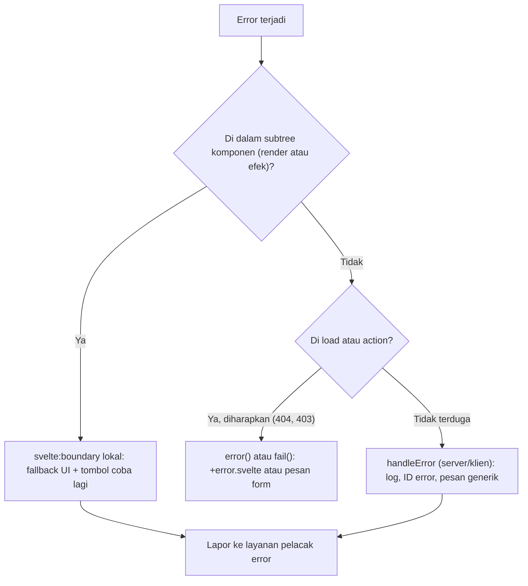

| Lapisan | Mekanisme |
|---|---|
| Widget/komponen | `<svelte:boundary>` dengan snippet `failed` |
| Halaman/route | `+error.svelte` |
| Global | `handleError` (server dan klien) |
| Kode async di handler | `try/catch` eksplisit, tampilkan toast/pesan |
| Server ke klien | Format error konsisten (`AppError` → kode status dan `kode` mesin-terbaca) |

## 17.2 Large Scale Application

### Scalable Folder Structure dan Component Library Architecture

Susun komponen dalam lapisan yang makin spesifik:

| Lapisan | Contoh | Aturan |
|---|---|---|
| **Tokens** | warna, jarak, tipografi (CSS variables) | Sumber kebenaran visual |
| **Primitives** | `Button`, `Input`, `Icon` | Tanpa logika bisnis; aksesibel; bertipe |
| **Patterns** | `FormField`, `DataTable`, `Modal` | Komposisi primitives |
| **Feature components** | `TodoItem`, `InvoiceTable` | Tahu domain; berada di dalam fitur |
| **Pages/Routes** | merangkai fitur | Setipis mungkin |

### Shared State, API Layer, Authentication dan Permission Architecture

- **Shared state:** modul/class per fitur (bukan satu *store* raksasa); state server lewat `load`/cache; state URL untuk filter dan halaman; context untuk data per-subtree (Level 6).
- **API layer:** klien terpusat dan bertipe; pertimbangkan **membangkitkan tipe dari OpenAPI** (`openapi-typescript`) agar kontrak backend dan frontend sinkron; satu tempat untuk transformasi DTO.
- **Autentikasi:** satu jalur (`hooks.server.ts` → `locals`), layanan sesi terpusat, tidak ada logika auth tersebar di komponen.
- **Izin:** satu **lapisan kebijakan** (`bisa(user, aksi, sumber)`) yang dipakai server untuk **penegakan** dan UI hanya untuk **petunjuk** (menyembunyikan tombol). Penegakan selalu di server.

### Multi-tenant Application

**Multi-tenancy:** satu aplikasi melayani banyak pelanggan (*tenant*) dengan data terisolasi.

| Strategi | Isolasi | Biaya/Kompleksitas |
|---|---|---|
| **Database bersama + kolom `tenant_id`** | Logis (wajib disiplin; bisa diperkuat *Row-Level Security*) | Termurah, paling umum |
| **Schema per tenant** | Menengah | Migrasi harus dijalankan per schema |
| **Database per tenant** | Tertinggi | Paling mahal dan kompleks, cocok untuk kebutuhan regulasi/enterprise |

```ts
// hooks.server.ts: tentukan tenant dari subdomain (mis. perusahaan-a.aplikasi.com)
export const handle: Handle = async ({ event, resolve }) => {
  const host = event.url.hostname;
  const subdomain = host.endsWith('.aplikasi.com') ? host.split('.')[0] : null;

  const tenant = subdomain ? await cariTenant(subdomain) : null;
  if (subdomain && !tenant) error(404, 'Organisasi tidak ditemukan');
  event.locals.tenant = tenant;

  return resolve(event);
};
```

```ts
// SEMUA kueri harus dibatasi tenant; bungkus dalam repository agar tidak ada yang terlupa
const daftarFaktur = (tenantId: string) => db.select().from(faktur).where(eq(faktur.tenantId, tenantId));
```

Aturan emas: pengguna hanya boleh mengakses data di **tenant-nya**; sertakan `tenant_id` di setiap tabel yang relevan dan di setiap indeks; tulis **tes isolasi** (tenant A tidak bisa membaca data tenant B), dan masukkan tenant ke dalam kunci cache.

### Internationalization (i18n) dan Localization

- **i18n:** merancang aplikasi agar bisa diterjemahkan (tidak ada teks tertanam di komponen). **Localization (l10n):** menyesuaikan konten dan format untuk lokal tertentu.
- Pustaka yang umum untuk Svelte/SvelteKit: **Paraglide JS** (terintegrasi lewat `npx sv add paraglide`, pesan bertipe dan *tree-shakeable*) atau `svelte-i18n`. Cek dokumentasi versi terbaru.
- Tentukan locale dari **URL** (`/id/...` dengan `[[lang]]` atau subdomain), simpan preferensi, dan atur `<html lang>`.

```ts
// format yang sadar lokal tanpa library tambahan
const rupiah = new Intl.NumberFormat('id-ID', { style: 'currency', currency: 'IDR', maximumFractionDigits: 0 });
const tanggal = new Intl.DateTimeFormat('id-ID', { dateStyle: 'long' });
const jamak = new Intl.PluralRules('id-ID');
rupiah.format(1250000);                 // "Rp 1.250.000"
tanggal.format(new Date('2026-10-31'));  // "31 Oktober 2026"
```

Hal yang sering terlewat: teks panjang (Jerman) merusak tata letak, bahasa kanan-ke-kiri (Arab/Ibrani) memerlukan `dir="rtl"` dan CSS logis (`margin-inline-start`), bentuk jamak, urutan nama/alamat, dan zona waktu.

### Feature Flags

Memisahkan **rilis kode** dari **rilis fitur**: fitur baru dikirim "mati" lalu dinyalakan bertahap atau per kelompok.

```ts
// $lib/server/fitur.ts
import { createHash } from 'node:crypto';

type Flag = { aktif: boolean; persen?: number; peran?: string[] };
const FLAGS: Record<string, Flag> = {
  'dasbor-baru': { aktif: true, persen: 20 },        // rollout 20% pengguna
  'ekspor-pdf': { aktif: true, peran: ['admin'] },
};

export function fiturAktif(nama: string, user: { id: string; peran: string } | null) {
  const f = FLAGS[nama];
  if (!f?.aktif) return false;
  if (f.peran && !(user && f.peran.includes(user.peran))) return false;
  if (f.persen !== undefined) {
    if (!user) return false;
    const bucket = createHash('sha256').update(`${nama}:${user.id}`).digest().readUInt16BE(0) % 100;   // stabil per pengguna
    return bucket < f.persen;
  }
  return true;
}
```

Evaluasi flag di **server** dan kirim hasilnya lewat `load`; untuk skala besar pertimbangkan layanan khusus (Unleash, GrowthBook, atau standar OpenFeature). **Disiplin penting:** beri pemilik dan tanggal kedaluwarsa pada setiap flag, dan hapus flag yang sudah permanen agar tidak menumpuk menjadi utang teknis.

## 17.3 Enterprise Development

### Design System

Lebih dari kumpulan komponen: **tokens + komponen + pedoman + dokumentasi + proses**. Kunci keberhasilannya: versi semantik, *changelog*, aksesibilitas bawaan (WCAG 2.2 AA sebagai target), dukungan tema, kontribusi terbuka dari tim, dan tes (unit, visual, a11y) pada setiap komponen.

### Monorepo dan Workspace Management

**Monorepo** menyimpan beberapa paket/aplikasi dalam satu repositori agar berbagi kode, konfigurasi, dan alur kerja.

```text
mono/
├── apps/
│   ├── web/              # aplikasi SvelteKit utama
│   └── admin/            # aplikasi SvelteKit admin
├── packages/
│   ├── ui/               # pustaka komponen Svelte (design system)
│   ├── config/           # tsconfig, eslint, prettier bersama
│   └── domain/           # tipe dan logika bersama
├── pnpm-workspace.yaml
├── turbo.json            # (opsional) orkestrasi tugas dan cache build (Turborepo)
└── package.json
```

```yaml
# pnpm-workspace.yaml
packages:
  - 'apps/*'
  - 'packages/*'
```

```json
// apps/web/package.json (cuplikan)
{ "dependencies": { "@mono/ui": "workspace:*", "@mono/domain": "workspace:*" } }
```

- **`workspace:*`** menautkan paket lokal tanpa mempublikasikan.
- **Turborepo/Nx** menjalankan tugas (`build`, `test`, `lint`) berurutan sesuai dependensi dan **meng-cache** hasilnya.
- **Changesets** mengelola versi dan *changelog* untuk paket yang dipublikasikan.
- Satu versi `svelte` dan dependensi utama di seluruh workspace mencegah duplikasi dan bug aneh.

### Shared Packages (Pustaka Svelte)

```bash
npx sv create --template library packages/ui    # kerangka pustaka dengan svelte-package
```

```json
// packages/ui/package.json (cuplikan)
{
  "name": "@mono/ui",
  "version": "0.1.0",
  "type": "module",
  "svelte": "./dist/index.js",
  "types": "./dist/index.d.ts",
  "exports": { ".": { "types": "./dist/index.d.ts", "svelte": "./dist/index.js" } },
  "files": ["dist"],
  "peerDependencies": { "svelte": "^5.0.0" },
  "scripts": { "build": "svelte-package", "dev": "svelte-package --watch" }
}
```

`svelte-package` (dari `@sveltejs/package`) mengompilasi `src/lib` menjadi `dist` dengan deklarasi tipe. `svelte` dideklarasikan sebagai **peerDependency** agar aplikasi dan pustaka berbagi satu instansi.

### Component Documentation dan Storybook

**Storybook** menyediakan katalog komponen interaktif untuk pengembangan terisolasi, dokumentasi, dan uji visual/aksesibilitas:

```bash
npx storybook@latest init        # mendeteksi proyek Svelte/SvelteKit dan menyiapkan konfigurasi
npm run storybook
```

```ts
// Button.stories.ts  (gaya CSF; sintaks tepatnya bergantung versi Storybook dan addon Svelte)
import type { Meta, StoryObj } from '@storybook/sveltekit';
import Button from './Button.svelte';

const meta = { title: 'UI/Button', component: Button, tags: ['autodocs'] } satisfies Meta<Button>;
export default meta;

export const Primer: StoryObj<typeof meta> = { args: { varian: 'primer', children: undefined } };
export const Nonaktif: StoryObj<typeof meta> = { args: { disabled: true } };
```

Dokumentasikan setiap komponen: tujuan, props, contoh pemakaian, perilaku aksesibilitas (keyboard, ARIA), dan kapan **tidak** memakainya.

### Accessibility Standards

Targetkan **WCAG 2.2 level AA**. Praktik: elemen semantik; pola ARIA mengikuti *ARIA Authoring Practices Guide*; kontras dan ukuran target sentuh memadai; fokus terlihat; dukungan keyboard penuh; teks alternatif; tidak bergantung warna saja; `prefers-reduced-motion`. Otomatisasi (axe di CI, `svelte-check`, ESLint) + audit manual dengan pembaca layar secara berkala.

### Security Audit

- **Dependensi:** `npm audit`, pembaruan otomatis (Dependabot/Renovate), kunci versi lewat *lockfile*.
- **Kode:** analisis statis (SAST), pemindaian rahasia (mencegah kunci API ter-commit), tinjauan khusus untuk kode autentikasi/otorisasi.
- **Konfigurasi:** CSP, header keamanan, HTTPS, CORS ketat, batas laju.
- **Rancangan:** *threat modeling* (mis. STRIDE) pada fitur sensitif; acuan **OWASP ASVS** sebagai daftar periksa.
- **Verifikasi:** uji penetrasi berkala dan program pelaporan kerentanan.

### Code Review dan Technical Documentation

**Code review:** PR kecil dan fokus; deskripsi jelas (apa dan mengapa); otomatisasi untuk hal yang bisa diotomatisasi (format, lint, tipe, tes); reviewer memeriksa desain, keamanan, aksesibilitas, tes, dan keterbacaan, bukan gaya yang bisa diperiksa mesin.

**Dokumentasi teknis** yang hidup bersama kode:

| Dokumen | Isi |
|---|---|
| **README** | Apa ini, cara menjalankan, struktur, skrip penting |
| **ADR** (*Architecture Decision Record*) | Keputusan arsitektur: konteks, opsi, keputusan, konsekuensi |
| **Diagram (C4/Mermaid)** | Konteks, kontainer, komponen, alur penting |
| **Runbook** | Cara men-deploy, memantau, memulihkan, menangani insiden |
| **API docs** | OpenAPI untuk endpoint, kontrak event |

```markdown
# ADR-007: Memakai sesi server-side, bukan JWT, untuk autentikasi web

- Status: Diterima (2026-10-31)
- Konteks: Aplikasi web satu domain, butuh logout instan dan pencabutan sesi per perangkat.
- Opsi: (1) JWT stateless, (2) sesi di database dengan cookie HttpOnly.
- Keputusan: Opsi 2.
- Konsekuensi: Satu kueri DB per request (dapat di-cache); pencabutan seketika; JWT tetap dipakai untuk API antar layanan.
```

### Micro Frontend dan Module Federation (Konsep)

**Micro frontend** memecah frontend besar menjadi bagian yang **dikembangkan dan di-deploy secara independen** oleh tim berbeda.

| Pendekatan | Cara | Pertimbangan |
|---|---|---|
| **Komposisi di server/edge** | Halaman dirakit dari fragmen | Rumit tetapi performa baik |
| **Berbasis route** | Aplikasi berbeda melayani path berbeda di balik satu *gateway* | Sederhana; transisi antar aplikasi memuat penuh |
| **iframe** | Isolasi kuat | UX, aksesibilitas, dan komunikasi terbatas |
| **Web Components** | Setiap bagian dibungkus custom element | Svelte dapat mengompilasi komponen menjadi custom element |
| **Module Federation** | Aplikasi *host* memuat modul dari aplikasi *remote* saat runtime, berbagi dependensi | Konsep populer; dukungan Vite/SvelteKit lewat plugin komunitas, periksa kematangannya |

```svelte
<!-- Kartu.svelte sebagai Web Component (butuh opsi compiler customElement: true pada build khusus) -->
<svelte:options customElement="x-kartu" />
<script>
  let { judul = 'Tanpa judul', children } = $props();
</script>
<article><h3>{judul}</h3>{@render children?.()}</article>
```

> Micro frontend menambah kompleksitas (konsistensi UI, berbagi state, versi dependensi, performa). **Gunakan hanya** bila organisasi benar-benar membutuhkan *independent deployability*; monorepo dengan pustaka bersama sering cukup.

## Project Level 17

| Proyek | Cakupan |
|---|---|
| **Enterprise Admin Dashboard** | Monorepo (`apps/admin`, `packages/ui`), RBAC dan permission, tabel server-side, audit log, feature flags, i18n (id/en), pengujian lengkap, CI/CD |
| **Multi-tenant Management System** | Resolusi tenant dari subdomain, isolasi data (`tenant_id` + RLS bila tersedia), pengaturan per tenant (branding, fitur), penagihan sederhana, tes isolasi |
| **Enterprise HR Management System** | Modul: karyawan, absensi, cuti (alur persetujuan), payroll, penilaian kinerja; bounded context terpisah; integrasi event antar modul; laporan; kebijakan retensi dan perlindungan data |
| **Component Design System** | Paket `@org/ui` (tokens + primitives + patterns), Storybook, tes visual/a11y, rilis dengan Changesets |
| **Modular Frontend Application** | Aplikasi dengan batas modul ditegakkan (ESLint/dependency-cruiser), API publik per fitur, dan dokumentasi ADR |

Arsitektur contoh untuk HR Management System:

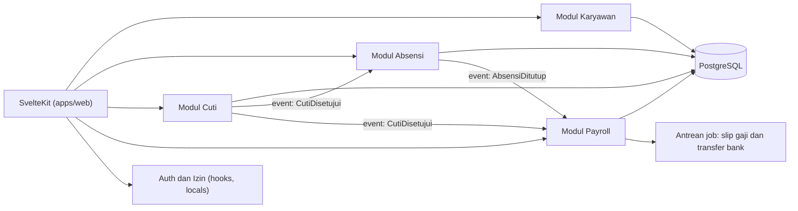

## Target Kompetensi Level 17

- [ ] Merancang struktur berbasis fitur, berlapis, dan modular dengan batas yang ditegakkan.
- [ ] Menerapkan error boundary, DI, repository, dan lapisan izin secara konsisten.
- [ ] Merancang multi-tenancy, i18n/l10n, dan feature flags dengan aman.
- [ ] Mengelola monorepo, pustaka bersama, Storybook, dan dokumentasi teknis (ADR, C4, runbook).
- [ ] Memahami trade-off micro frontend dan kapan menghindarinya.

---

# Jadwal Belajar yang Disarankan

Roadmap ini tidak menetapkan durasi baku. Berikut saran dengan asumsi **10-15 jam per minggu** (sesuaikan dengan latar belakangmu; jika sudah mahir web, percepat Level 0-1).

| Fase | Level | Perkiraan | Hasil |
|---|---|---|---|
| **Fondasi** | 0-1 | 4-6 minggu | Web, HTML/CSS, JavaScript/TypeScript |
| **Inti Svelte** | 2-4 | 5-6 minggu | Komponen, template, Runes |
| **Arsitektur UI** | 5-8 | 6-8 minggu | Komponen, state, form, UI/UX |
| **Full-stack** | 9-12 | 8-10 minggu | SvelteKit, API, database, autentikasi |
| **Lanjutan** | 13-15 | 5-7 minggu | Advanced Svelte, performa, testing |
| **Produksi** | 16-17 | 4-6 minggu | Deployment dan arsitektur |
| **Total** | 0-17 | **± 32-43 minggu** | Portofolio full-stack lengkap |

---

# Tips Belajar Efektif

1. **Bangun proyek di setiap level.** Proyek memaksa kamu menghadapi masalah nyata yang tidak muncul di tutorial.
2. **Baca dokumentasi resmi** ([svelte.dev/docs](https://svelte.dev/docs) dan [svelte.dev/docs/kit](https://svelte.dev/docs/kit)), lalu kerjakan **tutorial interaktif** dan latihan di [Svelte Playground](https://svelte.dev/playground) (ada tab *JS output* untuk melihat hasil kompilasi).
3. **Pahami "kenapa", bukan hafal sintaks.** Mengapa Runes? Mengapa `$derived` bukan `$effect`? Mengapa server load, bukan fetch di komponen?
4. **Utamakan Svelte 5.** Tutorial lama (Svelte 3/4) memakai `$:`, `export let`, `on:click`, dan `createEventDispatcher`. Kenali keduanya agar bisa membaca kode lama, tetapi tulis kode baru dengan Runes.
5. **Ukur sebelum mengoptimasi; uji sebelum percaya.** Biasakan menulis tes dan memakai DevTools sejak dini.
6. **Keamanan bukan fitur tambahan.** Validasi di server, otorisasi di setiap titik akses data, rahasia tetap di server.
7. **Baca kode orang lain:** repositori contoh resmi, library UI (mis. shadcn-svelte, Bits UI), dan kode SvelteKit di GitHub.
8. **Tulis dan bagikan:** blog (seperti panduan ini), jawab pertanyaan di komunitas (Discord Svelte, r/sveltejs, GitHub Discussions), atau kontribusi ke dokumentasi.
9. **Konsisten:** 1-2 jam setiap hari lebih efektif daripada maraton akhir pekan.
10. **Simpan semua di Git** dan tulis README tiap proyek (masalah, keputusan teknis, cara menjalankan).

## Kesalahan Umum Svelte 5

| Kesalahan | Akibat | Solusi |
|---|---|---|
| Destructuring `$state` atau mengirim primitif state ke fungsi | Kehilangan reaktivitas (salinan nilai) | Kirim objek/getter; baca properti langsung |
| `$effect` untuk menurunkan nilai | Kode berbelit, loop efek | Gunakan `$derived` |
| Menulis dan membaca state yang sama di `$effect` | `effect_update_depth_exceeded` | `untrack`, atau hindari efek |
| Memutasi objek yang diterima sebagai prop | Peringatan, perilaku tak terduga | Callback atau `$bindable` |
| Mengekspor `$state` primitif yang ditimpa dari modul | Error kompilasi | Ekspor objek atau getter/setter |
| Lupa ekstensi `.svelte.js/.ts` | Runes tidak dikenali di modul | Gunakan `.svelte.ts` |
| State pengguna di modul sisi server | Kebocoran data antar pengguna (SSR) | `locals`, `load`, atau context |
| `{#each}` tanpa key pada data yang berubah | State input/animasi salah menempel | Key unik dan stabil |
| `{@html}` dengan input pengguna | XSS | Sanitasi atau hindari |
| `fetch` di `$effect` untuk data halaman | Race condition, kedip, tanpa SSR | Gunakan `load` |
| Mengandalkan guard `load` layout untuk melindungi action/endpoint | Celah otorisasi | Periksa `locals.user` di tiap action/endpoint |
| Mengakses `window`/`localStorage` di level atas komponen | Error SSR | `onMount`, `$effect`, atau cek `browser` |
| Modifier event Svelte 4 (mis. `preventDefault` pada `on:submit`) | Tidak berlaku di Svelte 5 | `e.preventDefault()` di handler |

---

# Penutup

Kamu telah menelusuri perjalanan lengkap dari **fondasi web** sampai **arsitektur enterprise** dengan Svelte 5 dan SvelteKit. Ingat bahwa kemahiran bukan soal menghafal semua API, melainkan **memahami konsep (reaktivitas, komponen, aliran data, batas server-klien), membiasakan membangun dan menguji, serta terus belajar** seiring ekosistem berkembang.

> *"Pelajari prinsipnya; alatnya akan berubah."* Mulailah dari proyek kecil hari ini, lalu naik satu level setiap kali kamu merasa nyaman.

Selamat belajar dan selamat berkarya! 🚀

---

### Referensi

- Svelte: <https://svelte.dev/docs/svelte>
- SvelteKit: <https://svelte.dev/docs/kit>
- Svelte Playground: <https://svelte.dev/playground>
- CLI `sv`: <https://svelte.dev/docs/cli>
- Vite: <https://vite.dev>
- Vitest: <https://vitest.dev>
- Testing Library (Svelte): <https://testing-library.com/docs/svelte-testing-library/intro>
- Playwright: <https://playwright.dev>
- MSW: <https://mswjs.io>
- Drizzle ORM: <https://orm.drizzle.team>
- Prisma: <https://www.prisma.io/docs>
- Superforms: <https://superforms.rocks>
- Zod: <https://zod.dev> · Valibot: <https://valibot.dev>
- Tailwind CSS: <https://tailwindcss.com/docs>
- OWASP Cheat Sheet Series: <https://cheatsheetseries.owasp.org/>
- Web Vitals: <https://web.dev/vitals>
- MDN Web Docs: <https://developer.mozilla.org>


