

Selamat datang di panduan belajar **Flowchart (Diagram Alir) dari nol sampai mahir**. Materi ini disusun seperti kuliah Informatika dan Teknik Komputer: dimulai dari konsep dan simbol, naik ke struktur kontrol dan perancangan algoritma, lalu berlanjut ke flowchart sistem, arsitektur software, dan alat bantu modern.

Setiap level berisi **dasar teori, penjelasan, contoh diagram, pseudocode, kode program, latihan, dan target kompetensi**.

## Tujuan Akhir

Setelah menyelesaikan panduan ini, kamu diharapkan mampu:

- Memahami konsep dan standar flowchart.
- Menerjemahkan permasalahan menjadi algoritma.
- Membuat flowchart dari algoritma sederhana hingga kompleks.
- Memahami hubungan flowchart, pseudocode, dan bahasa pemrograman.
- Merancang workflow aplikasi dan sistem informasi.
- Membuat dokumentasi proses bisnis dan software architecture.

## Peta Level

| Level | Topik | Tingkat |
|---|---|---|
| 1 | Fondasi flowchart | Beginner |
| 2 | Simbol dan notasi | Basic |
| 3 | Logika algoritma dan struktur kontrol | Intermediate |
| 4 | Teknik perancangan algoritma | Intermediate+ |
| 5 | Advanced flowchart | Advanced |
| 6 | System flowchart dan software architecture | Professional |
| 7 | Tools: Draw.io, Lucidchart, Mermaid, PlantUML | Praktis |
| 8 | Final project dan portofolio | Portofolio |

## Metode Belajar yang Dipakai di Seluruh Panduan

Untuk setiap latihan, ikuti siklus berikut:

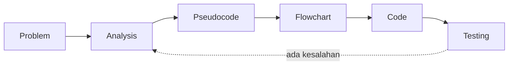

1. **Problem**: pahami masalahnya dengan kata-katamu sendiri.
2. **Analysis**: tentukan input, proses, dan output.
3. **Pseudocode**: tuliskan langkah dalam bahasa semi-formal.
4. **Flowchart**: gambarkan alurnya.
5. **Code**: terjemahkan ke bahasa pemrograman.
6. **Testing**: uji dengan data nyata dan kasus tepi (*edge case*).

> Kuasai dulu tiga struktur utama: **Sequence, Selection, Iteration**. Ketiganya adalah fondasi hampir semua alur program. Jangan terburu-buru ke flowchart sistem besar.

**Konvensi pseudocode** yang dipakai:

| Konstruksi | Penulisan |
|---|---|
| Awal / akhir | `MULAI` / `SELESAI` |
| Masukan / keluaran | `BACA x` atau `INPUT x` / `TULIS x` atau `OUTPUT x` |
| Penugasan | `x ← 5` |
| Perbandingan | `=`, `≠`, `<`, `>`, `≤`, `≥` |
| Percabangan | `JIKA ... MAKA ... JIKA TIDAK ... AKHIR JIKA` |
| Perulangan | `SELAMA ... LAKUKAN`, `ULANGI ... SAMPAI`, `UNTUK i DARI a SAMPAI b` |
| Subprogram | `FUNGSI nama(param)`, `PROSEDUR nama(param)`, `KEMBALIKAN nilai` |

Contoh kode memakai **Python** karena sintaksnya paling mendekati pseudocode. Konsepnya berlaku sama untuk JavaScript, Java, C, Go, Lua, dan lainnya.

* TOC
{:toc}

---

# LEVEL 1: Fondasi Flowchart (Beginner)

**Tujuan:** memahami konsep dasar flowchart dan penggunaannya dalam pemecahan masalah.

## 1.1 Pengertian Flowchart

**Flowchart** (diagram alir) adalah diagram yang menggambarkan **urutan langkah dan keputusan dalam suatu proses** menggunakan **simbol baku** yang dihubungkan oleh **panah**. Ia menjawab pertanyaan: *"Apa yang dilakukan, dalam urutan apa, dan apa yang terjadi bila kondisi tertentu terpenuhi?"*

Analogi: **resep masakan** yang digambar. Bahan (input) diproses lewat langkah-langkah (proses), ada keputusan ("sudah matang?"), lalu hasilnya disajikan (output).

Contoh paling sederhana, flowchart membuat teh:

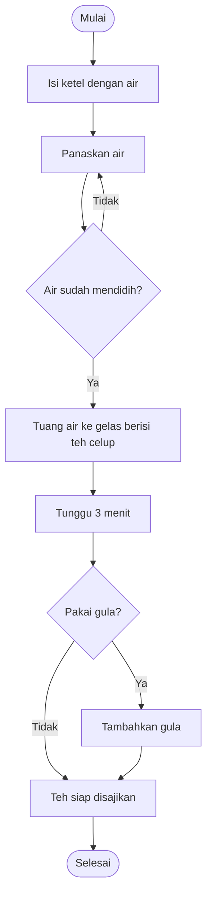

Dari diagram ini kamu sudah melihat tiga hal penting: **urutan** (A sampai F), **percabangan** (keputusan "pakai gula?"), dan **perulangan** (kembali ke "panaskan air" selama belum mendidih).

## 1.2 Sejarah Singkat Flowchart

| Periode | Peristiwa |
|---|---|
| **1921** | Frank dan Lillian Gilbreth memperkenalkan *process chart* kepada American Society of Mechanical Engineers (ASME) untuk menganalisis alur kerja industri |
| **1930-an** | Allan Mogensen menyebarkan teknik process chart dalam rekayasa industri dan penyederhanaan kerja |
| **1947** | Herman Goldstine dan John von Neumann memakai *flow diagram* untuk merencanakan program komputer, yang mempopulerkan flowchart dalam pemrograman |
| **1960–1970-an** | Penyeragaman simbol oleh badan standar (ANSI) dan IBM mempopulerkan *flowcharting template* |
| **1985** | Standar internasional **ISO 5807** menetapkan simbol dan konvensi flowchart data, program, dan sistem |
| **1990–2000-an** | Muncul UML (activity diagram) dan BPMN sebagai notasi yang lebih kaya untuk perangkat lunak dan proses bisnis |
| **2010-an–kini** | Diagram berbasis teks (*diagram as code*) seperti PlantUML dan Mermaid, disimpan dan di-*review* bersama kode di Git |

> Rincian tahun pada awal sejarah bisa berbeda antar sumber. Yang penting dipahami adalah arah perkembangannya: dari analisis kerja pabrik, ke perencanaan program komputer, ke dokumentasi sistem modern.

## 1.3 Tujuan Penggunaan Flowchart

1. **Memvisualisasikan** logika sebelum menulis kode.
2. **Menyamakan pemahaman** antara programmer, analis, desainer, dan pemangku kepentingan non-teknis.
3. **Menemukan kesalahan logika** lebih awal (langkah hilang, alur buntu, kondisi tidak lengkap).
4. **Mendokumentasikan** proses untuk pemeliharaan dan *onboarding* anggota tim baru.
5. **Menyederhanakan proses** yang berbelit (analisis bisnis dan perbaikan proses).

## 1.4 Fungsi Flowchart dalam Pengembangan Perangkat Lunak

| Fase pengembangan | Peran flowchart |
|---|---|
| **Analisis kebutuhan** | Memetakan proses bisnis saat ini dan yang diharapkan |
| **Desain** | Merancang logika fitur, alur data, dan arsitektur sistem |
| **Implementasi** | Panduan menulis kode, terutama logika bercabang dan berulang |
| **Pengujian** | Dasar menurunkan *test case* (setiap jalur adalah kandidat skenario uji) |
| **Pemeliharaan** | Dokumentasi untuk memahami kode lama dan menganalisis dampak perubahan |
| **Komunikasi** | Alat presentasi ke klien dan manajemen |

## 1.5 Hubungan Flowchart dengan Algoritma

**Algoritma** adalah urutan langkah-langkah yang **terbatas, jelas, dan terstruktur** untuk menyelesaikan suatu masalah. Ciri algoritma yang baik (merujuk pada ciri klasik dari Donald Knuth):

| Ciri | Arti |
|---|---|
| **Input** | Memiliki nol atau lebih masukan |
| **Output** | Menghasilkan setidaknya satu keluaran |
| **Definiteness** (jelas) | Setiap langkah tidak ambigu |
| **Finiteness** (berhingga) | Pasti berhenti setelah sejumlah langkah |
| **Effectiveness** (efektif) | Setiap langkah cukup sederhana untuk dikerjakan |

**Flowchart adalah salah satu cara merepresentasikan algoritma secara visual.** Algoritma yang sama dapat ditulis dengan tiga cara:

| Representasi | Kelebihan | Kekurangan |
|---|---|---|
| **Bahasa alami** | Mudah dipahami semua orang | Rawan ambigu |
| **Pseudocode** | Presisi, dekat dengan kode | Kurang visual untuk alur rumit |
| **Flowchart** | Alur dan percabangan langsung terlihat | Memakan ruang pada algoritma besar |

## 1.6 Hubungan Flowchart dengan Pseudocode dan Kode

**Pseudocode** adalah penulisan algoritma menyerupai kode, tetapi **tidak terikat sintaks bahasa tertentu**. Flowchart, pseudocode, dan kode adalah tiga "wajah" dari logika yang sama.

**Contoh: menentukan bilangan terbesar dari dua angka.**

*Bahasa alami:* masukkan dua angka; jika yang pertama lebih besar, tampilkan yang pertama; jika tidak, tampilkan yang kedua.

*Pseudocode:*

```text
MULAI
  BACA a, b
  JIKA a > b MAKA
    TULIS a
  JIKA TIDAK
    TULIS b
  AKHIR JIKA
SELESAI
```

*Flowchart:*

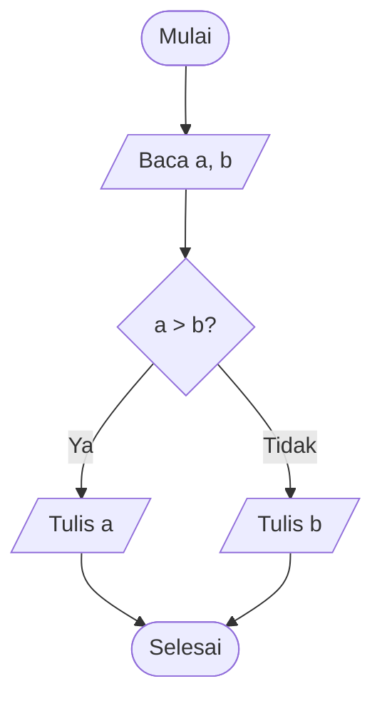

*Kode (Python):*

```python
a = float(input("a: "))
b = float(input("b: "))
if a > b:
    print(a)
else:
    print(b)
```

Alur kerja ideal: **flowchart → pseudocode → kode**, atau sebaliknya untuk mendokumentasikan kode yang sudah ada.

## 1.7 Perbedaan Flowchart dan UML

| Aspek | Flowchart | UML |
|---|---|---|
| Sifat | Satu jenis diagram untuk alur proses/algoritma | **Keluarga** 14 jenis diagram (struktur dan perilaku) |
| Fokus | *Bagaimana langkah-langkah berjalan* | Struktur kelas, interaksi objek, perilaku sistem, dll. |
| Notasi | Sedikit simbol baku, mudah dipelajari | Notasi lebih kaya dan formal |
| Cocok untuk | Algoritma, logika program, proses bisnis sederhana | Desain berorientasi objek dan arsitektur sistem |
| Padanan | — | **Activity Diagram** adalah "saudara" flowchart di UML |

Diagram UML yang sering dipakai: *Use Case*, *Class*, *Sequence*, *Activity*, *State*, *Component*, *Deployment*. **Flowchart dan UML saling melengkapi, bukan saling menggantikan.** Flowchart menjelaskan alur logika; UML sequence menjelaskan interaksi antar komponen; class diagram menjelaskan struktur.

Notasi lain yang perlu dikenal: **BPMN** (Business Process Model and Notation) untuk proses bisnis lintas peran, dan **DFD** (*Data Flow Diagram*) untuk aliran data antar proses dan penyimpanan.

## 1.8 Kapan Harus (dan Tidak Perlu) Menggunakan Flowchart

**Gunakan flowchart ketika:**

- Logika memiliki **banyak percabangan atau perulangan** yang sulit dibayangkan.
- Perlu **menyepakati alur** dengan orang non-teknis.
- Mendokumentasikan **proses bisnis** atau alur fitur penting (login, pembayaran, persetujuan).
- Mengajarkan **algoritma** kepada pemula.
- Menganalisis **bug logika** pada alur yang rumit.

**Tidak perlu (atau pilih alat lain) ketika:**

- Logikanya satu-dua baris yang sudah jelas dari kode.
- Yang ingin digambarkan adalah **struktur** (pakai class/ER diagram) atau **interaksi antar layanan berurutan waktu** (pakai sequence diagram).
- Diagram menjadi **terlalu besar** untuk satu halaman. Pecah menjadi beberapa flowchart berhierarki.

## 1.9 Jenis-jenis Flowchart

Roadmap ini mengelompokkan flowchart menjadi lima jenis. Batas antar jenis tidak kaku; yang terpenting adalah memahami **tingkat abstraksi dan fokusnya**.

| Jenis | Fokus | Audiens utama |
|---|---|---|
| **System Flowchart** | Alur keseluruhan sistem: proses, dokumen, penyimpanan data, perangkat | Analis sistem, arsitek |
| **Program Flowchart** | Logika detail di dalam program (langkah, keputusan, loop) | Programmer |
| **Document Flowchart** | Perjalanan dokumen antar bagian/pihak | Analis bisnis, auditor |
| **Process Flowchart** | Urutan kegiatan dalam proses bisnis/operasional | Manajer, analis proses |
| **Data Flowchart** | Pergerakan dan transformasi data antar proses dan penyimpanan | Analis data, DBA |

**a. System Flowchart** — contoh alur pemesanan online:

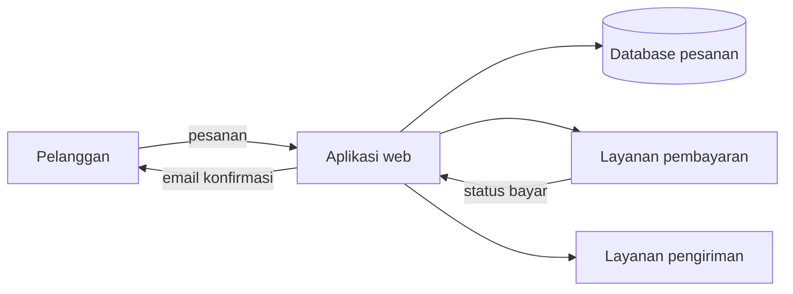

**b. Program Flowchart** — logika di dalam satu fungsi (memeriksa kelulusan):

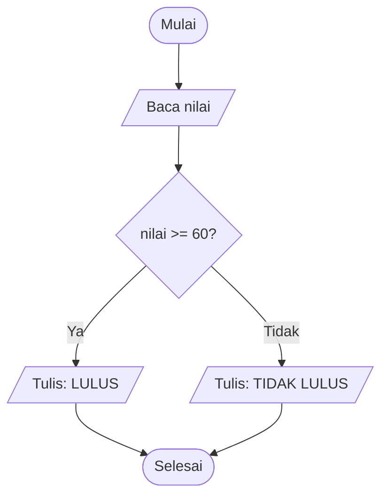

**c. Document Flowchart** — perjalanan dokumen pengajuan cuti:

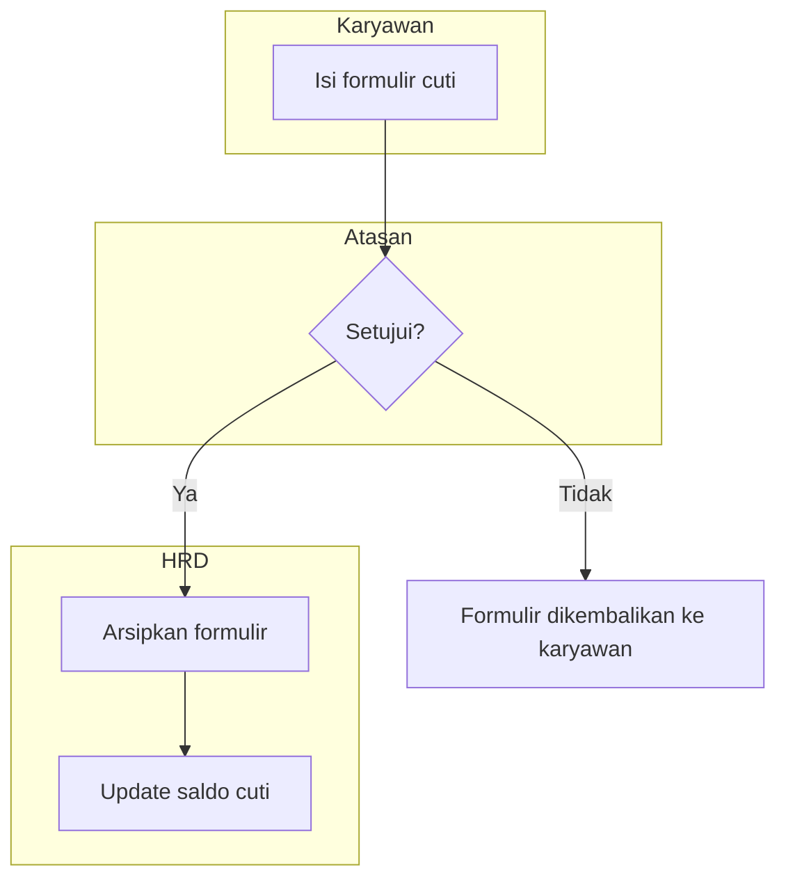

**d. Process Flowchart** — proses penerimaan barang di gudang:

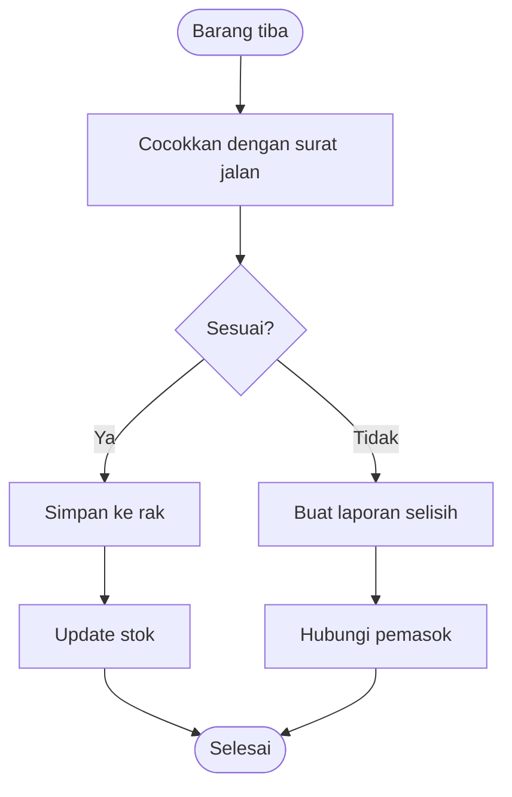

**e. Data Flowchart** — alur data penjualan menjadi laporan:

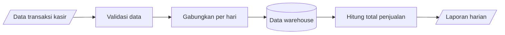

> **Data flowchart vs DFD:** keduanya menggambarkan perpindahan data. DFD punya notasi tersendiri (proses, entitas eksternal, data store, aliran data) dan bertingkat (level 0, 1, 2). Flowchart data lebih bebas dan dekat dengan alur langkah.

## 1.10 Praktik Level 1

Kerjakan dulu sendiri di kertas atau di editor diagram, baru bandingkan dengan solusi.

### Praktik 1: Flowchart aktivitas sehari-hari

Pilih satu kegiatan (mis. **berangkat kuliah/kerja**) dan gambarkan lengkap dengan keputusan.

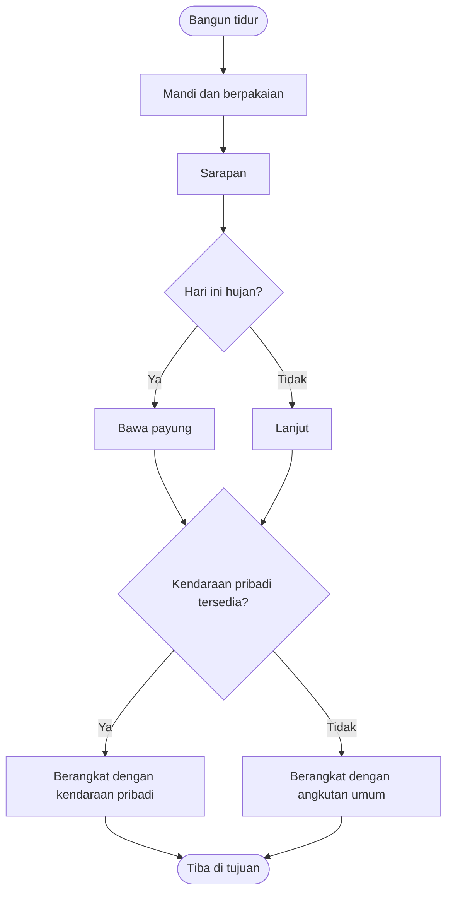

### Praktik 2: Flowchart proses login

**Pseudocode:**

```text
MULAI
  BACA username, password
  JIKA username dan password cocok dengan data pengguna MAKA
    TULIS "Login berhasil"
  JIKA TIDAK
    TULIS "Username atau password salah"
  AKHIR JIKA
SELESAI
```

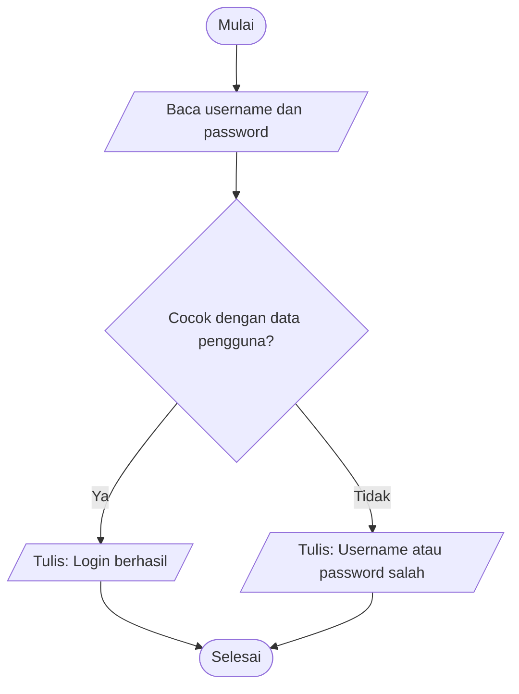

```python
PENGGUNA = {"dina": "rahasia123"}   # contoh data; di dunia nyata password harus di-hash

username = input("Username: ")
password = input("Password: ")

if PENGGUNA.get(username) == password:
    print("Login berhasil")
else:
    print("Username atau password salah")
```

> Pesan error dibuat **sama** untuk username salah maupun password salah agar tidak membocorkan informasi ke penyerang. Versi lengkap dengan batas percobaan dibahas di Level 5.

### Praktik 3: Menghitung luas persegi

**Analisis:** input = `sisi`; proses = `luas ← sisi × sisi`; output = `luas`.

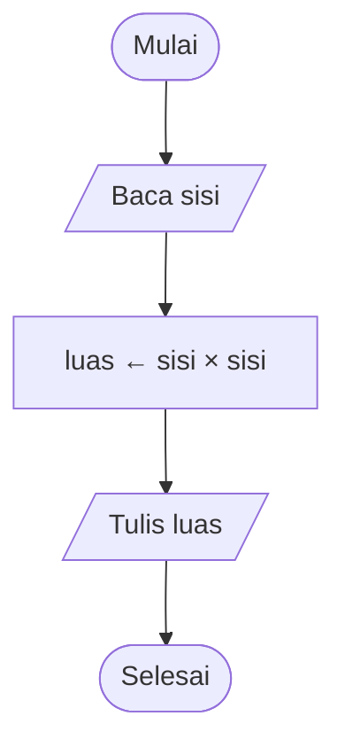

```python
sisi = float(input("Sisi: "))
luas = sisi * sisi
print("Luas:", luas)
```

**Tabel uji:**

| `sisi` | Hasil yang diharapkan |
|---|---|
| 4 | 16 |
| 2.5 | 6.25 |
| 0 | 0 |

### Praktik 4: Bilangan ganjil atau genap

Bilangan **genap** jika sisa bagi 2 sama dengan 0 (operator *modulo*, `mod` atau `%`).

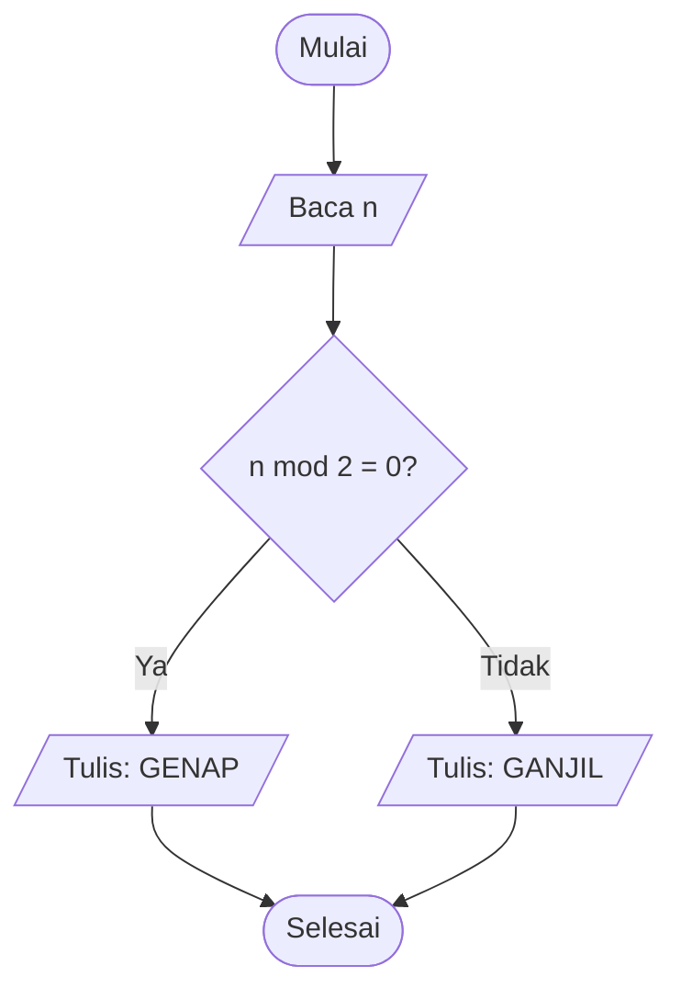

```python
n = int(input("Bilangan bulat: "))
print("GENAP" if n % 2 == 0 else "GANJIL")
```

Uji juga dengan **0** (genap) dan **bilangan negatif** (`-3` ganjil). Pada beberapa bahasa, sisa bagi bilangan negatif bisa bernilai negatif, jadi pengecekan `n % 2 != 0` lebih aman daripada `n % 2 == 1`.

## 1.11 Cek Pemahaman Level 1

1. Apa perbedaan algoritma dan flowchart?
2. Sebutkan lima ciri algoritma yang baik.
3. Mengapa pseudocode sering ditulis sebelum kode?
4. Kapan sebaiknya memakai sequence diagram dan bukan flowchart?
5. Sebutkan tiga manfaat flowchart pada fase pengujian.

<details>
<summary>Kunci jawaban singkat</summary>

1. Algoritma adalah **urutan langkah** penyelesaian masalah; flowchart adalah **representasi visual** dari algoritma itu.
2. Input, output, jelas (*definiteness*), berhingga (*finiteness*), efektif (*effectiveness*).
3. Memfokuskan pikiran pada logika tanpa terbebani sintaks, dan mudah ditinjau tim.
4. Ketika yang penting adalah **urutan interaksi antar komponen/layanan dari waktu ke waktu**.
5. Menurunkan test case dari tiap jalur, menemukan jalur yang tidak tertangani, dan memastikan setiap keputusan diuji pada kedua cabangnya.

</details>

## 1.12 Target Kompetensi Level 1

- [ ] Memahami konsep flowchart.
- [ ] Memahami kegunaan flowchart.
- [ ] Mampu menjelaskan hubungan algoritma dengan flowchart.

---

# LEVEL 2: Simbol dan Notasi Flowchart (Basic)

**Tujuan:** menguasai simbol standar yang dipakai dalam pembuatan flowchart.

## 2.1 Simbol Dasar

Simbol dan konvensi flowchart mengacu pada standar seperti **ISO 5807** dan praktik umum di industri. Berikut simbol yang wajib kamu hafal:

| Simbol | Nama | Fungsi | Contoh isi |
|---|---|---|---|
| **Oval / stadium** | Terminator | Awal dan akhir alur | `Mulai`, `Selesai` |
| **Persegi panjang** | Process | Proses atau instruksi (perhitungan, penugasan) | `luas ← sisi × sisi` |
| **Jajar genjang** | Input/Output | Masukan dan keluaran data | `Baca nilai`, `Tulis hasil` |
| **Belah ketupat** | Decision | Percabangan berdasarkan kondisi | `nilai >= 60?` |
| **Panah** | Flowline | Arah aliran | — |
| **Lingkaran** | Connector | Penghubung alur (pada halaman sama atau berbeda) | `A`, `B` |
| **Persegi panjang bergaris ganda samping** | Predefined Process | Memanggil subproses/fungsi yang didefinisikan di tempat lain | `Hitung pajak` |
| **Bentuk dokumen (dasar bergelombang)** | Document | Dokumen atau laporan tercetak | `Faktur`, `Laporan` |

**Simbol tambahan** yang sering ditemui:

| Simbol | Nama | Fungsi |
|---|---|---|
| Heksagon | Preparation | Inisialisasi/persiapan (mis. pada perulangan `for`) |
| Silinder | Stored data / Database | Penyimpanan data |
| Jajar genjang miring atas | Manual input | Masukan manual dari keyboard |
| Bentuk layar | Display | Keluaran ke layar |
| Pentagon (rumah) | Off-page connector | Sambungan ke halaman lain |
| Kurung siku | Annotation / Comment | Catatan tambahan |
| Persegi panjang bergelombang ganda | Multi-document | Beberapa dokumen |

### Padanan di Mermaid

| Simbol | Sintaks Mermaid | Hasil |
|---|---|---|
| Terminator | `A(["Mulai"])` | Oval |
| Process | `B["Proses"]` | Persegi panjang |
| Input/Output | `C[/"Baca x"/]` | Jajar genjang |
| Decision | `D{"x > 0?"}` | Belah ketupat |
| Predefined process | `E[["Hitung pajak"]]` | Persegi panjang bergaris ganda |
| Connector | `F((A))` | Lingkaran |
| Database | `G[("Data")]` | Silinder |
| Preparation | `H{{"i ← 1"}}` | Heksagon |

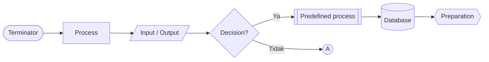

Mermaid versi 11.3 ke atas juga menyediakan sintaks bentuk eksplisit untuk simbol seperti dokumen:

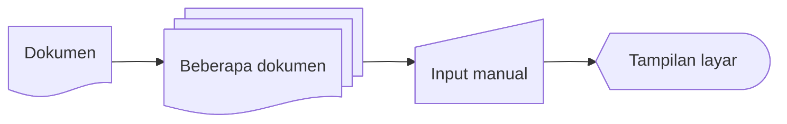

> Sintaks `@{ shape: ... }` bergantung versi Mermaid. Jika diagram di atas gagal tampil di situsmu, perbarui versi Mermaid atau abaikan; konsepnya yang penting.

## 2.2 Aturan Penggunaan Simbol

1. **Gunakan simbol sesuai fungsinya.** Input/output memakai jajar genjang, bukan persegi panjang.
2. **Satu titik awal, minimal satu titik akhir.** Alur dimulai dari satu terminator `Mulai` dan berakhir di `Selesai` (boleh lebih dari satu akhir bila memang ada beberapa kondisi berhenti, tetapi satu akhir yang menampung semua cabang biasanya lebih rapi).
3. **Isi simbol singkat dan lugas.** Gunakan frasa kerja: *Hitung luas*, *Baca nilai*, bukan kalimat panjang.
4. **Setiap keputusan harus punya label** pada setiap cabang keluar (`Ya`/`Tidak`, `True`/`False`, atau nilai kasus).
5. **Semua jalur harus berujung** ke terminator. Tidak boleh ada simbol "menggantung".
6. **Ukuran dan jarak seragam** agar mudah dibaca.

## 2.3 Standar Notasi dan Arah Aliran

- Alur utama mengalir **dari atas ke bawah** dan **dari kiri ke kanan**.
- Panah menunjukkan arah. Pada alur yang jelas arahnya, panah boleh dihilangkan, tetapi pada pemula **selalu gunakan panah**.
- Hindari **panah bersilangan**. Atur ulang tata letak atau gunakan connector.
- Pertahankan **jalur "normal"** (kasus yang paling umum) lurus ke bawah, dan cabang pengecualian ke samping.

Pada Mermaid, arah diatur lewat kata kunci setelah `flowchart`: `TD`/`TB` (atas ke bawah), `LR` (kiri ke kanan), `RL`, `BT`.

## 2.4 Penggunaan Connector

**Connector** menghindari panah panjang yang menyilang atau menyambung diagram yang terlalu panjang untuk satu halaman.

- **On-page connector** (lingkaran): menyambung dua titik dalam halaman yang sama.
- **Off-page connector** (pentagon): menyambung ke halaman/diagram lain.
- Pasangan connector memakai **label yang sama** (`A` dengan `A`, `B` dengan `B`).

**Halaman 1:**

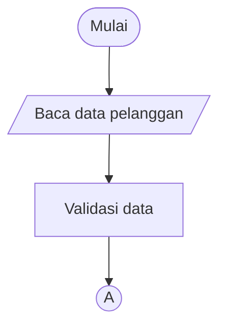

**Halaman 2** (lanjutan dari connector `A`):

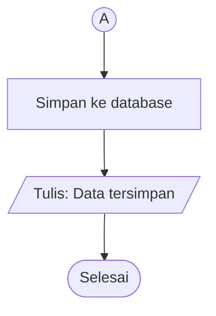

## 2.5 Aturan Penggunaan Decision

- Decision berisi **pertanyaan yang dijawab Ya/Tidak** (atau perbandingan yang bernilai benar/salah).
- Biasanya **dua cabang keluar** (`Ya` dan `Tidak`). Satu masuk, dua keluar.
- Pastikan **kedua cabang tertangani**. Lupa menangani cabang `Tidak` adalah kesalahan paling umum.
- Tulis kondisi dalam bentuk **positif dan spesifik**: `umur >= 17?` lebih jelas daripada `umur bukan di bawah 17?`.

## 2.6 Multiple Exit

Decision dengan **lebih dari dua cabang keluar** dipakai untuk pemilihan banyak nilai (setara `switch-case`/`match`). Setiap cabang diberi label nilai yang mungkin, termasuk cabang **lainnya** (*default*).

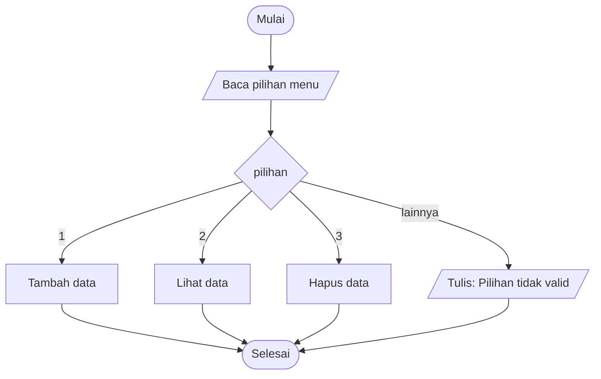

Selain pada decision, **satu simbol dengan banyak panah keluar** hanya dibenarkan bila menggambarkan **proses paralel** (dibahas di Level 5).

## 2.7 Nested Flowchart

**Nested** berarti ada struktur di dalam struktur. Ada dua bentuk:

**a. Decision di dalam decision** (nested IF): keputusan kedua hanya diperiksa bila keputusan pertama terpenuhi.

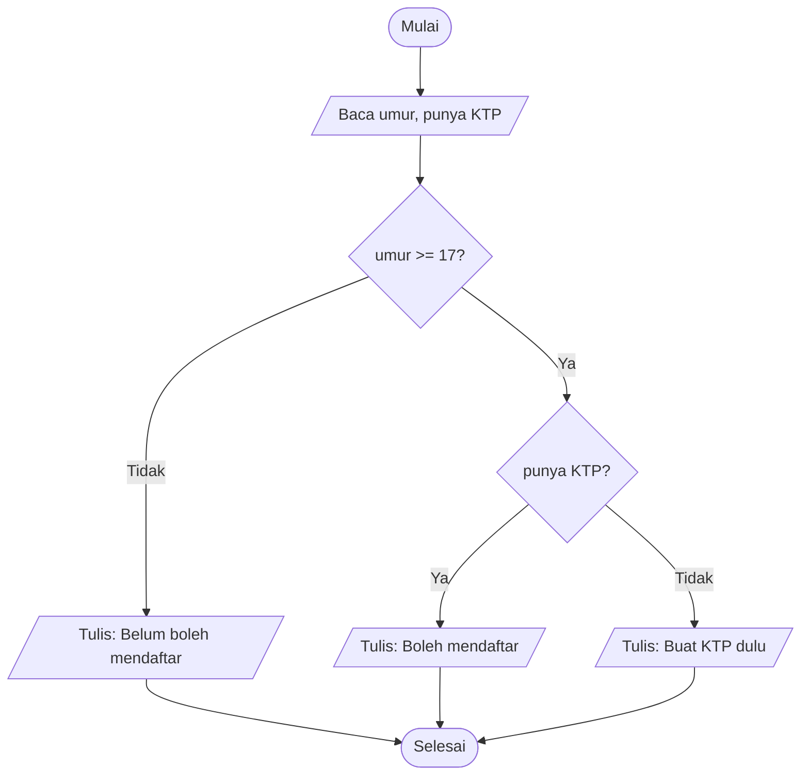

**b. Flowchart di dalam flowchart** (subproses): satu langkah pada diagram utama dirinci pada diagram lain. Diagram utama memakai simbol *predefined process*.

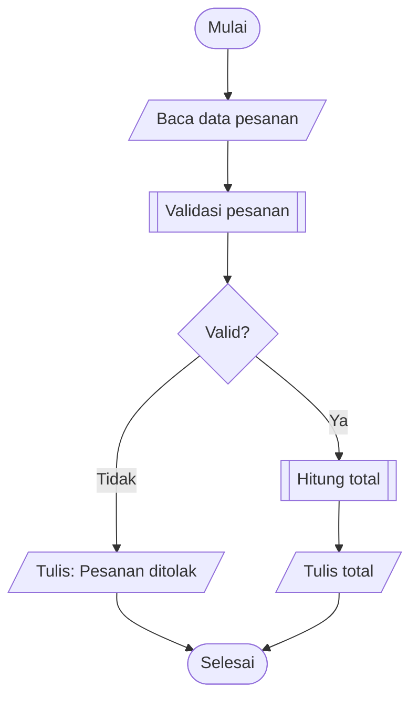

Rincian `Validasi pesanan` digambar terpisah:

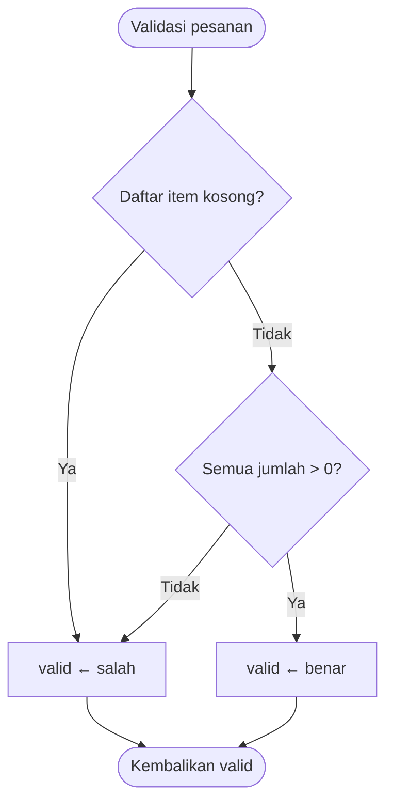

## 2.8 Kesalahan Umum dalam Pembuatan Flowchart

| # | Kesalahan | Perbaikan |
|---|---|---|
| 1 | Tidak ada `Mulai`/`Selesai` | Selalu mulai dan akhiri dengan terminator |
| 2 | Decision tanpa label cabang | Beri label `Ya`/`Tidak` pada setiap panah keluar |
| 3 | Decision hanya punya satu jalur keluar | Tangani **semua** kemungkinan hasil |
| 4 | Simbol menggantung (jalan buntu) | Hubungkan ke langkah berikut atau ke terminator |
| 5 | Perulangan tanpa jalan keluar (*infinite loop*) | Pastikan kondisi berhenti bisa tercapai |
| 6 | Simbol salah fungsi (input pakai persegi panjang) | Ikuti standar simbol |
| 7 | Teks panjang berbentuk kalimat | Pakai frasa singkat berawalan kata kerja |
| 8 | Panah bersilangan | Atur ulang tata letak atau pakai connector |
| 9 | Terlalu detail atau terlalu umum | Samakan tingkat abstraksi; pecah dengan subproses |
| 10 | Banyak titik `Mulai` | Satu alur, satu awal |
| 11 | Mencampur pernyataan proses di dalam decision | Decision hanya untuk pertanyaan; proses di simbol terpisah |

**Contoh SALAH** (tidak ada akhir, decision tanpa label, jalan buntu, proses di dalam decision):

```mermaid
flowchart TD
    A["Mulai"] --> B["Input nilai"]
    B --> C{"nilai lulus, tampilkan lulus"}
    C --> D["Tampilkan lulus"]
    C --> E["Tampilkan tidak lulus"]
```

**Contoh BENAR** dari alur yang sama:

```mermaid
flowchart TD
    A(["Mulai"]) --> B[/"Baca nilai"/]
    B --> C{"nilai >= 60?"}
    C -->|"Ya"| D[/"Tulis: LULUS"/]
    C -->|"Tidak"| E[/"Tulis: TIDAK LULUS"/]
    D --> F(["Selesai"])
    E --> F
```

## 2.9 Praktik Level 2

### Praktik 1: Menghitung luas segitiga

Rumus: `luas = ½ × alas × tinggi`. Validasi: alas dan tinggi harus **positif**.

```text
MULAI
  BACA alas, tinggi
  JIKA alas > 0 DAN tinggi > 0 MAKA
    luas ← 0.5 × alas × tinggi
    TULIS luas
  JIKA TIDAK
    TULIS "Alas dan tinggi harus positif"
  AKHIR JIKA
SELESAI
```

```mermaid
flowchart TD
    A(["Mulai"]) --> B[/"Baca alas, tinggi"/]
    B --> C{"alas > 0 dan tinggi > 0?"}
    C -->|"Ya"| D["luas ← 0.5 × alas × tinggi"]
    D --> E[/"Tulis luas"/]
    C -->|"Tidak"| F[/"Tulis: Alas dan tinggi harus positif"/]
    E --> G(["Selesai"])
    F --> G
```

```python
alas = float(input("Alas: "))
tinggi = float(input("Tinggi: "))

if alas > 0 and tinggi > 0:
    print("Luas:", 0.5 * alas * tinggi)
else:
    print("Alas dan tinggi harus positif")
```

### Praktik 2: Menghitung nilai rata-rata

Rata-rata dari tiga nilai ujian.

```mermaid
flowchart TD
    A(["Mulai"]) --> B[/"Baca n1, n2, n3"/]
    B --> C["rata ← (n1 + n2 + n3) / 3"]
    C --> D[/"Tulis rata"/]
    D --> E(["Selesai"])
```

```python
n1, n2, n3 = (float(input(f"Nilai {i}: ")) for i in (1, 2, 3))
rata = (n1 + n2 + n3) / 3
print(f"Rata-rata: {rata:.2f}")
```

Pada Level 3 kamu akan menggeneralisasi ini untuk **n nilai** memakai perulangan.

### Praktik 3: Menghitung total belanja

Tiga barang dengan harga dan jumlah masing-masing.

```text
BACA harga1, qty1, harga2, qty2, harga3, qty3
total ← harga1 × qty1 + harga2 × qty2 + harga3 × qty3
TULIS total
```

```mermaid
flowchart TD
    A(["Mulai"]) --> B[/"Baca harga1, qty1, harga2, qty2, harga3, qty3"/]
    B --> C["total ← harga1×qty1 + harga2×qty2 + harga3×qty3"]
    C --> D[/"Tulis total"/]
    D --> E(["Selesai"])
```

### Praktik 4: Menghitung diskon

Aturan (contoh): total belanja **≥ Rp100.000** mendapat diskon **10%**; selain itu tidak ada diskon.

```mermaid
flowchart TD
    A(["Mulai"]) --> B[/"Baca total"/]
    B --> C{"total >= 100000?"}
    C -->|"Ya"| D["diskon ← 0.10 × total"]
    C -->|"Tidak"| E["diskon ← 0"]
    D --> F["bayar ← total - diskon"]
    E --> F
    F --> G[/"Tulis diskon, bayar"/]
    G --> H(["Selesai"])
```

```python
total = float(input("Total belanja: "))
diskon = 0.10 * total if total >= 100_000 else 0
bayar = total - diskon
print(f"Diskon: {diskon:,.0f} | Bayar: {bayar:,.0f}")
```

| `total` | `diskon` | `bayar` |
|---:|---:|---:|
| 99.999 | 0 | 99.999 |
| 100.000 | 10.000 | 90.000 |
| 250.000 | 25.000 | 225.000 |

Perhatikan **nilai batas** (99.999 dan 100.000). Di sinilah kesalahan `>` vs `>=` sering terjadi.

### Praktik 5: Menentukan status kelulusan mahasiswa

Aturan: nilai akhir = 30% tugas + 30% UTS + 40% UAS. Mahasiswa **lulus** jika nilai akhir ≥ 60 **dan** kehadiran ≥ 75%.

```mermaid
flowchart TD
    A(["Mulai"]) --> B[/"Baca tugas, uts, uas, hadir"/]
    B --> C["akhir ← 0.3×tugas + 0.3×uts + 0.4×uas"]
    C --> D{"akhir >= 60 dan hadir >= 75?"}
    D -->|"Ya"| E[/"Tulis: LULUS"/]
    D -->|"Tidak"| F[/"Tulis: TIDAK LULUS"/]
    E --> G(["Selesai"])
    F --> G
```

```python
tugas, uts, uas, hadir = (float(input(f"{k}: ")) for k in ("Tugas", "UTS", "UAS", "Hadir (%)"))
akhir = 0.3 * tugas + 0.3 * uts + 0.4 * uas
print(f"Nilai akhir: {akhir:.1f}")
print("LULUS" if akhir >= 60 and hadir >= 75 else "TIDAK LULUS")
```

## 2.10 Cek Pemahaman Level 2

1. Simbol apa untuk input dan output?
2. Mengapa decision harus memiliki label di setiap cabang?
3. Kapan connector dipakai?
4. Apa kesalahan pada diagram yang decision-nya hanya punya satu panah keluar?
5. Apa perbedaan *process* dan *predefined process*?

<details>
<summary>Kunci jawaban singkat</summary>

1. Jajar genjang.
2. Agar jelas kondisi mana yang menuju jalur mana; tanpa label, diagram ambigu.
3. Untuk menyambung alur yang terpisah halaman atau menghindari panah panjang bersilangan.
4. Salah satu hasil kondisi tidak tertangani, sehingga alur buntu atau tidak lengkap.
5. *Process* adalah satu instruksi langsung; *predefined process* memanggil rangkaian langkah yang didefinisikan di tempat lain (fungsi/subproses).

</details>

## 2.11 Target Kompetensi Level 2

- [ ] Mengenali seluruh simbol flowchart.
- [ ] Menggunakan simbol sesuai fungsinya.
- [ ] Membuat flowchart sederhana dengan notasi yang benar.

---

# LEVEL 3: Logika Algoritma dan Struktur Kontrol (Intermediate)

**Tujuan:** memahami logika algoritma yang menjadi dasar pembuatan flowchart program.

> Menurut teorema *structured program* (Böhm–Jacopini), setiap algoritma dapat disusun hanya dari **tiga struktur kontrol**: **Sequence**, **Selection**, dan **Iteration**. Kuasai ketiganya dan kamu mampu membaca hampir semua alur program.

```mermaid
flowchart LR
    subgraph SQ["Sequence"]
        direction TB
        s1["Langkah 1"] --> s2["Langkah 2"] --> s3["Langkah 3"]
    end
    subgraph SL["Selection"]
        direction TB
        c1{"Kondisi?"}
        c1 -->|"Ya"| c2["Aksi A"]
        c1 -->|"Tidak"| c3["Aksi B"]
    end
    subgraph IT["Iteration"]
        direction TB
        i1{"Kondisi?"}
        i1 -->|"Ya"| i2["Aksi"]
        i2 --> i1
        i1 -->|"Tidak"| i3["Lanjut"]
    end
```

## 3.1 Sequence (Urutan)

### Konsep

**Sequence** adalah instruksi yang dijalankan **satu per satu sesuai urutan penulisan**, tanpa percabangan atau pengulangan. Urutan berpengaruh: menukar dua langkah bisa mengubah hasil.

```mermaid
flowchart TD
    A(["Mulai"]) --> B[/"Baca a, b"/]
    B --> C["jumlah ← a + b"]
    C --> D[/"Tulis jumlah"/]
    D --> E(["Selesai"])
```

### Variabel dan Konstanta

| Konsep | Penjelasan | Contoh |
|---|---|---|
| **Variabel** | "Kotak" bernama yang menyimpan nilai dan **boleh berubah** | `umur`, `total` |
| **Konstanta** | Nilai tetap yang **tidak berubah** selama program berjalan | `PI ← 3.14159`, `PPN ← 0.11` |
| **Tipe data** | Jenis nilai: bilangan bulat, desimal, teks, boolean | `5`, `3.14`, `"Dina"`, `benar` |
| **Penugasan** | Menyimpan nilai ke variabel (`←`), **bukan** perbandingan | `total ← total + 10` |

Konvensi penamaan: nama bermakna (`gajiPokok`, bukan `g`), tidak diawali angka, hindari spasi.

### Operator

| Jenis | Operator | Contoh |
|---|---|---|
| **Aritmatika** | `+`, `-`, `×`, `/`, `div` (bagi bulat), `mod` (sisa bagi), `^` (pangkat) | `17 div 5 = 3`, `17 mod 5 = 2` |
| **Perbandingan** | `=`, `≠`, `<`, `>`, `≤`, `≥` | `a ≥ b` |
| **Logika** | `DAN` (and), `ATAU` (or), `TIDAK` (not) | `a > 0 DAN b > 0` |

**Urutan prioritas:** tanda kurung, lalu pangkat, lalu `× / div mod`, lalu `+ -`, lalu perbandingan, lalu `TIDAK`, `DAN`, `ATAU`. Bila ragu, **gunakan tanda kurung**.

### Dry Run dengan Tabel Jejak

**Dry run** (uji manual) berarti menelusuri algoritma langkah demi langkah sambil mencatat nilai variabel. Ini keterampilan paling berguna untuk menemukan kesalahan logika sebelum kode ditulis.

Algoritma: tukar nilai `a` dan `b` dengan variabel bantu.

```text
t ← a
a ← b
b ← t
```

| Langkah | Instruksi | a | b | t |
|---|---|---|---|---|
| awal | | 3 | 8 | – |
| 1 | `t ← a` | 3 | 8 | 3 |
| 2 | `a ← b` | 8 | 8 | 3 |
| 3 | `b ← t` | 8 | 3 | 3 |

Jika urutan langkah 2 dan 3 dibalik, hasilnya salah. Itulah bukti bahwa **urutan penting**.

### Praktik Sequence

**1. Menghitung luas dan keliling persegi panjang**

```mermaid
flowchart TD
    A(["Mulai"]) --> B[/"Baca panjang, lebar"/]
    B --> C["luas ← panjang × lebar"]
    C --> D["keliling ← 2 × (panjang + lebar)"]
    D --> E[/"Tulis luas, keliling"/]
    E --> F(["Selesai"])
```

```python
p = float(input("Panjang: "))
l = float(input("Lebar: "))
print("Luas:", p * l)
print("Keliling:", 2 * (p + l))
```

**2. Menghitung gaji karyawan**

`gaji bersih = gaji pokok + tunjangan - potongan`, dengan tunjangan 20% dari gaji pokok dan potongan BPJS 3% (angka contoh).

```text
TUNJANGAN_RATE ← 0.20
POTONGAN_RATE ← 0.03
BACA gajiPokok
tunjangan ← gajiPokok × TUNJANGAN_RATE
potongan ← gajiPokok × POTONGAN_RATE
gajiBersih ← gajiPokok + tunjangan - potongan
TULIS gajiBersih
```

```mermaid
flowchart TD
    A(["Mulai"]) --> B["TUNJANGAN_RATE ← 0.20; POTONGAN_RATE ← 0.03"]
    B --> C[/"Baca gajiPokok"/]
    C --> D["tunjangan ← gajiPokok × TUNJANGAN_RATE"]
    D --> E["potongan ← gajiPokok × POTONGAN_RATE"]
    E --> F["gajiBersih ← gajiPokok + tunjangan - potongan"]
    F --> G[/"Tulis gajiBersih"/]
    G --> H(["Selesai"])
```

```python
TUNJANGAN_RATE = 0.20
POTONGAN_RATE = 0.03

gaji_pokok = float(input("Gaji pokok: "))
tunjangan = gaji_pokok * TUNJANGAN_RATE
potongan = gaji_pokok * POTONGAN_RATE
gaji_bersih = gaji_pokok + tunjangan - potongan
print(f"Gaji bersih: {gaji_bersih:,.0f}")
```

**3. Menghitung pajak penghasilan sederhana (tarif tunggal, ilustrasi)**

> Tarif di sini **hanya ilustrasi belajar**, bukan aturan pajak resmi. Pajak sesungguhnya memiliki lapisan tarif dan komponen lain.

```text
BACA penghasilan
pajak ← penghasilan × 0.05
bersihSetelahPajak ← penghasilan - pajak
TULIS pajak, bersihSetelahPajak
```

```mermaid
flowchart TD
    A(["Mulai"]) --> B[/"Baca penghasilan"/]
    B --> C["pajak ← penghasilan × 0.05"]
    C --> D["bersih ← penghasilan - pajak"]
    D --> E[/"Tulis pajak, bersih"/]
    E --> F(["Selesai"])
```

## 3.2 Selection (Percabangan)

### Konsep

**Selection** memilih jalur eksekusi berdasarkan **kondisi** yang bernilai benar atau salah.

### IF

Aksi dijalankan **hanya jika** kondisi benar; jika salah, dilewati.

```mermaid
flowchart TD
    A{"suhu > 30?"} -->|"Ya"| B[/"Tulis: Panas"/]
    A -->|"Tidak"| C["Lanjut"]
    B --> C
```

### IF-ELSE

Dua jalur: satu untuk benar, satu untuk salah.

```text
JIKA kondisi MAKA
  aksi A
JIKA TIDAK
  aksi B
AKHIR JIKA
```

### Nested IF

IF di dalam IF; cocok untuk kondisi yang **bergantung bertahap** (sudah ditunjukkan di Level 2.7).

```python
if umur >= 17:
    if punya_ktp:
        print("Boleh mendaftar")
    else:
        print("Buat KTP dulu")
else:
    print("Belum boleh mendaftar")
```

### Multiple IF (Else-If Ladder) vs IF Terpisah

**Else-if ladder**: hanya **satu** cabang yang dijalankan (kondisi diperiksa berurutan, berhenti di yang pertama benar).

```mermaid
flowchart TD
    A(["Mulai"]) --> B[/"Baca nilai"/]
    B --> C{"nilai >= 85?"}
    C -->|"Ya"| G1["grade ← A"]
    C -->|"Tidak"| D{"nilai >= 70?"}
    D -->|"Ya"| G2["grade ← B"]
    D -->|"Tidak"| E{"nilai >= 55?"}
    E -->|"Ya"| G3["grade ← C"]
    E -->|"Tidak"| G4["grade ← D"]
    G1 --> Z[/"Tulis grade"/]
    G2 --> Z
    G3 --> Z
    G4 --> Z
    Z --> F(["Selesai"])
```

**IF terpisah** (beberapa `IF` berurutan, tiap kondisi diperiksa **independen**): bisa lebih dari satu aksi dijalankan.

```mermaid
flowchart TD
    A(["Mulai"]) --> B[/"Baca belanja, anggota"/]
    B --> C{"belanja >= 100000?"}
    C -->|"Ya"| D["Beri voucher"]
    C -->|"Tidak"| E{"anggota?"}
    D --> E
    E -->|"Ya"| F["Beri poin"]
    E -->|"Tidak"| G["Selesai transaksi"]
    F --> G
    G --> H(["Selesai"])
```

> **Urutan kondisi penting** pada else-if ladder. Memeriksa `nilai >= 55` lebih dulu membuat nilai 90 ikut jatuh ke grade C.

### SWITCH CASE

Memilih berdasarkan **nilai tertentu** dari satu ekspresi (bukan rentang). Pada flowchart digambar sebagai decision dengan multiple exit (Level 2.6).

```text
PILIH hari
  KASUS 1: nama ← "Senin"
  KASUS 2: nama ← "Selasa"
  ...
  LAINNYA: nama ← "Tidak valid"
AKHIR PILIH
```

```python
hari = int(input("Hari (1-7): "))
match hari:                       # Python 3.10+; bahasa lain: switch/case
    case 1: nama = "Senin"
    case 2: nama = "Selasa"
    case 3: nama = "Rabu"
    case _: nama = "Tidak valid"
print(nama)
```

### Operator Logika: AND, OR, NOT

| A | B | A DAN B | A ATAU B | TIDAK A |
|---|---|---|---|---|
| benar | benar | benar | benar | salah |
| benar | salah | salah | benar | salah |
| salah | benar | salah | benar | benar |
| salah | salah | salah | salah | benar |

### Multiple Conditions

Kondisi majemuk boleh digambar dalam **satu decision** (`umur >= 17 dan punya_ktp`) atau **dipecah jadi decision bertingkat**. Pilih satu decision bila ringkas; pecah bila tiap kondisi butuh pesan atau penanganan berbeda.

**Hukum De Morgan** membantu menyederhanakan dan membalik kondisi:

```text
TIDAK (A DAN B)  =  (TIDAK A) ATAU (TIDAK B)
TIDAK (A ATAU B) =  (TIDAK A) DAN (TIDAK B)
```

### Praktik Selection

**1. Sistem login** dengan pesan berbeda untuk setiap kegagalan dan peran pengguna:

```mermaid
flowchart TD
    A(["Mulai"]) --> B[/"Baca username, password"/]
    B --> C{"Username terdaftar?"}
    C -->|"Tidak"| X[/"Tulis: Login gagal"/]
    C -->|"Ya"| D{"Password cocok?"}
    D -->|"Tidak"| X
    D -->|"Ya"| E{"Peran = admin?"}
    E -->|"Ya"| F[/"Tulis: Masuk ke dashboard admin"/]
    E -->|"Tidak"| G[/"Tulis: Masuk ke dashboard pengguna"/]
    X --> H(["Selesai"])
    F --> H
    G --> H
```

```python
USERS = {"dina": ("rahasia123", "admin"), "budi": ("pass456", "user")}

u = input("Username: ")
p = input("Password: ")

data = USERS.get(u)
if data is None or data[0] != p:
    print("Login gagal")             # pesan sama agar tidak membocorkan info
elif data[1] == "admin":
    print("Masuk ke dashboard admin")
else:
    print("Masuk ke dashboard pengguna")
```

**2. Penentuan grade nilai**: lihat diagram else-if ladder di atas.

```python
nilai = float(input("Nilai: "))
if nilai >= 85:   grade = "A"
elif nilai >= 70: grade = "B"
elif nilai >= 55: grade = "C"
else:             grade = "D"
print("Grade:", grade)
```

**3. Perhitungan pajak berdasarkan penghasilan** (tarif berlapis **fiktif** untuk latihan): penghasilan sampai Rp5 juta bebas pajak, Rp5–10 juta dikenai 5% untuk bagian di atas Rp5 juta, di atas Rp10 juta dikenai 10% untuk bagian di atas Rp10 juta.

```mermaid
flowchart TD
    A(["Mulai"]) --> B[/"Baca penghasilan"/]
    B --> C["pajak ← 0; sisa ← penghasilan"]
    C --> D{"sisa > 10000000?"}
    D -->|"Ya"| E["pajak ← pajak + (sisa - 10000000) × 0.10; sisa ← 10000000"]
    D -->|"Tidak"| F{"sisa > 5000000?"}
    E --> F
    F -->|"Ya"| G["pajak ← pajak + (sisa - 5000000) × 0.05"]
    F -->|"Tidak"| H[/"Tulis pajak"/]
    G --> H
    H --> I(["Selesai"])
```

```python
penghasilan = float(input("Penghasilan: "))
pajak, sisa = 0, penghasilan

if sisa > 10_000_000:
    pajak += (sisa - 10_000_000) * 0.10
    sisa = 10_000_000
if sisa > 5_000_000:
    pajak += (sisa - 5_000_000) * 0.05

print(f"Pajak: {pajak:,.0f}")
```

Uji `penghasilan = 12.000.000`: pajak = 2.000.000×0,10 + 5.000.000×0,05 = 200.000 + 250.000 = **450.000**.

**4. Sistem penentuan bonus karyawan**

Aturan (contoh): masa kerja ≥ 5 tahun **dan** rating ≥ 4 → bonus 3× gaji; masa kerja ≥ 5 tahun saja → 1× gaji; rating ≥ 4 saja → 0,5× gaji; lainnya → 0.

```mermaid
flowchart TD
    A(["Mulai"]) --> B[/"Baca masaKerja, rating, gaji"/]
    B --> C{"masaKerja >= 5?"}
    C -->|"Ya"| D{"rating >= 4?"}
    C -->|"Tidak"| E{"rating >= 4?"}
    D -->|"Ya"| F["bonus ← 3 × gaji"]
    D -->|"Tidak"| G["bonus ← 1 × gaji"]
    E -->|"Ya"| H["bonus ← 0.5 × gaji"]
    E -->|"Tidak"| I["bonus ← 0"]
    F --> J[/"Tulis bonus"/]
    G --> J
    H --> J
    I --> J
    J --> K(["Selesai"])
```

```python
masa, rating, gaji = float(input("Masa kerja: ")), float(input("Rating: ")), float(input("Gaji: "))

if masa >= 5 and rating >= 4:
    bonus = 3 * gaji
elif masa >= 5:
    bonus = 1 * gaji
elif rating >= 4:
    bonus = 0.5 * gaji
else:
    bonus = 0
print("Bonus:", bonus)
```

**5. Validasi usia pengguna**

Aturan: usia harus bilangan bulat 0–120; ≥ 17 dapat membuat akun, < 17 tidak.

```mermaid
flowchart TD
    A(["Mulai"]) --> B[/"Baca usia"/]
    B --> C{"Usia berupa bilangan bulat?"}
    C -->|"Tidak"| X[/"Tulis: Usia harus angka bulat"/]
    C -->|"Ya"| D{"0 <= usia <= 120?"}
    D -->|"Tidak"| Y[/"Tulis: Usia tidak masuk akal"/]
    D -->|"Ya"| E{"usia >= 17?"}
    E -->|"Ya"| F[/"Tulis: Boleh membuat akun"/]
    E -->|"Tidak"| G[/"Tulis: Belum cukup umur"/]
    X --> H(["Selesai"])
    Y --> H
    F --> H
    G --> H
```

```python
teks = input("Usia: ").strip()
if not teks.isdigit():
    print("Usia harus angka bulat")
else:
    usia = int(teks)
    if not 0 <= usia <= 120:
        print("Usia tidak masuk akal")
    elif usia >= 17:
        print("Boleh membuat akun")
    else:
        print("Belum cukup umur")
```

## 3.3 Iteration (Perulangan)

### Konsep Looping

**Perulangan** mengulang sekelompok instruksi selama kondisi tertentu terpenuhi. Setiap perulangan membutuhkan empat komponen:

1. **Inisialisasi**: nilai awal penghitung/variabel.
2. **Kondisi**: kapan lanjut atau berhenti.
3. **Badan (body)**: instruksi yang diulang.
4. **Pembaruan (update)**: mengubah variabel agar kondisi akhirnya salah.

Lupa **pembaruan** adalah penyebab utama *infinite loop*.

### FOR (Jumlah Pengulangan Diketahui)

```text
UNTUK i DARI 1 SAMPAI 100
  TULIS i
AKHIR UNTUK
```

Flowchart FOR digambar dengan inisialisasi, pengecekan kondisi, badan, lalu pembaruan:

```mermaid
flowchart TD
    A(["Mulai"]) --> B{{"i ← 1"}}
    B --> C{"i <= 100?"}
    C -->|"Ya"| D[/"Tulis i"/]
    D --> E["i ← i + 1"]
    E --> C
    C -->|"Tidak"| F(["Selesai"])
```

```python
for i in range(1, 101):
    print(i)
```

### WHILE (Cek Kondisi di Awal)

Badan loop **mungkin tidak pernah dijalankan** bila kondisi sejak awal salah (*pre-test loop*).

```mermaid
flowchart TD
    A(["Mulai"]) --> B["saldo ← 100000; bulan ← 0"]
    B --> C{"saldo < 150000?"}
    C -->|"Ya"| D["saldo ← saldo × 1.01"]
    D --> E["bulan ← bulan + 1"]
    E --> C
    C -->|"Tidak"| F[/"Tulis bulan"/]
    F --> G(["Selesai"])
```

```python
saldo, bulan = 100_000, 0
while saldo < 150_000:
    saldo *= 1.01
    bulan += 1
print("Butuh", bulan, "bulan")
```

### DO WHILE / REPEAT UNTIL (Cek Kondisi di Akhir)

Badan loop **minimal dijalankan sekali** (*post-test loop*). Cocok untuk menu dan validasi input.

```mermaid
flowchart TD
    A(["Mulai"]) --> B[/"Baca angka"/]
    B --> C{"angka > 0?"}
    C -->|"Tidak"| D[/"Tulis: harus positif"/]
    D --> B
    C -->|"Ya"| E[/"Tulis: Terima kasih"/]
    E --> F(["Selesai"])
```

Python tidak punya `do-while`; tirunya dengan `while True` dan `break`:

```python
while True:
    angka = int(input("Angka positif: "))
    if angka > 0:
        break
    print("Harus positif")
```

| | WHILE | DO WHILE |
|---|---|---|
| Cek kondisi | Sebelum badan | Sesudah badan |
| Minimal eksekusi | 0 kali | 1 kali |
| Contoh | Baca file sampai habis | Menu, validasi input |

### Nested Loop

Loop di dalam loop. Loop **dalam** selesai penuh untuk setiap satu langkah loop **luar**. Total iterasi = (luar) × (dalam).

```mermaid
flowchart TD
    A(["Mulai"]) --> B["i ← 1"]
    B --> C{"i <= 3?"}
    C -->|"Tidak"| Z(["Selesai"])
    C -->|"Ya"| D["j ← 1"]
    D --> E{"j <= 3?"}
    E -->|"Ya"| F[/"Tulis i × j"/]
    F --> G["j ← j + 1"]
    G --> E
    E -->|"Tidak"| H["i ← i + 1"]
    H --> C
```

### Infinite Loop

Perulangan yang **tidak pernah berhenti**. Penyebab umum: lupa memperbarui variabel, kondisi yang tidak mungkin salah, atau salah arah pembaruan.

```text
i ← 1
SELAMA i <= 10 LAKUKAN
  TULIS i
  // lupa i ← i + 1  → i selalu 1 → tak pernah berhenti
```

**Infinite loop yang disengaja** (mis. *main loop* server, game loop) harus punya **pintu keluar** lewat `break`/sinyal berhenti, dan dalam flowchart digambar jelas dengan decision yang mengarah keluar.

### Break dan Continue

- **`break`**: keluar dari loop segera.
- **`continue`**: lompati sisa badan loop untuk iterasi ini, lanjut ke iterasi berikutnya.

```mermaid
flowchart TD
    A(["Mulai"]) --> B{{"i ← 1"}}
    B --> C{"i <= 10?"}
    C -->|"Tidak"| Z(["Selesai"])
    C -->|"Ya"| D{"i = 7?"}
    D -->|"Ya (break)"| Z
    D -->|"Tidak"| E{"i genap?"}
    E -->|"Ya (continue)"| G["i ← i + 1"]
    E -->|"Tidak"| F[/"Tulis i"/]
    F --> G
    G --> C
```

```python
for i in range(1, 11):
    if i == 7:
        break          # berhenti total
    if i % 2 == 0:
        continue       # lewati genap
    print(i)           # 1, 3, 5
```

### Counter dan Accumulator

| Pola | Fungsi | Contoh |
|---|---|---|
| **Counter** (penghitung) | Menghitung berapa kali sesuatu terjadi | `jumlahLulus ← jumlahLulus + 1` |
| **Accumulator** (penampung) | Mengumpulkan hasil (jumlah/hasil kali) | `total ← total + nilai` |

Inisialisasi **harus** dilakukan **sebelum** loop (`0` untuk penjumlahan, `1` untuk perkalian).

### Praktik Iteration

**1. Menampilkan angka 1–100**: lihat diagram FOR di atas.

**2. Menghitung total bilangan**

Jumlahkan bilangan yang dimasukkan sampai pengguna memasukkan `0` (nilai penanda/*sentinel*).

```mermaid
flowchart TD
    A(["Mulai"]) --> B["total ← 0"]
    B --> C[/"Baca angka"/]
    C --> D{"angka = 0?"}
    D -->|"Tidak"| E["total ← total + angka"]
    E --> C
    D -->|"Ya"| F[/"Tulis total"/]
    F --> G(["Selesai"])
```

```python
total = 0
while True:
    angka = float(input("Angka (0 untuk selesai): "))
    if angka == 0:
        break
    total += angka
print("Total:", total)
```

**3. Menghitung faktorial** (`n! = 1 × 2 × ... × n`, `0! = 1`)

```mermaid
flowchart TD
    A(["Mulai"]) --> B[/"Baca n"/]
    B --> C{"n < 0?"}
    C -->|"Ya"| X[/"Tulis: n tidak boleh negatif"/]
    C -->|"Tidak"| D["hasil ← 1; i ← 2"]
    D --> E{"i <= n?"}
    E -->|"Ya"| F["hasil ← hasil × i"]
    F --> G["i ← i + 1"]
    G --> E
    E -->|"Tidak"| H[/"Tulis hasil"/]
    X --> Z(["Selesai"])
    H --> Z
```

Tabel jejak untuk `n = 4`:

| Iterasi | i | hasil |
|---|---|---|
| awal | 2 | 1 |
| 1 | 2 | 2 |
| 2 | 3 | 6 |
| 3 | 4 | 24 |
| selesai | 5 | 24 |

```python
n = int(input("n: "))
if n < 0:
    print("n tidak boleh negatif")
else:
    hasil = 1
    for i in range(2, n + 1):
        hasil *= i
    print(f"{n}! = {hasil}")
```

**4. Membuat tabel perkalian** (nested loop)

```python
n = int(input("Tabel perkalian sampai: "))
for i in range(1, n + 1):
    baris = [f"{i * j:4d}" for j in range(1, n + 1)]
    print("".join(baris))
```

**5. Menentukan bilangan prima**

Bilangan prima adalah bilangan > 1 yang hanya habis dibagi 1 dan dirinya sendiri. Cukup uji pembagi `i` sampai `i × i ≤ n`.

```mermaid
flowchart TD
    A(["Mulai"]) --> B[/"Baca n"/]
    B --> C{"n < 2?"}
    C -->|"Ya"| N[/"Tulis: BUKAN PRIMA"/]
    C -->|"Tidak"| D["prima ← benar; i ← 2"]
    D --> E{"i × i <= n?"}
    E -->|"Ya"| F{"n mod i = 0?"}
    F -->|"Ya"| G["prima ← salah"]
    F -->|"Tidak"| H["i ← i + 1"]
    H --> E
    G --> I{"prima?"}
    E -->|"Tidak"| I
    I -->|"Ya"| J[/"Tulis: PRIMA"/]
    I -->|"Tidak"| N
    J --> K(["Selesai"])
    N --> K
```

```python
n = int(input("n: "))
prima = n >= 2
i = 2
while prima and i * i <= n:
    if n % i == 0:
        prima = False
    i += 1
print("PRIMA" if prima else "BUKAN PRIMA")
```

| n | Hasil | Alasan |
|---|---|---|
| 1 | bukan prima | < 2 |
| 2 | prima | tidak ada pembagi |
| 9 | bukan prima | habis dibagi 3 |
| 97 | prima | tidak habis dibagi 2–9 |

**6. Membuat pola dengan perulangan**

Segitiga bintang dengan tinggi `n` (nested loop):

```text
*
**
***
****
```

```mermaid
flowchart TD
    A(["Mulai"]) --> B[/"Baca n"/]
    B --> C["baris ← 1"]
    C --> D{"baris <= n?"}
    D -->|"Tidak"| Z(["Selesai"])
    D -->|"Ya"| E["kolom ← 1"]
    E --> F{"kolom <= baris?"}
    F -->|"Ya"| G[/"Tulis *"/]
    G --> H["kolom ← kolom + 1"]
    H --> F
    F -->|"Tidak"| I[/"Tulis baris baru"/]
    I --> J["baris ← baris + 1"]
    J --> D
```

```python
n = int(input("Tinggi: "))
for baris in range(1, n + 1):
    print("*" * baris)        # versi ringkas tanpa loop dalam
```

Tantangan: buat piramida simetris dan pola angka (`1`, `12`, `123`, ...).

## 3.4 Cek Pemahaman Level 3

1. Apa beda else-if ladder dan beberapa IF terpisah?
2. Kapan memilih DO WHILE dibanding WHILE?
3. Apa peran inisialisasi accumulator, dan mengapa perkalian diawali 1?
4. Berapa kali badan loop terdalam dijalankan pada nested loop 5 × 4?
5. Tuliskan negasi dari `umur >= 17 DAN punya_ktp` menurut De Morgan.

<details>
<summary>Kunci jawaban singkat</summary>

1. Else-if ladder: maksimal satu cabang berjalan. IF terpisah: tiap kondisi dicek independen, bisa lebih dari satu berjalan.
2. Ketika badan harus berjalan minimal sekali (menu, validasi input).
3. Agar hasil awal netral. Pada perkalian, 1 adalah elemen identitas; jika 0, hasil akhir selalu 0.
4. 5 × 4 = 20 kali.
5. `umur < 17 ATAU TIDAK punya_ktp`.

</details>

## 3.5 Target Kompetensi Level 3

- [ ] Mampu membuat flowchart sequence.
- [ ] Mampu membuat flowchart selection.
- [ ] Mampu membuat flowchart iteration.
- [ ] Mampu memahami nested decision dan nested loop.

---

# LEVEL 4: Teknik Perancangan Algoritma (Intermediate+)

**Tujuan:** mampu menyelesaikan permasalahan menggunakan pendekatan algoritmik **sebelum** membuat program.

## 4.1 Problem Solving

Pemecahan masalah yang sistematis mengikuti empat langkah klasik dari George Pólya:

| Langkah | Pertanyaan pemandu | Hasil |
|---|---|---|
| **1. Pahami masalah** | Apa yang diminta? Apa yang diketahui? Apa batasannya? | Problem statement |
| **2. Susun rencana** | Pernah menemui masalah serupa? Bisa dipecah? Rumus apa yang relevan? | Algoritma / pseudocode |
| **3. Jalankan rencana** | Apakah tiap langkah benar? | Flowchart dan kode |
| **4. Tinjau kembali** | Apakah hasil masuk akal? Bisa lebih sederhana? Bagaimana kasus tepi? | Pengujian dan perbaikan |

**Tips memahami masalah:**

- Tulis ulang soal dengan **kalimatmu sendiri**.
- Buat **satu contoh konkret** dan selesaikan manual. Jika kamu tidak bisa melakukannya manual, kamu belum siap membuat algoritmanya.
- Catat **asumsi** secara eksplisit (mis. "harga selalu positif").

## 4.2 Problem Decomposition

**Dekomposisi** adalah memecah masalah besar menjadi submasalah kecil yang lebih mudah dipahami dan diselesaikan, lalu menyatukannya kembali.

Contoh: *"Buat sistem kasir toko"* dipecah menjadi:

```mermaid
flowchart TD
    A["Sistem kasir"] --> B["Kelola produk"]
    A --> C["Proses transaksi"]
    A --> D["Cetak struk"]
    A --> E["Laporan penjualan"]
    C --> C1["Scan atau pilih barang"]
    C --> C2["Hitung total dan diskon"]
    C --> C3["Terima pembayaran"]
    C --> C4["Kurangi stok"]
```

Kriteria pemecahan yang baik: setiap bagian **punya satu tugas jelas**, **ukurannya dapat dikerjakan**, dan **hubungan antarbagian minimal**.

## 4.3 Identifikasi Input dan Output

Sebelum membuat algoritma, tulis **tabel IPO** (*Input-Process-Output*):

| Input | Proses | Output |
|---|---|---|
| Apa data yang dibutuhkan? Tipe dan rentangnya? | Apa yang dilakukan terhadap data? | Apa hasil akhir? Format dan satuannya? |

Contoh IPO "menghitung total belanja dengan diskon":

| Input | Proses | Output |
|---|---|---|
| Daftar `(harga, jumlah)` | Jumlahkan `harga × jumlah`; terapkan diskon bila total ≥ batas | `total`, `diskon`, `bayar` |

Tambahkan juga **prasyarat** (*precondition*) dan **hasil akhir** (*postcondition*): "harga ≥ 0 dan jumlah bulat > 0" sebelum; "bayar ≥ 0" sesudah.

## 4.4 Identifikasi Proses

Dari tabel IPO, turunkan proses menjadi langkah-langkah konkret dan klasifikasikan:

| Jenis proses | Contoh | Struktur kontrol |
|---|---|---|
| Perhitungan | Hitung subtotal | Sequence |
| Pengambilan keputusan | Cek stok cukup | Selection |
| Pengulangan | Untuk setiap item di keranjang | Iteration |
| Pengambilan/penyimpanan data | Baca produk dari database | I/O, subproses |
| Validasi | Jumlah harus > 0 | Selection |

## 4.5 Abstraksi Masalah

**Abstraksi** adalah menyembunyikan detail yang tidak relevan dan fokus pada hal esensial. Dalam flowchart, abstraksi berarti memakai **satu simbol subproses** untuk mewakili rangkaian langkah detail.

- Level tinggi: `Proses pembayaran`.
- Level rendah: validasi kartu → otorisasi bank → catat transaksi → kirim bukti.

Aturan: **dalam satu diagram, pertahankan tingkat abstraksi yang sama.** Jangan mencampur "Proses pembayaran" dengan "i ← i + 1" pada diagram yang sama.

## 4.6 Divide and Conquer

**Divide and conquer**: bagi masalah menjadi submasalah yang lebih kecil dan serupa, selesaikan masing-masing, lalu gabungkan hasilnya.

Contoh klasik: **binary search** (mencari nilai pada array terurut dengan membagi dua ruang pencarian setiap langkah).

```mermaid
flowchart TD
    A(["Mulai"]) --> B[/"Baca array terurut A, target"/]
    B --> C["kiri ← 0; kanan ← panjang(A) - 1"]
    C --> D{"kiri <= kanan?"}
    D -->|"Tidak"| N[/"Tulis: tidak ditemukan"/]
    D -->|"Ya"| E["tengah ← (kiri + kanan) div 2"]
    E --> F{"A[tengah] = target?"}
    F -->|"Ya"| G[/"Tulis: ditemukan di indeks tengah"/]
    F -->|"Tidak"| H{"A[tengah] < target?"}
    H -->|"Ya"| I["kiri ← tengah + 1"]
    H -->|"Tidak"| J["kanan ← tengah - 1"]
    I --> D
    J --> D
    G --> Z(["Selesai"])
    N --> Z
```

```python
def binary_search(a, target):
    kiri, kanan = 0, len(a) - 1
    while kiri <= kanan:
        tengah = (kiri + kanan) // 2
        if a[tengah] == target:
            return tengah
        if a[tengah] < target:
            kiri = tengah + 1
        else:
            kanan = tengah - 1
    return -1

print(binary_search([2, 5, 8, 12, 16, 23, 38], 23))   # 5
```

Pencarian linear butuh hingga *n* langkah; binary search hanya sekitar log₂(*n*) langkah (untuk satu juta data, sekitar 20 langkah). Syaratnya data **harus terurut**.

## 4.7 Top-Down Design

**Top-down (stepwise refinement)**: mulai dari gambaran **umum**, lalu rinci bertahap ke bawah.

**Contoh "Sistem Penjualan":**

```text
Level 0:  Proses penjualan
Level 1:  1. Pilih barang   2. Hitung total   3. Terima pembayaran   4. Cetak struk
Level 2 (rincian "Hitung total"):
          2.1 Jumlahkan subtotal
          2.2 Hitung diskon
          2.3 Hitung pajak
          2.4 Hitung total akhir
```

```mermaid
flowchart TD
    A(["Mulai"]) --> B[["Pilih barang"]]
    B --> C[["Hitung total"]]
    C --> D[["Terima pembayaran"]]
    D --> E[["Cetak struk"]]
    E --> F(["Selesai"])
```

Setiap kotak ganda kemudian dirinci dengan flowchart tersendiri. Pendekatan top-down cocok ketika **tujuan sistem sudah jelas** dan kamu ingin menjaga struktur yang rapi.

## 4.8 Bottom-Up Design

**Bottom-up**: mulai dari **komponen kecil yang sudah pasti dibutuhkan**, lalu menyusunnya menjadi sistem utuh.

| Aspek | Top-down | Bottom-up |
|---|---|---|
| Titik mulai | Sistem utuh | Komponen/fungsi dasar |
| Arah | Umum → rinci | Rinci → umum |
| Kelebihan | Struktur jelas, mudah dipahami | Komponen *reusable*, cepat diuji tiap bagian |
| Risiko | Detail bawah baru terlihat belakangan | Komponen mungkin tidak pas dengan kebutuhan akhir |
| Cocok untuk | Sistem baru dengan tujuan jelas | Memakai library/komponen yang sudah ada |

Praktik terbaik biasanya **kombinasi**: rancang top-down, sambil membangun dan menguji komponen dasar secara bottom-up.

## 4.9 Modular Programming

**Modular programming** memecah program menjadi **modul** (fungsi, prosedur, file/kelas) yang masing-masing menangani satu tanggung jawab.

**Manfaat:** mudah dibaca, dapat dipakai ulang (*reuse*), mudah diuji per modul, kerja tim paralel, perubahan terlokalisasi.

**Dua ukuran modul yang baik:**

- **Cohesion tinggi**: seluruh isi modul berkaitan dengan satu tujuan.
- **Coupling rendah**: modul sedikit bergantung pada detail internal modul lain (komunikasi lewat parameter dan nilai kembali).

## 4.10 Function dan Procedure

| | **Function** | **Procedure** |
|---|---|---|
| Nilai kembali | **Mengembalikan** nilai | Tidak mengembalikan nilai (melakukan aksi) |
| Contoh | `hitungDiskon(total) → diskon` | `cetakStruk(transaksi)` |
| Dipakai dalam ekspresi | Ya (`bayar ← total - hitungDiskon(total)`) | Tidak |

Di banyak bahasa modern (Python, JavaScript, Go) keduanya ditulis sebagai *function*. Prosedur dapat dianggap function yang tidak mengembalikan nilai berguna.

**Cara menggambarkan di flowchart:**

- **Pemanggil:** simbol *predefined process* `[[hitungDiskon]]`.
- **Fungsi itu sendiri:** diagram terpisah, dimulai dengan terminator bernama fungsi beserta parameternya dan diakhiri dengan terminator `Kembalikan ...`.

```mermaid
flowchart TD
    A(["FUNGSI hitungDiskon(total)"]) --> B{"total >= 100000?"}
    B -->|"Ya"| C["diskon ← 0.10 × total"]
    B -->|"Tidak"| D["diskon ← 0"]
    C --> E(["KEMBALIKAN diskon"])
    D --> E
```

Pemanggilnya:

```mermaid
flowchart TD
    A(["Mulai"]) --> B[/"Baca total"/]
    B --> C[["diskon ← hitungDiskon(total)"]]
    C --> D["bayar ← total - diskon"]
    D --> E[/"Tulis bayar"/]
    E --> F(["Selesai"])
```

## 4.11 Parameter dan Return Value

| Istilah | Arti | Contoh |
|---|---|---|
| **Parameter formal** | Nama variabel pada definisi fungsi | `hitungDiskon(total)` → `total` |
| **Argumen (parameter aktual)** | Nilai yang dikirim saat pemanggilan | `hitungDiskon(250000)` |
| **Return value** | Nilai yang dikembalikan ke pemanggil | `KEMBALIKAN diskon` |
| **Variabel lokal** | Hanya hidup di dalam fungsi | `diskon` dalam fungsi |

Prinsip rancangan:

- Fungsi sebaiknya **mengerjakan satu hal**.
- Hindari mengubah variabel global dari dalam fungsi (*side effect* tersembunyi).
- Beri nama yang menjelaskan tujuan (`hitungDiskon`, bukan `proses1`).
- Tentukan apa yang terjadi pada masukan tidak valid: kembalikan nilai khusus, atau lempar error.

```python
def hitung_diskon(total, batas=100_000, persen=0.10):
    """Mengembalikan nilai diskon (bukan total bayar)."""
    if total < 0:
        raise ValueError("total tidak boleh negatif")
    return total * persen if total >= batas else 0.0

bayar = 250_000 - hitung_diskon(250_000)     # 225000.0
```

## 4.12 Praktik Proyek Level 4

Untuk setiap proyek, ikuti siklus: **Problem → IPO → Dekomposisi → Pseudocode → Flowchart → Kode → Uji**.

### Proyek 1: Sistem Kalkulator Sederhana

**Problem statement:** program menu yang melakukan tambah, kurang, kali, bagi, dan terus berjalan sampai pengguna memilih keluar.

| Input | Proses | Output |
|---|---|---|
| Pilihan menu (0–4), dua angka | Validasi, pilih operasi, hitung | Hasil atau pesan kesalahan |

**Dekomposisi (modul):** `tampilMenu`, `bacaAngka` (validasi), `tambah/kurang/kali/bagi`, `main`.

**Flowchart utama:**

```mermaid
flowchart TD
    A(["Mulai"]) --> B[["tampilMenu"]]
    B --> C[/"Baca pilihan"/]
    C --> D{"pilihan"}
    D -->|"0"| Z(["Selesai"])
    D -->|"1-4"| E[["bacaAngka a dan b"]]
    D -->|"lainnya"| X[/"Tulis: Pilihan tidak valid"/]
    X --> B
    E --> F{"pilihan = 4 dan b = 0?"}
    F -->|"Ya"| G[/"Tulis: Tidak bisa membagi nol"/]
    F -->|"Tidak"| H[["hitung(pilihan, a, b)"]]
    H --> I[/"Tulis hasil"/]
    G --> B
    I --> B
```

**Flowchart modul `bacaAngka` (perulangan validasi):**

```mermaid
flowchart TD
    A(["FUNGSI bacaAngka(prompt)"]) --> B[/"Baca teks"/]
    B --> C{"Teks dapat diubah ke angka?"}
    C -->|"Tidak"| D[/"Tulis: Input harus angka"/]
    D --> B
    C -->|"Ya"| E(["KEMBALIKAN angka"])
```

**Kode:**

```python
def baca_angka(prompt):
    while True:
        try:
            return float(input(prompt))
        except ValueError:
            print("Input harus angka.")

def tambah(a, b): return a + b
def kurang(a, b): return a - b
def kali(a, b):   return a * b
def bagi(a, b):   return a / b          # pemanggil sudah memastikan b != 0

OPERASI = {
    "1": ("+", tambah),
    "2": ("-", kurang),
    "3": ("×", kali),
    "4": ("÷", bagi),
}

def tampil_menu():
    print("\n=== KALKULATOR ===")
    print("1. Tambah  2. Kurang  3. Kali  4. Bagi  0. Keluar")

def main():
    while True:
        tampil_menu()
        pilihan = input("Pilih: ").strip()
        if pilihan == "0":
            print("Sampai jumpa!")
            break
        if pilihan not in OPERASI:
            print("Pilihan tidak valid.")
            continue
        a = baca_angka("Angka pertama: ")
        b = baca_angka("Angka kedua  : ")
        if pilihan == "4" and b == 0:
            print("Tidak bisa membagi dengan nol.")
            continue
        simbol, fungsi = OPERASI[pilihan]
        print(f"{a:g} {simbol} {b:g} = {fungsi(a, b):g}")

if __name__ == "__main__":
    main()
```

**Test case:**

| # | Input | Hasil yang diharapkan |
|---|---|---|
| 1 | `1`, 3, 4 | `3 + 4 = 7` |
| 2 | `4`, 10, 0 | Pesan tidak bisa membagi nol |
| 3 | `9` | Pilihan tidak valid |
| 4 | `3`, `abc` lalu `2`, `5` | Diminta ulang, lalu `2 × 5 = 10` |
| 5 | `0` | Program berhenti |

### Proyek 2: Sistem Penggajian Karyawan

**Problem statement:** hitung gaji bersih beberapa karyawan dari gaji pokok, tunjangan jabatan, lembur, dan potongan.

| Input | Proses | Output |
|---|---|---|
| Jumlah karyawan; per karyawan: nama, jabatan, gaji pokok, jam lembur | Tunjangan sesuai jabatan, upah lembur, potongan BPJS, pajak ilustrasi | Slip gaji per karyawan, total pengeluaran gaji |

**Aturan (angka contoh, bukan aturan resmi):** tunjangan jabatan staf Rp500.000, supervisor Rp1.500.000, manajer Rp3.000.000; lembur Rp25.000/jam; potongan BPJS 3% dari gaji pokok; pajak ilustrasi 5% dari bagian gaji kotor di atas Rp5.000.000.

```mermaid
flowchart TD
    A(["Mulai"]) --> B[/"Baca jumlah karyawan n"/]
    B --> C["i ← 1; totalGaji ← 0"]
    C --> D{"i <= n?"}
    D -->|"Tidak"| K[/"Tulis totalGaji"/]
    D -->|"Ya"| E[/"Baca nama, jabatan, gajiPokok, jamLembur"/]
    E --> F{"Jabatan valid?"}
    F -->|"Tidak"| G[/"Tulis: Jabatan tidak dikenal"/]
    G --> E
    F -->|"Ya"| H[["gajiKotor ← hitungGajiKotor(...)"]]
    H --> I[["gajiBersih ← hitungGajiBersih(...)"]]
    I --> J[/"Tulis slip gaji"/]
    J --> L["totalGaji ← totalGaji + gajiBersih; i ← i + 1"]
    L --> D
    K --> Z(["Selesai"])
```

```python
TUNJANGAN_JABATAN = {"staf": 500_000, "supervisor": 1_500_000, "manajer": 3_000_000}
TARIF_LEMBUR = 25_000
POTONGAN_BPJS = 0.03
BATAS_PAJAK, TARIF_PAJAK = 5_000_000, 0.05     # ilustrasi

def hitung_gaji_kotor(pokok, jabatan, jam_lembur):
    return pokok + TUNJANGAN_JABATAN[jabatan] + max(jam_lembur, 0) * TARIF_LEMBUR

def hitung_potongan(pokok, gaji_kotor):
    bpjs = pokok * POTONGAN_BPJS
    pajak = max(gaji_kotor - BATAS_PAJAK, 0) * TARIF_PAJAK
    return bpjs + pajak

def main():
    n = int(input("Jumlah karyawan: "))
    total_gaji = 0
    for _ in range(n):
        nama = input("Nama: ")
        while (jabatan := input("Jabatan (staf/supervisor/manajer): ").lower()) not in TUNJANGAN_JABATAN:
            print("Jabatan tidak dikenal.")
        pokok = float(input("Gaji pokok: "))
        lembur = float(input("Jam lembur: "))

        kotor = hitung_gaji_kotor(pokok, jabatan, lembur)
        bersih = kotor - hitung_potongan(pokok, kotor)
        total_gaji += bersih
        print(f"{nama:<15} kotor {kotor:>12,.0f}  bersih {bersih:>12,.0f}")
    print(f"Total pengeluaran gaji: {total_gaji:,.0f}")

if __name__ == "__main__":
    main()
```

**Uji:** gaji pokok 4.000.000, staf, lembur 10 jam → kotor = 4.000.000 + 500.000 + 250.000 = 4.750.000; potongan = 120.000 (BPJS) + 0 (di bawah batas pajak) → bersih = **4.630.000**.

### Proyek 3: Sistem Penjualan Barang

**Problem statement:** kasir memilih barang berdasarkan kode, memasukkan jumlah, sistem menghitung total, diskon, pajak, dan mencetak struk, serta mengurangi stok.

| Input | Proses | Output |
|---|---|---|
| Kode barang, jumlah, uang bayar | Cek ketersediaan, hitung subtotal, diskon, PPN, kembalian, kurangi stok | Struk, stok terbarui |

```mermaid
flowchart TD
    A(["Mulai"]) --> B["keranjang ← kosong"]
    B --> C[/"Baca kode barang (kosong = selesai)"/]
    C --> D{"Kode kosong?"}
    D -->|"Ya"| H{"Keranjang kosong?"}
    D -->|"Tidak"| E{"Kode ada di daftar produk?"}
    E -->|"Tidak"| E1[/"Tulis: Kode tidak ditemukan"/]
    E1 --> C
    E -->|"Ya"| F[/"Baca jumlah"/]
    F --> G{"jumlah > 0 dan jumlah <= stok?"}
    G -->|"Tidak"| G1[/"Tulis: Jumlah/stok tidak valid"/]
    G1 --> C
    G -->|"Ya"| G2["Tambah ke keranjang"]
    G2 --> C
    H -->|"Ya"| X[/"Tulis: Tidak ada transaksi"/]
    H -->|"Tidak"| I[["Hitung subtotal, diskon, pajak, total"]]
    I --> J[/"Baca uang bayar"/]
    J --> K{"uang >= total?"}
    K -->|"Tidak"| K1[/"Tulis: Uang kurang"/]
    K1 --> J
    K -->|"Ya"| L[["Kurangi stok"]]
    L --> M[["Cetak struk"]]
    X --> Z(["Selesai"])
    M --> Z
```

```python
PPN = 0.11                                     # contoh; sesuaikan aturan yang berlaku
BATAS_DISKON, PERSEN_DISKON = 200_000, 0.05

produk = {
    "A01": {"nama": "Beras 5kg", "harga": 68_000, "stok": 20},
    "A02": {"nama": "Minyak 1L", "harga": 18_000, "stok": 35},
    "A03": {"nama": "Gula 1kg",  "harga": 16_000, "stok": 0},
}

def hitung_total(keranjang):
    subtotal = sum(produk[k]["harga"] * q for k, q in keranjang.items())
    diskon = subtotal * PERSEN_DISKON if subtotal >= BATAS_DISKON else 0
    pajak = (subtotal - diskon) * PPN
    return subtotal, diskon, pajak, subtotal - diskon + pajak

def cetak_struk(keranjang, subtotal, diskon, pajak, total, bayar):
    print("\n--- STRUK ---")
    for k, q in keranjang.items():
        p = produk[k]
        print(f"{p['nama']:<12} {q:>3} x {p['harga']:>7,} = {q * p['harga']:>9,}")
    print(f"Subtotal {subtotal:>12,.0f}\nDiskon   {diskon:>12,.0f}\nPPN      {pajak:>12,.0f}")
    print(f"TOTAL    {total:>12,.0f}\nBayar    {bayar:>12,.0f}\nKembali  {bayar - total:>12,.0f}")

def main():
    keranjang = {}
    while (kode := input("Kode barang (Enter = selesai): ").strip().upper()):
        if kode not in produk:
            print("Kode tidak ditemukan.")
            continue
        qty = int(input("Jumlah: "))
        sudah = keranjang.get(kode, 0)
        if qty <= 0 or sudah + qty > produk[kode]["stok"]:
            print("Jumlah/stok tidak valid.")
            continue
        keranjang[kode] = sudah + qty

    if not keranjang:
        print("Tidak ada transaksi.")
        return
    subtotal, diskon, pajak, total = hitung_total(keranjang)
    print(f"Total yang harus dibayar: {total:,.0f}")
    while (bayar := float(input("Uang bayar: "))) < total:
        print("Uang kurang.")
    for k, q in keranjang.items():
        produk[k]["stok"] -= q
    cetak_struk(keranjang, subtotal, diskon, pajak, total, bayar)

if __name__ == "__main__":
    main()
```

### Proyek 4: Sistem Perhitungan Nilai Mahasiswa

**Problem statement:** hitung nilai akhir dan grade banyak mahasiswa, lalu tampilkan rata-rata kelas, nilai tertinggi, nilai terendah, dan distribusi grade.

```mermaid
flowchart TD
    A(["Mulai"]) --> B[/"Baca jumlah mahasiswa n"/]
    B --> C["i ← 1; daftar ← kosong"]
    C --> D{"i <= n?"}
    D -->|"Ya"| E[/"Baca nama, tugas, uts, uas"/]
    E --> F[["akhir ← hitungNilaiAkhir(tugas, uts, uas)"]]
    F --> G[["grade ← tentukanGrade(akhir)"]]
    G --> H["Tambahkan (nama, akhir, grade) ke daftar; i ← i + 1"]
    H --> D
    D -->|"Tidak"| I[["Hitung statistik: rata-rata, tertinggi, terendah"]]
    I --> J[["Hitung distribusi grade"]]
    J --> K[/"Tulis rekap kelas"/]
    K --> Z(["Selesai"])
```

```python
from collections import Counter

def hitung_nilai_akhir(tugas, uts, uas):
    return 0.3 * tugas + 0.3 * uts + 0.4 * uas

def tentukan_grade(nilai):
    if nilai >= 85: return "A"
    if nilai >= 70: return "B"
    if nilai >= 55: return "C"
    return "D"

def main():
    n = int(input("Jumlah mahasiswa: "))
    daftar = []
    for _ in range(n):
        nama = input("Nama: ")
        tugas, uts, uas = (float(input(f"  {k}: ")) for k in ("Tugas", "UTS", "UAS"))
        akhir = hitung_nilai_akhir(tugas, uts, uas)
        daftar.append((nama, akhir, tentukan_grade(akhir)))

    nilai = [a for _, a, _ in daftar]
    print(f"\nRata-rata : {sum(nilai) / len(nilai):.2f}")
    print(f"Tertinggi : {max(daftar, key=lambda d: d[1])[0]} ({max(nilai):.1f})")
    print(f"Terendah  : {min(daftar, key=lambda d: d[1])[0]} ({min(nilai):.1f})")
    print("Distribusi:", dict(sorted(Counter(g for *_, g in daftar).items())))

if __name__ == "__main__":
    main()
```

Kasus tepi: `n = 0` (hindari pembagian dengan nol; tambahkan pengecekan), nilai di luar 0–100, dan dua mahasiswa dengan nilai tertinggi yang sama.

### Proyek 5: Sistem Manajemen Stok Barang

**Problem statement:** mencatat barang masuk dan keluar, menampilkan stok, dan memberi peringatan bila stok di bawah batas minimum.

```mermaid
flowchart TD
    A(["Mulai"]) --> B[["tampilMenu"]]
    B --> C[/"Baca pilihan"/]
    C --> D{"pilihan"}
    D -->|"1 Barang masuk"| E[["barangMasuk"]]
    D -->|"2 Barang keluar"| F[["barangKeluar"]]
    D -->|"3 Lihat stok"| G[["lihatStok"]]
    D -->|"4 Peringatan stok"| H[["cekStokMinimum"]]
    D -->|"0"| Z(["Selesai"])
    D -->|"lainnya"| X[/"Tulis: Pilihan tidak valid"/]
    E --> B
    F --> B
    G --> B
    H --> B
    X --> B
```

Rincian modul `barangKeluar`:

```mermaid
flowchart TD
    A(["PROSEDUR barangKeluar"]) --> B[/"Baca kode, jumlah"/]
    B --> C{"Kode terdaftar?"}
    C -->|"Tidak"| X[/"Tulis: Barang tidak ditemukan"/]
    C -->|"Ya"| D{"jumlah > 0 dan jumlah <= stok?"}
    D -->|"Tidak"| Y[/"Tulis: Stok tidak cukup"/]
    D -->|"Ya"| E["stok ← stok - jumlah"]
    E --> F{"stok < stokMinimum?"}
    F -->|"Ya"| G[/"Tulis: PERINGATAN stok menipis"/]
    F -->|"Tidak"| H(["Selesai"])
    G --> H
    X --> H
    Y --> H
```

```python
stok = {
    "B001": {"nama": "Kabel HDMI", "jumlah": 15, "minimum": 5},
    "B002": {"nama": "Mouse",      "jumlah": 8,  "minimum": 10},
}

def barang_masuk():
    kode = input("Kode: ").upper()
    jml = int(input("Jumlah masuk: "))
    if kode not in stok or jml <= 0:
        print("Data tidak valid.")
        return
    stok[kode]["jumlah"] += jml
    print("Stok diperbarui.")

def barang_keluar():
    kode = input("Kode: ").upper()
    jml = int(input("Jumlah keluar: "))
    if kode not in stok:
        print("Barang tidak ditemukan.")
    elif not 0 < jml <= stok[kode]["jumlah"]:
        print("Stok tidak cukup.")
    else:
        stok[kode]["jumlah"] -= jml
        if stok[kode]["jumlah"] < stok[kode]["minimum"]:
            print("PERINGATAN: stok menipis!")

def lihat_stok():
    for kode, d in stok.items():
        print(f"{kode}  {d['nama']:<12} {d['jumlah']:>4} (min {d['minimum']})")

def cek_stok_minimum():
    for kode, d in stok.items():
        if d["jumlah"] < d["minimum"]:
            print(f"{kode} {d['nama']} perlu restock ({d['jumlah']} < {d['minimum']})")

MENU = {"1": barang_masuk, "2": barang_keluar, "3": lihat_stok, "4": cek_stok_minimum}

while (pilih := input("\n1 Masuk | 2 Keluar | 3 Stok | 4 Peringatan | 0 Keluar: ")) != "0":
    MENU.get(pilih, lambda: print("Pilihan tidak valid."))()
```

## 4.13 Cek Pemahaman Level 4

1. Sebutkan empat langkah pemecahan masalah menurut Pólya.
2. Mengapa tabel IPO dibuat sebelum flowchart?
3. Apa beda *cohesion* dan *coupling*?
4. Kapan top-down lebih tepat dibanding bottom-up?
5. Bagaimana menggambarkan pemanggilan fungsi pada flowchart?

<details>
<summary>Kunci jawaban singkat</summary>

1. Pahami masalah, susun rencana, jalankan rencana, tinjau kembali.
2. Agar data masukan, proses, dan keluaran jelas, sehingga algoritma tidak melewatkan data atau hasil yang diminta.
3. Cohesion: seberapa erat isi satu modul; coupling: seberapa bergantung modul pada modul lain. Targetnya cohesion tinggi, coupling rendah.
4. Ketika tujuan dan struktur sistem sudah jelas dan ingin dirinci bertahap.
5. Dengan simbol *predefined process* pada diagram pemanggil dan diagram terpisah untuk fungsi tersebut.

</details>

## 4.14 Target Kompetensi Level 4

- [ ] Mampu menganalisis permasalahan.
- [ ] Mampu memecah masalah menjadi beberapa proses.
- [ ] Mampu membuat algoritma modular.
- [ ] Mampu membuat flowchart menggunakan subproses.

---

# LEVEL 5: Advanced Flowchart

**Tujuan:** menguasai flowchart untuk merepresentasikan sistem yang lebih kompleks.

## 5.1 Modular Flowchart

Flowchart besar yang dipaksakan pada satu halaman sulit dibaca. **Pecah menjadi diagram bermodul:**

1. **Diagram induk** (*overview*): hanya langkah utama dengan simbol subproses.
2. **Diagram anak**: satu diagram per subproses, bernama sama dengan simbol pemanggilnya.
3. **Satu pintu masuk, satu pintu keluar** untuk setiap modul (kecuali error handling yang eksplisit).
4. **Penamaan konsisten** dan tabel indeks yang memetakan modul ke diagram.

```mermaid
flowchart TD
    M["Sistem Pendaftaran Online"] --> A["1. Registrasi akun"]
    M --> B["2. Isi formulir"]
    M --> C["3. Unggah dokumen"]
    M --> D["4. Verifikasi admin"]
    M --> E["5. Pengumuman"]
    C --> C1["3.1 Validasi tipe dan ukuran"]
    C --> C2["3.2 Simpan ke storage"]
    C --> C3["3.3 Catat metadata"]
```

## 5.2 Subroutine dan Function pada Flowchart Lanjutan

Tambahan pada Level 4: subproses yang **dipanggil dari beberapa tempat** (reuse), subproses yang **memanggil subproses lain** (bertingkat), dan subproses **rekursif**.

**Rekursif (faktorial)** yang memanggil dirinya sendiri, dengan *base case*:

```mermaid
flowchart TD
    A(["FUNGSI faktorial(n)"]) --> B{"n <= 1?"}
    B -->|"Ya (base case)"| C(["KEMBALIKAN 1"])
    B -->|"Tidak"| D[["h ← faktorial(n - 1)"]]
    D --> E(["KEMBALIKAN n × h"])
```

Aturan rekursi: selalu ada **base case** dan setiap pemanggilan **mendekati** base case; jika tidak, terjadi *stack overflow*.

## 5.3 Nested Decision dan Nested Loop (Tingkat Lanjut)

Contoh gabungan: tampilkan semua bilangan prima dari 2 sampai *N* (loop luar untuk kandidat, loop dalam untuk pembagi, dengan `break` dini).

```mermaid
flowchart TD
    A(["Mulai"]) --> B[/"Baca N"/]
    B --> C["n ← 2"]
    C --> D{"n <= N?"}
    D -->|"Tidak"| Z(["Selesai"])
    D -->|"Ya"| E["prima ← benar; i ← 2"]
    E --> F{"i × i <= n dan prima?"}
    F -->|"Ya"| G{"n mod i = 0?"}
    G -->|"Ya"| H["prima ← salah"]
    G -->|"Tidak"| I["i ← i + 1"]
    H --> F
    I --> F
    F -->|"Tidak"| J{"prima?"}
    J -->|"Ya"| K[/"Tulis n"/]
    J -->|"Tidak"| L["n ← n + 1"]
    K --> L
    L --> D
```

```python
N = int(input("N: "))
for n in range(2, N + 1):
    prima = True
    i = 2
    while i * i <= n and prima:
        if n % i == 0:
            prima = False
        i += 1
    if prima:
        print(n, end=" ")
print()
```

> Menggambar nested loop dengan benar: beri **nama variabel berbeda** (`i`, `j`), pastikan inisialisasi variabel dalam dilakukan **di dalam** loop luar, dan setiap loop punya pembaruan sendiri.

## 5.4 Multi-Level Process

Sistem besar digambarkan **berjenjang**: level 0 (konteks), level 1 (proses utama), level 2 (rincian proses tertentu), dan seterusnya. Konsepnya sama dengan DFD bertingkat.

**Level 0:**

```mermaid
flowchart LR
    P["Sistem Pemesanan Online"]
    U["Pelanggan"] -->|"pesanan"| P
    P -->|"konfirmasi"| U
    P -->|"permintaan bayar"| G["Payment gateway"]
    G -->|"status bayar"| P
    P -->|"perintah kirim"| K["Kurir"]
```

**Level 1:**

```mermaid
flowchart TD
    A["1. Terima pesanan"] --> B["2. Validasi stok"]
    B --> C["3. Proses pembayaran"]
    C --> D["4. Siapkan pengiriman"]
    D --> E["5. Kirim notifikasi"]
```

**Level 2** (rincian proses 3):

```mermaid
flowchart TD
    A(["3. Proses pembayaran"]) --> B["3.1 Buat tagihan"]
    B --> C["3.2 Tampilkan instruksi bayar"]
    C --> D{"3.3 Pembayaran diterima?"}
    D -->|"Ya"| E["3.4 Verifikasi dan catat"]
    D -->|"Tidak (kedaluwarsa)"| F["3.5 Batalkan pesanan"]
    E --> G(["Selesai"])
    F --> G
```

Penomoran hierarkis (`3`, `3.1`, `3.2`) memudahkan penelusuran antar level.

## 5.5 Error Handling Flow

Alur yang hanya menggambarkan *happy path* itu tidak lengkap. Setiap operasi yang bisa gagal (jaringan, database, input, izin) butuh **jalur kegagalan** yang digambar eksplisit.

Pola umum: **coba → gagal? → coba ulang (terbatas) → menyerah dengan pesan jelas**.

```mermaid
flowchart TD
    A(["Mulai"]) --> B["percobaan ← 0"]
    B --> C["Panggil layanan eksternal"]
    C --> D{"Berhasil?"}
    D -->|"Ya"| E["Proses hasil"]
    D -->|"Tidak"| F["percobaan ← percobaan + 1; catat log"]
    F --> G{"percobaan < 3?"}
    G -->|"Ya"| H["Tunggu (backoff: 1s, 2s, 4s)"]
    H --> C
    G -->|"Tidak"| I["Tandai gagal; beri tahu pengguna"]
    E --> Z(["Selesai"])
    I --> Z
```

```python
import time

def panggil_dengan_retry(fungsi, maks=3):
    for percobaan in range(1, maks + 1):
        try:
            return fungsi()
        except ConnectionError as e:
            print(f"Percobaan {percobaan} gagal: {e}")
            if percobaan == maks:
                raise
            time.sleep(2 ** (percobaan - 1))     # 1s, 2s, 4s ...
```

**Prinsip:** retry hanya untuk kegagalan **sementara** (timeout jaringan), bukan kesalahan permanen (data tidak valid); batasi jumlah percobaan; catat log; beri pesan yang jelas kepada pengguna tanpa membocorkan detail internal.

## 5.6 Exception Handling

Pada bahasa modern, kegagalan dimodelkan sebagai **exception** yang "naik" ke penanganan terdekat. Flowchart-nya memiliki tiga blok: **try**, **catch/except**, dan **finally** (selalu dijalankan).

```mermaid
flowchart TD
    A(["Mulai"]) --> B["TRY: buka file dan baca isinya"]
    B --> C{"Terjadi exception?"}
    C -->|"Tidak"| D["Proses isi file"]
    C -->|"Ya: file tidak ada"| E["CATCH: tulis pesan file tidak ditemukan"]
    C -->|"Ya: tidak ada izin"| F["CATCH: tulis pesan akses ditolak"]
    D --> G["FINALLY: tutup file jika terbuka"]
    E --> G
    F --> G
    G --> Z(["Selesai"])
```

```python
try:
    with open("data.txt", encoding="utf-8") as f:       # 'with' otomatis menutup file
        isi = f.read()
except FileNotFoundError:
    print("File tidak ditemukan.")
except PermissionError:
    print("Akses ditolak.")
else:
    print(f"{len(isi)} karakter dibaca.")
finally:
    print("Selesai memproses file.")                    # selalu dijalankan
```

Praktik baik: tangkap exception yang **spesifik** (bukan sembarang `Exception`), jangan menelan error tanpa log, dan bersihkan sumber daya di `finally` atau lewat konstruksi seperti `with`.

## 5.7 Validation Flow

**Validasi** memastikan data layak sebelum diproses. Lakukan **berlapis** dan **gagal cepat** (*fail fast*):

1. **Format/tipe**: apakah angka? panjang? pola email?
2. **Rentang/aturan sederhana**: umur 0–120, jumlah > 0.
3. **Aturan bisnis**: stok cukup, username belum dipakai.
4. **Otorisasi**: apakah pengguna berhak?

```mermaid
flowchart TD
    A(["Terima formulir registrasi"]) --> B{"Semua field wajib terisi?"}
    B -->|"Tidak"| X1["Error: lengkapi field"]
    B -->|"Ya"| C{"Format email valid?"}
    C -->|"Tidak"| X2["Error: email tidak valid"]
    C -->|"Ya"| D{"Password >= 8 karakter dan kuat?"}
    D -->|"Tidak"| X3["Error: password lemah"]
    D -->|"Ya"| E{"Email belum terdaftar?"}
    E -->|"Tidak"| X4["Error: email sudah dipakai"]
    E -->|"Ya"| F["Simpan pengguna baru"]
    X1 --> G[/"Tampilkan semua pesan error ke pengguna"/]
    X2 --> G
    X3 --> G
    X4 --> G
    F --> H[/"Tulis: Registrasi berhasil"/]
    G --> Z(["Selesai"])
    H --> Z
```

> **Validasi di sisi klien tidak cukup.** Selalu validasi ulang di server, karena data dari klien dapat dimanipulasi. Pesan error harus membantu pengguna tanpa membocorkan informasi sensitif.

## 5.8 Data Processing Flow

Pemrosesan data biasanya berbentuk **pipeline**: *extract → validate → transform → load*, dengan jalur untuk **data buruk**.

```mermaid
flowchart LR
    A[/"Sumber data mentah"/] --> B["Extract: baca"]
    B --> C{"Validasi tiap baris"}
    C -->|"valid"| D["Transform: bersihkan, hitung, normalisasi"]
    C -->|"tidak valid"| R[("Reject log")]
    D --> E[("Tabel tujuan")]
    E --> F["Hasilkan ringkasan"]
    R --> F
    F --> G[/"Laporan: berhasil, ditolak"/]
```

Prinsip: **jangan membuang data buruk diam-diam**; simpan beserta alasannya agar bisa diperbaiki.

## 5.9 File Processing Flow

Pola dasar: **buka → proses sampai akhir file (EOF) → tutup**, dengan penanganan kegagalan di setiap tahap.

```mermaid
flowchart TD
    A(["Mulai"]) --> B["Buka file"]
    B --> C{"Berhasil dibuka?"}
    C -->|"Tidak"| X[/"Tulis: Gagal membuka file"/]
    C -->|"Ya"| D["Baca baris berikutnya"]
    D --> E{"Akhir file (EOF)?"}
    E -->|"Tidak"| F["Proses baris"]
    F --> D
    E -->|"Ya"| G["Tutup file"]
    G --> H[/"Tulis ringkasan hasil"/]
    X --> Z(["Selesai"])
    H --> Z
```

```python
jumlah, total = 0, 0.0
try:
    with open("penjualan.csv", encoding="utf-8") as f:
        next(f, None)                       # lewati header
        for baris in f:
            kolom = baris.strip().split(",")
            if len(kolom) < 3:
                continue                    # lewati baris rusak
            total += float(kolom[2])
            jumlah += 1
    print(f"{jumlah} baris, total {total:,.0f}")
except FileNotFoundError:
    print("Gagal membuka file")
```

## 5.10 Database Transaction Flow

**Transaksi** mengelompokkan beberapa operasi database menjadi satu unit kerja yang bersifat **ACID**: *Atomicity* (semua atau tidak sama sekali), *Consistency*, *Isolation*, *Durability*.

```mermaid
flowchart TD
    A(["Mulai transaksi"]) --> B["BEGIN"]
    B --> C["Operasi 1: UPDATE saldo pengirim"]
    C --> D{"Berhasil?"}
    D -->|"Tidak"| R["ROLLBACK"]
    D -->|"Ya"| E["Operasi 2: UPDATE saldo penerima"]
    E --> F{"Berhasil?"}
    F -->|"Tidak"| R
    F -->|"Ya"| G["Operasi 3: INSERT riwayat"]
    G --> H{"Berhasil?"}
    H -->|"Tidak"| R
    H -->|"Ya"| K["COMMIT"]
    R --> Z(["Selesai: tidak ada perubahan"])
    K --> Y(["Selesai: semua perubahan tersimpan"])
```

```python
import sqlite3

def transfer(db_path, dari, ke, jumlah):
    con = sqlite3.connect(db_path)
    try:
        with con:                           # commit jika sukses, rollback otomatis jika exception
            saldo = con.execute("SELECT saldo FROM rekening WHERE id=?", (dari,)).fetchone()
            if saldo is None or saldo[0] < jumlah:
                raise ValueError("Saldo tidak cukup atau rekening tidak ada")
            con.execute("UPDATE rekening SET saldo = saldo - ? WHERE id=?", (jumlah, dari))
            con.execute("UPDATE rekening SET saldo = saldo + ? WHERE id=?", (jumlah, ke))
            con.execute("INSERT INTO riwayat(dari, ke, jumlah) VALUES (?,?,?)", (dari, ke, jumlah))
    finally:
        con.close()
```

Pada sistem sungguhan dengan banyak pengguna bersamaan, tambahkan penguncian baris (mis. `SELECT ... FOR UPDATE` pada database yang mendukung) atau kontrol konkurensi lain agar dua transfer tidak saling menimpa.

## 5.11 Parallel Process

Pada **proses paralel**, beberapa jalur dijalankan **bersamaan**, lalu digabung kembali. Notasi standar memakai **batang tebal** *fork* (percabangan) dan *join* (penggabungan); setiap jalur **harus selesai** sebelum join.

```mermaid
flowchart TD
    A(["Mulai: pesanan dibayar"]) --> F{{"FORK: jalankan paralel"}}
    F --> B["Kurangi stok"]
    F --> C["Kirim email konfirmasi"]
    F --> D["Buat label pengiriman"]
    B --> J{{"JOIN: tunggu semuanya selesai"}}
    C --> J
    D --> J
    J --> E["Tandai pesanan: diproses"]
    E --> Z(["Selesai"])
```

> Berbeda dengan *decision* (hanya **satu** cabang yang diambil), pada **fork** **semua** cabang dijalankan. Hexagon di atas hanya mewakili batang fork/join; PlantUML (Level 7) memiliki sintaks `fork` / `end fork` yang menggambarkannya dengan batang tebal sesungguhnya.

Hal yang perlu dipikirkan pada paralelisme: **race condition** (dua jalur mengubah data yang sama), **kegagalan sebagian** (satu jalur gagal, bagaimana kompensasinya?), dan **urutan** yang tidak terjamin.

## 5.12 Multi-User Workflow (Swimlane)

Alur yang melibatkan banyak peran digambar dengan **swimlane**: satu jalur per aktor/sistem, sehingga terlihat **siapa melakukan apa**.

```mermaid
flowchart TD
    subgraph KRY["Karyawan"]
        a1(["Mulai"]) --> a2["Ajukan permintaan pembelian"]
        a7["Terima barang"] --> a8(["Selesai"])
    end
    subgraph ATS["Atasan"]
        b1{"Setujui?"}
    end
    subgraph PGD["Pengadaan"]
        c1["Pilih vendor dan buat PO"]
        c2["Pantau pengiriman"]
    end
    subgraph GDG["Gudang"]
        d1["Periksa dan catat penerimaan"]
    end
    a2 --> b1
    b1 -->|"Tidak"| a3["Revisi atau batal"]
    b1 -->|"Ya"| c1
    c1 --> c2
    c2 --> d1
    d1 --> a7
```

Tips swimlane: satu lane untuk satu peran; panah yang **menyeberang lane** menandai serah terima (*handoff*), yang biasanya titik rawan keterlambatan; jangan lupa jalur penolakan.

## 5.13 Praktik Proyek Level 5

### Proyek 1: Flowchart Sistem Autentikasi

**Aturan:** username dan password; maksimal 3 kali gagal beruntun → akun terkunci 15 menit; opsional kode OTP; log setiap percobaan.

```mermaid
flowchart TD
    A(["Mulai"]) --> B[/"Baca username dan password"/]
    B --> C{"Akun ditemukan?"}
    C -->|"Tidak"| X["Tampilkan: Login gagal"]
    C -->|"Ya"| D{"Akun sedang terkunci?"}
    D -->|"Ya"| L["Tampilkan: Akun terkunci, coba lagi nanti"]
    D -->|"Tidak"| E{"Password cocok dengan hash?"}
    E -->|"Tidak"| F["gagalBeruntun ← gagalBeruntun + 1; catat log"]
    F --> G{"gagalBeruntun >= 3?"}
    G -->|"Ya"| H["Kunci akun 15 menit"]
    G -->|"Tidak"| X
    H --> L
    E -->|"Ya"| I["gagalBeruntun ← 0"]
    I --> J{"Wajib OTP?"}
    J -->|"Ya"| K[/"Baca OTP"/]
    K --> M{"OTP benar dan belum kedaluwarsa?"}
    M -->|"Tidak"| X
    M -->|"Ya"| N["Buat sesi"]
    J -->|"Tidak"| N
    N --> O[/"Tulis: Login berhasil"/]
    X --> Z(["Selesai"])
    L --> Z
    O --> Z
```

```python
import time

MAKS_GAGAL, DURASI_KUNCI = 3, 15 * 60

def coba_login(akun, password_benar):
    sekarang = time.time()
    if akun["terkunci_sampai"] > sekarang:
        return "Akun terkunci, coba lagi nanti"
    if not password_benar:
        akun["gagal"] += 1
        if akun["gagal"] >= MAKS_GAGAL:
            akun["terkunci_sampai"] = sekarang + DURASI_KUNCI
            akun["gagal"] = 0
            return "Akun terkunci, coba lagi nanti"
        return "Login gagal"
    akun["gagal"] = 0
    return "Login berhasil"
```

Catatan keamanan: simpan password sebagai **hash dengan algoritma khusus password** (bcrypt, scrypt, atau Argon2) dan bukan teks asli; pesan gagal seragam; batasi laju (*rate limiting*) per IP dan per akun.

### Proyek 2: Flowchart Proses Transaksi (Transfer)

```mermaid
flowchart TD
    A(["Mulai"]) --> B[/"Baca rekening asal, tujuan, jumlah"/]
    B --> C{"Jumlah > 0 dan rekening berbeda?"}
    C -->|"Tidak"| X1[/"Tulis: Input tidak valid"/]
    C -->|"Ya"| D["BEGIN transaksi"]
    D --> E["Kunci baris rekening asal dan tujuan"]
    E --> F{"Saldo asal >= jumlah?"}
    F -->|"Tidak"| R["ROLLBACK"]
    F -->|"Ya"| G["Kurangi saldo asal"]
    G --> H["Tambah saldo tujuan"]
    H --> I["Catat riwayat transaksi"]
    I --> J{"Semua langkah berhasil?"}
    J -->|"Ya"| K["COMMIT"]
    J -->|"Tidak"| R
    K --> L[/"Tulis: Transfer berhasil"/]
    R --> M[/"Tulis: Transfer dibatalkan"/]
    X1 --> Z(["Selesai"])
    L --> Z
    M --> Z
```

Pertimbangan tambahan: **idempotency key** agar permintaan yang terkirim dua kali tidak memproses transfer ganda, urutan penguncian rekening yang konsisten (mencegah *deadlock*), dan jejak audit.

### Proyek 3: Flowchart Sistem Pembayaran

```mermaid
flowchart TD
    A(["Pesanan dibuat"]) --> B["Status: PENDING"]
    B --> C[/"Pelanggan memilih metode bayar"/]
    C --> D["Buat tagihan di payment gateway"]
    D --> E{"Tagihan berhasil dibuat?"}
    E -->|"Tidak"| F["Tampilkan error, izinkan coba lagi"]
    F --> C
    E -->|"Ya"| G[/"Tampilkan instruksi pembayaran"/]
    G --> H{"Menunggu pembayaran"}
    H -->|"Notifikasi dari gateway"| I["Verifikasi tanda tangan notifikasi"]
    H -->|"Melewati batas waktu"| J["Status: EXPIRED"]
    I --> K{"Valid dan jumlah sesuai?"}
    K -->|"Tidak"| L["Abaikan dan catat log keamanan"]
    K -->|"Ya"| M{"Status sudah PAID?"}
    M -->|"Ya"| N["Abaikan duplikat notifikasi"]
    M -->|"Tidak"| O["Status: PAID"]
    O --> P["Kirim bukti bayar dan proses pesanan"]
    L --> H
    N --> Z(["Selesai"])
    J --> Z
    P --> Z
```

Poin penting: notifikasi (*webhook*) **bisa datang berulang atau terlambat**, jadi proses harus **idempoten**; **verifikasi tanda tangan** agar tidak ada pihak lain yang memalsukan status bayar.

### Proyek 4: Flowchart Proses CRUD

**CRUD** = *Create, Read, Update, Delete*. Diagram induk mengarahkan ke empat operasi, masing-masing dengan validasi dan otorisasi.

```mermaid
flowchart TD
    A(["Permintaan masuk"]) --> B{"Pengguna terautentikasi?"}
    B -->|"Tidak"| X["401: Tidak terautentikasi"]
    B -->|"Ya"| C{"Operasi"}
    C -->|"Create"| D{"Data valid?"}
    D -->|"Ya"| D1["Simpan data baru"] --> D2["Respons 201 Created"]
    D -->|"Tidak"| D3["Respons 422: data tidak valid"]
    C -->|"Read"| E{"Data ada?"}
    E -->|"Ya"| E1["Respons 200 + data"]
    E -->|"Tidak"| E2["Respons 404"]
    C -->|"Update"| F{"Data ada dan pengguna berhak?"}
    F -->|"Tidak"| F2["Respons 404 atau 403"]
    F -->|"Ya"| F3{"Data baru valid?"}
    F3 -->|"Ya"| F4["Perbarui data"] --> F5["Respons 200"]
    F3 -->|"Tidak"| D3
    C -->|"Delete"| G{"Data ada dan pengguna berhak?"}
    G -->|"Tidak"| F2
    G -->|"Ya"| G1["Hapus (soft delete: isi deleted_at)"] --> G2["Respons 204"]
```

Catatan: **soft delete** (menandai terhapus) sering lebih aman daripada penghapusan fisik karena data dapat dipulihkan dan jejak audit terjaga.

### Proyek 5: Flowchart Import dan Export Excel

**Import:**

```mermaid
flowchart TD
    A(["Pengguna mengunggah file"]) --> B{"Ekstensi .xlsx dan ukuran <= batas?"}
    B -->|"Tidak"| X1["Tolak: file tidak valid"]
    B -->|"Ya"| C["Baca header"]
    C --> D{"Header sesuai template?"}
    D -->|"Tidak"| X2["Tolak: template salah"]
    D -->|"Ya"| E["Ambil baris berikutnya"]
    E --> F{"Masih ada baris?"}
    F -->|"Ya"| G{"Baris valid?"}
    G -->|"Ya"| H["Tambah ke batch valid"]
    G -->|"Tidak"| I["Catat error: nomor baris dan alasan"]
    H --> E
    I --> E
    F -->|"Tidak"| J{"Ada error dan mode strict?"}
    J -->|"Ya"| K["Batalkan semua; tampilkan laporan error"]
    J -->|"Tidak"| L["Simpan batch valid dalam satu transaksi"]
    L --> M[/"Tampilkan ringkasan: berhasil, gagal"/]
    X1 --> Z(["Selesai"])
    X2 --> Z
    K --> Z
    M --> Z
```

```python
from openpyxl import load_workbook          # pip install openpyxl

def import_produk(path):
    wb = load_workbook(path, read_only=True, data_only=True)
    ws = wb.active
    baris = ws.iter_rows(values_only=True)
    header = next(baris)
    if list(header[:3]) != ["kode", "nama", "harga"]:
        raise ValueError("Header tidak sesuai template")

    valid, error = [], []
    for no, row in enumerate(baris, start=2):
        kode, nama, harga = (list(row) + [None] * 3)[:3]     # aman bila kolom kurang/lebih
        if not kode or not nama:
            error.append((no, "kode/nama kosong"))
        elif not isinstance(harga, (int, float)) or harga < 0:
            error.append((no, "harga tidak valid"))
        else:
            valid.append((str(kode), str(nama), float(harga)))
    return valid, error
```

**Export:**

```mermaid
flowchart TD
    A(["Pengguna menekan Export"]) --> B["Terapkan filter dan hak akses"]
    B --> C{"Jumlah data > batas sinkron?"}
    C -->|"Ya"| D["Antrikan job latar belakang"]
    D --> E["Pengguna diberi tahu saat file siap"]
    C -->|"Tidak"| F["Ambil data bertahap (paginasi)"]
    F --> G["Tulis baris ke file Excel"]
    G --> H["Kirim file untuk diunduh"]
    E --> Z(["Selesai"])
    H --> Z
```

Perhatikan: untuk data besar gunakan **streaming/paginasi** dan **job latar belakang**; waspadai **formula injection** (sel diawali `=`, `+`, `-`, `@` dari input pengguna) saat mengekspor data tak tepercaya ke spreadsheet.

### Proyek 6: Flowchart Proses Approval Bertingkat

**Aturan (contoh):** pengajuan ≤ Rp5 juta disetujui supervisor; ≤ Rp25 juta perlu supervisor dan manajer; di atas itu perlu supervisor, manajer, dan direktur. Penolakan di tahap mana pun mengembalikan ke pemohon.

```mermaid
flowchart TD
    A(["Pemohon mengajukan"]) --> B["Supervisor meninjau"]
    B --> C{"Supervisor setuju?"}
    C -->|"Tidak"| R["Status: DITOLAK; kembalikan ke pemohon"]
    C -->|"Ya"| D{"Nominal > 5 juta?"}
    D -->|"Tidak"| OK["Status: DISETUJUI"]
    D -->|"Ya"| E["Manajer meninjau"]
    E --> F{"Manajer setuju?"}
    F -->|"Tidak"| R
    F -->|"Ya"| G{"Nominal > 25 juta?"}
    G -->|"Tidak"| OK
    G -->|"Ya"| H["Direktur meninjau"]
    H --> I{"Direktur setuju?"}
    I -->|"Tidak"| R
    I -->|"Ya"| OK
    R --> Z(["Selesai"])
    OK --> Z
```

Tambahan yang membuat alur lebih realistis: **eskalasi** bila penyetuju tidak merespons dalam *X* hari, **delegasi** saat penyetuju cuti, dan **pencatatan** siapa menyetujui, kapan, serta alasannya.

```python
def rantai_persetujuan(nominal):
    rantai = ["supervisor"]
    if nominal > 5_000_000:
        rantai.append("manajer")
    if nominal > 25_000_000:
        rantai.append("direktur")
    return rantai

print(rantai_persetujuan(3_000_000))    # ['supervisor']
print(rantai_persetujuan(30_000_000))   # ['supervisor', 'manajer', 'direktur']
```

### Proyek 7: Flowchart Sistem Absensi Karyawan

**Aturan (contoh):** jam masuk 08:00 dengan toleransi 10 menit; absen hanya dari lokasi kantor (radius tertentu) atau dengan persetujuan; absen pulang menghitung durasi dan lembur; rekap bulanan.

```mermaid
flowchart TD
    A(["Karyawan membuka aplikasi absen"]) --> B{"Sudah login?"}
    B -->|"Tidak"| L["Arahkan ke login"]
    B -->|"Ya"| C{"Sudah absen masuk hari ini?"}
    C -->|"Tidak"| D{"Lokasi dalam radius kantor?"}
    D -->|"Tidak"| E["Tolak, atau ajukan absen luar kantor ke atasan"]
    D -->|"Ya"| F["Catat jam masuk"]
    F --> G{"Jam masuk > 08:10?"}
    G -->|"Ya"| H["Tandai: TERLAMBAT"]
    G -->|"Tidak"| I["Tandai: TEPAT WAKTU"]
    C -->|"Ya"| J{"Sudah absen pulang?"}
    J -->|"Ya"| K[/"Tulis: Absen hari ini sudah lengkap"/]
    J -->|"Tidak"| M["Catat jam pulang"]
    M --> N["Hitung durasi kerja dan lembur"]
    H --> Z(["Selesai"])
    I --> Z
    N --> Z
    E --> Z
    K --> Z
    L --> Z
```

**Rekap bulanan** (diagram terpisah) memuat: hari kerja, hadir, terlambat, izin/sakit, alpa, total lembur. Pikirkan kasus tepi: lupa absen pulang, zona waktu, hari libur, dan pergantian hari pada shift malam.

## 5.14 Cek Pemahaman Level 5

1. Mengapa flowchart yang hanya menggambarkan *happy path* tidak cukup?
2. Apa beda *decision* dan *fork*?
3. Mengapa notifikasi pembayaran harus idempoten?
4. Apa fungsi blok `finally`?
5. Kapan swimlane lebih tepat dibanding flowchart biasa?

<details>
<summary>Kunci jawaban singkat</summary>

1. Karena kegagalan (input salah, jaringan putus, izin ditolak) pasti terjadi; alur tanpa jalur gagal menyisakan celah dan bug.
2. *Decision* memilih **satu** cabang; *fork* menjalankan **semua** cabang secara paralel.
3. Gateway dapat mengirim notifikasi berulang; tanpa idempotensi, pesanan bisa diproses ganda.
4. Menjalankan pembersihan yang **selalu** harus terjadi (tutup file/koneksi), baik sukses maupun gagal.
5. Ketika alur melibatkan banyak aktor/sistem dan penting menunjukkan siapa bertanggung jawab pada tiap langkah.

</details>

## 5.15 Target Kompetensi Level 5

- [ ] Mampu membuat flowchart kompleks.
- [ ] Mampu menggambarkan proses bisnis.
- [ ] Mampu menangani berbagai kondisi dan kesalahan.
- [ ] Mampu membuat flowchart modular yang mudah dipelihara.

---

# LEVEL 6: System Flowchart dan Software Architecture (Professional)

**Tujuan:** memakai flowchart sebagai alat **dokumentasi dan perancangan** sistem perangkat lunak.

> Pada level ini, satu diagram jarang cukup. Praktik profesional adalah memakai **beberapa jenis diagram yang saling melengkapi**: flowchart untuk alur logika, *sequence diagram* untuk urutan interaksi antar komponen, dan diagram komponen untuk struktur. Kamu akan melihat ketiganya digunakan berdampingan di bawah ini.

## 6.1 System Flowchart

**System flowchart** menggambarkan **aliran data dan kontrol di seluruh sistem**: program, dokumen, penyimpanan data, perangkat, dan operasi manual. Berbeda dengan *program flowchart* yang merinci logika di dalam satu program, system flowchart menjawab: *"Data masuk dari mana, diproses oleh siapa/apa, disimpan di mana, dan keluar ke mana?"*

| Aspek | Program Flowchart | System Flowchart |
|---|---|---|
| Fokus | Logika di dalam program | Interaksi antar program, dokumen, data store, orang |
| Unit | Instruksi/keputusan | Proses, dokumen, penyimpanan, perangkat |
| Pembaca | Programmer | Analis sistem, arsitek, auditor, manajemen |

**Contoh: sistem penjualan toko.**

```mermaid
flowchart LR
    K["Kasir"] -->|"input transaksi"| P["Aplikasi POS"]
    P --> DB[("Database penjualan")]
    P -->|"cetak"| S[/"Struk pelanggan"/]
    DB --> L["Modul laporan"]
    L --> R[/"Laporan harian"/]
    R --> M["Manajer toko"]
    DB --> G["Modul stok"]
    G -->|"stok menipis"| N["Notifikasi ke gudang"]
```

Saat menggambar system flowchart: beri label **jenis data** pada panah, bedakan **proses otomatis** dan **manual**, serta tunjukkan **di mana data disimpan**.

## 6.2 Application Workflow

**Application workflow** menggambarkan alur sebuah fitur dari sisi pengguna **dan** sistem, termasuk komponen yang terlibat. Contoh: *checkout e-commerce*.

```mermaid
flowchart TD
    A(["Pengguna menekan Checkout"]) --> B{"Sudah login?"}
    B -->|"Tidak"| L["Arahkan ke halaman login lalu kembali"]
    B -->|"Ya"| C["Server mengambil keranjang"]
    C --> D{"Keranjang kosong?"}
    D -->|"Ya"| E[/"Tampilkan: Keranjang kosong"/]
    D -->|"Tidak"| F["Validasi stok dan harga terbaru"]
    F --> G{"Semua tersedia?"}
    G -->|"Tidak"| H[/"Tampilkan item bermasalah"/]
    G -->|"Ya"| I["Hitung ongkir, diskon, pajak"]
    I --> J[/"Pengguna memilih alamat dan metode bayar"/]
    J --> K["Buat pesanan: status PENDING"]
    K --> M["Buat tagihan pembayaran"]
    M --> N[/"Arahkan ke halaman pembayaran"/]
    E --> Z(["Selesai"])
    H --> Z
    L --> Z
    N --> Z
```

Perhatikan bahwa validasi stok dilakukan **di server saat checkout** (bukan hanya saat memasukkan ke keranjang), karena kondisi bisa berubah.

## 6.3 API Request Lifecycle

Perjalanan sebuah permintaan HTTP dari klien sampai respons kembali melewati banyak lapisan. Memahaminya penting untuk *debugging*, keamanan, dan performa.

```mermaid
flowchart TD
    A(["Klien mengirim request"]) --> B["Load balancer atau API gateway"]
    B --> C{"Lolos rate limit?"}
    C -->|"Tidak"| X1["429 Too Many Requests"]
    C -->|"Ya"| D{"Token valid? (autentikasi)"}
    D -->|"Tidak"| X2["401 Unauthorized"]
    D -->|"Ya"| E{"Punya izin? (otorisasi)"}
    E -->|"Tidak"| X3["403 Forbidden"]
    E -->|"Ya"| F{"Request valid? (skema, tipe, rentang)"}
    F -->|"Tidak"| X4["400 atau 422 + detail error"]
    F -->|"Ya"| G["Controller memanggil service (logika bisnis)"]
    G --> H{"Ada di cache?"}
    H -->|"Ya"| J["Ambil dari cache"]
    H -->|"Tidak"| I[("Query database")]
    I --> K{"Data ditemukan?"}
    K -->|"Tidak"| X5["404 Not Found"]
    K -->|"Ya"| L["Simpan ke cache"]
    L --> J
    J --> M["Serialisasi respons"]
    M --> N["200 OK + body"]
    X1 --> Q["Catat log dan metrik"]
    X2 --> Q
    X3 --> Q
    X4 --> Q
    X5 --> Q
    N --> Q
    Q --> Z(["Respons dikirim ke klien"])
```

Urutan yang sama dilihat sebagai interaksi antar komponen (*sequence diagram*):

```mermaid
sequenceDiagram
    autonumber
    participant C as Klien
    participant G as API Gateway
    participant S as Service
    participant R as Cache
    participant D as Database

    C->>G: GET /orders/42 dengan Bearer token
    G->>G: Cek rate limit dan verifikasi token
    alt token tidak valid
        G-->>C: 401 Unauthorized
    else token valid
        G->>S: Teruskan request dengan identitas pengguna
        S->>R: Cari order:42
        alt cache hit
            R-->>S: Data order
        else cache miss
            S->>D: SELECT order id 42
            D-->>S: Baris data
            S->>R: Simpan ke cache (TTL)
        end
        S-->>G: Data order
        G-->>C: 200 OK
    end
```

**Pemetaan kode status HTTP yang umum:**

| Kode | Arti | Contoh penyebab |
|---|---|---|
| `200` / `201` / `204` | Sukses / dibuat / sukses tanpa isi | GET berhasil / POST berhasil / DELETE berhasil |
| `400` | Permintaan salah | JSON rusak |
| `401` | Tidak terautentikasi | Token hilang atau kedaluwarsa |
| `403` | Dilarang | Terautentikasi tapi tidak berhak |
| `404` | Tidak ditemukan | ID tidak ada |
| `409` | Konflik | Data duplikat, versi tidak cocok |
| `422` | Tidak dapat diproses | Validasi bisnis gagal |
| `429` | Terlalu banyak permintaan | Melebihi *rate limit* |
| `500` / `502` / `503` / `504` | Kesalahan server / gateway buruk / tidak tersedia / timeout | Bug, layanan hilir mati, kelebihan beban |

## 6.4 Authentication Flow

**Autentikasi** menjawab *"Siapa kamu?"*. Dua pendekatan umum: **sesi berbasis server** (server menyimpan sesi, klien membawa *session ID* di cookie) dan **berbasis token** (klien membawa token bertanda tangan, mis. JWT).

```mermaid
flowchart TD
    A(["Pengguna mengirim kredensial"]) --> B["Cari pengguna berdasarkan identitas"]
    B --> C{"Pengguna ada dan aktif?"}
    C -->|"Tidak"| X["Respons 401 dengan pesan generik"]
    C -->|"Ya"| D{"Hash password cocok?"}
    D -->|"Tidak"| E["Catat percobaan gagal; terapkan lockout bila perlu"]
    E --> X
    D -->|"Ya"| F{"MFA aktif?"}
    F -->|"Ya"| G["Minta dan verifikasi kode MFA"]
    G --> H{"Kode benar?"}
    H -->|"Tidak"| X
    H -->|"Ya"| I["Buat sesi atau terbitkan token"]
    F -->|"Tidak"| I
    I --> J["Respons sukses + kredensial sesi"]
    X --> Z(["Selesai"])
    J --> Z
```

**Login pihak ketiga (OAuth 2.0 / OpenID Connect, *Authorization Code* + PKCE)** secara ringkas:

```mermaid
sequenceDiagram
    autonumber
    participant U as Pengguna
    participant A as Aplikasi (klien)
    participant P as Penyedia identitas
    U->>A: Klik Masuk dengan Penyedia
    A->>P: Redirect ke halaman otorisasi (client_id, code_challenge, state)
    U->>P: Login dan setujui akses
    P-->>A: Redirect balik dengan authorization code dan state
    A->>A: Cocokkan state
    A->>P: Tukar code dengan token (disertai code_verifier)
    P-->>A: Access token dan ID token
    A-->>U: Pengguna masuk
```

## 6.5 Authorization Flow

**Otorisasi** menjawab *"Apa yang boleh kamu lakukan?"*. Model yang umum: **RBAC** (*Role-Based*: izin melekat pada peran) dan **ABAC** (*Attribute-Based*: keputusan memakai atribut pengguna, sumber daya, dan konteks).

```mermaid
flowchart TD
    A(["Request ke sumber daya"]) --> B{"Pengguna terautentikasi?"}
    B -->|"Tidak"| X1["401"]
    B -->|"Ya"| C["Ambil peran dan atribut pengguna"]
    C --> D{"Peran punya izin untuk aksi ini?"}
    D -->|"Tidak"| X2["403"]
    D -->|"Ya"| E{"Sumber daya milik pengguna, atau pengguna admin?"}
    E -->|"Tidak"| X2
    E -->|"Ya"| F{"Aturan kontekstual terpenuhi? (jam kerja, status data)"}
    F -->|"Tidak"| X2
    F -->|"Ya"| G["Izinkan dan jalankan aksi"]
    G --> H["Catat audit log"]
    X1 --> Z(["Selesai"])
    X2 --> Z
    H --> Z
```

Prinsip: **deny by default** (tolak kecuali diizinkan), **least privilege** (izin minimum), dan **periksa otorisasi di setiap request di server**, bukan hanya menyembunyikan tombol di antarmuka. Pemeriksaan kepemilikan objek (langkah "milik pengguna?") mencegah serangan IDOR (mengganti ID di URL untuk mengakses data orang lain).

## 6.6 Database Workflow

**Pola baca *cache-aside*** dan **pola tulis** yang menjaga konsistensi cache:

```mermaid
flowchart TD
    subgraph BACA["Alur baca"]
        R1(["Baca data"]) --> R2{"Ada di cache?"}
        R2 -->|"Ya"| R3["Kembalikan dari cache"]
        R2 -->|"Tidak"| R4[("Baca dari database")]
        R4 --> R5["Simpan ke cache dengan TTL"]
        R5 --> R6["Kembalikan data"]
    end
    subgraph TULIS["Alur tulis"]
        W1(["Tulis data"]) --> W2[("Tulis ke database dalam transaksi")]
        W2 --> W3{"Berhasil commit?"}
        W3 -->|"Ya"| W4["Hapus atau perbarui entri cache"]
        W3 -->|"Tidak"| W5["Kembalikan error; cache tidak diubah"]
    end
```

Hal yang perlu dipertimbangkan: **indeks** untuk kueri yang sering dipakai, **connection pool** agar koneksi tidak dibuka-tutup per request, **read replica** untuk beban baca (waspadai *replication lag*), dan **migrasi skema** yang dijalankan terkontrol:

```mermaid
flowchart LR
    A["Tulis skrip migrasi"] --> B["Uji di lingkungan staging"]
    B --> C{"Lulus?"}
    C -->|"Tidak"| A
    C -->|"Ya"| D["Backup database"]
    D --> E["Jalankan migrasi di produksi"]
    E --> F{"Sukses?"}
    F -->|"Ya"| G["Verifikasi aplikasi"]
    F -->|"Tidak"| H["Rollback migrasi atau pulihkan backup"]
```

## 6.7 Transaction Management

**Transaksi lokal** (satu database) memakai ACID (lihat Level 5.10). Pada **microservices**, setiap layanan biasanya punya database sendiri sehingga satu transaksi ACID lintas layanan tidak praktis. Pendekatan umum: **Saga**, yaitu rangkaian transaksi lokal; bila satu gagal, dijalankan **transaksi kompensasi** untuk membatalkan langkah yang sudah sukses.

| Pendekatan | Cara kerja | Catatan |
|---|---|---|
| **2PC** (two-phase commit) | Koordinator meminta semua peserta *prepare*, lalu *commit* | Konsisten kuat, tetapi memblokir dan rapuh bila koordinator gagal |
| **Saga (orkestrasi)** | Satu orkestrator memerintah tiap langkah dan kompensasinya | Alur terpusat dan mudah dilacak |
| **Saga (koreografi)** | Layanan saling bereaksi terhadap event | Longgar, tetapi alur sulit terlihat secara keseluruhan |

**Contoh Saga orkestrasi untuk pesanan:**

```mermaid
flowchart TD
    A(["Buat pesanan: PENDING"]) --> B["Reservasi stok"]
    B --> C{"Berhasil?"}
    C -->|"Tidak"| F1["Batalkan pesanan"]
    C -->|"Ya"| D["Tagih pembayaran"]
    D --> E{"Berhasil?"}
    E -->|"Tidak"| K1["Kompensasi: lepas reservasi stok"]
    K1 --> F1
    E -->|"Ya"| G["Buat pengiriman"]
    G --> H{"Berhasil?"}
    H -->|"Tidak"| K2["Kompensasi: refund pembayaran"]
    K2 --> K1
    H -->|"Ya"| I["Pesanan: CONFIRMED"]
    F1 --> Z1(["Pesanan: CANCELLED"])
    I --> Z2(["Selesai"])
```

Setiap langkah dan kompensasi harus **idempoten** (aman dijalankan ulang), karena pesan dapat terkirim lebih dari sekali.

## 6.8 Distributed Processing

Pada sistem terdistribusi, **kegagalan sebagian** (satu node/layanan gagal, lainnya jalan) adalah kondisi normal. Pola penting:

- **Scatter-gather**: sebar pekerjaan ke banyak node, kumpulkan hasilnya.
- **Leader-worker**: satu pengatur membagi tugas ke banyak pekerja.
- **Timeout, retry, dan circuit breaker** untuk melindungi dari layanan hilir yang lambat atau mati.

```mermaid
flowchart TD
    A(["Request ke layanan hilir"]) --> B{"Status circuit breaker"}
    B -->|"OPEN"| C{"Sudah lewat masa tunggu?"}
    C -->|"Tidak"| D["Gagal cepat: pakai fallback atau error"]
    C -->|"Ya"| E["Ubah ke HALF-OPEN; izinkan beberapa request uji"]
    B -->|"CLOSED atau HALF-OPEN"| F["Panggil layanan hilir dengan timeout"]
    E --> F
    F --> G{"Berhasil?"}
    G -->|"Ya"| H["Reset hitungan gagal; HALF-OPEN kembali CLOSED"]
    G -->|"Tidak"| I["Tambah hitungan gagal"]
    I --> J{"Gagal melewati ambang?"}
    J -->|"Ya"| K["Ubah ke OPEN; catat waktu"]
    J -->|"Tidak"| L["Tetap CLOSED"]
    K --> D
    H --> Z(["Selesai"])
    L --> D
    D --> Z
```

**Scatter-gather** dengan batas waktu:

```mermaid
flowchart LR
    A["Request pencarian"] --> B["Sebar ke shard 1, 2, 3"]
    B --> C["Shard 1"]
    B --> D["Shard 2"]
    B --> E["Shard 3"]
    C --> F["Kumpulkan hasil (tunggu sampai timeout)"]
    D --> F
    E --> F
    F --> G{"Ada shard yang tidak menjawab?"}
    G -->|"Ya"| H["Kembalikan hasil parsial + penanda"]
    G -->|"Tidak"| I["Gabungkan dan urutkan hasil"]
```

## 6.9 Microservices Communication Flow

Dua gaya komunikasi utama antar layanan:

| Aspek | **Sinkron** (REST/gRPC) | **Asinkron** (event/message) |
|---|---|---|
| Pola | Request → tunggu respons | Kirim pesan → lanjut kerja |
| Coupling | Lebih erat (layanan harus hidup) | Lebih longgar |
| Latensi | Langsung | Eventual |
| Kegagalan | Merambat ke pemanggil | Pesan menunggu di antrean |
| Cocok untuk | Query yang butuh jawaban segera | Proses panjang, notifikasi, integrasi antar domain |

**Alur checkout sinkron lewat API gateway:**

```mermaid
sequenceDiagram
    autonumber
    participant C as Klien
    participant G as API Gateway
    participant O as Order Service
    participant I as Inventory Service
    participant P as Payment Service
    participant N as Notification Service
    C->>G: POST /checkout
    G->>O: Buat pesanan
    O->>I: Reservasi stok
    I-->>O: Stok direservasi
    O->>P: Minta pembayaran
    P-->>O: Tagihan dibuat
    O-->>G: Pesanan PENDING dan tautan bayar
    G-->>C: 201 Created
    O-)N: Event OrderCreated (asinkron)
```

Tanda `-)` pada baris terakhir menandai pesan **asinkron**. Alur lengkap (stok, pembayaran) sebaiknya diatur memakai Saga seperti pada 6.7.

**Hal yang wajib dipikirkan:** *service discovery*, *timeout dan retry dengan backoff*, **idempotency key**, *distributed tracing* (ID korelasi diteruskan di setiap panggilan), serta versi kontrak API.

## 6.10 Message Queue Workflow

**Message queue** memisahkan pengirim (*producer*) dan penerima (*consumer*) secara waktu dan beban. Konsep pada **RabbitMQ**:

| Komponen | Fungsi |
|---|---|
| **Producer** | Mengirim pesan ke *exchange* |
| **Exchange** | Menentukan ke queue mana pesan dirutekan (`direct`, `fanout`, `topic`, `headers`) |
| **Binding / routing key** | Aturan yang menghubungkan exchange dengan queue |
| **Queue** | Menyimpan pesan sampai dikonsumsi |
| **Consumer** | Mengambil dan memproses pesan |
| **Ack / Nack** | Konfirmasi sukses / gagal dari consumer |
| **Dead-letter exchange (DLX)** | Tujuan pesan yang ditolak, kedaluwarsa, atau gagal berulang |

```mermaid
flowchart TD
    P(["Producer"]) -->|"publish dengan routing key order.created"| X{"Exchange (topic)"}
    X -->|"binding order.*"| Q1["Queue: notifikasi"]
    X -->|"binding order.created"| Q2["Queue: inventori"]
    Q1 --> C1["Consumer notifikasi"]
    Q2 --> C2["Consumer inventori"]
    C2 --> D{"Berhasil diproses?"}
    D -->|"Ya"| A["ACK: pesan dihapus dari queue"]
    D -->|"Tidak"| E{"Kesalahan sementara dan percobaan < maks?"}
    E -->|"Ya"| F["NACK dan requeue, atau kirim ke queue retry dengan delay"]
    E -->|"Tidak"| G["NACK tanpa requeue"]
    G --> H[("Dead-letter queue")]
    H --> I["Dianalisis manual atau diproses ulang setelah diperbaiki"]
    F --> Q2
```

**Garansi pengiriman:** pada praktiknya sistem antrean menyediakan **at-least-once** (pesan bisa terkirim lebih dari sekali), sehingga **consumer harus idempoten**. Agar pesan tidak hilang: queue `durable`, pesan `persistent`, *publisher confirms* di sisi producer, dan **manual ack** di sisi consumer.

```python
import pika   # pip install pika

# Consumer dengan manual ack dan dead-letter
conn = pika.BlockingConnection(pika.ConnectionParameters("localhost"))
ch = conn.channel()

ch.exchange_declare(exchange="dlx", exchange_type="fanout", durable=True)
ch.queue_declare(queue="pesanan.dead", durable=True)
ch.queue_bind(queue="pesanan.dead", exchange="dlx")

ch.queue_declare(
    queue="pesanan",
    durable=True,
    arguments={"x-dead-letter-exchange": "dlx"},     # pesan yang di-nack tanpa requeue masuk ke DLX
)
ch.basic_qos(prefetch_count=10)                      # batasi pesan "belum di-ack" per consumer

def proses(body: bytes):
    print("Memproses:", body.decode())

def callback(channel, method, properties, body):
    try:
        proses(body)
        channel.basic_ack(delivery_tag=method.delivery_tag)
    except Exception:
        channel.basic_nack(delivery_tag=method.delivery_tag, requeue=False)

ch.basic_consume(queue="pesanan", on_message_callback=callback)
ch.start_consuming()
```

## 6.11 Background Job Processing

Pekerjaan lambat atau tidak perlu menahan pengguna (kirim email, buat laporan PDF, proses video) dikerjakan di **latar belakang** oleh *worker*.

```mermaid
flowchart TD
    A(["Request pengguna"]) --> B["Aplikasi web memasukkan job ke antrean"]
    B --> C["Respons cepat: 202 Accepted + ID job"]
    B --> Q[("Antrean job")]
    Q --> W["Worker mengambil job"]
    W --> X["Tandai job: RUNNING"]
    X --> Y["Jalankan pekerjaan"]
    Y --> D{"Berhasil?"}
    D -->|"Ya"| E["Status: SUCCESS; simpan hasil; beri notifikasi"]
    D -->|"Tidak"| F{"Percobaan < maks?"}
    F -->|"Ya"| G["Jadwalkan ulang dengan backoff"]
    G --> Q
    F -->|"Tidak"| H["Status: FAILED; pindahkan ke dead-letter; beri alarm"]
    E --> Z(["Selesai"])
    H --> Z
```

Praktik penting: job **idempoten**, **batas waktu** per job, **visibility timeout** agar job yang worker-nya mati dapat diambil worker lain, penjadwalan berkala (*cron*), pemantauan antrean (panjang, usia job tertua), dan **status job** yang dapat ditanyakan klien. Contoh alat: Celery (Python), Sidekiq (Ruby), BullMQ (Node.js), serta layanan antrean cloud.

## 6.12 Deployment Workflow

**CI/CD** mengotomatiskan jalur dari kode ke produksi dengan *gate* kualitas di setiap tahap.

```mermaid
flowchart TD
    A(["Developer push atau buka pull request"]) --> B["CI: install dependensi dan build"]
    B --> C["Lint dan format"]
    C --> D["Unit test"]
    D --> E["Pemindaian keamanan dan dependensi"]
    E --> F{"Semua lulus?"}
    F -->|"Tidak"| X["Gagal: beri tahu developer"]
    F -->|"Ya"| G{"Branch utama?"}
    G -->|"Tidak"| Z1(["Selesai: hanya validasi"])
    G -->|"Ya"| H["Bangun image dan push ke registry"]
    H --> I["Deploy ke staging"]
    I --> J["Integration dan E2E test"]
    J --> K{"Lulus?"}
    K -->|"Tidak"| X
    K -->|"Ya"| L{"Persetujuan rilis?"}
    L -->|"Ditolak"| Z2(["Berhenti"])
    L -->|"Disetujui"| M["Deploy produksi (rolling, blue-green, atau canary)"]
    M --> N["Health check dan pantau metrik"]
    N --> O{"Sehat?"}
    O -->|"Ya"| P(["Rilis selesai"])
    O -->|"Tidak"| R["Rollback otomatis ke versi sebelumnya"]
    R --> X
```

| Strategi rilis | Ide | Keuntungan |
|---|---|---|
| **Rolling** | Ganti instance bertahap | Sederhana, tanpa downtime |
| **Blue-green** | Dua lingkungan; alihkan lalu lintas sekaligus | Rollback instan |
| **Canary** | Arahkan sebagian kecil lalu lintas ke versi baru | Risiko terkontrol |

## 6.13 Praktik Proyek Berskala Besar

### Proyek 1: Arsitektur Aplikasi RESTful API

**Studi kasus:** API manajemen tugas (`Task API`) dengan autentikasi, database, cache, dan notifikasi.

```mermaid
flowchart LR
    C["Klien web dan mobile"] --> GW["API Gateway: TLS, rate limit"]
    GW --> AUTH["Auth middleware: verifikasi token"]
    AUTH --> API["REST API: controller dan service"]
    API --> DB[("PostgreSQL")]
    API --> CA[("Redis cache")]
    API --> MQ["Message broker"]
    MQ --> W["Worker: email dan notifikasi"]
    API --> LOG["Log dan metrik"]
    W --> LOG
```

**Dokumentasikan setiap endpoint:**

| Endpoint | Metode | Auth | Sukses | Error umum |
|---|---|---|---|---|
| `/auth/login` | POST | Tidak | 200 + token | 401, 429 |
| `/tasks` | GET | Ya | 200 + daftar (paginasi) | 401 |
| `/tasks` | POST | Ya | 201 + objek | 400, 422 |
| `/tasks/{id}` | GET | Ya | 200 | 401, 403, 404 |
| `/tasks/{id}` | PATCH | Ya | 200 | 403, 404, 409, 422 |
| `/tasks/{id}` | DELETE | Ya | 204 | 403, 404 |

Lengkapi dengan **flowchart per endpoint penting** (seperti 6.3) dan **spesifikasi OpenAPI** sebagai sumber kebenaran kontrak.

### Proyek 2: Autentikasi JWT dan Refresh Token

**Konsep:** *access token* berumur **pendek** (mis. 5-15 menit) untuk mengakses API; *refresh token* berumur **lebih panjang** untuk meminta access token baru. Refresh token disimpan server dalam bentuk **hash**, dirotasi setiap dipakai, dan dapat dicabut.

```mermaid
sequenceDiagram
    autonumber
    participant C as Klien
    participant A as Auth Server
    participant R as Resource API
    C->>A: POST /login (kredensial)
    A-->>C: Access token (pendek) dan refresh token (panjang)
    C->>R: Request dengan Bearer access token
    R->>R: Verifikasi tanda tangan, exp, iss, aud
    R-->>C: 200 OK
    Note over C,R: Beberapa waktu kemudian, access token kedaluwarsa
    C->>R: Request dengan access token kedaluwarsa
    R-->>C: 401 Unauthorized
    C->>A: POST /refresh dengan refresh token
    A->>A: Cek hash refresh token, belum dicabut, belum kedaluwarsa
    A-->>C: Access token baru dan refresh token baru (rotasi)
    C->>R: Ulangi request dengan access token baru
    R-->>C: 200 OK
```

**Alur server saat `/refresh`:**

```mermaid
flowchart TD
    A(["POST /refresh dengan refresh token"]) --> B["Hitung hash token; cari di database"]
    B --> C{"Ditemukan?"}
    C -->|"Tidak"| X["401: login ulang"]
    C -->|"Ya"| D{"Sudah pernah dipakai (digunakan ulang)?"}
    D -->|"Ya"| E["Indikasi pencurian: cabut seluruh keluarga token pengguna; 401"]
    D -->|"Tidak"| F{"Kedaluwarsa atau dicabut?"}
    F -->|"Ya"| X
    F -->|"Tidak"| G["Tandai token ini USED"]
    G --> H["Terbitkan access token dan refresh token baru"]
    H --> I["Simpan hash refresh token baru"]
    I --> J["200 + token baru"]
    X --> Z(["Selesai"])
    E --> Z
    J --> Z
```

**Catatan keamanan:** selalu lewat **HTTPS**; **verifikasi tanda tangan dan klaim** (`exp`, `iss`, `aud`) serta tolak algoritma yang tidak diharapkan; jangan menaruh data sensitif di payload JWT (payload hanya di-*encode*, bukan dienkripsi); pertimbangkan tempat penyimpanan token di klien (cookie `HttpOnly`, `Secure`, `SameSite` biasanya lebih tahan XSS dibanding `localStorage`, tetapi perlu mitigasi CSRF); sediakan **logout** yang mencabut refresh token.

### Proyek 3: Workflow Komunikasi Antar-Microservice

**Studi kasus:** *checkout* pada empat layanan: `order`, `inventory`, `payment`, `notification`. Gabungkan sequence diagram (6.9), Saga (6.7), dan message queue (6.10).

**Hasil yang diharapkan:**

- Diagram konteks yang menunjukkan layanan, database masing-masing, dan broker.
- Alur **sukses**, **stok habis**, **pembayaran gagal**, dan **layanan hilir timeout** (masing-masing dengan kompensasi).
- Tabel kontrak event: nama event, pengirim, penerima, skema payload, kunci idempotensi.

| Event | Producer | Consumer | Aksi consumer |
|---|---|---|---|
| `OrderCreated` | order | inventory | Reservasi stok |
| `StockReserved` | inventory | payment | Buat tagihan |
| `PaymentSucceeded` | payment | order, notification | Konfirmasi pesanan, kirim email |
| `PaymentFailed` | payment | inventory, order | Lepas stok, batalkan pesanan |

### Proyek 4: Workflow RabbitMQ

**Studi kasus:** notifikasi pesanan dengan retry dan dead-letter.

```mermaid
flowchart LR
    O["Order Service"] -->|"order.created"| EX{"Exchange: orders (topic)"}
    EX -->|"order.*"| QE["Queue: email"]
    EX -->|"order.created"| QA["Queue: analytics"]
    QE --> CE["Email consumer"]
    CE -->|"gagal sementara"| QR[("Queue retry: TTL 30 detik")]
    QR -->|"dead-letter ke exchange utama"| EX
    CE -->|"gagal permanen atau percobaan habis"| DLQ[("Dead-letter queue")]
    DLQ --> OPS["Dipantau dan diproses ulang oleh operator"]
```

Dokumentasikan: nama exchange, queue, dan routing key; kebijakan retry (jumlah dan jeda); apa yang terjadi saat broker mati (producer buffering, publisher confirms); dan metrik yang dipantau (panjang queue, jumlah pesan di DLQ, laju konsumsi).

### Proyek 5: Proses Transaksi Database

Lanjutan dari 5.10, dengan **kontrol konkurensi**. Teknik *optimistic locking* memakai kolom versi:

```mermaid
flowchart TD
    A(["Mulai"]) --> B["Baca baris beserta kolom versi"]
    B --> C["Hitung perubahan di aplikasi"]
    C --> D["UPDATE ... SET ..., versi = versi + 1 WHERE id = ? AND versi = versi lama"]
    D --> E{"Jumlah baris terpengaruh = 1?"}
    E -->|"Ya"| F["COMMIT: sukses"]
    E -->|"Tidak"| G{"Percobaan < maks?"}
    G -->|"Ya"| B
    G -->|"Tidak"| H["Kembalikan 409 Conflict"]
    F --> Z(["Selesai"])
    H --> Z
```

Bandingkan dengan *pessimistic locking* (`SELECT ... FOR UPDATE`): optimistic cocok bila konflik jarang; pessimistic cocok bila konflik sering atau konsekuensinya mahal. Dokumentasikan juga **level isolasi** yang dipakai dan alasannya.

### Proyek 6: Sistem Payroll End-to-End

```mermaid
flowchart TD
    subgraph HR["HR"]
        h1["Kelola data induk karyawan"]
        h2["Tinjau hasil perhitungan"]
    end
    subgraph SYS["Sistem Payroll"]
        s1["Tarik data absensi, lembur, cuti"]
        s2["Hitung gaji kotor: pokok, tunjangan, lembur"]
        s3["Hitung potongan: BPJS, pajak, pinjaman"]
        s4["Hitung gaji bersih"]
        s5["Buat slip gaji PDF"]
        s6["Buat file transfer bank"]
    end
    subgraph FIN["Keuangan"]
        f1{"Setujui pembayaran?"}
        f2["Kirim file ke bank"]
        f3["Rekonsiliasi hasil transfer"]
    end
    subgraph BANK["Bank"]
        b1["Proses transfer massal"]
    end
    h1 --> s1 --> s2 --> s3 --> s4 --> h2
    h2 -->|"Ada koreksi"| s1
    h2 -->|"OK"| f1
    f1 -->|"Tidak"| h2
    f1 -->|"Ya"| s5
    f1 -->|"Ya"| s6
    s6 --> f2 --> b1 --> f3
    s5 --> N["Kirim slip ke karyawan"]
    f3 --> L["Laporan dan arsip periode gaji"]
```

**Aturan yang harus tercermin di dokumentasi:** siklus (bulanan), batas waktu tutup absensi, versi aturan pajak/BPJS yang berlaku pada periode itu (**aturan berubah**, jadi simpan sebagai konfigurasi bertanggal), kontrol akses data gaji, jejak audit, dan penanganan koreksi setelah pembayaran (*adjustment* periode berikutnya).

### Proyek 7: Sistem HRIS End-to-End

**HRIS** (*Human Resource Information System*) menyatukan siklus hidup karyawan.

```mermaid
flowchart LR
    R["Rekrutmen"] --> O["Onboarding"]
    O --> D[("Data karyawan (master)")]
    D --> A["Absensi dan jadwal"]
    D --> C["Cuti dan izin"]
    D --> K["Kinerja dan pengembangan"]
    A --> P["Payroll"]
    C --> P
    D --> P
    K --> P
    D --> X["Offboarding"]
    P --> L["Laporan dan analitik"]
    A --> L
    K --> L
```

**Alur pengajuan cuti** (contoh alur kunci):

```mermaid
flowchart TD
    A(["Karyawan mengajukan cuti"]) --> B{"Saldo cuti cukup?"}
    B -->|"Tidak"| X["Tolak otomatis: saldo kurang"]
    B -->|"Ya"| C{"Bentrok dengan jadwal tim kritis?"}
    C -->|"Ya"| D["Beri peringatan ke atasan"]
    C -->|"Tidak"| E["Kirim ke atasan"]
    D --> E
    E --> F{"Atasan setuju?"}
    F -->|"Tidak"| Y["Status: DITOLAK; notifikasi ke karyawan"]
    F -->|"Ya"| G["Kurangi saldo cuti; tandai di kalender dan absensi"]
    G --> H["Status: DISETUJUI; notifikasi ke karyawan dan HR"]
    X --> Z(["Selesai"])
    Y --> Z
    H --> Z
```

**Alur offboarding** perlu mencakup: pencabutan akses (akun, perangkat), serah terima aset, perhitungan *final pay* (sisa cuti, kompensasi), dokumen keluar, dan pengarsipan data sesuai kebijakan retensi serta peraturan perlindungan data yang berlaku.

## 6.14 Cek Pemahaman Level 6

1. Apa perbedaan system flowchart dan program flowchart?
2. Mengapa Saga memerlukan transaksi kompensasi?
3. Apa fungsi *dead-letter queue*?
4. Mengapa refresh token dirotasi?
5. Mengapa pemeriksaan otorisasi harus dilakukan di server?

<details>
<summary>Kunci jawaban singkat</summary>

1. System flowchart menggambarkan aliran antar program, dokumen, data store, dan orang; program flowchart merinci logika di dalam satu program.
2. Karena tidak ada satu transaksi ACID lintas layanan; langkah yang sudah sukses harus dibatalkan secara eksplisit bila langkah berikutnya gagal.
3. Menampung pesan yang gagal diproses berulang agar tidak memblokir antrean utama dan dapat dianalisis atau diproses ulang.
4. Agar token yang dicuri hanya berguna sekali dan penggunaan ulang bisa dideteksi sebagai indikasi pencurian.
5. Karena kontrol di sisi klien dapat dilewati; server adalah satu-satunya tempat yang dapat dipercaya.

</details>

## 6.15 Target Kompetensi Level 6

- [ ] Mampu merancang alur sistem aplikasi.
- [ ] Mampu mendokumentasikan proses backend.
- [ ] Mampu menggambarkan komunikasi antar-service.
- [ ] Mampu membuat dokumentasi sistem berskala enterprise.

---

# LEVEL 7: Tools untuk Membuat Flowchart

Alat yang tepat membuat diagram **cepat dibuat, mudah diubah, dan terawat**. Ada dua kelompok: **visual** (seret dan lepas: Draw.io, Lucidchart) dan **berbasis teks / *diagram as code*** (Mermaid, PlantUML).

| Aspek | Draw.io | Lucidchart | Mermaid | PlantUML |
|---|---|---|---|---|
| Pendekatan | Visual | Visual (web) | Teks | Teks |
| Biaya | Gratis | Ada paket gratis berbatas dan berbayar | Gratis, open source | Gratis, open source |
| Kolaborasi | Lewat penyimpanan bersama (Drive, Git, dll.) | Real-time, komentar | Lewat Git/PR | Lewat Git/PR |
| Kontrol tata letak | Penuh | Penuh | Otomatis (terbatas) | Otomatis (terbatas) |
| Cocok di Git | Cukup (file XML/SVG) | Kurang | **Sangat baik** | **Sangat baik** |
| Kurva belajar | Landai | Landai | Sedang | Sedang |
| Terbaik untuk | Diagram presentasi dan bebas | Tim non-teknis dan dokumentasi bisnis | Dokumentasi dekat kode | Diagram UML dan arsitektur formal |

## 7.1 diagrams.net (Draw.io)

**Website:** [app.diagrams.net](https://app.diagrams.net/)

Draw.io adalah editor diagram gratis berbasis web (dan aplikasi desktop) dengan pustaka bentuk yang lengkap, termasuk flowchart, UML, jaringan, dan cloud.

### Mengenal Antarmuka

| Area | Fungsi |
|---|---|
| **Panel bentuk (kiri)** | Pustaka shape; cari atau aktifkan pustaka **Flowchart** lewat *More Shapes* |
| **Kanvas (tengah)** | Area menggambar |
| **Panel format (kanan)** | Gaya, teks, ukuran, posisi, dan properti bentuk terpilih |
| **Bilah alat (atas)** | Undo/redo, zoom, tambah garis, tabel, dll. |
| **Menu** | File, Edit, View, Arrange, Extras, Help |

### Membuat Diagram dengan Shape

1. Seret bentuk dari panel kiri, atau **klik bentuk di kanvas lalu klik panah biru** di sekelilingnya untuk membuat bentuk baru yang langsung terhubung.
2. **Klik dua kali** pada bentuk untuk mengetik teks.
3. Rapikan dengan **Arrange**: *Align*, *Distribute*, dan *Same size*.
4. Aktifkan **grid** dan *snap to grid* agar bentuk rapi dan sejajar.

### Mengatur Connector

- Hubungkan bentuk dengan menyeret dari titik biru ke bentuk lain; titik sambungan akan **menempel**, sehingga garis mengikuti saat bentuk digeser.
- Pilih gaya garis: *straight*, *orthogonal* (siku-siku, paling cocok untuk flowchart), atau *curved*.
- Tambahkan **label** pada connector (klik dua kali pada garis) untuk `Ya`/`Tidak`.
- Tarik **waypoint** untuk mengatur jalur agar tidak bersilangan.

### Mengelompokkan Komponen

- Pilih beberapa bentuk lalu **Group** (`Ctrl/Cmd + G`) agar bergerak bersama.
- Gunakan **Container** atau *swimlane* untuk lane/tahap proses.
- Gunakan **Layers** untuk memisahkan latar, diagram utama, dan anotasi.

### Menggunakan Template

*File → New → Templates* menyediakan templat flowchart, UML, jaringan, dan lainnya. Simpan **bentuk gaya sendiri** sebagai pustaka kustom (mis. warna merek) agar konsisten.

### Export Diagram

*File → Export as →* **PNG**, **SVG**, **PDF** (juga JPEG dan HTML).

| Format | Kapan dipakai |
|---|---|
| **SVG** | Web dan dokumentasi (tajam di semua ukuran, ukuran kecil) |
| **PNG** | Slide, dokumen, platform yang tidak mendukung SVG |
| **PDF** | Cetak dan arsip |

Opsi **"Include a copy of my diagram"** pada PNG/SVG menyisipkan data diagram sehingga file gambar tersebut **masih dapat dibuka dan diedit** di Draw.io (`.drawio.png` / `.drawio.svg`). Berguna untuk menyimpan satu file yang bisa ditampilkan sekaligus diedit.

**Tips alur kerja di Git:** simpan `.drawio` atau `.drawio.svg` di repositori dekat kode/dokumentasi; commit bersama perubahan terkait; pakai nama file bermakna (`alur-login.drawio.svg`).

> Fitur Draw.io (mis. impor teks/Mermaid, penyimpanan ke layanan tertentu) bertambah seiring versi. Periksa menu **Arrange → Insert → Advanced** dan dokumentasi resmi untuk fitur terbaru.

## 7.2 Lucidchart

**Website:** [lucidchart.com](https://www.lucidchart.com/)

Lucidchart adalah aplikasi diagram **berbasis web** yang kuat pada **kolaborasi** dan integrasi dengan alat kerja tim.

**Materi:**

- **Membuat flowchart profesional:** seret bentuk dari pustaka, gunakan *smart connector* dan panduan perataan otomatis; tersedia pustaka flowchart, UML, ERD, dan AWS/Azure/GCP.
- **Menggunakan template:** banyak templat siap pakai untuk proses bisnis, alur pengguna, dan arsitektur.
- **Kolaborasi tim:** pengeditan bersama **real-time**, komentar dan *mention*, riwayat versi, serta pengaturan akses (lihat/komentar/edit).
- **Dokumentasi sistem:** dapat disematkan atau dihubungkan ke alat seperti Confluence dan Google Workspace; mendukung impor dan ekspor format seperti Visio.

**Kapan memilih Lucidchart:** tim non-teknis ikut mengedit, butuh komentar dan persetujuan di dalam diagram, atau organisasi sudah memakainya. **Pertimbangkan:** paket gratis memiliki **batasan** (jumlah dokumen dan objek), dan diagram tidak sepraktis teks untuk *di-review* di Git. Detail paket dan harga dapat berubah, jadi cek halaman resmi.

## 7.3 Mermaid.js

**Website:** [mermaid.js.org](https://mermaid.js.org/)

Mermaid membuat diagram dari **teks**. Kamu menulis deskripsi, Mermaid menata dan menggambarnya. Seluruh diagram di panduan ini ditulis dengan Mermaid.

### Pengenalan Mermaid

**Keunggulan:** diagram hidup bersama dokumentasi dan kode; perubahan terlihat jelas pada *diff* Git; tidak perlu membuka aplikasi lain; mudah di-*review*. **Keterbatasan:** tata letak otomatis (kendali posisi terbatas) dan diagram yang sangat besar jadi sulit dibaca.

**Coba langsung** di [Mermaid Live Editor](https://mermaid.live/) tanpa instalasi.

### Flowchart Berbasis Teks dan Direction

```text
flowchart TD
    A --> B
```

| Kode | Arah |
|---|---|
| `TD` atau `TB` | Atas ke bawah (*top-down*) |
| `BT` | Bawah ke atas |
| `LR` | Kiri ke kanan |
| `RL` | Kanan ke kiri |

### Node dan Edge

**Bentuk node:**

```mermaid
flowchart LR
    n1["Persegi panjang"] --> n2("Sudut membulat")
    n2 --> n3(["Stadium (terminator)"])
    n3 --> n4[["Subroutine"]]
    n4 --> n5[("Database")]
    n5 --> n6(("Lingkaran"))
    n6 --> n7{"Belah ketupat"}
    n7 --> n8{{"Heksagon"}}
    n8 --> n9[/"Jajar genjang"/]
    n9 --> n10[\"Jajar genjang terbalik"\]
    n10 --> n11[/"Trapesium"\]
```

**Jenis edge:**

```mermaid
flowchart LR
    A1 --> B1
    A2 --- B2
    A3 -.-> B3
    A4 ==> B4
    A5 --o B5
    A6 --x B6
    A7 <--> B7
    A8 -->|"label"| B8
    A9 -- "label alternatif" --> B9
```

| Sintaks | Hasil |
|---|---|
| `A --> B` | Panah |
| `A --- B` | Garis tanpa panah |
| `A -.-> B` | Panah putus-putus |
| `A ==> B` | Panah tebal |
| `A --o B`, `A --x B` | Ujung bulat / silang |
| `A <--> B` | Dua arah |
| `A -- teks --> B` | Dengan label (versi pendek memakai tanda pipa, seperti `-->` dengan label di antara dua garis tegak) |
| `A --> B & C` | Satu ke banyak |
| `A & B --> C` | Banyak ke satu |

Tambahkan tanda hubung untuk garis lebih panjang (`A ----> B`), berguna mengatur tata letak.

### Decision Node

Decision memakai `{ }` dan label pada edge keluarnya:

```mermaid
flowchart TD
    S(["Mulai"]) --> Q{"Nilai >= 60?"}
    Q -->|"Ya"| L["Lulus"]
    Q -->|"Tidak"| R["Remedial"]
    L --> E(["Selesai"])
    R --> E
```

### Subgraph

Mengelompokkan node (untuk modul atau swimlane). Dapat bersarang dan memiliki arah sendiri:

```mermaid
flowchart LR
    subgraph FE["Frontend"]
        direction TB
        w["Web"] --> m["Mobile"]
    end
    subgraph BE["Backend"]
        api["API"] --> db[("DB")]
    end
    FE --> BE
```

> Jika ada edge yang menghubungkan node di dalam subgraph ke luar, `direction` di dalam subgraph tidak diterapkan; atur arah di level atas.

### Styling Diagram

```mermaid
flowchart TD
    A(["Mulai"]):::terminal --> B["Proses"]:::proses
    B --> C{"Valid?"}:::keputusan
    C -->|"Ya"| D(["Selesai"]):::terminal
    C -->|"Tidak"| B

    classDef terminal fill:#1f6feb,stroke:#0b3d91,color:#ffffff
    classDef proses fill:#e8f1ff,stroke:#1f6feb,color:#0b1f44
    classDef keputusan fill:#fff4d6,stroke:#c98a00,color:#3a2a00
    linkStyle 3 stroke:#d62828,stroke-width:2px
```

| Sintaks | Fungsi |
|---|---|
| `style A fill:#f9f,stroke:#333,stroke-width:2px` | Gaya satu node |
| `classDef nama fill:...` + `class A,B nama` atau `A:::nama` | Gaya yang dipakai ulang |
| `linkStyle 0,2 stroke:red` | Gaya edge berdasarkan urutan penulisan (mulai 0) |
| `%% komentar` | Komentar |

**Tema** diatur lewat *frontmatter* konfigurasi di awal diagram (tema bawaan: `default`, `neutral`, `dark`, `forest`, `base`):

```text
---
config:
  theme: neutral
---
flowchart TD
    A --> B
```

Gunakan tanda kutip pada label yang mengandung karakter khusus (`( ) [ ] { } < > ; # "`), dan hindari memakai kata `end` huruf kecil sebagai id node karena bentrok dengan kata kunci.

### Integrasi dengan Markdown

| Platform | Dukungan |
|---|---|
| **GitHub / GitLab** | Render otomatis untuk blok kode ` ```mermaid ` pada Markdown, issue, dan PR |
| **VS Code** | Ekstensi pratinjau Markdown dengan dukungan Mermaid |
| **Jekyll** | Tambahkan skrip Mermaid ke layout (lihat bagian awal panduan ini) |
| **Docusaurus, MkDocs, Obsidian, dan lain-lain** | Dukungan bawaan atau lewat plugin |
| **CLI** | `mermaid-cli` mengekspor ke SVG/PNG/PDF |

```bash
npm install -g @mermaid-js/mermaid-cli
mmdc -i alur-login.mmd -o alur-login.svg
```

### Dokumentasi Diagram dalam Git

Praktik yang disarankan:

1. Simpan diagram **bersama kode/dokumen** yang dijelaskannya: blok Mermaid di `README.md`/`docs/*.md`, atau file `.mmd` terpisah di `docs/diagrams/`.
2. Lakukan **review diagram di Pull Request** seperti kode (perubahan teks mudah dibaca pada diff).
3. Sepakati **konvensi**: bahasa label, penamaan ID node (`cek_stok`, bukan `A`), `classDef` standar, panjang label.
4. Jaga diagram **kecil dan fokus**; pecah dengan subgraph atau beberapa file.
5. Validasi sintaks di **CI** (mis. menjalankan `mmdc` agar gagal bila diagram rusak) dan hasilkan SVG untuk dokumen statis.
6. Tautkan diagram ke **kode atau tiket** terkait, dan perbarui bersamaan saat alur berubah (diagram yang usang lebih buruk daripada tanpa diagram).

## 7.4 PlantUML

**Website:** [plantuml.com](https://plantuml.com/)

PlantUML juga berbasis teks, dengan fokus pada **diagram UML** dan diagram arsitektur. Setiap diagram dibungkus `@startuml` ... `@enduml`.

### Pengenalan PlantUML

Cara menjalankan: **server PlantUML** (online atau *self-hosted* via Docker), **`plantuml.jar`** (butuh Java; beberapa jenis diagram juga membutuhkan **Graphviz**), ekstensi editor (VS Code, IntelliJ), atau layanan seperti Kroki. **Peringatan:** server publik menerima teks diagram melalui internet; **jangan** memasukkan diagram yang memuat informasi rahasia, dan pakai server internal untuk dokumen sensitif.

### Activity Diagram

Activity diagram adalah padanan flowchart di PlantUML dengan sintaks yang sangat dekat dengan pseudocode.

```text
@startuml
start
:Baca nilai;
if (nilai >= 85?) then (ya)
  :grade = A;
elseif (nilai >= 70?) then (ya)
  :grade = B;
else (tidak)
  :grade = C;
endif
:Tampilkan grade;
stop
@enduml
```

**Perulangan:**

```text
@startuml
start
:i = 1;
while (i <= 5?) is (ya)
  :Tampilkan i;
  :i = i + 1;
endwhile (tidak)
stop
@enduml
```

```text
@startuml
start
repeat
  :Baca input;
repeat while (input tidak valid?) is (ya) not (tidak)
:Proses input;
stop
@enduml
```

**Paralel dan swimlane:**

```text
@startuml
|Sistem|
start
:Pesanan dibayar;
fork
  :Kurangi stok;
fork again
  :Kirim email konfirmasi;
fork again
  :Buat label pengiriman;
end fork
|Gudang|
:Kemas barang;
stop
@enduml
```

Elemen lain yang sering dipakai: `switch ... case ... endswitch`, `partition "Nama" { ... }`, catatan `note right: teks`, dan `kill`/`detach` untuk mengakhiri jalur.

### Component Diagram

Menggambarkan komponen sistem dan ketergantungannya:

```text
@startuml
package "Backend" {
  [API Gateway] --> [Auth Service]
  [API Gateway] --> [Order Service]
  [Order Service] --> [Payment Service]
}
database "PostgreSQL" as db
queue "RabbitMQ" as mq
[Order Service] --> db
[Order Service] --> mq : publish OrderCreated
mq --> [Notification Service] : consume
@enduml
```

> Beberapa elemen (mis. `queue`) bergantung versi PlantUML. Jika tidak dikenali, ganti dengan `[RabbitMQ]`.

### Integrasi dengan Dokumentasi Software

- **Di repositori:** simpan file `.puml`, hasilkan **SVG/PNG pada CI** dan sematkan di Markdown.
- **Jekyll:** gunakan plugin PlantUML, atau praktik yang lebih sederhana: render ke gambar saat build dan simpan di `assets/`.
- **Alat dokumentasi:** banyak yang punya integrasi PlantUML (Docusaurus, MkDocs, AsciiDoc, Confluence, dan lain-lain).
- Gunakan **`!include`** untuk berbagi gaya dan komponen antar diagram.

### Satu Alur, Dua Notasi

**Mermaid:**

```mermaid
flowchart TD
    A(["Mulai"]) --> B[/"Baca username dan password"/]
    B --> C{"Kredensial valid?"}
    C -->|"Ya"| D["Buat sesi"]
    C -->|"Tidak"| E["Tampilkan error"]
    D --> F(["Selesai"])
    E --> F
```

**PlantUML:**

```text
@startuml
start
:Baca username dan password;
if (Kredensial valid?) then (ya)
  :Buat sesi;
else (tidak)
  :Tampilkan error;
endif
stop
@enduml
```

## 7.5 Memilih Tool yang Tepat

```mermaid
flowchart TD
    A(["Perlu membuat diagram"]) --> B{"Diagram harus hidup di Git dan di-review bersama kode?"}
    B -->|"Ya"| C{"Butuh diagram UML formal atau arsitektur kompleks?"}
    C -->|"Ya"| P["PlantUML"]
    C -->|"Tidak"| M["Mermaid"]
    B -->|"Tidak"| D{"Banyak orang non-teknis ikut mengedit dan berkomentar real-time?"}
    D -->|"Ya"| L["Lucidchart"]
    D -->|"Tidak"| E["Draw.io"]
```

**Rekomendasi:** pakai **Draw.io** untuk belajar membuat flowchart secara visual dan untuk diagram presentasi yang butuh kendali penuh, dan **Mermaid.js** untuk membiasakan mendokumentasikan diagram sebagai kode. Menguasai keduanya memberi kamu kemampuan visualisasi sekaligus dokumentasi teknis yang baik.

## 7.6 Praktik Level 7

1. Gambar ulang **flowchart login** (Level 5, Proyek 1) di **Draw.io**; ekspor sebagai SVG dan `.drawio.svg`.
2. Tulis flowchart yang sama di **Mermaid**; tampilkan di Markdown dan di blog Jekyll-mu.
3. Tulis versi **activity diagram PlantUML** dan bandingkan hasilnya.
4. Buat repositori Git `dokumentasi-alur` berisi `docs/diagrams/`, dan tambahkan langkah CI yang merender semua `.mmd` dengan `mmdc`.
5. Tulis ringkasan satu halaman: kapan kamu memilih tiap tool dan mengapa.

## 7.7 Target Kompetensi Level 7

- [ ] Mampu membuat flowchart di Draw.io dan mengekspornya ke PNG, SVG, dan PDF.
- [ ] Mengenal fitur kolaborasi dan template pada Lucidchart.
- [ ] Mampu menulis flowchart berbasis teks dengan Mermaid, termasuk subgraph dan styling.
- [ ] Mampu membuat activity dan component diagram sederhana dengan PlantUML.
- [ ] Mampu menyimpan dan me-review diagram sebagai bagian dari repositori Git.

---

# LEVEL 8: Final Project dan Portofolio

Level terakhir ini menguji seluruh kemampuan lewat **sembilan proyek berurutan** dari mudah ke sulit. Hasilnya adalah **portofolio**: bukti bahwa kamu bisa berpikir algoritmik, menggambar alur dengan benar, dan mendokumentasikan sistem secara profesional.

| No. | Proyek | Tingkat | Fokus utama flowchart | Rujukan materi |
|---|---|---|---|---|
| 1 | Kalkulator sederhana | Beginner | Sequence, selection, loop menu, validasi | Level 3 dan 4.12 |
| 2 | Sistem login | Beginner | Decision bertingkat, penghitung gagal | Level 5.13 (Proyek 1) |
| 3 | Sistem penjualan | Intermediate | Loop keranjang, subproses hitung, struk | Level 4.12 (Proyek 3) |
| 4 | Sistem penggajian | Intermediate | Modular, loop karyawan, aturan bisnis | Level 4.12 (Proyek 2) |
| 5 | Sistem inventaris | Intermediate | Menu, CRUD stok, peringatan minimum | Level 4.12 (Proyek 5), 5.13 (Proyek 4) |
| 6 | Sistem approval | Advanced | Swimlane, rantai persetujuan, eskalasi | Level 5.12 dan 5.13 (Proyek 6) |
| 7 | REST API workflow | Advanced | Siklus request, auth, error mapping | Level 6.3 sampai 6.5, 6.13 (Proyek 1 dan 2) |
| 8 | Microservices workflow | Expert | Saga, event, message queue, kegagalan sebagian | Level 6.7 sampai 6.11 |
| 9 | Enterprise HRIS workflow | Expert | Integrasi banyak modul, dokumentasi berlapis | Level 6.13 (Proyek 6 dan 7) |

## 8.1 Standar Setiap Proyek

Setiap proyek **wajib** memiliki tujuh komponen berikut:

- [ ] **Problem statement**: apa masalahnya, untuk siapa, dan apa batasannya.
- [ ] **Analisis kebutuhan**: kebutuhan fungsional dan non-fungsional, aktor, asumsi.
- [ ] **Identifikasi input dan output** (tabel IPO).
- [ ] **Pseudocode**.
- [ ] **Flowchart** (induk dan rincian subproses).
- [ ] **Test case**.
- [ ] **Dokumentasi alur sistem**.

### Template Dokumen Proyek

Salin kerangka berikut sebagai `README.md` pada setiap repositori proyek:

```markdown
# Nama Proyek

## 1. Problem Statement
Satu paragraf: masalah, pengguna, tujuan, batasan.

## 2. Analisis Kebutuhan
**Aktor:** ...
**Kebutuhan fungsional**
| ID | Kebutuhan |
|---|---|
| FR1 | ... |
**Kebutuhan non-fungsional** (keamanan, kinerja, ketersediaan): ...
**Asumsi dan batasan:** ...

## 3. Input dan Output (IPO)
| Input | Proses | Output |
|---|---|---|

## 4. Pseudocode
(blok kode)

## 5. Flowchart
(diagram induk + diagram subproses; sertakan sumber Mermaid/Draw.io)

## 6. Test Case
| ID | Skenario | Input | Hasil yang diharapkan | Jalur |
|---|---|---|---|---|

## 7. Dokumentasi Alur Sistem
Penjelasan naratif: alur normal, alur alternatif, penanganan error, dan keputusan desain.

## 8. Implementasi (opsional)
Cara menjalankan kode dan tes.
```

## 8.2 Menurunkan Test Case dari Flowchart

Flowchart adalah **peta jalur uji**. Setiap jalur dari `Mulai` ke `Selesai` adalah calon skenario uji. Jumlah **jalur independen minimum** dapat dihitung dengan **kompleksitas siklomatik** (McCabe):

```text
V(G) = jumlah decision + 1        (untuk satu flowchart yang terhubung)
atau V(G) = E - N + 2             (E = jumlah panah, N = jumlah simpul)
```

Contoh: alur login berikut memiliki **5 decision**, sehingga `V(G) = 6`, artinya minimal **6 test case** agar setiap cabang dijalankan.

```mermaid
flowchart TD
    A(["Mulai"]) --> B[/"Baca username dan password"/]
    B --> C{"D1: Ada yang kosong?"}
    C -->|"Ya"| R1[/"Hasil: INPUT_KOSONG"/]
    C -->|"Tidak"| D{"D2: Akun ditemukan?"}
    D -->|"Tidak"| R2[/"Hasil: GAGAL"/]
    D -->|"Ya"| E{"D3: Akun sedang terkunci?"}
    E -->|"Ya"| R3[/"Hasil: TERKUNCI"/]
    E -->|"Tidak"| F{"D4: Password cocok?"}
    F -->|"Ya"| G["gagal ← 0"]
    G --> R4[/"Hasil: BERHASIL"/]
    F -->|"Tidak"| H["gagal ← gagal + 1"]
    H --> I{"D5: gagal >= 3?"}
    I -->|"Ya"| J["Kunci akun 15 menit; gagal ← 0"]
    J --> R3
    I -->|"Tidak"| R2
    R1 --> Z(["Selesai"])
    R2 --> Z
    R3 --> Z
    R4 --> Z
```

**Teknik merancang data uji** di setiap decision:

| Teknik | Ide | Contoh pada "umur ≥ 17" |
|---|---|---|
| **Partisi ekuivalensi** | Bagi masukan menjadi kelompok yang diperlakukan sama; uji satu wakil tiap kelompok | Wakil < 17 (mis. 10) dan ≥ 17 (mis. 30) |
| **Analisis nilai batas** | Uji tepat di batas, sebelum, dan sesudahnya | 16, 17, 18 |
| **Cakupan jalur** | Setiap jalur independen dijalankan minimal sekali | 6 skenario pada diagram di atas |
| **Kasus negatif** | Masukan tidak valid atau tak terduga | `null`, teks, negatif, spasi, karakter khusus |

## 8.3 Contoh Lengkap: Proyek 2, Sistem Login

Berikut contoh dokumen proyek yang memenuhi tujuh komponen standar.

### 1. Problem Statement

Pengguna terdaftar harus dapat masuk ke aplikasi dengan username dan password. Untuk mencegah tebak-menebak password, akun **dikunci 15 menit** setelah **3 kali gagal beruntun**. Pesan kegagalan tidak boleh membocorkan apakah username atau password yang salah.

### 2. Analisis Kebutuhan

**Aktor:** Pengguna, Sistem autentikasi.

| ID | Kebutuhan fungsional |
|---|---|
| FR1 | Sistem menerima username dan password |
| FR2 | Sistem menolak input kosong (setelah username dipangkas spasinya) |
| FR3 | Sistem memverifikasi password terhadap hash yang tersimpan |
| FR4 | Sistem menghitung gagal beruntun per akun |
| FR5 | Sistem mengunci akun 15 menit pada kegagalan ke-3 |
| FR6 | Sistem menolak login selama akun terkunci, walaupun password benar |
| FR7 | Sistem mereset hitungan gagal setelah login berhasil |

**Non-fungsional:** password disimpan sebagai **hash** (bukan teks asli); pesan gagal seragam; setiap percobaan dicatat di log (tanpa mencatat password).

**Asumsi:** data akun tersedia (database); jam sistem akurat.

### 3. Input dan Output

| Input | Proses | Output |
|---|---|---|
| `username`, `password` | Validasi input, cari akun, cek kunci, verifikasi hash, perbarui hitungan gagal | Salah satu dari `BERHASIL`, `GAGAL`, `TERKUNCI`, `INPUT_KOSONG` |

### 4. Pseudocode

```text
FUNGSI login(username, password, sekarang)
  username ← pangkas(username)
  JIKA username kosong ATAU password kosong MAKA
    KEMBALIKAN "INPUT_KOSONG"
  akun ← cariAkun(username)
  JIKA akun tidak ada MAKA
    KEMBALIKAN "GAGAL"
  JIKA akun.terkunciSampai > sekarang MAKA
    KEMBALIKAN "TERKUNCI"
  JIKA hash(password) ≠ akun.passwordHash MAKA
    akun.gagal ← akun.gagal + 1
    JIKA akun.gagal ≥ 3 MAKA
      akun.terkunciSampai ← sekarang + 15 menit
      akun.gagal ← 0
      KEMBALIKAN "TERKUNCI"
    KEMBALIKAN "GAGAL"
  akun.gagal ← 0
  KEMBALIKAN "BERHASIL"
```

### 5. Flowchart

Lihat diagram pada **8.2** (induk). Subproses `verifikasi hash` dirinci terpisah agar perbandingan memakai fungsi *constant-time* (menghindari kebocoran informasi lewat waktu respons).

### 6. Test Case

| ID | Skenario | Input | Hasil yang diharapkan | Jalur |
|---|---|---|---|---|
| TC01 | Login valid | `dina` / `rahasia123` | `BERHASIL` | D1 tidak, D2 ya, D3 tidak, D4 ya |
| TC02 | Username kosong | `` / `rahasia123` | `INPUT_KOSONG` | D1 ya |
| TC03 | Password kosong | `dina` / `` | `INPUT_KOSONG` | D1 ya |
| TC04 | Username hanya spasi | `   ` / `x` | `INPUT_KOSONG` | D1 ya |
| TC05 | Username tidak terdaftar | `zzz` / `x` | `GAGAL` | D2 tidak |
| TC06 | Password salah (percobaan 1) | `dina` / `salah` | `GAGAL`, gagal = 1 | D4 tidak, D5 tidak |
| TC07 | Password salah ke-3 beruntun | 3× salah | Ke-3 mengembalikan `TERKUNCI` | D5 ya |
| TC08 | Akun terkunci, password benar | `dina` / `rahasia123` | `TERKUNCI` | D3 ya |
| TC09 | Setelah 15 menit lewat | waktu +15m 1d | `BERHASIL` | D3 tidak, D4 ya |
| TC10 | Gagal 2×, lalu sukses, lalu gagal | urut | Hitungan gagal direset, tidak langsung terkunci | FR7 |

### 7. Dokumentasi Alur Sistem

- **Alur normal:** input valid, akun ada dan tidak terkunci, password cocok → hitungan gagal direset → `BERHASIL`.
- **Alur alternatif:** input kosong, akun tidak ada, password salah (di bawah ambang), akun terkunci.
- **Penanganan error:** semua kegagalan autentikasi menghasilkan pesan generik di antarmuka; rincian (`INPUT_KOSONG`, `TERKUNCI`) hanya digunakan secara internal dan untuk pesan "akun terkunci" yang memang perlu diketahui pengguna sah.
- **Keputusan desain:** hitungan gagal direset ke 0 saat akun dikunci, agar setelah kunci berakhir pengguna mendapat tiga percobaan baru; durasi kunci dan ambang disimpan sebagai konstanta konfigurasi.
- **Risiko yang diketahui:** penguncian per akun dapat disalahgunakan untuk mengunci akun orang lain (*denial of service*); mitigasi dengan *rate limiting* per IP dan notifikasi ke pemilik akun.

### 8. Implementasi Referensi dan Pengujian

```python
import hashlib
import hmac
import time
from dataclasses import dataclass

MAKS_GAGAL = 3
DURASI_KUNCI = 15 * 60          # detik


def hash_demo(password: str) -> str:
    # DEMO SAJA. Produksi: pakai bcrypt, scrypt, atau Argon2 (hash lambat + salt).
    return hashlib.sha256(password.encode()).hexdigest()


@dataclass
class Akun:
    username: str
    password_hash: str
    gagal: int = 0
    terkunci_sampai: float = 0.0


def login(db: dict, username: str, password: str, sekarang: float | None = None) -> str:
    sekarang = time.time() if sekarang is None else sekarang
    username = username.strip()
    if not username or not password:
        return "INPUT_KOSONG"

    akun = db.get(username)
    if akun is None:
        return "GAGAL"
    if akun.terkunci_sampai > sekarang:
        return "TERKUNCI"

    if not hmac.compare_digest(akun.password_hash, hash_demo(password)):
        akun.gagal += 1
        if akun.gagal >= MAKS_GAGAL:
            akun.terkunci_sampai = sekarang + DURASI_KUNCI
            akun.gagal = 0
            return "TERKUNCI"
        return "GAGAL"

    akun.gagal = 0
    return "BERHASIL"
```

```python
# test_login.py  (jalankan dengan: pytest)
import pytest
from login import Akun, hash_demo, login, DURASI_KUNCI

@pytest.fixture
def db():
    return {"dina": Akun("dina", hash_demo("rahasia123"))}

def test_tc01_login_valid(db):
    assert login(db, "dina", "rahasia123", sekarang=1000) == "BERHASIL"

def test_tc02_username_kosong(db):
    assert login(db, "", "rahasia123", sekarang=1000) == "INPUT_KOSONG"

def test_tc04_username_spasi(db):
    assert login(db, "   ", "x", sekarang=1000) == "INPUT_KOSONG"

def test_tc05_username_tidak_ada(db):
    assert login(db, "zzz", "x", sekarang=1000) == "GAGAL"

def test_tc07_ketiga_kali_salah_mengunci(db):
    assert login(db, "dina", "salah", sekarang=1000) == "GAGAL"
    assert login(db, "dina", "salah", sekarang=1001) == "GAGAL"
    assert login(db, "dina", "salah", sekarang=1002) == "TERKUNCI"

def test_tc08_terkunci_walau_password_benar(db):
    for t in (1000, 1001, 1002):
        login(db, "dina", "salah", sekarang=t)
    assert login(db, "dina", "rahasia123", sekarang=1003) == "TERKUNCI"

def test_tc09_kunci_berakhir(db):
    for t in (1000, 1001, 1002):
        login(db, "dina", "salah", sekarang=t)
    assert login(db, "dina", "rahasia123", sekarang=1002 + DURASI_KUNCI + 1) == "BERHASIL"

def test_tc10_hitungan_direset_setelah_sukses(db):
    login(db, "dina", "salah", sekarang=1000)
    login(db, "dina", "salah", sekarang=1001)
    assert login(db, "dina", "rahasia123", sekarang=1002) == "BERHASIL"
    assert login(db, "dina", "salah", sekarang=1003) == "GAGAL"      # bukan TERKUNCI
```

Perhatikan bahwa waktu dikirim sebagai **parameter** (`sekarang`), sehingga uji tidak perlu menunggu 15 menit sungguhan. Ini contoh merancang kode agar mudah diuji.

> Catatan sintaks: `float | None` membutuhkan Python 3.10+. Pada versi lebih lama, ganti dengan `Optional[float]` dari modul `typing`.

## 8.4 Spesifikasi Singkat Sembilan Proyek

| No. | Proyek | Deliverable khusus di luar tujuh komponen standar |
|---|---|---|
| 1 | Kalkulator | Flowchart menu + subproses `bacaAngka`; test untuk pembagian nol dan input non-angka |
| 2 | Sistem login | Dokumen lengkap seperti 8.3 + tabel keterlacakan kebutuhan → test |
| 3 | Sistem penjualan | Diagram alur kasir, rumus diskon/pajak terdokumentasi, contoh struk, kasus stok habis |
| 4 | Sistem penggajian | Tabel aturan gaji (mudah diubah), diagram modul, contoh slip, uji kasus batas pajak |
| 5 | Sistem inventaris | Diagram CRUD + peringatan stok minimum; kasus stok negatif ditolak |
| 6 | Sistem approval | Swimlane multi-peran, aturan eskalasi dan delegasi, diagram status (DRAFT → APPROVED/REJECTED) |
| 7 | REST API workflow | Diagram siklus request, tabel endpoint dan kode status, alur autentikasi, spesifikasi OpenAPI singkat |
| 8 | Microservices workflow | Diagram konteks, Saga lengkap dengan kompensasi, tabel kontrak event, skenario kegagalan |
| 9 | Enterprise HRIS | Dokumentasi berlapis: konteks, modul, alur kunci (cuti, payroll, onboarding, offboarding), kebijakan data |

## 8.5 Rubrik Penilaian Mandiri

| Kriteria | Bobot | Pertanyaan pemeriksa |
|---|---:|---|
| Ketepatan simbol dan notasi | 15% | Simbol sesuai fungsi? Semua decision berlabel? Satu awal, ujung jelas? |
| Kelengkapan alur | 20% | Alur normal, alternatif, dan error tergambar? Tidak ada jalan buntu? |
| Kebenaran logika | 20% | Dry run dengan data uji menghasilkan keluaran yang benar? Loop pasti berhenti? |
| Konsistensi artefak | 15% | Pseudocode, flowchart, dan kode menggambarkan logika yang sama? |
| Kualitas test case | 15% | Setiap jalur dan nilai batas teruji? Hasil yang diharapkan jelas? |
| Kualitas dokumentasi | 15% | Problem statement jelas? Keputusan desain dan asumsi tertulis? Mudah dipahami orang baru? |

Target kelulusan: **≥ 75%** pada setiap proyek, dan **≥ 85%** pada proyek 7–9.

## 8.6 Menyusun Portofolio

1. **Satu repositori per proyek**, struktur seragam:

   ```text
   nama-proyek/
   ├── README.md              (dokumen proyek: 7 komponen)
   ├── docs/diagrams/         (sumber .mmd / .drawio + hasil .svg)
   ├── src/                   (implementasi, bila ada)
   └── tests/                 (test case yang dapat dijalankan)
   ```

2. **Tampilkan diagram langsung di README** (Mermaid dirender GitHub) dan sediakan SVG sebagai cadangan.
3. **Tulis ringkasan keputusan desain**: mengapa memilih pendekatan tertentu dan apa alternatifnya.
4. **Publikasikan** di blog Jekyll-mu sebagai studi kasus (masalah, pendekatan, hasil, pelajaran).
5. **Minta tinjauan sejawat** memakai checklist di Lampiran C.
6. Urutkan portofolio dari yang paling meyakinkan, dan sertakan **satu proyek besar** (7–9) sebagai unggulan.

---

# Estimasi Jadwal Belajar

Asumsi waktu belajar **1–2 jam setiap hari**.

| Level | Materi | Durasi | Hari ke- |
|---|---|---|---|
| 1 | Fundamental | 3 hari | 1–3 |
| 2 | Simbol dan notasi | 4 hari | 4–7 |
| 3 | Struktur kontrol | 10 hari | 8–17 |
| 4 | Perancangan algoritma | 7 hari | 18–24 |
| 5 | Advanced flowchart | 10 hari | 25–34 |
| 6 | System flowchart | 14 hari | 35–48 |
| 7 | Tools | 4 hari | 49–52 |
| 8 | Final project | 14 hari | 53–66 |
| | **Total** | **66 hari** | |

**Saran pembagian harian per level:**

| Level | Rencana |
|---|---|
| **1** (3 hari) | Hari 1: konsep, sejarah, algoritma. Hari 2: pseudocode, UML, jenis flowchart. Hari 3: empat praktik. |
| **2** (4 hari) | Hari 4–5: simbol dan aturan. Hari 6: connector, multiple exit, nested. Hari 7: kesalahan umum dan lima praktik. |
| **3** (10 hari) | Hari 8–9: sequence. Hari 10–12: selection. Hari 13–16: iteration. Hari 17: gabungan dan review. |
| **4** (7 hari) | Hari 18–19: problem solving, dekomposisi, IPO. Hari 20: divide and conquer, top-down, bottom-up. Hari 21: modular, fungsi. Hari 22–24: lima proyek. |
| **5** (10 hari) | Hari 25–27: teori lanjutan (error, exception, validasi, file, transaksi, paralel). Hari 28–34: tujuh proyek (satu per hari). |
| **6** (14 hari) | Hari 35–41: konsep (6.1 sampai 6.12), satu atau dua topik per hari. Hari 42–48: tujuh proyek skala besar. |
| **7** (4 hari) | Hari 49: Draw.io. Hari 50: Lucidchart dan perbandingan. Hari 51: Mermaid. Hari 52: PlantUML dan Git. |
| **8** (14 hari) | Hari 53–66: sembilan proyek; proyek 1–5 masing-masing sekitar satu hari, proyek 6–9 sekitar dua hari. |

Jika waktumu lebih sedikit, perpanjang jadwal secara proporsional. **Konsistensi lebih penting daripada kecepatan.**

---

# Standar Kompetensi Akhir

Setelah menyelesaikan panduan ini, pastikan kamu sudah menguasai:

- [ ] Memahami seluruh simbol flowchart.
- [ ] Mampu membuat algoritma dari permasalahan.
- [ ] Mampu membuat flowchart sequence, selection, dan iteration.
- [ ] Mampu menerjemahkan flowchart menjadi pseudocode.
- [ ] Mampu menerjemahkan flowchart menjadi kode program.
- [ ] Mampu membuat flowchart modular.
- [ ] Mampu merancang workflow database.
- [ ] Mampu mendokumentasikan REST API.
- [ ] Mampu merancang workflow microservices.
- [ ] Mampu membuat dokumentasi enterprise system.

Panduan praktis untuk beberapa butir di atas:

## Menerjemahkan Flowchart ke Pseudocode dan Kode

Kenali **pola** pada flowchart, lalu terjemahkan pola demi pola.

| Pola pada flowchart | Pseudocode | Python |
|---|---|---|
| Urutan proses | Baris berurutan | Baris berurutan |
| Decision dengan dua cabang | `JIKA ... MAKA ... JIKA TIDAK ... AKHIR JIKA` | `if ...: ... else: ...` |
| Rangkaian decision berurutan | Else-if | `if` / `elif` / `else` |
| Decision multi-cabang berdasarkan nilai | `PILIH ... KASUS ...` | `match` / `case` (atau dict) |
| Panah kembali ke atas dengan kondisi di awal | `SELAMA ... LAKUKAN` | `while ...:` |
| Panah kembali dengan kondisi di akhir | `ULANGI ... SAMPAI` | `while True:` + `break` |
| Hitung dari a sampai b | `UNTUK i DARI a SAMPAI b` | `for i in range(a, b + 1):` |
| Predefined process | `PANGGIL nama(...)` | `nama(...)` |
| Terminator `KEMBALIKAN` | `KEMBALIKAN nilai` | `return nilai` |
| Try / catch / finally | `COBA ... TANGKAP ... AKHIRNYA` | `try` / `except` / `finally` |

**Langkah menerjemahkan:**

1. Beri **nama** pada setiap variabel yang muncul di diagram.
2. Tentukan **struktur** (sequence, selection, iteration) tiap bagian, mulai dari yang terluar.
3. Tulis **pseudocode**; pastikan setiap panah punya padanan.
4. Terjemahkan ke kode; jalankan **dry run** pada keduanya dengan data yang sama.
5. Ubah kode menjadi **fungsi** sesuai subproses pada diagram.

Menerjemahkan **kode ke flowchart** adalah latihan yang sama dibalik, dan sangat berguna untuk memahami kode warisan.

## Mendokumentasikan REST API

Flowchart menjelaskan **alur**, sedangkan **kontrak** (bentuk request dan respons) didokumentasikan dengan spesifikasi seperti **OpenAPI**. Contoh potongan untuk satu endpoint:

```yaml
openapi: 3.0.3
info:
  title: Task API
  version: 1.0.0
paths:
  /tasks/{id}:
    get:
      summary: Ambil satu tugas
      parameters:
        - name: id
          in: path
          required: true
          schema: { type: integer }
      security:
        - bearerAuth: []
      responses:
        "200":
          description: Berhasil
          content:
            application/json:
              schema:
                $ref: "#/components/schemas/Task"
        "401": { description: Tidak terautentikasi }
        "403": { description: Tidak berhak }
        "404": { description: Tugas tidak ditemukan }
components:
  securitySchemes:
    bearerAuth: { type: http, scheme: bearer, bearerFormat: JWT }
  schemas:
    Task:
      type: object
      required: [id, judul, selesai]
      properties:
        id: { type: integer }
        judul: { type: string }
        selesai: { type: boolean }
```

Pasangkan setiap endpoint dengan **flowchart alur internalnya** (seperti 6.3) dan dokumen **status kode**.

## Dokumentasi Enterprise System

Dokumentasi sistem besar berlapis, dari umum ke rinci. Kerangka yang sering dipakai adalah **model C4** (*Context, Containers, Components, Code*), dilengkapi flowchart untuk alur dinamis.

| Lapisan | Pertanyaan | Alat bantu |
|---|---|---|
| **Konteks** | Sistem ini berinteraksi dengan siapa dan sistem apa? | Diagram konteks |
| **Container** | Aplikasi, database, antrean apa saja yang menyusunnya? | Diagram komponen/deployment |
| **Komponen** | Modul apa di dalam tiap container? | Diagram komponen |
| **Alur dinamis** | Bagaimana proses kunci berjalan? | **Flowchart**, sequence diagram |
| **Data** | Entitas dan relasinya? | ERD |
| **Operasional** | Bagaimana deploy, pantau, dan pulih dari gangguan? | Flowchart deployment, runbook |
| **Keputusan** | Mengapa memilih desain ini? | *Architecture Decision Record* (ADR) |

---

# Metode Belajar yang Direkomendasikan

Gunakan siklus berikut untuk setiap latihan pemrograman:

```mermaid
flowchart LR
    P["Problem"] --> A["Analysis"] --> S["Pseudocode"] --> F["Flowchart"] --> C["Code"] --> T["Testing"]
    T -->|"temuan bug"| A
```

**Jangan langsung mempelajari flowchart sistem besar.** Kuasai terlebih dahulu tiga struktur utama:

1. **Sequence.**
2. **Selection.**
3. **Iteration.**

Ketiganya merupakan fondasi utama untuk memahami hampir semua alur program.

## Contoh Satu Siklus Penuh: Menghitung Ongkos Kirim

**Problem.** Toko mengenakan ongkir berdasarkan berat: Rp8.000 per kg (dibulatkan ke atas), minimal 1 kg. Belanja ≥ Rp300.000 **gratis ongkir**. Hitung ongkir.

**Analysis (IPO).**

| Input | Proses | Output |
|---|---|---|
| `beratGram` (> 0), `totalBelanja` (≥ 0) | Bulatkan berat ke kg (naik, min. 1); cek syarat gratis; hitung | `ongkir` |

**Pseudocode.**

```text
FUNGSI hitungOngkir(beratGram, totalBelanja)
  JIKA beratGram ≤ 0 ATAU totalBelanja < 0 MAKA
    KEMBALIKAN galat
  JIKA totalBelanja ≥ 300000 MAKA
    KEMBALIKAN 0
  kg ← pembulatan ke atas (beratGram / 1000)
  JIKA kg < 1 MAKA kg ← 1
  KEMBALIKAN kg × 8000
```

**Flowchart.**

```mermaid
flowchart TD
    A(["FUNGSI hitungOngkir(beratGram, totalBelanja)"]) --> B{"beratGram <= 0 atau totalBelanja < 0?"}
    B -->|"Ya"| X(["KEMBALIKAN galat"])
    B -->|"Tidak"| C{"totalBelanja >= 300000?"}
    C -->|"Ya"| G(["KEMBALIKAN 0"])
    C -->|"Tidak"| D["kg ← pembulatan ke atas (beratGram / 1000)"]
    D --> E{"kg < 1?"}
    E -->|"Ya"| F["kg ← 1"]
    E -->|"Tidak"| H["lanjut"]
    F --> I(["KEMBALIKAN kg × 8000"])
    H --> I
```

**Code.**

```python
import math

TARIF_PER_KG = 8_000
BATAS_GRATIS = 300_000

def hitung_ongkir(berat_gram: float, total_belanja: float) -> int:
    if berat_gram <= 0 or total_belanja < 0:
        raise ValueError("berat harus > 0 dan total belanja >= 0")
    if total_belanja >= BATAS_GRATIS:
        return 0
    kg = max(1, math.ceil(berat_gram / 1000))
    return kg * TARIF_PER_KG
```

**Testing.**

| Berat (g) | Belanja | Hasil | Alasan |
|---:|---:|---:|---|
| 500 | 100.000 | 8.000 | Dibulatkan ke minimal 1 kg |
| 1.000 | 100.000 | 8.000 | Tepat 1 kg |
| 1.001 | 100.000 | 16.000 | Naik ke 2 kg |
| 2.500 | 300.000 | 0 | Batas gratis ongkir (nilai batas) |
| 2.500 | 299.999 | 24.000 | Tepat di bawah batas |
| 0 | 100.000 | error | Berat tidak valid |

**Rekomendasi alat:** gunakan **Draw.io** untuk belajar membuat flowchart secara visual dan **Mermaid.js** untuk membiasakan diri mendokumentasikan diagram menggunakan kode. Dengan menguasai keduanya, kamu akan memiliki kemampuan visualisasi sekaligus dokumentasi teknis yang baik.

---

# Lampiran

## Lampiran A: Template Mermaid Siap Salin

**Sequence:**

```text
flowchart TD
    A(["Mulai"]) --> B["Langkah 1"] --> C["Langkah 2"] --> D(["Selesai"])
```

**Selection (if-else):**

```text
flowchart TD
    A{"Kondisi?"} -->|"Ya"| B["Aksi A"]
    A -->|"Tidak"| C["Aksi B"]
    B --> D["Lanjut"]
    C --> D
```

**Iteration (while, kondisi di awal):**

```text
flowchart TD
    A["Inisialisasi"] --> B{"Kondisi?"}
    B -->|"Ya"| C["Badan loop"]
    C --> D["Pembaruan"]
    D --> B
    B -->|"Tidak"| E["Keluar loop"]
```

**Iteration (do-while, kondisi di akhir):**

```text
flowchart TD
    A["Badan loop"] --> B{"Ulangi?"}
    B -->|"Ya"| A
    B -->|"Tidak"| C["Keluar loop"]
```

**Pemanggilan subproses:**

```text
flowchart TD
    A["Langkah sebelum"] --> B[["namaSubproses"]] --> C["Langkah sesudah"]
```

**Try/catch/finally:**

```text
flowchart TD
    A["TRY: operasi berisiko"] --> B{"Exception?"}
    B -->|"Tidak"| C["Lanjutkan"]
    B -->|"Ya"| D["CATCH: tangani"]
    C --> E["FINALLY: bersihkan"]
    D --> E
```

**Swimlane:**

```text
flowchart TD
    subgraph L1["Peran 1"]
        a["Langkah A"]
    end
    subgraph L2["Peran 2"]
        b["Langkah B"]
    end
    a --> b
```

## Lampiran B: Glosarium

| Istilah | Arti |
|---|---|
| **Abstraksi** | Menyembunyikan detail agar fokus pada hal esensial |
| **Accumulator** | Variabel yang mengumpulkan hasil (jumlah, hasil kali) selama perulangan |
| **Algoritma** | Urutan langkah terbatas dan jelas untuk menyelesaikan masalah |
| **Base case** | Kondisi berhenti pada rekursi |
| **Connector** | Simbol penghubung alur pada halaman sama atau berbeda |
| **Counter** | Variabel penghitung kejadian |
| **Decision** | Simbol percabangan berdasarkan kondisi |
| **Dry run** | Menelusuri algoritma manual sambil mencatat nilai variabel |
| **Edge case** | Kasus ekstrem atau tidak biasa (kosong, nol, negatif, batas) |
| **EOF** | *End of file*, penanda akhir file |
| **Flowline** | Garis berpanah yang menunjukkan arah alur |
| **Fork / Join** | Pemisahan dan penggabungan jalur paralel |
| **Idempoten** | Operasi yang hasilnya sama walau dijalankan berulang |
| **IPO** | *Input-Process-Output* |
| **Iteration** | Struktur perulangan |
| **Modular** | Dipecah menjadi bagian-bagian kecil dengan tugas jelas |
| **Nested** | Struktur di dalam struktur sejenis |
| **Predefined process** | Simbol pemanggil subproses yang didefinisikan di tempat lain |
| **Pseudocode** | Penulisan algoritma menyerupai kode tanpa terikat bahasa |
| **Saga** | Rangkaian transaksi lokal dengan transaksi kompensasi |
| **Selection** | Struktur percabangan |
| **Sentinel** | Nilai penanda akhir masukan (mis. 0 atau kosong) |
| **Sequence** | Struktur urutan |
| **Swimlane** | Pembagian diagram menjadi jalur per peran atau sistem |
| **Terminator** | Simbol awal dan akhir alur |
| **Trace table** | Tabel jejak nilai variabel untuk dry run |

## Lampiran C: Checklist Review Flowchart

Gunakan saat menilai diagram sendiri atau milik orang lain.

**Notasi**

- [ ] Ada tepat satu `Mulai` dan semua jalur berakhir di `Selesai`.
- [ ] Simbol sesuai fungsi (input/output, proses, decision, subproses).
- [ ] Setiap decision punya label pada semua cabang.
- [ ] Tidak ada panah bersilangan yang bisa dihindari; connector berpasangan.

**Logika**

- [ ] Tidak ada jalan buntu atau simbol menggantung.
- [ ] Semua loop punya kondisi berhenti yang bisa tercapai.
- [ ] Variabel diinisialisasi sebelum dipakai.
- [ ] Nilai batas dan kasus kosong/negatif ditangani.
- [ ] Dry run dengan minimal tiga data uji memberi hasil benar.

**Kejelasan**

- [ ] Teks singkat, berawalan kata kerja, konsisten.
- [ ] Tingkat abstraksi sama dalam satu diagram.
- [ ] Muat dibaca dalam satu layar; sisanya dipecah menjadi subproses.
- [ ] Jalur "normal" mengalir lurus; pengecualian di samping.

**Sistem (Level 5 ke atas)**

- [ ] Jalur kegagalan, timeout, dan retry tergambar.
- [ ] Operasi bersifat idempoten bila bisa terulang.
- [ ] Pemeriksaan keamanan (autentikasi, otorisasi, validasi) jelas posisinya.
- [ ] Peran/sistem yang terlibat terlihat (swimlane atau label).

## Lampiran D: Sumber Belajar Lanjutan

| Jenis | Sumber |
|---|---|
| **Alat** | [diagrams.net (Draw.io)](https://app.diagrams.net/) · [Lucidchart](https://www.lucidchart.com/) · [Mermaid](https://mermaid.js.org/) · [Mermaid Live Editor](https://mermaid.live/) · [PlantUML](https://plantuml.com/) |
| **Dokumentasi arsitektur** | [Model C4](https://c4model.com/) · [OpenAPI Specification](https://spec.openapis.org/oas/latest.html) |
| **Notasi proses bisnis** | BPMN (standar OMG) dan UML (standar OMG) |
| **Standar simbol** | ISO 5807 (simbol dokumentasi untuk flowchart data, program, dan sistem) |
| **Buku** | *How to Solve It* (George Pólya); *The Art of Computer Programming*, Vol. 1 (Donald Knuth); *UML Distilled* (Martin Fowler) |

---

## Penutup

Flowchart bukan sekadar gambar kotak dan panah. Ia adalah **alat berpikir**: memaksa kita menjelaskan logika secara eksplisit sebelum menulis kode, menemukan kesalahan saat biayanya masih murah, dan menyamakan pemahaman seluruh tim. Kuasai tiga struktur dasar, biasakan siklus **Problem → Analysis → Pseudocode → Flowchart → Code → Testing**, lalu naikkan skalanya menjadi alur sistem, arsitektur, dan dokumentasi profesional.

> *"Jika kamu tidak bisa menggambar alurnya, kemungkinan besar kamu belum benar-benar memahami masalahnya."*

Mulailah hari ini dari satu proses sederhana di sekitarmu, gambar alurnya, lalu telusuri dengan dry run. Selamat belajar dan selamat berkarya! 🚀

---

### Referensi

- diagrams.net (Draw.io): <https://app.diagrams.net/>
- Lucidchart: <https://www.lucidchart.com/>
- Mermaid.js: <https://mermaid.js.org/>
- PlantUML: <https://plantuml.com/>
- Model C4: <https://c4model.com/>
- OpenAPI Specification: <https://spec.openapis.org/oas/latest.html>


